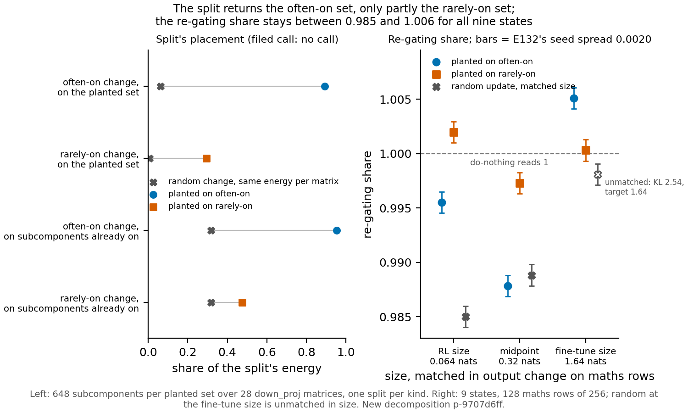

# Can the Qwen decomposition's readings see a change whose placement we built in? (E152, P3.3)

*2026-11-11. Cell P3.3, two $0 runs on the new decomposition p-9707d6ff: step 0 on CPU (Slurm 58729), step 1 on one
debug L40 (Slurm 58847, 99 min). Brief `reports/plans/2026-11-11_plan_qwen-instrument-check.md`, plans
`reports/plans/2026-11-11_plan_qwen-instrument-check-step0.md` and `...-step1.md`, filed rules
`experiments/qwen_instrument_check/results/predictions_step0.json` and `predictions_step1.json`. Provisional, no
independent check, no verdict on reuse.*

**In plain words.** We planted changes on known subcomponents of the Qwen decomposition and asked the usual pipeline
to find them again. It found a change planted on subcomponents that are usually on, but less than a third of one
planted on subcomponents that are almost never on. By the filed rules no row of the brief's table is called, so we
cannot yet say whether Qwen readings of where an update sits can answer the question in `GOALS.md`.

*Left: the share of the least-squares split's energy on the planted set and on subcomponents already on, beside a
random change scaled to the same energy per matrix. Right: the re-gating share of the nine states, each with a bar of
the seed spread from the earlier Qwen run; the hollow cross is the random change the size search could not match.*

## Step 0: what the saved files say

Three tables, from saved files only, on all 196 decomposed matrices.

- **Can the split place anything?** Every one of the 84 MLP matrices is fully reachable by the split on its small
  side, and all 196 matrices have their alive vectors in general position. A Gaussian change must leave 0.0981 of its
  squared norm outside the subcomponents, all of it in attention; the measured draw read 0.0981 too. Each of the 15
  saved updates leaves between 0.973 and 1.005 of what a Gaussian change of the same norms per matrix leaves. The
  filed call printed **free**: real updates sit no more inside the subcomponents' reach than chance.
- **Update against leftover.** The decomposition's own leftover weight has a total norm of 4.98. The two
  reinforcement-learning updates, the two shuffled-reward nulls and the own-samples fine-tune are smaller than it on
  all 196 matrices. The two TOFU fine-tunes are larger on all 196.
- **Output change against the decomposition's own error.** On the 128 maths rows the masked decomposition misses the
  unchanged model by 0.0932 nats per token. Against that, the reinforcement-learning updates read 0.69 and 1.05 of it,
  the own-samples fine-tune 0.011, and the supervised maths fine-tunes 15 to 18 times it.

## Step 1: changes whose placement we know

**What ran.** At each of the 28 down_proj matrices we took the subcomponents switched on at over half of the
unchanged model's maths positions, 648 in all, and scaled up their write vectors. A second change did the same to 648
subcomponents never on at maths positions. A third was the Gaussian change used before. Each was scaled to three
output sizes on the maths rows: the reinforcement-learning update's 0.064 nats per token, the step-10 fine-tune's 1.64,
and their midpoint 0.32. The least-squares split was run once per kind and scaled with it. Three readings followed:
the share of the split's energy on the planted set, the share on subcomponents already on, and the re-gating share.

Every control passed first. The unchanged model reproduced the earlier run's numbers exactly, do-nothing read a share
of 1, every member of the often-on set was on and none of the rarely-on set.

**Where the split puts a planted change.** The split put 0.892 of the often-on change on the planted set, where the
random change at the same energy put 0.062. That is a recovery of 0.88 of the way from chance to all of it. For the
rarely-on change it put 0.293 on the planted set against a chance of 0.0063, a recovery of 0.29. Of the rest, 0.315
of the rarely-on change's split landed on the often-on set. On subcomponents already on, the two planted kinds read
0.953 and 0.474, against 0.318 and 0.317 for the matched random change. The two differ by 0.479.

**The re-gating share.** Write $K_{00}$ for the KL from the changed model to the original subcomponents under the
unchanged model's masks, $K_{01}$ for the same under the changed model's own masks, and $K_{11}$ for the split
subcomponents under the changed model's masks. The share is $(K_{00}-K_{01})/(K_{00}-K_{11})$, the part of the masked
error's fall that switching masks alone gives. It is 1 when the split adds nothing. All nine states read between
0.985 and 1.005. Of the 36 pairs, 24 separate by more than the seed spread of 0.0020, 4 do not, and 8 involve the
unmatched random change and are not read. The often-on and rarely-on changes separate at every size, but the sign
flips: rarely-on reads higher at the two smaller sizes by 0.0065 and 0.0095, and often-on higher at the largest by
0.0048. Within the often-on kind alone the share moves by 0.0173 between the midpoint and the largest size.

**Shares above 1.** The often-on change at the largest size read 1.005 and the rarely-on change at the smallest read
1.002. Nothing in the definition bounds the share at 1. It exceeds 1 whenever $K_{11} > K_{01}$, that is when adding
the split's change to the subcomponents leaves the masked model slightly further from the changed model than the mask
switch alone. For the often-on change at the largest size, $K_{01}$ is 0.485 and $K_{11}$ is 0.508 nats per token,
against a $K_{00}$ of 4.98.

**Size.** The random change at the largest size is not matched: its size search stopped after eight evaluations at
2.54 nats per token, against a target of 1.64. Its readings jumped between about 1 and 2.5 or more as the scale moved.

## The filed calls, as the script printed them

| call | filed rule in words | read | printed |
|---|---|---|---|
| Split | both kinds recover at least 0.5 of the way from chance and the already-on shares differ by at least 0.5: works; both under 0.2: free | often 0.88, returns; rarely 0.29, partial; gap 0.479 | **no call** |
| Size | at each size, the often-on and rarely-on re-gating shares separate under the earlier run's rule | separate at all three | **all sizes** |
| Re-gating blind | no readable pair of the nine states separates | 24 of 36 separate | **responds** |
| Step 0 placement | every update's outside share at least 0.8 of its null: free; any under 0.5: constrained | lowest 0.973 | **free** |

**Which row of the brief's table came back.** None. Rows 1 and 2 need the split call to read "works" and row 3 needs it
to read "free"; it read "no call", so none of rows 1 to 3 is called. Row 4 needs no pair to separate, and 24 did, so
row 4 is ruled out: the re-gating share does respond to these changes. What was read: the split recovers a change
planted on often-on subcomponents, recovers under a third of one planted on never-on subcomponents, and the
already-on gap sits 0.021 under its bar.

## Surprises

- The size call was filed as "none" with a weak lean and read **all sizes**. The re-gating share separated the two
  planted kinds at every size, but in opposite directions at the small and large sizes, and it moved within one kind
  across sizes by more than between kinds. So the separation does not order the kinds.
- The rarely-on change's already-on share was expected at 0.02 to 0.2 and read 0.474: almost half of its split went to
  subcomponents that are on, a third of it to the often-on set.
- The often-on change at the largest size, filed as the positive control's re-gating range of 0.98 to 0.9995, read
  1.005.

## Deviations from the brief

- Only the 28 down_proj matrices were planted; the brief named no matrix type. Step 0 showed every MLP matrix fully
  reachable, which made down_proj the clean case.
- One random change, the Gaussian one; the earlier run used two.
- Sizes were the reinforcement-learning update, the midpoint and the step-10 fine-tune. The brief's two supervised
  sizes sit 5% apart, so the midpoint replaced one.
- The split was run once per kind and scaled for each size, since it is linear in the change. Its shares therefore
  cannot change with size.
- Row 2 of the brief's table was read on the re-gating share only, for the same reason.
- The planted sets are not small: 648 subcomponents each, set by "on at most maths positions", not chosen.

## Departures from the literature

None. Every quantity here is the project's own: the least-squares split, the already-on share and the re-gating share.

## Not run

- Planted changes on the attention matrices, where the split cannot reach everything.
- The other three explanations the brief names: confounded anchors, masks frozen on the unchanged model, and the
  rank-one unit.
- A second seed of the planted sets, and a second random change.
- A random change drawn inside the subcomponents' span.
- A matched random change at the fine-tune size.
- Output floors on the fact, template and own rows, which step 0 left as gaps.

## Provenance

Step 0: `experiments/qwen_instrument_check/results/step0.json`, figure not drawn. Step 1:
`experiments/qwen_instrument_check/results/step1/summary.json`, the nine `S_*.json`, `split_*.json`, `search_*.json`,
`controls.json`, `run.log`. Figure `experiments/qwen_instrument_check/figures/step1.png` from `plot_step1.py`.
