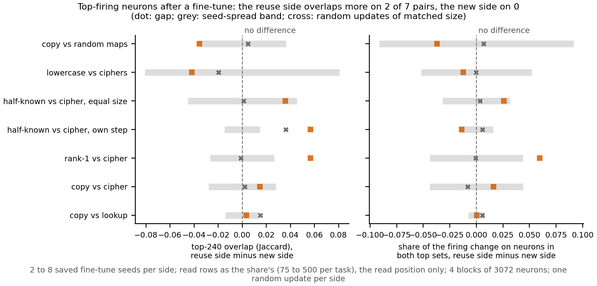

# After a fine-tune, are the top-firing neurons the same ones or new ones?

*Cell P2.18, compare-lead, 2026-11-11. Experiment E155, job 58821. Provisional: one run, no independent check,
descriptive only, and no verdict on reuse while the definition is under revision. Plan
`reports/plans/2026-11-11_plan_p2-18-neuron-overlap.md`; card `reports/plans/2026-11-11_plan_p2-18-card.md`.*

We compared the 240 most strongly firing MLP neurons of the 67M model before and after each fine-tune on the seven built
pairs, and against a random update of the same size. Every fine-tune, on either side, replaces far more of the top set
than a random update does, and the two sides differ by more than their seed spread on only two of seven pairs. In the
user's terms, every fine-tune here brings in mostly new top neurons, and the plain overlap does not tell the side built to
reuse from the side built to be new.

## The answer

Mostly new neurons, on both sides. A real fine-tune keeps between 0.34 and 0.69 of the top set, measured as overlap, while
a random update of the same size keeps between 0.84 and 0.95. The side built to reuse keeps more of its top set on two
pairs, rank-1 against cipher and half-known against cipher at its own step, and neither side does on the other five. The
check that this measure would reward "the same neurons, firing harder" failed, so a high overlap was never shown to mean reuse.

## What was measured

In each block's 3072 MLP neurons we take the 240 that fire most strongly in absolute value, at the read position of the
rows the share reads. That cut of 7.8% of the width follows Goodfire's neurons-as-a-basis reading. One departure: Goodfire ranks
neurons by activation, and we rank by its absolute value, so negative GELU outputs count by their size too. The **overlap** is
the Jaccard index of the top set before and after the fine-tune, averaged over rows and the four blocks: 1 means the same
neurons, 0 means none in common. The second reading is the **share on both**: the fraction of the squared firing change
that falls on neurons in both top sets. Each pair is read as the reuse-side mean minus the new-side mean over saved seeds,
and a side is called higher only when that gap exceeds the wider side's seed range. Each side also gets one random Gaussian
update scaled to its first seed's size in every weight matrix.

## What we observed

**Reading it.** The orange square is each pair's gap, the grey bar the seed-spread band it must clear, the cross the same
gap for the two random updates. On overlap, two squares clear their band to the right and none to the left. On the share on
both, only rank-1 against cipher clears it. On half-known against cipher at its own step, the two random updates alone already
differ by 0.036, more than that pair's band of 0.015. So that call may reflect the two sides' different update sizes, and
the same pair at equal size gets no call. Copy against random maps sits at a gap of -0.035, just inside its band of 0.036, the
direction an earlier idle-neuron reading pointed.

The striking number is not in the gaps but in the levels. Every one of the fourteen pair-sides keeps far less of its top set
than its size-matched random update, by 0.21 to 0.55 in overlap. The filed lean expected this, reasoning that a
fine-tune's update lines up with the directions the task's inputs use; this run did not test that reason.

## The positive control failed

The unchanged model read against itself gave overlap exactly 1, so the measuring code is sound. The positive control scaled
each block's input weight matrix by about 1.005, the size of one copy fine-tune's update there, so the same neurons fire a
little harder. Its overlap was 0.962 against 0.965 for a random update of the same size: lower, not higher, so the control
failed. Its share on both was 0.472 against 0.445, which passed. At that size neither update moves the top set much, so
the run cannot show that the overlap rewards "the same neurons, harder"; the fine-tunes' low overlaps came from updates
that change firing much more. This is a gap in the measure's shown power, not a fault in the apparatus.

## Earlier neuron readings

The top-set swap on these pairs moved under 0.05 of the gain on every pair, with no call. The idle-neuron share on copy
against random maps read 0.41 on copy and 0.125 on random maps: copy moved neurons that were quiet before, the reversed way.

## Not run

- A Qwen3-1.7B version, passed to qwen-lead.
- The 64-neuron form: recorded in the stage files, not called.
- A positive control at a fine-tune's own size, where the top set actually moves.
- A second random seed per side; each side has one random update.
- Any position other than the read position, and the twin pairs.

*Provenance: `experiments/neuron_overlap/results/{predictions.json,stage0.json,stage1.json,stage2.json}`, log
`cluster/logs/commute-neuron-overlap-58821.out`, one L40, about a minute. Earlier readings:
`experiments/method_table/results/final.json` and `experiments/baseline_neurons/results/baseline_neurons.json`.*
