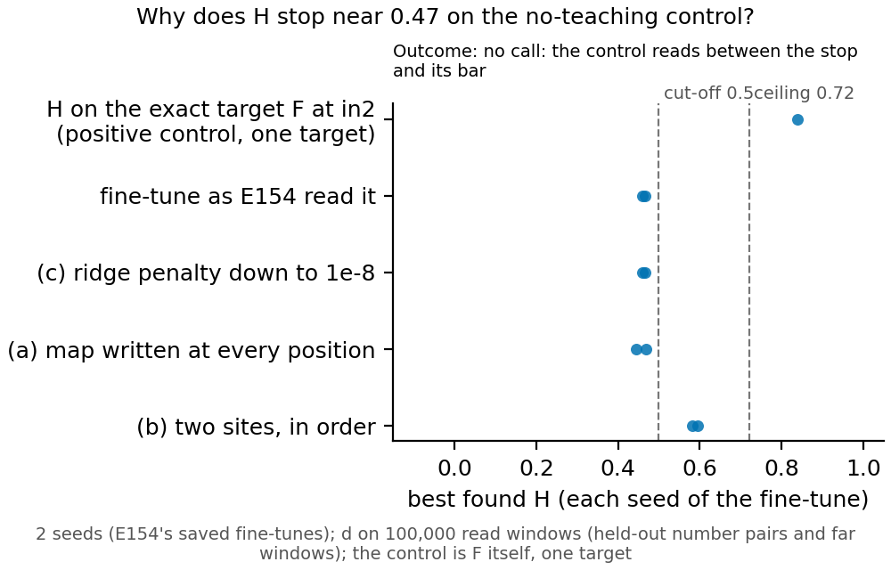

# Why the reuse search stops near 0.47 on a variable the original holds exactly (E156, P1.13)

*2026-11-11. Cell P1.13, one $0 debug job (Slurm 58855, 64 min). Plan `reports/plans/2026-11-11_plan_h-diagnosis.md`,
card `experiments/h_diagnosis/card.txt`, filed rules `experiments/h_diagnosis/results/predictions.json`, readings
`experiments/h_diagnosis/results/readings.json`. Provisional.*

**In plain words.** We asked why the reuse search reproduced just under half of a fine-tune's change when the fine-tune
only pushed on a fact the original model already holds exactly. The search itself, given the exact target edit to
reproduce, gets only about 0.84 of the way, and no wider map raises the fine-tunes by the filed margin; two edits in a row
raise them to about 0.6. So the shortfall is mostly in the scale of the measure, not in the fine-tunes, and the 0.5 cut-off
sits on a scale whose top is not 1.

**Answer.** No call under the filed rule: the positive control read 0.839, between the stop (0.5) and its bar (0.9).
Read as described: a smaller ridge penalty changes nothing (0.4659 and 0.4593, the same as E154), a map written at every
position does not raise either seed (0.4686 and 0.4435), and two sites written in order raise both seeds to 0.5955 and
0.5829, a rise of 0.1296 and 0.1236, under the 0.2 bar but above the 0.5 cut-off. A map that reproduced the target edit
exactly would read 0.7217 and 0.7197 on these fine-tunes.

*Best found H per variant, each dot one seed of E154's saved fine-tune; top row the search run on the exact target edit
itself. Dashed: the 0.5 cut-off and the ceiling of a map that reproduced the target exactly.*

## What it means for the gate (L1.5)

- The measure cannot read 1 even on an edit built to be exactly reachable: at the input of block 2 the search lands at
  0.839. Its readings are a share on a scale whose attainable top is not known for a given fine-tune.
- On this control the fine-tunes also differ from their own target (the ceiling, 0.7217 and 0.7197): a fine-tune that
  learned a push does not make exactly that push, and H charges the difference against reuse.
- Whether two sites count as one map is a wording question. Under "one site" this control reads under the cut-off; under
  "two sites in order" it reads above. Only the user changes the wording; this page changes nothing.
- The premise check (`~/commute-data/premise/P1.13.md`) doubts the premise that 0.47 is a defect to fix: the cut-off and
  bars were set without a known attainable maximum. It belongs in the gate page's "where it gives no reading".

## Not run

- A nonlinear map; a joint fit of the two-site maps; three or more sites.
- A new fine-tune, other tasks, other push sizes; more seeds.
- The control at sites other than the five searched, or with the KL refinement in the variants.
