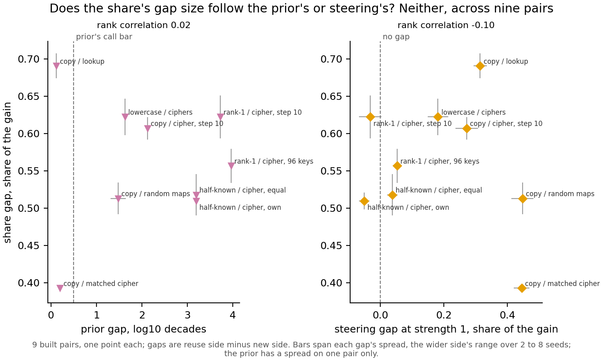

# Do the share's gap sizes across the built pairs follow the prior's or steering's?

*Cell P2.16, compare-lead, 2026-11-11. From saved results only: no GPU, no new measurement, no verdict on reuse, since the
definition is under revision. Card `reports/decisions/2026-11-10_decision_what-share-adds.md`; script
`experiments/share_gap_sizes/plot.py`; numbers `experiments/share_gap_sizes/results/gaps.json`.*

From saved results, we set the share's gap on each of the nine built pairs beside the prior's gap and steering's gap. Neither cheap reading orders the pairs the way the share
does, and the share's largest and smallest gaps fall on the two pairs built with the prior matched, which steering orders
the other way. On these
nine pairs the share's gap sizes carry something neither cheap reading carries, though nine pairs from a few task families
make this a description, not a test.

## What was compared

On each built pair, two families of fine-tunes of the 67M model are set side by side, one built to reuse what the model
already does and one built to be new. Every gap below is the side built to reuse minus the side built to be new.

- **The share**: the part of a fine-tune's gain that comes from changing which subcomponents the decomposition switches
  on. Its gap is the difference of seed means, as in the method comparison's table.
- **The prior**: the original model's log probability of each task's trained answer, in decades, one value per map. It
  calls a pair at a gap of 0.5 decades or more.
- **Steering at strength 1**: each fine-tune's mean activation change at the answer position added once to the original
  model, read as a share of the fine-tune's own gain, in the vector kind each pair's filed cell uses.

A gap's spread is the wider side's range over its seeds, the form the steering record saves. The share's spread is computed
here from its saved seeds by the same formula. The prior has a spread on one pair only, copy maps against random maps,
where each side has two maps; every other pair has a single map on at least one side, so no prior spread exists there.

## What we observed

**Reading it.** Neither cheap reading explains the share's gap sizes on these nine pairs. The rank correlation of the
share's gap with the prior's is 0.02, and with steering's it is -0.10. The share's gaps run from 0.39 to 0.69, while its
largest spread is 0.06, so their differences are well above seed noise.

The sharpest case is the two pairs built with the prior matched. Copy against lookup has a prior gap of 0.12 decades and a
steering gap of 0.31; copy against the prior-matched cipher has 0.20 decades and 0.44. The prior rates them alike and
steering puts the matched cipher pair higher. The share does the reverse, with its largest gap, 0.69, on copy against
lookup and its smallest, 0.39, on copy against the matched cipher. At the
other end, the two half-known pairs have prior gaps of 3.20 decades, among the largest, yet share gaps in the lower half.

**How far this goes.** Nine pairs, described, not tested: no rank correlation over nine points is called significant
here. The pairs are not independent: the two half-known pairs share their reuse side, and the two step-10 pairs share
their cipher side. The three readings are in different units, so only orderings are compared, not slopes. A low rank
correlation says neither reading orders the pairs like the share; it does not say what the share's gap sizes do follow.

## Departures from the literature

None: no external procedure is reproduced.

## Not run

- Any new pair, seed or GPU measurement; steering at the searched strength, whose gap sizes were not compared.
- A combined model of prior and steering together, or any fitted weight; any significance test.
- A prior spread where a side has one map; the twin pairs; any Qwen pair.
- Any verdict on reuse.

Provenance: the share's cells come from `experiments/method_table/results/final.json`, group built. The prior gap and
steering at strength 1 come from `experiments/prior_steering/results/stage1.json`, key `score.pairs`. The figure is
`experiments/share_gap_sizes/figures/gap_sizes.png`, with its plotted numbers beside it as `gap_sizes.csv`.
