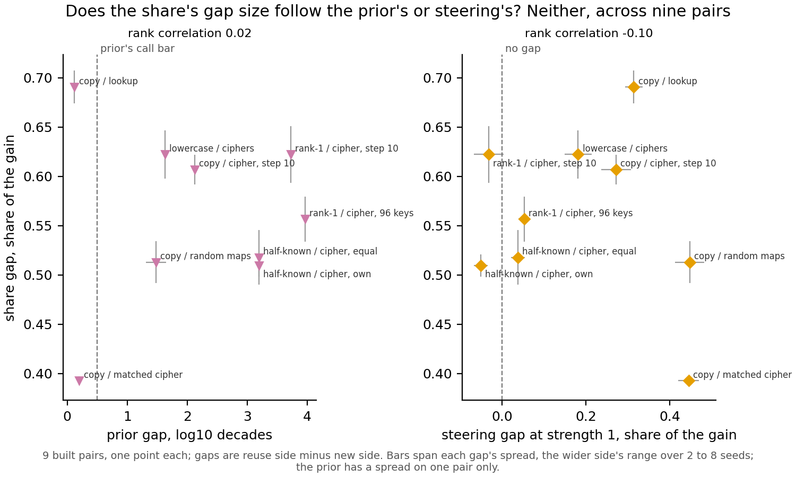

# What does the share add over the cheap readings, as it stands?

*Cell P2.19, compare-lead, 2026-11-11. No run, no GPU, $0: saved results only. Sides are named as each pair was built;
no verdict on reuse is given, since the definition is under revision.*

We set the re-gating share beside every cheaper reading saved for the nine built pairs of 67M fine-tunes. On which side
reads higher, the original model's prior and steering together already match the share. On how far apart the sides are,
neither cheap reading orders the pairs the way the share does. For the aim in `GOALS.md`, the share carries a pattern
of gap sizes the cheap readings lack, but whether that pattern is right about reuse waits on part 1's labels.

**The terms.** A **built pair** is two sets of fine-tunes on matching windows, one built to reuse something the model
already does and one built to be new. The labels are the builders' intentions, not findings. The **share** is the part
of a fine-tune's gain that comes from changing only which subcomponents Γ switches on. The gain is the rise in the
trained answer's log-odds, and a share of 0 means none of it, 1 all of it. A **gap** is the reuse side minus the new
side. The **cheap readings** are the original model's prior for the answer, steering, the update's size and effective
rank, and three neuron readings. Steering adds the fine-tune's mean activation change to the original model, at strength
1 or at a searched strength.

## The answer

The share is the only single reading that puts the reuse side higher on all nine pairs, and its gap sizes follow neither
the prior nor steering. That is what it adds. It does not add a different call on direction: the prior and steering at
strength 1 together reproduce every one of its nine calls. And nothing yet says whether the share or a cheap reading is
right about reuse, because no pair has an independent label.

## What the share shows that no cheap reading shows

- **One reading, all nine pairs, one direction.** Every cheap reading alone misses or reverses some pair. Steering with
  its searched strength reverses three. Update size, where it separates the sides, puts the new side higher. Size and
  effective rank read no gap on the three pairs built at equal size, which the share separates. The neuron readings
  separate few pairs: swapping in the top-set neurons moves under 0.05 of the gain on every pair.
- **Gap sizes no cheap reading explains.** The share's gaps run from 0.39 to 0.69, while its largest seed spread is
  0.06. Their rank correlation with the prior's gaps is 0.02, and with steering's it is -0.10. On the two pairs built
  with the prior matched, the prior gaps are 0.12 and 0.20 decades and steering puts the matched cipher pair higher. The
  share does the reverse: its largest gap is copy against lookup and its smallest the matched cipher pair.

**Reading it.** Each point is one built pair. In neither panel do the points rise together. On the left, the two
prior-matched pairs sit at the top and bottom of the share's range; on the right, steering orders them the other way.
Nine pairs from a few task families make this a description, not a test.

## What it does not show

- **A different direction.** Where the prior is matched, steering added at its own size separates the sides, by 0.31
  and 0.44 of the gain. Where steering is flat, the prior gap is large, 3.20 decades on both half-known pairs. Together they call
  all nine pairs the share's way.
- **A pair where the prior and steering disagree.** The attempt to build one stopped before training. A cipher whose
  answers stay unrelated to the key reached a prior of 0.000232, just under the 0.000235 the pair needed.
- **Who is right about reuse.** Which reading the share tracks does not say which one is right. The top-neuron overlap
  does not help. Every fine-tune on both sides keeps 0.34 to 0.69 of its 240 top-firing neurons. A random update of the
  same size keeps 0.84 to 0.95, and the overlap's positive control failed.

## What would change this

Scoring the share and each cheap reading against part 1's independent labels of reused and new. If the share's gap sizes
follow those labels where the prior and steering do not, the share adds information about reuse. If a cheap reading
follows them as well, the share adds only a second measure of the same thing.

## Not run

- New pairs with the prior and steering pointing opposite ways; both runs stopped before any pair was built.
- The top-neuron overlap on Qwen3-1.7B, passed to qwen-lead.
- Effective rank on the 96-key refit pairs, an option not taken.
- A fitted combination of the cheap readings, any significance test, the twin pairs, any Qwen pair.
- Any verdict on reuse.

*Sources: `reports/analyses/2026-11-10_analysis_p2-11-method-comparison.md`,
`reports/analyses/2026-11-10_analysis_e149-prior-steering.md`, `reports/analyses/2026-11-11_analysis_p2-16-gap-sizes.md`,
`reports/analyses/2026-11-11_analysis_e155-neuron-overlap.md`, cell P2.17's reading, and the files in the ledger beside
this page. The scoring against part 1's labels is rung L2.2 of `reports/plans/2026-11-09_plan_paper-roadmap.md`.*
