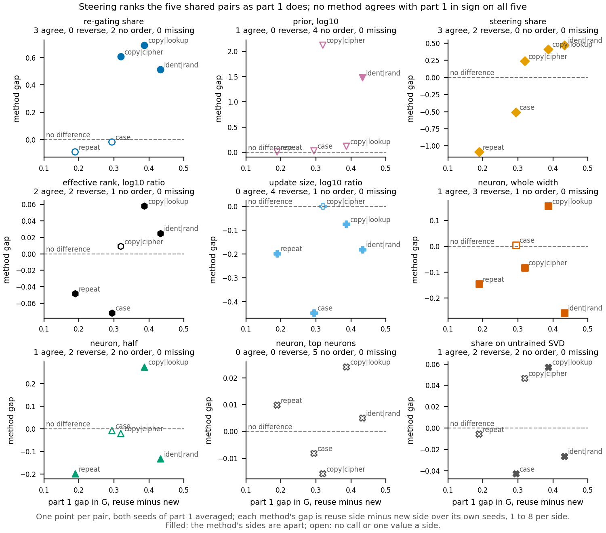

# Does part 1's order within a pair match what each part 2 method reads on the same fine-tunes?

*2026-11-11, cell P2.20, compare-lead. No run, no GPU, $0: saved results only. Rule filed before the comparison in
`experiments/part1_vs_methods/results/predictions.json`; computed by `experiments/part1_vs_methods/run.py` into
`experiments/part1_vs_methods/results/compare.json`; figure by `experiments/part1_vs_methods/plot.py`. Sides are named
as each pair was built. No verdict of reused or new is given, because the definition is under revision in cell P1.1.*

*Update 2026-11-11: E158 filled the four neuron readings. The whole-width and half neuron readings on the case and
repeat twins were missing. E158 read them on the cluster, job 58971, $0, and the method table and this comparison were
rerun with them. The tables, the answer and the section that listed them as missing now hold the readings.*

We took the five matched pairs that part 1 reads and asked, for each method in the part 2 table, whether it puts the
same side of each pair higher. All five pairs are read by both parts on the same saved fine-tunes, and on them the
re-gating share agrees with part 1 on the three built pairs and makes no call on the two label twins. For the aim in
`GOALS.md`, part 1's reading and the re-gating share point the same way wherever the share makes a call, and no simpler
method matches part 1 in direction on all five pairs.

**The answer.** Five of five part 1 pairs overlap the method table by saved file. On them part 1's gap runs from 0.19 to
0.43, always toward the side built to reuse. The re-gating share agrees on three and makes no call on two. Steering
ranks the five exactly as part 1 does but reads the two label twins the other way. Update size reads the new side higher
on four. Both neuron readings make no call on the case twins and read the repeat twin higher, so the whole-width form
reverses part 1 on three of five pairs; the top-neuron form calls nothing.

## What was compared

**Part 1** reads each fine-tune with the **re-weighting share**, called G: how much of the fine-tune's effect is
explained when one 4-dimensional variable of the original model is set by an affine map of its own value, at the best of
four sites and three starts. G is 0 when nothing is explained and 1 when all of it is. The values are
`experiments/old_task_labels/results/labels_cut_0p8_0p5.json`, two seeds per task. The five pairs are those of the gate
page's figure, in `experiments/old_task_labels/plot_gate.py`: in-context copy against lookup, copy against cipher on 24
keys, an identity map against a random map on 32 keys, and two real labels against twins trained on shuffled labels.

**Part 1's gap** for a pair is G on the side built to reuse minus G on the side built to be new, per seed, then the mean
of the two seeds. A gap of 0 means part 1 does not order the pair.

**Part 2** is the method table, `experiments/method_table/results/final.json`, nine methods on thirteen pairs. Each
cell holds a method's readings on each side, its gap as reuse side minus new side, and a call. For shares and the log10
prior the gap is a difference of means; for update size and effective rank it is log10 of the ratio of means, so its
sign is still the sign of reuse minus new. The call is "apart" when the two sides' seed ranges do not overlap or the
run's filed call says so, "no call" otherwise, and "one value a side" when a side has a single value. The sign
convention was checked in `experiments/method_table/plot_final.py`, function `score`.

**Overlap** means both parts read the same saved update files. `run.py` takes each part 1 state file from
`commute.old_tasks.TASKS`, resolves its symlink, and requires it among the files that
`experiments/share_untrained/results/inventory.json` lists for the same side of the method table's pair. That
inventory is what the share on an untrained SVD reads on all five pairs, what the share reads on the three built pairs,
and what `experiments/holes_fill`'s top-neuron and steering readings read on the two key-table pairs. The
other sources were traced by hand to the same files: `experiments/neuron_r/run.py` `files`, `experiments/update_svd/run.py`
`PAIRS`, `experiments/steering_copy_lookup/run.py` `load_states`, `experiments/real_vs_twin/run.py` `state`, and the
size records of the runs that saved each update. The prior reads the task's map, one value per map, not the update.

**Agree** means the method's call is "apart" and its gap has part 1's sign. **Reverse** means apart with the other sign.
A "no call" or "one value a side" is **no order**. A cell the table never filled is **missing**. Agree here means only
the same sign; it does not say a method reads the reuse side as reused. The **rank correlation** is Spearman's, between
part 1's gap and the method's gap over the pairs where the method has a value. With at most five pairs no threshold was
filed and none is called significant.

## Which pairs overlap

All five do. Part 1's files are a subset of what the methods read: part 1 reads seeds 0 and 1, and the methods read two to
eight seeds per side, always including those two files.

| pair | final.json pair | seed 0 | seed 1 | mean | part 2 seeds per side |
|---|---|---|---|---|---|
| identity against random map, 32 keys | `e46_copy_random` | 0.41 | 0.45 | 0.43 | 4 |
| in-context copy against lookup | `e62_copy_lookup` | 0.37 | 0.41 | 0.39 | 3 |
| copy against cipher, 24 keys | `open_pair_c3_copy` | 0.29 | 0.35 | 0.32 | 8 |
| real case label against its twin | `e123_case_label` | 0.31 | 0.28 | 0.29 | 2 |
| real repeat label against its twin | `e125_repeat_label` | 0.21 | 0.17 | 0.19 | 2 |

The seed columns are part 1's gap in G. The last column counts the update files the share inventory lists per side;
the identity pair's four include a second pair of tables, and the twins' share, steering, neuron and top-neuron
readings add a third seed retrained in `experiments/real_vs_twin`. One more pair matches on task only:
`e58_copy_prior_cipher` copies against a cipher too, but on 96 keys with a prior-matched cipher and refit states in
`experiments/refit_96key/results/large`. It is listed and not scored.

## What each method did on the shared pairs

**Reading it.** No method orders all five pairs as part 1 does. Each panel puts part 1's gap on the horizontal axis and
one method's gap on the vertical, with the dashed line where the method reads the sides equal. Part 1 has every pair on
the reuse side, so a method that agreed everywhere would put every point above the line and filled. The re-gating
share does so on the three built pairs, with gaps of 0.51 to 0.69, and leaves both twins unfilled just below the line.
Steering's five points rise in part 1's order, a rank correlation of 1.0, but both twins sit below the line at -0.51 and
-1.09. Update size sits at or below the line on every pair. The whole-width neuron reading reverses two of three built pairs
and the repeat twin, and leaves the case twin unfilled on the line. Its half form reverses the identity pair and the
repeat twin. The top-neuron form stays near zero on all five. One caveat matters: each
method's gap averages its own seeds, which include files part 1 never read.

| method | identity / random | copy / lookup | copy / cipher | case twin | repeat twin | agree / reverse / no order / missing | rank correlation, n |
|---|---|---|---|---|---|---|---|
| re-gating share | 0.51 agree | 0.69 agree | 0.61 agree | -0.02 no order | -0.09 no order | 3 / 0 / 2 / 0 | 0.7, 5 |
| prior, log10 | 1.48 agree | 0.12 no order | 2.12 no order | 0.03 no order | 0.01 no order | 1 / 0 / 4 / 0 | 0.7, 5 |
| steering share | 0.47 agree | 0.41 agree | 0.24 agree | -0.51 reverse | -1.09 reverse | 3 / 2 / 0 / 0 | 1.0, 5 |
| effective rank, log10 ratio | 0.02 agree | 0.06 agree | 0.01 no order | -0.07 reverse | -0.05 reverse | 2 / 2 / 1 / 0 | 0.8, 5 |
| update size, log10 ratio | -0.18 reverse | -0.08 reverse | 0.00 no order | -0.45 reverse | -0.20 reverse | 0 / 4 / 1 / 0 | 0.5, 5 |
| neuron, whole width | -0.26 reverse | 0.16 agree | -0.08 reverse | 0.00 no order | -0.15 reverse | 1 / 3 / 1 / 0 | -0.1, 5 |
| neuron, half | -0.13 reverse | 0.27 agree | -0.02 no order | -0.01 no order | -0.20 reverse | 1 / 2 / 2 / 0 | 0.3, 5 |
| neuron, top neurons | 0.00 no order | 0.02 no order | -0.02 no order | -0.01 no order | 0.01 no order | 0 / 0 / 5 / 0 | 0.1, 5 |
| share on untrained SVD | -0.03 reverse | 0.06 agree | 0.05 no order | -0.04 reverse | -0.01 no order | 1 / 2 / 2 / 0 | 0.2, 5 |

Columns are ordered by part 1's gap, largest first. Each cell is the method's gap, reuse side minus new side, and its
order against part 1.

**Against the filed expectation.** The rule expected part 1's gap above zero on all five pairs, and it is. It expected
the re-gating share apart on the three built pairs and no call on the two label twins, and that is what `final.json`
holds.

**The method table's own counts**, from `final.json` `.tally` only: on the nine built pairs the share is apart on all
nine; steering points the same way as the share on 4, the opposite way on 3, and makes no call on 2. On the four twin
pairs the share is apart on 1 and makes no call on 3. The P2.11 report's earlier count of five for steering predates the
96-key refit and was corrected by a dated note in commit `32715f45`.

## The neuron readings on the twins, filled by E158

Until E158 the whole-width and half neuron readings were missing on both label twins. No script read these pairs with
the neuron functions, and the twins are scored on the contrast between the two labels, not on the log-odds of one
target. E158, `experiments/neuron_twins`, read them in that contrast on the same three seeds a side the twins' share
uses, seeds 0 and 1 being part 1's files. It ran as cluster job 58971 for $0. Both controls passed: a zero update
left every reading at the original model's, and a change to the last block's MLP output weights alone re-fired no
neuron. The method table then took these four cells from `experiments/neuron_twins/results/cells.json`.

The whole-width reading is the share of the fine-tune's gain in the label contrast that comes back when the original
model's MLP output weights read the fine-tuned model's neuron firing. The half form keeps both of the original model's
MLP matrices and changes only what flows into the MLP. Each reads 0 when the changed firing carries none of the gain
and 1 when it carries all of it.

| method | pair | side built to reuse, 3 seeds | side built to be new, 3 seeds | gap | call |
|---|---|---|---|---|---|
| neuron, whole width | real case label against its twin | 0.75 to 0.77 | 0.74 to 0.78 | 0.00 | ranges overlap, no call |
| neuron, half | real case label against its twin | 0.54 to 0.57 | 0.54 to 0.60 | -0.01 | ranges overlap, no call |
| neuron, whole width | real repeat label against its twin | 0.59 to 0.66 | 0.74 to 0.79 | -0.15 | apart, twin higher |
| neuron, half | real repeat label against its twin | 0.37 to 0.49 | 0.57 to 0.66 | -0.20 | apart, twin higher |

On the case pair the two sides' seed ranges overlap for both forms, so neither orders the pair. On the repeat pair the
twin trained on shuffled labels reads higher on every seed, in both forms, which is the reverse of part 1's order. The
re-gating share makes no call on either twin pair.

## What the reference can and cannot tell

A premise check (`~/commute-data/premise/P2.20.md`, advisory) doubts that part 1 is an independent reference. Part 1's
share reads a variable of the original model, not the decomposition, so it is not built like the re-gating share. But
it puts the reuse side higher on every pair, exactly as the pairs were built, so on direction it repeats the build
labels and the earlier direction checks. Only the ranking of gap sizes is new here, and that rests on five pairs, three
of them for the re-gating share. The doubt is listed for the user's gate; nothing here changes.

## Departures from the literature

None. Spearman's rank correlation is used as defined, with average ranks for ties.

## Not run

- The methods re-read on part 1's two seeds alone; each method's gap keeps its own seed set.
- Part 1's G on the extra seeds the methods read.
- The 96-key copy against prior-matched cipher pair: a task-only match, not scored.
- Any significance test on the rank correlations: with five pairs or fewer none was filed.

Provenance: `experiments/part1_vs_methods/results/compare.json` holds the overlap check, per-pair orders, counts and rank
correlations; the figure is `experiments/part1_vs_methods/figures/part1_vs_methods.png` with its `.csv` and `.pdf`. Inputs read:
`experiments/old_task_labels/results/labels_cut_0p8_0p5.json`, `experiments/method_table/results/final.json`,
`experiments/share_untrained/results/inventory.json`. CPU worker, under a minute, $0.
