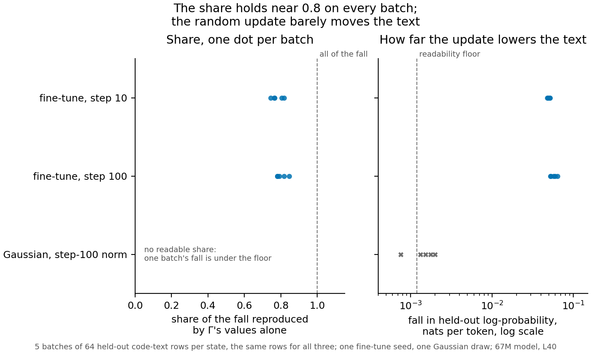

# Does the share read high on a fine-tune that made held-out text worse, and would a random update of its size?

*Cell P2.6, compare-lead, 2026-11-11. One run, Slurm job 59106 on a debug L40, $0. Plan
`reports/plans/2026-11-11_plan_p2-6-share-stability.md`; filed rules `experiments/share_stability/results/predictions.json`;
results `experiments/share_stability/results/run.json`. No verdict of reused or new is given: the definition is under
revision.*

We re-read the every-position share of one code-text fine-tune on five fresh batches of held-out rows, and read one random
update with the same size in every weight matrix on the same rows. The fine-tune's share sat near 0.8 on every batch,
while the random update lowered the text about 39 times less than the fine-tune, too little for any share to be read. For
the aim in `GOALS.md`, the high reading on this fine-tune is a stable fact about it, and the size of an update alone does
not produce it.

## The answer

The share of this fine-tune is stable: on five batches of held-out rows it read between 0.74 and 0.85, and every batch
lies within a few hundredths of the pooled value. A random update of the same size per matrix does not read high, but it
does not read low either. It barely changes the text, so it has no gain for the share to divide. Size alone does not
produce the high reading; whether a random update that moves the text as much would read high was not tested.

## What we were trying to test

The fine-tune was trained for 100 steps on code-like text from the Pile, on the 67M model. Its states after 10 and 100
steps were saved. On held-out code rows it lowers the model's log-probability of the text: that is what earlier pages called
"a fine-tune that learned nothing". It did not merely fail to improve the text; it made it worse.

The **gain** $G$ is the mean change, from the original model to the updated one, of the log-probability per token that the
model gives held-out rows. Here it is negative: $G < 0$ means the update made the text less likely. The **share** is
$r = g / G$. Here $g$ is the same change for a masked model: it keeps the original subcomponents and leaves the update
out, and Γ switches them on and off as it does on the updated model. A share of 0 means changing which
subcomponents Γ switches on reproduces none of the change; 1 means all of it. With a negative gain, a share of 0.8 means that
Γ's changed values alone lower the text by 80% as much as the fine-tune does. The do-nothing state, the zero update, reads a
gain of exactly 0 and has no share.

The earlier reading, 0.82 at step 10 and 0.77 at step 100, came from 64 rows of one run whose states were not saved. The
saved states are a regeneration of the same recipe, read before at 0.8186 and 0.7802 on the same 64 rows. This run did
three things:

- **Reproduce** the saved states' reading on those 64 rows, and check the zero update reads exactly nothing.
- **Spread**: read both states on four more batches of 64 held-out rows, five batches in all.
- **Random update**: draw one Gaussian update and scale each matrix to the Frobenius norm of the step-100 update in that
  matrix, then read it on the same five batches. This rules out the rival that any update of this size reads near 0.8.

## What we expected, and why

We expected the batch spread to be small, near the row-sampling error of one batch, and the stability bar was a batch
standard deviation of at most 0.13. We expected the random update to lower the text far less than the fine-tune: earlier
random updates had to be scaled ten times or more to match a fine-tune's effect on the output. A share is read only when
every batch's gain is at least 0.0012 nats per token with one sign; below that, row noise alone can move the share a lot.
So we leaned toward the random update having no readable share.

## What we observed

**Is the 0.77 to 0.82 a stable reading?** **Reading it.** Yes. The left panel shows the share on each of five batches.
At step 10 the batches read 0.74 to 0.82, with a standard deviation of 0.031, and pooled over all rows 0.78. At step 100
they read 0.78 to 0.85, a standard deviation of 0.029, and pooled 0.80. Both spreads are under a quarter of the
stability bar. Batch 0 reproduced the saved states' earlier readings to better than a millionth of a nat per token.

**Does a random update of the same size read as high?** **Reading it.** It reads nothing. The right panel shows how far
each update lowers the held-out text, on a log scale. The fine-tune lowers it by 0.050 nats per token at step 10 and
0.057 at step 100. The random update, matched to the step-100 update's size in every matrix, lowers it by 0.0015, about 39
times less. Its batches run from 0.00076 to 0.0020, and the lowest falls under the readability floor, so by the filed rule
the random update has no readable share. The share of a random update is not low; it is undefined, because there is almost
nothing to share.

**The paragraph the cell asks for: does "a fine-tune that learned nothing still reads high" hold for any small update, or
only for this one?** Not for any update of this size. A random update with the same norm in every matrix lowers the
held-out text about 39 times less than the fine-tune. That is too little for the share to be read, so norm alone does not
produce the 0.8. The run does not show that the share reads low on an update that changes the text without learning. The
random update gives no reading at all, and a random update scaled to lower the text as much as the fine-tune was not run.
What the run does show is that the 0.8 is stable across rows for this fine-tune. Its effect on the text is directed, and
about 39 times larger than chance at its size.

## What we learned

The high every-position share on this fine-tune is not one batch's luck: five batches agree to within a few hundredths. A
random update of the same size cannot test whether the share reads high on any update, because it does not move the text
enough to be read. So the claim that the share "reads high on a fine-tune that learned nothing" narrows. It reads high on an
update that lowers held-out text in a directed way, and nothing here says what it reads on an undirected update of matching
effect. That limits how much this case can count against the share on the part 2 page.

## How compelling is the evidence

- **The stability reading is solid but narrow.** The five batches come from one held-out stream, one fine-tune seed and
  one model, so the spread is row sampling only, not seed variation.
- **The random comparison is weak.** One Gaussian draw, matched on norm, not on its effect on the text. Its pooled fall,
  0.0015, sits just above the 0.0012 floor; one batch of five is under it.
- **What the share is blind to here.** It averages the change over every position. It cannot say whether the fall came
  from a few positions or from all of them.

**The premise check's doubt, stated plainly.** The check on this cell judged the premise doubtful, for two reasons. First,
a Gaussian update matched only on norm is not a fair stand-in for "a fine-tune that learned nothing": norm captures size
but not direction, and this run shows direction is where the two differ. Second, a fine-tune that lowers held-out text
about 39 times more than chance did something directed to it, so "learned nothing" may be the wrong description. The check
also noted the rung was parked on 2026-11-10; the user un-parked it on 2026-11-11. This page agrees with both points: the
random update did not test the claim, and the fine-tune did change the text on purpose, just not for the better.

## Surprises

None against the filed predictions: both held. One thing a reader should know: had the random update's share been read
anyway, ignoring the floor, it would read 0.54 pooled, with batches from 0.29 to 1.06. The paired comparison with the
fine-tune would have an error of 0.15, twice the 0.075 above which the filed rule makes no call. So even ignoring the floor
the random update says nothing about the share. These numbers were computed after the run and are not a reading.

## What next

- A random update scaled until it lowers the held-out text as much as the fine-tune. If it reads near 0.8, the share reads
  any matching fall high and this case counts against it; if it reads well below, the 0.8 is specific to the fine-tune's
  direction. This needs a new cell from the user.
- Nothing else is proposed: the cell's one run is spent, and the rung stays as the user set it.

## Scorecard

| id | claim in words | rule | read | verdict |
|---|---|---|---|---|
| C0 | rows and states are the saved ones; zero update reads exactly nothing; batch 0 reproduces the saved states | exact sha256 and rows; zero update within a millionth; cells within 2e-4, share within 0.01 | all exact; share 0.8186 and 0.7802 | pass |
| P_stable | the share is stable across batches at both steps | readable on every batch, batch SD ≤ 0.13 | SD 0.031 and 0.029, all batches readable | pass, as filed |
| P_gauss | a random update of the step-100 norm reads like the fine-tune, or not | unreadable → B; SE > 0.075 → no call; gap ≤ 0.15 → A; else B | fall 0.0015 pooled, one batch under 0.0012 | B: unreadable, as filed |

Full readings, nats per token for the gain and the masked change:

| state | pooled gain | pooled masked change | pooled share | batch shares | batch SD |
|---|---|---|---|---|---|
| fine-tune, step 10 | -0.050 | -0.039 | 0.78 | 0.82, 0.76, 0.81, 0.77, 0.74 | 0.031 |
| fine-tune, step 100 | -0.057 | -0.046 | 0.80 | 0.78, 0.85, 0.78, 0.82, 0.79 | 0.029 |
| Gaussian, step-100 norm | -0.0015 | -0.00080 | unreadable | unreadable | |

The Gaussian's batch gains: -0.0018, -0.0015, -0.0020, -0.0013, -0.00076. Its per-matrix norm matched the step-100 update's
to within 7.6e-6.

## Not run

- A second Gaussian draw.
- A second fine-tune seed: the spread is row sampling of one stream.
- A random update matched to the fine-tune's KL divergence or gain rather than its norm.
- The trigger form of the share on these states: they have no trigger.
- Any verdict of reused or new.

## Departures from the literature

None. The share and the matched-norm random update are this project's own measures, as defined above.

*Provenance: job 59106, `cluster/logs/commute-share-stability-59106.out`, L40, 32 s of reading, $0. Origin of the 0.77 and
0.82: `reports/analyses/2026-11-09_analysis_what-regating-does.md`, section 3 and proposal 5, from
`experiments/regating_spread/results/regating_spread.json`; the saved states' earlier reading
`experiments/regating_table/results/stage0a.json`. Figure: `experiments/share_stability/plot.py`.*
