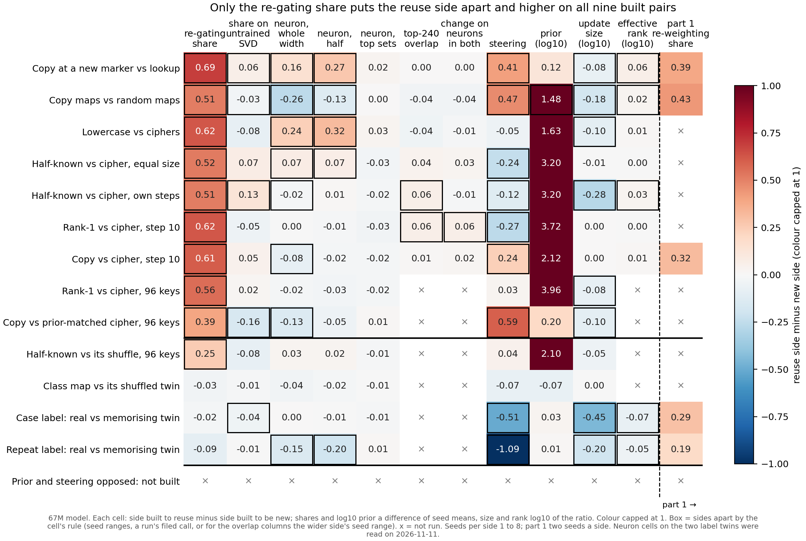

# The part 2 gate page: the scorecard and what the share adds, with every result to date

*Cell P2.22, compare-lead, 2026-11-11, for the gate of 2026-11-18. No run, no GPU, $0: saved results only. Figure by
`experiments/method_table/gate_plot.py`. Sides are named as each pair was built. No verdict of reused or new is given,
because the definition is under revision, and the scorecard is never joined into one score.*

We put every saved reading of the re-gating share and of ten simpler readings side by side on thirteen pairs of 67M
fine-tunes, with part 1's own reading on the five pairs both parts share. The share is the only reading that puts the side
built to reuse higher on all nine built pairs, and its gap sizes follow no cheaper reading. But the prior and steering
together already match its direction, and on real fine-tunes against shuffled twins it mostly reads nothing. For the aim in
`GOALS.md`, the share carries a pattern the cheap readings lack, and nothing on this page yet shows that pattern is reuse.

## The answer

On the nine built pairs the share reads the reuse side higher every time, by 0.39 to 0.69 of the gain, and no other single
reading does. How far apart it puts each pair follows neither the prior nor steering. It does not give a different call on
which side is higher: the prior and steering together give the same nine calls. On three of four shuffled-twin pairs it makes
no call, though part 1 puts the real fine-tune higher on both twins it reads. Whether the share is right about reuse is open.

**The terms.** A **built pair** is two sets of fine-tunes on matching windows, one built to reuse something the model
already does and one built to be new. A **twin pair** is a real fine-tune against one trained on shuffled labels. The
labels are the builders' intentions, not findings. The **gain** is the rise in the trained answer's log-odds from the
original to the fine-tuned model. The **re-gating share** is the part of the gain reproduced by changing only which
original subcomponents Γ switches on: 0 means none of it, 1 all of it. A **gap** is the reuse side minus the new side.

## The scorecard

**Reading it.** The first column is the only one boxed and red on all nine built pairs. A box means the two sides' seed
ranges do not overlap, or the run's own filed call said apart. Steering is boxed on seven built pairs but blue on three of
them. Update size is blue wherever it is boxed. The prior is dark red on every built pair, but has one value a side on
eight of them, so it has no box. The two top-neuron columns are near zero and boxed on at most two pairs. Below the first
line, the share is red and boxed only on the half-known map against its shuffle. Part 1, right of the dashed line, is red
on all five pairs it reads, both label twins included. The bottom row is the pair that could not be built.

Counts on the nine built pairs, from `experiments/method_table/results/final.json` `.tally`, and from the top-neuron run for
its two columns. "Same" means apart in the share's direction.

| method | same | opposite | no call | other |
|---|---|---|---|---|
| re-gating share | 9 apart, reuse side higher | | 0 | |
| share on an untrained SVD | 2 | 2 | 5 | |
| neuron, whole width | 3 | 4 | 2 | |
| neuron, half | 3 | 1 | 5 | |
| neuron, top sets | 0 | 0 | 9 | |
| top-240 neuron overlap | 2 | 0 | 5 | 2 not run |
| change on neurons in both top sets | 1 | 0 | 6 | 2 not run |
| steering, wider kind | 4 | 3 | 2 | |
| prior | 1 | 0 | 0 | 8 one value a side, all reuse higher |
| update size | 0 | 6 | 3 | |
| effective rank | 3 | 0 | 4 | 2 not run |

On the four twin pairs the share is apart on one and makes no call on three.

## What the share shows that the other readings do not

- **One reading, all nine built pairs, one direction.** Every other reading misses or reverses some built pair, as the
  table shows.
- **Gap sizes no cheap reading explains.** Its gaps run from 0.39 to 0.69 with a largest seed spread of 0.06. Their rank
  correlation is 0.02 with the prior's gaps and -0.10 with steering's at strength 1, over nine pairs. On the two pairs
  built with the prior nearly matched, its largest and smallest gaps fall the other way round from steering's.
- **Separation where the neurons see little.** Every fine-tune, on either side, keeps 0.34 to 0.69 of its top-240 MLP
  neurons. A random update of the same size keeps 0.84 to 0.95. That overlap tells the sides apart on two of seven
  pairs, and the check that it rewards the same neurons firing harder failed.

## What it does not show

- **A different direction.** The prior and steering at strength 1 together call all nine built pairs as the share does.
  Steering carries the pairs where the prior is nearly matched, and the prior, at 3.20 decades on both half-known pairs,
  carries those where steering is flat.
- **A test where the two cheap readings disagree.** The attempt to build such a pair stopped before training. A cipher
  whose answers stay unrelated to the key reached a prior of 2.32e-4, under the 2.35e-4 the pair needed.
- **The twins.** On the case and repeat label twins the share makes no call, while part 1 puts the real fine-tune higher
  by 0.29 and 0.19. Steering reverses both twins, and the neuron readings reverse the repeat twin.
- **Agreement with part 1 beyond the build labels.** On the five shared pairs part 1's gap runs from 0.19 to 0.43, always
  toward the reuse side. The share agrees on three and makes no call on two. Steering ranks all five as part 1 does, a
  rank correlation of 1 over five pairs, yet reverses both twins. No reading agrees with part 1 in sign on all five.
- **That a high share means re-gating on Qwen.** On the new Qwen decomposition six states read 0.991 to 0.9992, and two
  of them are random changes.

## The two doubtful premise checks, and what they limit

**Part 1 as the reference.** The check on the part 1 comparison found that part 1 puts the reuse side higher on all five
pairs, exactly as built. So agreement with it repeats the direction check already run, and only the ranking of gap sizes
is new, on five pairs, three of them for the share. This limits the comparison to a description: it cannot rank methods.

**The twin pairs.** The check on the neuron readings of the label twins found that a real fine-tune against a shuffled one
is learning against noise, not reuse against new. A method that agrees with part 1 there shows it detects that something
was learned. The neuron readings agree with part 1 on one of five pairs at both widths, and both twins are among the five. This limits
every twin cell in the figure: none of them bears on reuse.

## Per method: goes to Qwen, does not, undecided

**PROPOSAL for the 11-18 gate, not a decision.** Each line names the result it rests on.

- **Re-gating share: goes.** The only reading apart on all nine built pairs, with gap sizes no cheap reading explains. On
  Qwen it goes with a matched-size random change read first, since random changes already read near its ceiling there.
- **Prior: goes, as a baseline.** With steering it reproduces all nine direction calls; it needs no decomposition.
- **Steering: goes, as a baseline.** The other half of that pair, and the only reading to rank part 1's five pairs in
  order; it reverses three built pairs and both label twins.
- **Update size: goes, as a control column only.** Wherever it separates the sides, the new side's update is larger: six
  built pairs and two twins. It shows whether the share is tracking size.
- **Effective rank: undecided.** Apart in the share's direction on three built pairs, no call on four, not run on two.
- **Neuron, whole width: undecided.** It is the plan's named neuron rival and separates seven built pairs, but in mixed
  directions, three with the share and four against.
- **Top-neuron overlap and the change on both sets: undecided.** Apart on two and one of seven pairs, with a failed
  positive control.
- **Neuron, half: does not.** It repeats the whole-width form with fewer calls, three with the share and one against.
- **Neuron, top sets: does not.** No call on any of the thirteen pairs; no fine-tune reads more than 0.05 of its gain.
- **Share on an untrained SVD: does not.** Its gaps run from -0.16 to 0.13, two with the share and two against. It asked
  whether the share needs a trained decomposition, and the 67M already answers that.

## Does the share read high on any small update?

A code-text fine-tune that makes held-out text less likely reads a share near 0.8 in the every-position form, and five
batches of held-out rows confirm it is stable: 0.78 at step 10 and 0.80 at step 100, batch spreads 0.031 and 0.029. A
random update with the same norm in every matrix lowers the text by 0.0015 nats per token against the fine-tune's 0.057,
about 39 times less, so it has no readable share. Norm alone does not produce the 0.8; whether a random update that lowers
the text as much would also read high was not tested (`reports/analyses/2026-11-11_analysis_p2-6-share-stability.md`).

## Not run

- Any verdict of reused or new; any combined score over the columns.
- A pair with the prior and steering pointing opposite ways: none could be built.
- The top-neuron overlap on the two 96-key built pairs and on any twin pair.
- Effective rank on the two 96-key built pairs and two of the twins.
- Part 1's reading on the six built pairs and two twins it does not read.
- A positive control for the top-neuron overlap at a fine-tune's own size.
- Any significance test: at most nine pairs, not independent.
- Every reading of this page on Qwen except the share; the cheap Qwen columns are being read separately.

## Departures from the literature

- The top-neuron overlap ranks neurons by absolute firing, where Goodfire's neurons-as-a-basis reading ranks by
  activation, so negative outputs count by their size too.
- Steering is fitted on the fine-tune's own training windows and has a per-key form; the untrained stand-in is an SVD with
  a fixed switching rule. Both are stated in their own reports.

*Sources: `experiments/method_table/results/final.json`, `experiments/neuron_overlap/results/stage2.json`,
`experiments/part1_vs_methods/results/compare.json`, `experiments/share_gap_sizes/results/gaps.json`,
`experiments/prior_steering/results/stage1.json`, `experiments/disagreeing_pairs/results/`, qwen-lead's
`experiments/qwen_regating_new/results/summary.json`; earlier pages
`reports/analyses/2026-11-10_analysis_p2-11-method-comparison.md`, `reports/analyses/2026-11-11_analysis_p2-19-what-share-adds.md`,
`reports/analyses/2026-11-11_analysis_p2-20-part1-vs-methods.md`, `reports/analyses/2026-11-11_analysis_e155-neuron-overlap.md`;
premise checks `~/commute-data/premise/P2.20.md` and `P2.21.md`. Every decimal is in the ledger beside this page.*
