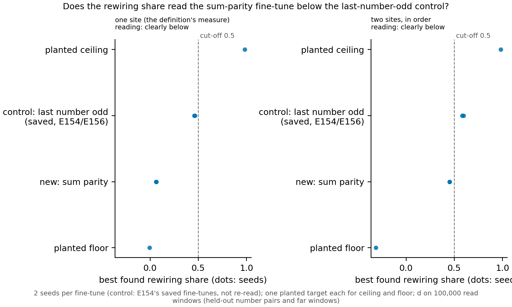

# P1.14 (E157): the sum-parity fine-tune read beside the last-number-odd control

We fine-tuned the plain 67M model to push on the parity of the sum of the last two numbers, a fact it does not hold
linearly, and read its rewiring share beside a fine-tune that pushes on a fact it holds exactly (the last number is
odd), between two planted edits of the same size that the map can and cannot reach. At one site the sum-parity
fine-tune reads far below the control, close to the planted floor, on both seeds; with two sites in order the gap
narrows but stays beyond the bar. This is exploratory: the share separates the two fine-tunes on this layout, but since
the sum's parity is linearly unreadable by construction it does not show the share tells reuse from building, and it
gives no label and changes no wording or cut-off.

**What was read.** The rewiring share is the part of a fine-tune's output change that a single affine map, written
into the plain model's activations at one site (or two sites in order), can reproduce; the best site found is
reported. The planted ceiling is an edit that is exactly affine in the plain model's input to block 2, and it reads
0.985 at one site, so the search finds what it can reach. The planted floor is an edit no map can reach, and its best
one-site reading is about zero. At one site the control's two saved seeds read 0.47 and 0.46, while the new sum-parity
fine-tune reads 0.06 and 0.07, well beyond the filed bar of 0.1 and against a seed spread of under 0.01. Rescaled
between the floor and the ceiling, the control sits about halfway (0.48, 0.47) and the new arm near the floor (0.07,
0.07). With two sites in order both rise: the control to 0.60 and 0.58, the new arm to 0.45 and 0.45, still clearly
below by the filed rule. The rival that the share cannot separate the two (rival b) is not borne out: its prediction
was the new arm within 0.1 of the control.

**What it means.** The share reads a fact the plain model holds linearly higher than one it does not, and the gap is
wide at one site. That is not yet evidence that it tells reuse from building: the sum's parity is unreadable by any
affine map by construction, so the low reading may show only that, which is the confound the built control of L1.4 is
meant to avoid (premise check, doubtful). The two-site reading raises the new arm most, so a map with more room partly
reaches the sum's parity too; how much room a definition should allow is the user's choice. Provisional: two seeds,
one planted target each for ceiling and floor.

Departures from the literature: none beyond those already in the working definition's page (P1.1).

## Not run
- No label under either wording; no change to the cut-off of 0.5 (user, 2026-11-11).
- Ceiling and floor on a second planted target, and the control re-read in this job (its saved readings from E154 and
  E156 were used; the repeat check reproduced E156's two-site reading exactly).
- More than two sites, and the new arm at the 3000-step rung (both seeds were learned at 300 steps).

Results: `experiments/sum_parity_beside/results/readings.json` (from `plot.py`); per-arm readings in
`ceiling.json`, `floor.json`, `plain_s0.json`, `plain_s1.json`, `repeat.json`. Jobs 58950 (wall limit, exit 3) and
58995 (resumed, exit 0), cluster debug, $0.
