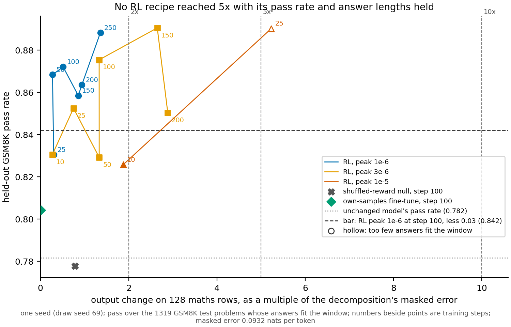

# Can reinforcement learning on Qwen3-1.7B grow its update to a readable size while the model still improves?

*E163, cell P3.4, run 1 of 3. Provisional: no independent check. Figure: `experiments/qwen_rl_readable/figures/run1.png`.*

We trained Qwen3-1.7B with reinforcement learning on school maths at three learning rates, to find a recipe whose
change to the model's output is five or ten times the decomposition's own error while the model still answers
held-out problems well. No recipe got there: the middle rate reached about three times and held the pass rate, and the
highest rate reached five times within 25 steps but its answers grew too long to fit the window. So part 3 has a
reinforcement-learning update at about twice the decomposition's error only, and the main run's recipe is a choice
for the user.

## The answer

Reinforcement learning on Qwen3-1.7B did not reach five times the decomposition's masked error with its held-out pass
rate and answer lengths both held, at any of the three rates tried. The best eligible state was the middle rate at step
150, at 2.6 times. The highest rate reached 5.2 times in 25 steps, but a sixth of its answers no longer fit the
window. The original run's update could not be reproduced exactly: the new run has the same size and pass rate but a
smaller output change.

## What we were trying to test

Part 3 of the paper puts a reinforcement-learning update beside supervised fine-tunes and reads both on the
decomposition of Qwen3-1.7B. The saved reinforcement-learning updates from the earlier run, E69, are too small to read.
Their output change is about the size of the decomposition's own error, so any reading of them sits in the noise.

The **output change** is the KL divergence from the unchanged model W0 to the trained model, in nats per token,
averaged over every position of 128 maths rows of length 256. It reads 0 at W0. The **masked error** is what the
decomposition alone changes on the same rows, 0.0932 nats per token. Their ratio is the **multiple**: 1 means the
update moves the output as much as the decomposition's own error does. The cell asks for states at 2, 5 and 10 times.

The training loop is E69's GRPO loop, unchanged. Each step samples answers to 64 training problems from GSM8K and
rewards the correct ones. Three arms ran from W0 on one seed:

- **RL**: the reward is whether the answer is right. This is the arm we want to grow.
- **Shuffled-reward null**: the same loop with the rewards shuffled across answers. It rules out that any update
  of this size, trained on the model's own answers, moves the pass rate the same way.
- **Own-samples fine-tune**: plain supervised training on the unchanged model's own sampled answers. It rules out
  that the gain comes from seeing the model's answers at all, without the reward.

The RL arm then ran three recipes, each warming up over 10 steps to a constant peak rate. E69's peak of 1e-6 ran to
step 250. A peak of 3e-6 ran to step 200, and a peak of 1e-5 was set to run to step 100. The null and the fine-tune ran only at 1e-6, to step 100, as
reproductions of E69.

The **pass rate** is greedy accuracy on the 1319 held-out GSM8K test problems, counted over the answers that fit the
generation window. The unchanged model reads 0.782. Because a long answer that runs off the window drops out of the
count, the **fits share** sits beside it: the share of the 1319 whose answer fits. The unchanged model reads 0.951.

A state was **eligible** when its pass rate was at least 0.842 and its fits share at least 0.9215. The first bar is
the RL arm's pass at step 100 at E69's rate, less 0.03. The second is the unchanged model's fits share less 0.03.

## What we expected, and why

- **The reproduction would come back.** Same code, seed and card type as E69, so the update's weight norm and pass
  rate at step 100 should land within a few per cent of E69's.
- **The middle rate would reach five or ten times by step 200.** We leaned medium on this. The update's size grows
  with rate times steps, and E69's RL arm had held its pass rate as it grew.
- **The highest rate might drift.** A larger step can leave the region where the reward improves the model. A drift
  stop ended an RL recipe when its pass rate or fits share fell below the unchanged model's bar while the output change
  grew.

## What we observed

### Did any recipe reach five times with the pass rate and answer lengths held?

**Reading it.** No. The filed selection rule reads "not reached". In the figure, every filled point above the dashed bar
lies left of the 5x line. The best eligible state is the 3e-6 recipe at step 150: 2.65 times, pass 0.891. At step 200
that recipe reads 2.89 times with pass 0.850, still eligible. The 1e-5 recipe is the only one past 5x, at step 25 with
5.23 times. Its pass rate held at 0.890, but only 0.829 of its answers fit the window. That point is hollow, and the
drift stop ended the recipe there. Its only other state, step 10 at 1.88 times, has a pass of 0.826, under the bar. At
E69's own rate the RL arm reached 1.36 times by step 250. The null and the fine-tune sit at the left: the fine-tune
barely moves the output, and the null moves it more than RL at the same step but loses accuracy.

What failed at the high rate was answer length, not accuracy. The pass rate never fell below the unchanged model's on
any RL recipe. The 1e-5 recipe cut off 7.8 per cent of its answers at the window. Every other read cut off
at most 4 per cent.

### Did the reproduction of E69 come back?

**Reading it.** In weight norm and pass rate, yes; in output change, no. At step 100 the RL arm's update norm was 0.352
against E69's 0.351. Its pass rate, 0.872, was inside its filed band. The fine-tune read 0.274 in norm and 0.804 in pass,
both inside their bands. But the RL arm's output change at step 100 was 0.0479, where the earlier measurement of E69's
saved step-100 update read 0.0643. That is 0.51 times the masked error against 0.69.

A check then applied this run's own measuring code to E69's saved RL updates, on the cluster at no cost. At step 100 it read
0.0643, exactly the earlier figure, and steps 10 and 50 grew towards it. One row at a time agreed with the batched read to within 3e-8. So the measure
is right, and the new run is a different update of the same norm. Both runs drew identical answers at step 1, so they
diverge somewhere in the 100 steps after. The cause is not checked.

### How much does the output change vary between runs at the same step?

**Reading it.** By up to about two times, which matters for run 2. E69's two seeds read 0.064 and 0.098 at step 100,
with update norms of 0.351 and 0.347. This run's step 100 reads 0.048. So the step at which an RL arm crosses 2 or 5
times will differ between seeds, and between reruns of one seed. Run 2 should save each seed's states at the step
where that seed's own RL arm crosses each size, and save its null and fine-tune at those same steps. States are matched
by step within a seed, not across seeds.

The output change is also not monotone along a run. Read every 5 steps, the 3e-6 recipe stood at 1.33 times at both
step 50 and step 100. At E69's rate the arm read 0.30 times at step 25 and 0.27 at step 50. At that rate it touched
1.86 times at step 240 and fell back to 1.36 at step 250. A state saved at a crossing may sit above where the run
settles.

### Where did the null and the fine-tune land?

**Reading it.** The null lost accuracy and the fine-tune barely moved the output, as in E69. At step 100 the
shuffled-reward null read pass 0.778, just under the unchanged model's 0.782 and well under RL's 0.872. Its output change
was 0.78 times, more than RL's 0.51 at the same step and similar norm. The fine-tune read 0.011 times with pass 0.804.
The null's pass was logged against E69's seed-0 value of 0.870 and missed it. E69's own two null seeds read 0.870 and
0.794, so this is within the null's wide spread between runs.

## What we learned

At these recipes RL on Qwen3-1.7B can reach about three times the decomposition's error while improving held-out maths,
and no further within 200 steps. Faster training reaches five times quickly, but the model starts writing answers too
long for the window. So part 3 can now read an RL update at two to three times the noise floor. Five times needs a longer run
or a changed recipe. The null at matched steps moves the output more than RL while losing accuracy. A
reading that separates RL from its null cannot rest on the size of the output change alone.

## How compelling is the evidence

One seed, three recipes, and pass-rate reads every 25 to 50 steps. The pass rate has a standard error of about 0.011,
so steps within 0.02 of each other are not distinguishable. The output change pools 128 rows and moves non-monotonically
between reads, so a single crossing step is noisy. The pass rate is greedy only and counts only answers that fit, which
the fits share covers. The fits bar of 0.03 was set before the run, from the unchanged model's share. A read just under
it, like the 1e-5 recipe's 0.829, is far under, not a narrow miss.

## Surprises

- **The reproduction moved less output than E69 at the same norm.** Predicted: about 0.064 at step 100, the earlier
  measurement of E69's update. Seen: 0.048. The check on E69's saved updates shows the measure is right and the runs
  diverge. The cause is not checked.
- **The high rate failed on answer length, not on accuracy.** The drift rival predicted the pass rate would fall as the
  output change grew. It rose to 0.890 at the 1e-5 recipe's step 25; what fell was the fits share.
- **E69's rate grew more slowly than expected.** Filed expectation: about 0.7 times at step 100 and 1.5 to 2.5 times
  at step 250. Seen: 0.51 and 1.36.

## What next

1. Run 2, the cell's main run: RL, null and fine-tune on seeds 0 and 70, at a recipe the user picks in
   `reports/decisions/2026-11-12_decision_qwen-rl-run2-recipe.md`. If the chosen recipe reaches 5 times on both seeds,
   part 3 has two sizes to read; if not, it has 2 times only and the report says why.
2. If run 2 uses peak 3e-6, its rate of growth past step 200 decides whether 5 times is reachable. From step 100 to 200
   it added about 0.8 times per 50 steps. The last 50 steps added only a quarter of a multiple.

## Scorecard

| id | claim in words | rule | read | verdict |
|---|---|---|---|---|
| reproduce, RL norm | E69's RL update norm at step 100 comes back | in [0.333, 0.368] | 0.352 | held |
| reproduce, RL pass | E69's RL pass at step 100 comes back | in [0.8587, 0.9027] | 0.872 | held |
| expect, RL output change | E93's read of E69's step-100 update comes back | in [0.0579, 0.0707], logged | 0.0479 | missed; measure checked on E69's updates |
| reproduce, null norm | E69's null norm comes back | in [0.3144, 0.4253] | 0.363 | held |
| expect, null pass | E69's seed-0 null pass | in [0.848, 0.892], logged | 0.778 | missed; E69's seeds 0.870 and 0.794 |
| reproduce, fine-tune | E69's fine-tune norm and pass | [0.260, 0.288]; [0.7832, 0.8272] | 0.274; 0.804 | held |
| step-20 norm, 3e-6 and 1e-5 | the higher rates were applied | [0.5, 2] x scaled E69 | in band | held |
| selection | 3e-6 reaches 5x or 10x above the bar by step 200, lean medium | `pick.py select` | best 2.65x, r3e-6 step 150 | not reached |
| control growth | about 0.7x at 100, 1.5 to 2.5x at 250 | expectation | 0.51x, 1.36x | below |
| drift stop | not on the control; possible on 1e-5 | `pick.py drift` | 1e-5 at step 25, on fits 0.829 | fired on 1e-5 only |

## Full reads

GSM8K reads, every arm. Multiple = output change / 0.0932; norm = Frobenius norm of the update over the 196 matrices.

| arm, recipe | step | multiple | pass | fits | norm |
|---|---|---|---|---|---|
| RL 1e-6 | 25 | 0.30 | 0.830 | 0.975 | 0.163 |
| RL 1e-6 | 50 | 0.27 | 0.868 | 0.945 | 0.245 |
| RL 1e-6 | 100 | 0.51 | 0.872 | 0.960 | 0.352 |
| RL 1e-6 | 150 | 0.86 | 0.858 | 0.970 | 0.434 |
| RL 1e-6 | 200 | 0.94 | 0.864 | 0.961 | 0.509 |
| RL 1e-6 | 250 | 1.36 | 0.888 | 0.943 | 0.585 |
| RL 3e-6 | 10 | 0.27 | 0.830 | 0.975 | 0.198 |
| RL 3e-6 | 25 | 0.75 | 0.852 | 0.951 | 0.472 |
| RL 3e-6 | 50 | 1.33 | 0.829 | 0.986 | 0.727 |
| RL 3e-6 | 100 | 1.33 | 0.875 | 0.937 | 1.035 |
| RL 3e-6 | 150 | 2.65 | 0.891 | 0.935 | 1.270 |
| RL 3e-6 | 200 | 2.89 | 0.850 | 0.978 | 1.490 |
| RL 1e-5 | 10 | 1.88 | 0.826 | 0.975 | 0.665 |
| RL 1e-5 | 25 | 5.23 | 0.890 | 0.829 | 1.603 |
| null 1e-6 | 100 | 0.78 | 0.778 | 0.966 | 0.363 |
| fine-tune 1e-6 | 100 | 0.011 | 0.804 | 0.957 | 0.274 |

Output change of E69's saved RL updates, read with this run's code (`kl_check.json`): 0.0119, 0.0389, 0.0643 nats per
token at steps 10, 50, 100; norms 0.069, 0.243, 0.351.

## Departures from the literature

The GRPO loop and its settings are E69's, unchanged; run 1 adds no departure from them. The peaks 3e-6 and 1e-5 are the
swept variable, not sourced settings.

## Not run

- Seed 70, and the null and fine-tune at the higher rates.
- Any saved state or update: run 1 kept only reads.
- A peak between 3e-6 and 1e-5, a longer generation window, or a rate schedule other than warm-up then constant.
- The cause of the divergence from E69 after identical step-1 answers.
- GSM1K, and any reading on the decomposition.
- An independent check of this report.

## Provenance

Results: `experiments/qwen_rl_readable/results/{control,N,F,r3e-6,r1e-5}.json` and `.log`, `selection.json`,
`predictions.json`, `kl_check.json` (cluster job 59301). Plan: `reports/plans/2026-11-11_plan_qwen-rl-readable-run1.md`.
Figure: `experiments/qwen_rl_readable/plot.py`. Five RunPod pods: four H100 80GB, the null on an H200. Time per step
from the logs: RL about 66 s with reads, null about 60 s, fine-tune about 40 s. Session spend $50.82.
