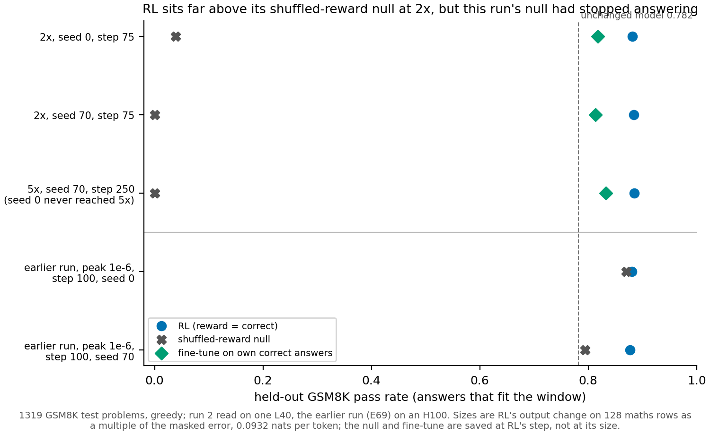

# Does reinforcement learning on Qwen3-1.7B beat its shuffled-reward null at two or five times the decomposition's error?

*E167, cell P3.4, run 2 of 3. Provisional: no independent check. Figure: `experiments/qwen_rl_readable/figures/run2.png`.*

We trained Qwen3-1.7B on school maths three ways on two seeds, by reinforcement learning, by the same loop with
shuffled rewards, and by plain training on its own correct answers, and read them where reinforcement learning had
moved the output two and five times as much as the decomposition's own error. By the filed rule reinforcement learning
stands apart from its null at twice the error, but the null had stopped working within 50 steps. So the cell still has no reading of
reinforcement learning against a working null at a size the decomposition can see.

## The answer

By the filed rule, reinforcement learning is apart from its shuffled-reward null at twice the decomposition's error on
both seeds; five and ten times are unread. That verdict tells us nothing. The null broke during training on both seeds:
its held-out pass rate fell to almost zero and its answers shrank to a few tokens, so RL beat a model that had stopped
answering, not a null. The cause of the null's collapse was not checked. Every update sits outside the decomposition's
subcomponents as much as a random change does.

## What we were trying to test

Part 3 of the paper reads reinforcement-learning updates on the decomposition of Qwen3-1.7B. The cell asks a question
about behaviour first: at which size, if any, does reinforcement learning improve held-out maths by more than an
update of the same kind with the reward made meaningless?

The **output change** is the KL divergence from the unchanged model W0 to the trained model, in nats per token, averaged
over every position of 128 maths rows of length 256. It reads 0 at W0. The **masked error** is what the decomposition
alone changes on the same rows, 0.0932 nats per token. Their ratio is the **multiple**: 1 means the update moves the
output as much as the decomposition's own error does, so an update below about 1 is lost in the decomposition's noise.

Each seed trained three arms from W0, with E69's GRPO loop at the peak rate the user chose after run 1, 3e-6 after 10
warm-up steps, to step 400:

- **RL**: each step samples 8 answers to each of 64 training problems and rewards the correct ones. This is the update
  we want to read.
- **Shuffled-reward null**: the same loop, with the rewards shuffled among the 8 answers to each problem. It rules out
  that any update of this kind, trained on the model's own answers at this rate, moves the pass rate the same way.
- **Own-samples fine-tune**: plain supervised training on the model's own correct sampled answers, drawn fresh from W0
  each step. It rules out that the gain comes from seeing correct answers at all, without the comparison the reward
  makes within a problem.

Each seed's states were saved at the first save step where that seed's RL arm had crossed 2, 5 and 10 times the masked
error. The null and the fine-tune of the same seed were saved at the same step, so they are matched to RL by step, not
by their own size. Every saved state was then read on one cluster card type, an L40.

The **pass rate** is greedy accuracy on the 1319 held-out GSM8K test problems, counted over answers that fit the
generation window. W0 reads 0.782. The **filed rule** calls RL apart from its null at a size when, on both seeds, RL's
pass minus the null's exceeds both the spread of either arm between seeds and twice the paired standard error.

## What we expected, and why

- **Apart at twice the error, with medium confidence.** In run 1 the RL arm at this rate held a pass of 0.891 at step
  150, while the null at a third of the rate fell to 0.778 by step 100. A null at three times that rate was expected
  to fall further, not to collapse.
- **Five times on at most one seed, ten times on neither.** Run 1's RL arm at this rate grew by about a quarter of a
  multiple in its last 50 steps.
- **Twice the error near step 125 on seed 0.** That is where run 1's arm at the same rate crossed it.
- **No drift stop.** Run 1's RL arm at this rate held its pass rate and answer lengths to step 200.

## What we observed

### Is RL apart from its null in held-out maths at the sizes reached?

**Reading it.** By the filed rule, yes at twice the error, and the verdict is uninformative. At step 75, RL passes
0.882 on seed 0 and 0.884 on seed 70. The null at the same step passes 0.039 and 0.000. The rule's margin is the null's
seed spread, 0.039, and the gaps are about 0.84 and 0.88, so the call is "apart". But the null scores far below the
unchanged model, which no working null should. The lower two rows show a working null from the earlier
run E69, at a third of this rate and step 100. There the null read 0.870 and 0.794, and RL 0.881 and 0.877. At five
times, read on seed 70 only, RL passes 0.885 and the null 0.000.

RL's pass rate did not grow with size. At twice the error it reads 0.882 and 0.884. On seed 70 at five times it reads
0.885. The earlier run's RL arm read 0.881 at 0.690 times. Across every GSM8K read of the two training runs, from step
50 to 400, RL's pass stayed between 0.848 and 0.906.

### What happened to the null?

**Reading it.** It stopped answering correctly early, then stopped training. The figures below come from the two null
pods' training logs, `results/run2/N_s0.json` and `N_s70.json`.

| | seed 0 | seed 70 |
|---|---|---|
| share of its sampled training answers correct, step 1 | 0.80 | 0.82 |
| first step with that share under 0.2 | 30 | 28 |
| same share at step 75 | 0.025 | 0.002 |
| mean answer length, step 1, tokens | 190 | 192 |
| mean answer length, step 75, tokens | 9.3 | 7.4 |
| last step with any update | 79 | 190 |
| update norm frozen at | 0.762 | 0.707 |
| multiple at step 75 | 4.21 | 4.05 |

The loop gives an answer a weight only when its problem has both right and wrong answers among its 8. Once almost every
answer was wrong, that never happened, and the update stopped: seed 0 froze after step 79, seed 70 after step 190.
The collapse came before that, between steps 25 and 35 on both seeds, at an update norm near 0.5. The null's output
change was already about 4 times the masked error at step 75, twice RL's on seed 0. So it is not matched to RL's size
either.

No early check caught it: every filed check of the null passed, and none of them watched its reward. **The cause of the
collapse was not checked.** Three hypotheses are untested, and none is favoured:

- the loop has no length normalisation, so a reward unrelated to correctness may favour short answers;
- the rate, three times E69's, may take the null past where its noisy gradient stays harmless;
- once correct answers become rare, the few problems with a mix of right and wrong answers dominate the update.

### Does the own-samples fine-tune read as a reference?

**Reading it.** Yes, but not as a matched null. At step 75 it passes 0.818 and 0.814, between W0's 0.782 and RL's
0.88, and 0.832 on seed 70 at step 250. Its output change stays near W0: 0.046 and 0.053 of the masked error at step
75, and 0.216 at step 250. Its update norm is 0.626 to 1.051, comparable to RL's, but it barely moves the output. It is
a reference at RL's step, not an update of RL's size.

### Where do the updates sit relative to the decomposition?

**Reading it.** Every update, of every arm, sits outside the decomposition's subcomponents as much as a random change of
the same size does. The **outside share** here is the share of an update's squared norm that lies outside the span the
subcomponents can reach, on all 196 decomposed matrices. A Gaussian change with the same norm on each matrix leaves
0.0981 of its squared norm outside, all of it in attention. The ratio of the update's outside share to that Gaussian
change's is 1 when the update is placed as randomly as noise, and below 1 when it favours the subcomponents. All nine
states read between 0.979 and 0.993; the earlier run's saved RL update, the control, reads 0.98047, inside its filed
band. So these updates are no more aligned with what the subcomponents can express than chance, as E152 found for the
earlier saved updates.

Every update is also smaller than the decomposition's own leftover weight, total norm 4.98, on each of the 196 matrices:
0 of 196 above it in every state. The largest update, RL on seed 70 at step 250, has norm 1.675.

## Full reads

One L40, the 1319 GSM8K test problems; multiple = output change / 0.0932; norm = Frobenius norm of the update over the
196 matrices; share ratio = outside share / that of a Gaussian change of the same norms.

| state | step | multiple | pass | fits | norm | share ratio |
|---|---|---|---|---|---|---|
| unchanged model | 0 | 0 | 0.782 | 0.951 | 0 | |
| earlier RL, seed 0, control | 100 | 0.690 | 0.881 | 0.947 | 0.351 | 0.98047 |
| RL, seed 0 | 75 | 2.09 | 0.882 | 0.948 | 0.867 | 0.984 |
| null, seed 0 | 75 | 4.21 | 0.039 | 0.999 | 0.753 | 0.981 |
| fine-tune, seed 0 | 75 | 0.046 | 0.818 | 0.943 | 0.626 | 0.993 |
| RL, seed 70 | 75 | 3.06 | 0.884 | 0.945 | 0.892 | 0.985 |
| null, seed 70 | 75 | 4.05 | 0.000 | 0.998 | 0.699 | 0.979 |
| fine-tune, seed 70 | 75 | 0.053 | 0.814 | 0.948 | 0.599 | 0.990 |
| RL, seed 70 | 250 | 5.04 | 0.885 | 0.965 | 1.675 | 0.987 |
| null, seed 70 | 250 | 4.26 | 0.000 | 1.000 | 0.707 | 0.979 |
| fine-tune, seed 70 | 250 | 0.216 | 0.832 | 0.941 | 1.051 | 0.988 |

RL on seed 70 crossed twice the error at step 55 on its training pod, 2.42 times, so its first save step, 75, reads
3.06 on the L40. RL on seed 0 reached at most 4.92 times, at step 400; seed 70 reached at most 8.64 times, also at
step 400. The paired standard errors of RL against the null at twice the error are 0.0104 and 0.0091.

## What we learned

At peak 3e-6, an RL update on Qwen3-1.7B reaches twice the decomposition's error by step 75 on both seeds and five
times by step 250 on one, with its held-out pass rate held near 0.88 throughout. The shuffled-reward null at the same
rate does not survive: it collapses within about 30 steps on both seeds, so it cannot serve as the comparison the cell
needs. The behaviour question, whether RL beats a working null beyond seed spread at a readable size, is therefore
still open. The earlier run's working null on seed 0 sat within 0.011 of RL, and its two seeds differed by 0.076, so
a working null may well read "together". All three kinds of update sit outside the subcomponents as randomly as noise.

## How compelling is the evidence

The verdict rests on two seeds at one size. The rule's margin comes from one pair of seeds, here the collapsed null's
spread of 0.039. The paired standard error is about 0.01, so the gaps of 0.84 and 0.88 are not noise; what they compare
is the problem. The pass rate is greedy and counts only answers that fit the window. The null's answers almost all fit,
so its near-zero pass is not a window artefact. Five times was read on one seed and ten times on none. The outside
share ratio has one control and no seed spread of its own; its readings agree with the earlier run's 15 saved updates,
0.973 to 1.005.

## Surprises

- **The shuffled-reward null collapsed on both seeds.** Expected: a null that loses some accuracy, like the earlier
  runs' 0.778 to 0.870. Seen: pass 0.039 and 0.000, answers of a few tokens, and training frozen. This makes the filed
  verdict uninformative, and no filed check was watching for it. The cause is not checked.
- **Twice the error arrived earlier than filed.** Expected near step 125 on seed 0; RL crossed it at step 75 on seed 0
  and at step 55 on seed 70.
- **Seed 70 reached five times, at step 250.** Expected around step 335 to 410, if at all.

## What next

1. The cell's last run, which needs the user's decision: `reports/decisions/2026-11-12_decision_qwen-rl-last-run.md`.
   It weighs a run with a null at a rate where it held in the earlier runs against closing the cell as read.
2. If a working null reads "together" with RL at twice the error, part 3 reports that RL's behaviour gain at readable
   sizes is not separable from training on the model's own answers. If it reads "apart", part 3 has its first
   behaviour-backed RL update to read on the decomposition.

## Scorecard

| id | claim in words | rule | read | verdict |
|---|---|---|---|---|
| worked, lean | apart at 2x; 5x read on at most one seed; 10x not reached | `match.worked` | apart at 2x; 5x on seed 70 only; 10x on neither | hit, against a null that collapsed |
| matched steps, 2x | crossed near step 125 on seed 0 | first 5-step read at or above 2x | step 75 on seed 0 | miss, earlier |
| matched steps, 5x | around step 335 to 410, or not by 400 | as above | seed 0 not by 400, at most 4.92; seed 70 at step 250 | seed 0 hit, seed 70 miss, earlier |
| matched steps, 10x | not reached | as above | at most 4.92 and 8.64 | hit |
| drift stop | not fired | `pick.drift` | not fired on either seed | hit |
| control, unchanged model | output change, pass, norm in band | pass in [0.7597, 0.8037] | 0, 0.782, 0 | held |
| control, earlier RL at step 100 | output change, pass, norm in band | e.g. output change in [0.06367, 0.06496] | 0.0643, 0.881, 0.351 | held |
| control, outside share ratio | earlier RL's ratio in band | in [0.98046, 0.98048] | 0.98047 | held |
| early checks | step-1 reward, first-step size and output change, step-20 norm, first save, seed-0 multiples at 50 and 150 | `predictions_run2.json` early | all within their bands on all six pods | held |

The filed lean's "apart" is scored as written. Not scored: the rule's value at W0 and the earlier run's stand-in, which
the filing worked out by hand and the run did not recompute.

## Departures from the literature

None beyond run 1's. The GRPO loop, the shuffled-reward null and the fine-tune are E69's, unchanged. Peak 3e-6 is the
rate swept in run 1, not a sourced setting. The outside share is E152's step-0 code, unchanged.

## Not run

- The cause of the null's collapse, including any of the three hypotheses above.
- A null at a rate or setting where it stays a null, at RL's size.
- RL, null and fine-tune matched by output change rather than by step.
- Ten times on any seed; five times on seed 0.
- Any decomposition reading beyond the outside share and the norms.
- GSM1K, sampled rather than greedy accuracy, and any third seed.
- An independent check of this report.

## Provenance

Training: `experiments/qwen_rl_readable/results/run2/{R,N,F}_s{0,70}.json` and `.log`, six RunPod H100 80GB pods, 
`run2.py`. Matched steps: `results/run2/chosen.json`. Reads: `results/run2_reads/controls.json`, `states/*.json`,
`share.json`, `share_sites.jsonl`, `verdict.json`, `reads.log`, cluster L40 jobs 59649 to 59657 and 59673. Filed
predictions: `results/predictions_run2.json`. Plan: `reports/plans/2026-11-12_plan_qwen-rl-readable-run2.md`. Figure:
`plot2.py`. Earlier run's numbers: `experiments/qwen_rl/results/lr1e-6w10{,_s70}/{R,N}.json`, run 1's null
`results/N.json`.
