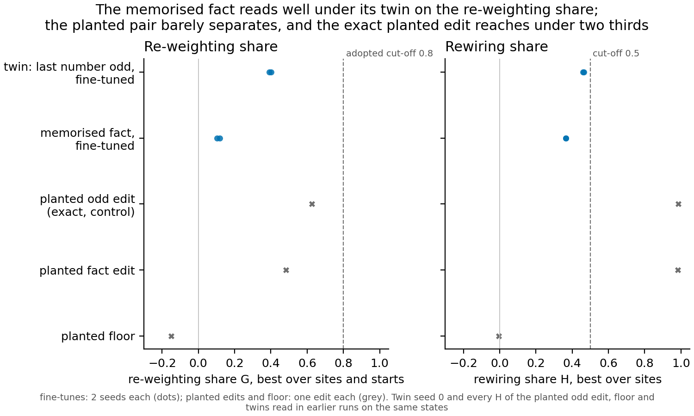

# Does the re-weighting share tell a memorised fact from its reuse twin?

We fine-tuned the 67M model to memorise a random one-bit fact about each number token, and compared it with a twin that
learned "the last number is odd" on the same inputs, push and prior. The ordinary fine-tunes separate: the memorised
fact reads well under its twin on the re-weighting share, as in all five older matched pairs. The planted edits mostly
do not, and the planted odd edit, an exact re-weighting by construction, reads only 0.63, so the search reaches under
two thirds of an edit it should reach fully.

## What was run

Every item pushes the model's next-token distribution along the same fixed direction on two-number windows, and only
when a one-bit fact about the last number token is 1. For the twin the fact is "the number is odd", which the plain
model already holds. For the memorised fact it is a seeded random bit per number token, marking exactly as many of the
100 number tokens as oddness does and agreeing with oddness on 0.46 of them, so the two differ only in which tokens are
marked. Each was trained twice by the same recipe, and both seeds of both learned the target at 300 steps.

Beside the fine-tunes sit three edits written straight into the plain model. The planted odd edit adds the push as an
exact affine function of the activations at one site, so it is a re-weighting by construction and is the positive
control. The planted fact edit is the same construction with the random bit, sized to the same gap. The planted floor
keys the push on a random bit per pair of numbers, which no map of a single token can reach.

Two readings come from the working definition. The re-weighting share, called G here, is the share of the gap between
the two models closed by the best affine map of a four-direction variable from its own value: 0 is nothing, 1 is all.
The rewiring share, called H, is the same with the map reading everything the model computed before that site. Each is
the best over sites and, for G, over three starts.

## What was seen

**The fine-tunes separate.** The memorised fact reads 0.10 and 0.12 on the re-weighting share, against its twin's 0.39
and 0.40. Each fact seed sits 0.29 and 0.28 under the twin's mean, well past the filed smallest gap of 0.17. The lowest
twin seed sits 0.27 above the highest fact seed. The noise floor is a seed spread of about 0.04 on old
tasks. The order matches all five older matched pairs, where every reuse seed read above every seed of its new twin.

**The planted edits mostly do not.** The planted fact edit reads 0.48 against the planted odd edit's 0.63, a gap of
0.14, inside the 0.17 the filed rule needs. The planted floor reads -0.15, so the search does not invent a map. Both
planted edits read near the top on the rewiring share, 0.985 and 0.98. The odd edit's 0.63 missed the filed
expectation of at least 0.9, though it cleared the stop at 0.5.

## What each reading labels the memorised fact

Under the adopted wording, an item is re-weighted when G is at least 0.8 and H at least 0.5, rewired when only H
reaches 0.5, and "no map found" when H is under 0.5. Both planted edits read rewired. Both fact seeds read no map found,
with a rewiring share of 0.36 and 0.37, and so do both twin seeds, at 0.47 and 0.46. So the adopted wording labels the
memorised fact "no map found", a search limit, never new, and gives the twin the same label.

Under the tentative reading, "new means not re-weighted", with the same cut-off of 0.8, every item reads new: both
fine-tunes, the twin, the planted fact edit and the planted odd edit. **This is the main caveat.** As an absolute label
the tentative reading cannot tell the memorised fact from its twin on this layout, and it calls an exact re-weighting
new. Only the ranking within the pair tells them apart.

## Open questions

- Why does the planted odd edit, exact by construction, read only 0.63 on the re-weighting share? Its other two starts
  at the best site read lower, so the search may be finding a poor optimum, or the four-direction variable may miss part
  of the push.
- Does the fine-tunes' gap reflect the variable itself, or how training implemented it? The planted pair, which fixes
  the implementation, is close, while the trained pair is far apart.

## Scorecard

| id | claim in words | rule | read | verdict |
|---|---|---|---|---|
| P0 | the exact planted odd edit is read nearly fully | best G at least 0.9; stop under 0.5 | 0.63 | missed, stop not hit |
| P1 | the floor reads no map | best G at most 0.1 | -0.15 | held |
| R1 | the planted fact edit reads under the planted odd edit | rival a if at least 0.17 under, b if within | 0.14 under | rival b |
| R2 | each fact seed reads under the twin mean | rival a if at least 0.17 under on both seeds | 0.29, 0.28 under | rival a |

## Not run

- No new run beyond the two open questions above, which are named only.
- The rewiring share was not re-searched on the planted odd edit, the floor or the twins: their values are the earlier
  runs' readings of the same edits and states.
- A second random labelling, other push sizes, and any absolute cut-off for the re-weighting share.
- No change to the wording or to `decisions.md`.

## Departures

- From the plan: the planted odd edit was expected to read at least 0.9 on the re-weighting share and read 0.63.
- From the plan: the rewiring share of the planted odd edit and the floor was taken from the earlier sum-parity run,
  not re-searched; the floor's best over sites is about 0, where the plan quoted that run's reading at one site.
- From the literature: none beyond those in the working definition's gate page.

*Sources: plan `reports/plans/2026-11-12_plan_memorised-fact.md`; rules `experiments/memorised_fact/results/predictions.json`;
readings `experiments/memorised_fact/results/readings.json`, per item `planted_odd.json`, `planted_fact.json`,
`floor.json`, `twin_s1.json`, `fact_s0.json`, `fact_s1.json`; twin seed 0 `experiments/built_control_sum/results/amend1_control_s0.json`;
planted odd and floor rewiring shares `experiments/sum_parity_beside/results/{ceiling,floor}.json` (E157); figure
`experiments/memorised_fact/plot.py`. E168: jobs 59525-59527 and 59533-59535, debug L40, about 80 min wall,
$0; code 201abea8.*
