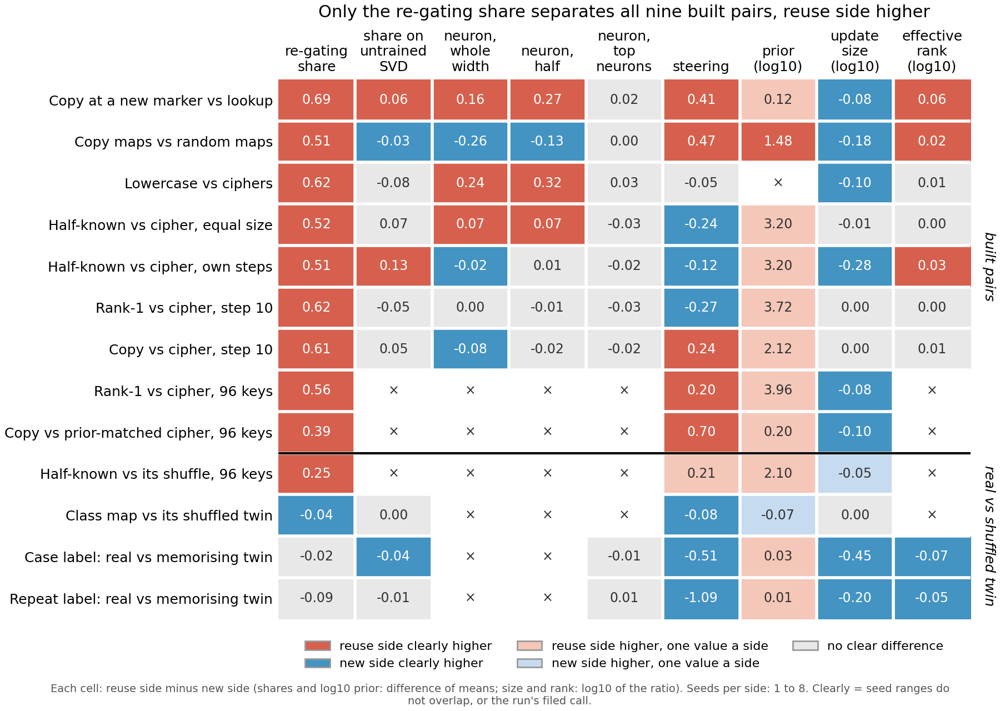

# Does the method table change when every column uses the same rule for "clearly"?

*Cell P2.23, compare-lead, 2026-11-12. No run: the figure is redrawn from saved results by
`experiments/method_table/plot_final.py`. No independent check, and no pair is labelled reuse or new beyond how it was
built. Card: `docs/research_log/parts/experiments/e133.html`.*

The method table's figure now colours every cell by one rule, and it gains a column for how many neurons carry half the
gain. The re-gating share is still the only reading that puts the reuse side higher on all nine built pairs. Two
readings now look closer than before, but only because their seeds are tight. Effective rank leans the share's way on seven
pairs by small margins. The top-neuron reading is apart on all nine, mostly the other way, by tiny gaps. For `GOALS.md`, the
comparison's answer stands.

## What changed

**One rule.** A cell is red or blue only when every seed of one side lies beyond every seed of the other. A cell with one
value on a side takes the light colour. Before this, a cell whose run had filed its own call used that run's bar, which also asked for a gap of
at least 0.1, while older cells used the seed rule. Each run's own call is still kept in `filed_call` in
`experiments/method_table/results/final.json`, but it no longer sets the colour. Colour is a call, not a score.

**A new column, neurons for half the gain.** This is the fewest of the original model's neurons, taken in order of
contribution, that carry half of the half-form neuron share, read from E98's saved
`experiments/neuron_r/results/carrying.json` on E98's own state lists. It is shown as log10 of the new side's mean over the
reuse side's mean, so red means fewer neurons on the reuse side. E98 scored both sides on four built pairs only. The cipher
states of the other pairs were not scored, so those cells show ×.

**Effective rank on the 96-key pairs.** E171 (cell P2.25) filled these from E147's refit updates. All four are apart, reuse
side higher.

## The new tally on the nine built pairs

| reading | agrees with the share | opposite | no difference | not measured |
|---|---|---|---|---|
| re-gating share | 9 | 0 | 0 | 0 |
| share on untrained SVD | 2 | 2 | 5 | 0 |
| neuron, whole width | 3 | 4 | 2 | 0 |
| neuron, half | 3 | 2 | 4 | 0 |
| neuron, top neurons | 4 | 5 | 0 | 0 |
| steering | 4 | 3 | 2 | 0 |
| prior | 9, eight with one value a side | 0 | 0 | 0 |
| update size | 0 | 6 | 3 | 0 |
| effective rank | 7 | 0 | 2 | 0 |
| neurons for half the gain | 3 | 0 | 1 | 5 |

**Reading it.** The share's column is unchanged. The top-neuron form went from no call on all nine to apart on all nine, but
no gap is larger than 0.03 of the gain, so its seeds are tight, not its gaps large. Effective rank went from three
agreeing to seven, with the reuse side's update spreading over at most 17% more directions (a gap of 0.07 in log10).

## Cells whose colour changed

All 23 went from no call to apart. None went the other way.

- Top neurons: every built pair; on the twins, half-known against its shuffle, class map and case label.
- Neuron, half: copy against the prior-matched cipher (new side higher).
- Effective rank: lowercase against ciphers, and copy against cipher at step 10.
- Half-known against its shuffle: untrained SVD, neuron whole width, neuron half, steering.
- Class map against its shuffled twin: share, neuron whole width, steering. The twin is higher on all three.
- Repeat label against its memorising twin: share, with the twin higher by 0.09.

## The four values in the new column

- Copy at a new marker against lookup: 0.00. Both sides need 512 neurons on every seed, so there is no call.
- Copy maps against random maps: 0.70, apart. As a mean of the logs it is 0.60. The value relayed from the user was 0.48,
  and that difference is unexplained.
- Lowercase against ciphers: 0.85, apart, as relayed.
- Half-known against the cipher at its own steps: 0.52, apart. The value relayed was 0.54, which is the mean of the logs.

Every value uses the log of the ratio of means, like the size and rank columns. No state's count was missing.

## Not run

- Neurons for half the gain on the five other built pairs and on the twins (cell P2.24). The reader picks up
  `experiments/k_half_fill/results/cells.json` once it exists.
- Any new measurement; any verdict of reused or new; any combined score over the columns.
- A check of where the relayed 0.48 came from.
