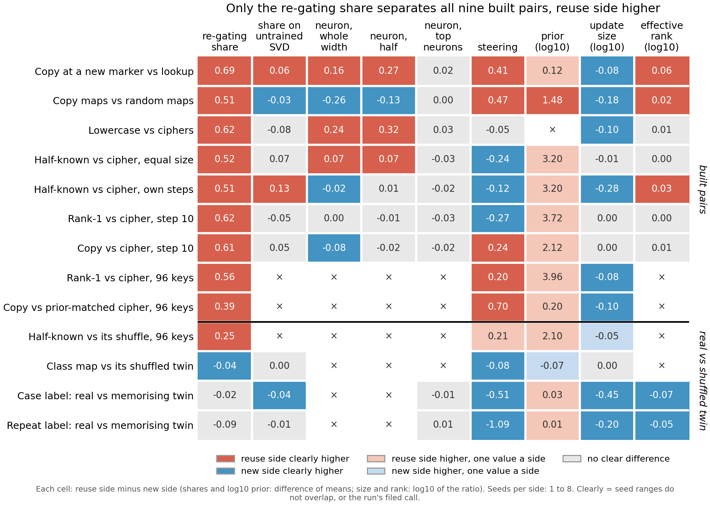

# How many neurons carry half the gain, on every built pair?

*Cell P2.24, E172, compare-lead, 2026-11-12. Provisional and descriptive: no prediction at a bar, no verdict on reuse,
no independent check. Run: Slurm job 59606 on one L40, about two minutes.*

For each fine-tune in the method table, we counted how few of the original model's neurons carry half of its gain, on
all nine built pairs and two twins. The side built to reuse needed clearly fewer neurons on six built pairs, with no
difference on the other three and on both twins. Five of those six
are also pairs where the new side's weight change is clearly larger, so this column does not yet show anything for
`GOALS.md` that update size does not.

## What was measured

Take one fine-tune and its training task. Rank the original model's MLP neurons by how much their change in activation
adds to the gain in the target's log-odds. Then patch in the fine-tuned activations on the top k neurons only, and keep
the original activations everywhere else. The count k_half is the smallest k on the grid 1, 2, 4 and so on up to 8192,
then 12288, at which this patch recovers half of what patching all 12288 neurons recovers. A small count means the
gain is carried by few neurons. This is E98's reading, unchanged.

E98 had read it on four built pairs. This run read it on the 37 states it lacked: the step-9 and step-10 ciphers of
three pairs, and the refit 96-key updates of two built pairs and two twins. Each pair's cell is the log10 of the new
side's mean count over the reuse side's mean count, so 0 means no difference and red means fewer neurons on the reuse
side. A cell is apart only when every seed of one side lies beyond every seed of the other.

**The control.** Before reading anything new, the job read two states E98 had already scored, a rank-1 fine-tune and
lowercase. It got the same counts, 128 and 16, the same patch value at every grid point to the last digit, and the same
order of the top 256 neurons. The reader is E98's reader.

## What we observed

The column is the last one, headed "neurons for half the gain", in log10.

**Reading it.** The reuse side needs fewer neurons on six of nine built pairs, with every seed apart. The gaps run from
0.52 to 0.90 in log10, so the new side needs three to eight times as many. The other three built pairs show no
difference: copy at a new marker against lookup, the half-known task against the cipher at equal size, and copy against
the cipher at step 10. On the two twins neither is apart, at 0.12 and -0.08. Counts sit on a power-of-two grid, so many
seeds tie exactly and a one-step move doubles a count.

## Does update size explain it?

The premise check on this cell asked whether the pairs that separate are just the ones where the new side changed the
weights more. The table sets each built pair's count ratio beside its update-size ratio from the same figure. Both are
log10 of new over reuse, so positive means the new side is higher. The size column here is the figure's update-size
column with its sign flipped.

| built pair | neurons for half the gain | apart? | update size | apart? |
|---|---|---|---|---|
| Copy maps vs random maps | 0.70 | yes | 0.18 | yes |
| Lowercase vs ciphers | 0.85 | yes | 0.10 | yes |
| Half-known vs cipher, own steps | 0.52 | yes | 0.28 | yes |
| Rank-1 vs cipher, 96 keys | 0.90 | yes | 0.08 | yes |
| Copy vs prior-matched cipher, 96 keys | 0.82 | yes | 0.10 | yes |
| Rank-1 vs cipher, step 10 | 0.55 | yes | -0.005 | no |
| Copy at a new marker vs lookup | 0.00 | no | 0.08 | yes |
| Half-known vs cipher, equal size | -0.08 | no | 0.006 | no |
| Copy vs cipher, step 10 | 0.00 | no | -0.001 | no |

**Reading it.** Mostly yes. Five of the six pairs where the count separates are pairs where the new side's weight
change is also clearly larger. The one pair that separates at equal size is rank-1 against the cipher at step 10, and
its cipher side is one of those that had not learned its task. Both pairs matched on size by design show no
difference in count. One pair breaks the link the other way: copy at a new marker against lookup differs in size but
not in count. Nine pairs cannot tell whether the count adds anything beyond size.

## How compelling is the evidence

- **The ciphers that had not learned.** E98 left the step-9 and step-10 ciphers out: their mean held-out probability
  of the target was under its learned bar of 0.5. It applies that bar to key-to-value tasks only. The step-9
  ciphers read 0.23 to 0.31 and the step-10 ciphers 0.32 to 0.45. This run counted them anyway, as a description. Their
  gains were far above E98's gain floor, so the count is defined. These ciphers are the new side of three pairs, and
  only one of the three is apart. The 96-key ciphers passed the bar, at 0.67 to 0.81.
- **The grid.** The count can only take grid values, so seed spread is mostly zero and "apart" is easy to reach. A real
  gap smaller than one doubling cannot show.
- **Sizes and counts come from different saves on the 96-key rows.** The counts read E147's refit updates, while the
  size column reads E58's original saves. E147 found the refit reproduces E58's share within each map's seed range.
- **Seeds:** 2 to 8 per side.

## Surprises

None against a filed expectation, since none was filed. The step-10 rank-1 pair separating at equal size is the one
case the size reading does not cover, and it rests on an unlearned cipher.

## What next

- A size-matched control for the count: rescale each new-side update to the reuse side's size and count again. If the
  gaps survive, the count carries something size does not.
- Read the count on the step-10 cipher after it has learned, at a later save. If the rank-1 pair stops separating,
  the one size-free case came from the unlearned cipher.

## Departures from the literature

None. The count is E98's reading. It departs from E98 in one way: the learned bar was not applied to the step-9 and
step-10 ciphers.

## Not run

- Any verdict on reuse, and any score that combines columns.
- The count on the two memorising-twin pairs, case label and repeat label.
- A size-matched rescale of any update, and a learned-bar filter on the new rows.
- A finer grid between powers of two.

*Provenance: `experiments/k_half_fill/results/cells.json` (`.stage0`, `.states`, `.cells`), E98's
`experiments/neuron_r/results/carrying.json`, `experiments/method_table/results/final.json` (methods `k_half` and
`size`), log `cluster/logs/commute-k-half-fill-59606.out`, code `experiments/k_half_fill/run.py`. Premise check:
`~/commute-data/premise/P2.24.md`.*
