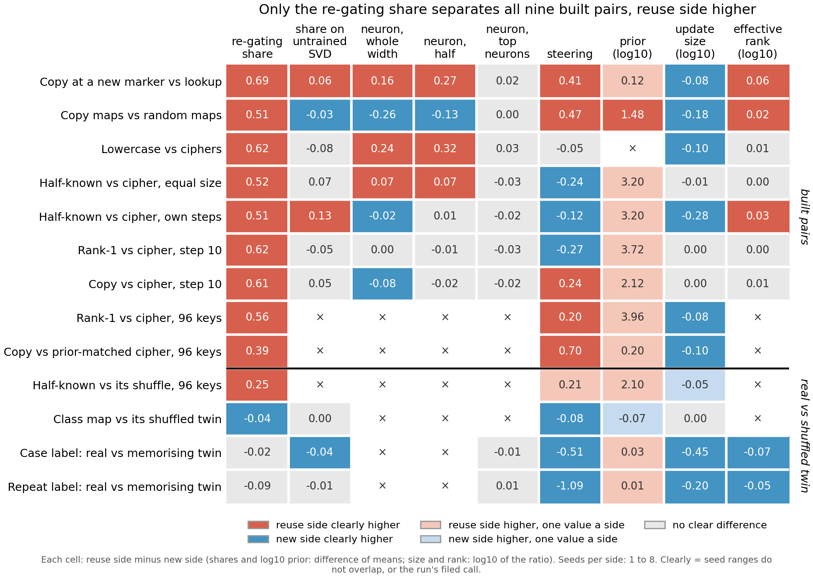

# Over how many directions do the 96-key updates spread?

*Cell P2.25, E171, compare-lead, 2026-11-12. Descriptive: no prediction at a bar, no verdict on reuse, no independent
check. Run on the CPU worker from saved weight changes, no model loaded.*

We measured the effective rank of the weight change on the four rows of the method table built from 96-key fine-tunes,
the last empty cells in that column. On all four rows the side built to reuse spreads its update over more directions,
with every seed apart, and on three of them it is also the smaller update. Rank is known to follow update size, so for
`GOALS.md` this mostly repeats the size column, except on the class-map twin, where sizes are near equal and rank still
differs by a little.

## What was measured

The effective rank of one weight matrix's change is the exponential of the entropy of its normalised singular values.
It reads 1 for a rank-1 change and k for k equal directions. The state's value averages this over the 24 matrices, each
weighted by its squared Frobenius norm. This is E141's reading, unchanged. The updates are E147's refits of E58's 96-key
fine-tunes at step 30, three seeds a side. Each row compares a reuse side with a new side:

- rank-1 against cipher, and copy against the prior-matched cipher, both built pairs;
- half-known against its shuffle, and the class map against its shuffled twin, both twins.

A cell is apart when every seed of one side lies beyond every seed of the other. E141's own rule, a mean gap larger than
the wider within-side range, gives the same call on all four rows.

**The controls.** Made-up updates with 10 and with 1 equal singular values per matrix read 10 and 1, and a zero update
reads no rank: the control passed before any row was read. The refit of rank-1 seed 0 reads 426.23, and E58's own saved
update reads 426.23 too, so the refits stand in for E58's saves.

## What we observed

The column is "effective rank", in log10, on the four rows marked 96 keys or twin.

| row | rank, reuse | rank, new | gap | wider seed range | squared size, reuse | squared size, new | size ratio, new over reuse |
|---|---|---|---|---|---|---|---|
| Rank-1 vs cipher | 421.8 | 404.7 | 17.1 | 6.8 | 1.22 | 1.83 | 1.50 |
| Copy vs prior-matched cipher | 475.0 | 406.6 | 68.4 | 5.9 | 1.04 | 1.70 | 1.64 |
| Half-known vs its shuffle | 421.8 | 406.0 | 15.8 | 2.9 | 1.37 | 1.74 | 1.27 |
| Class map vs its shuffled twin | 401.5 | 394.4 | 7.1 | 3.8 | 1.31 | 1.32 | 1.01 |

Ranks and sizes are means over three seeds. Squared size is the sum over the 24 matrices of each change's squared
Frobenius norm.

**Reading it.** All four rows are apart, with the reuse side higher. In the figure the gaps are small, from 0.01 to 0.07
in log10. The largest is copy against the prior-matched cipher, where the copy update spreads over about 68 more
directions. The smallest is the class-map twin, a gap of 7 against a seed range of 4.

**Size beside rank.** On three rows the new side is the larger update, by 1.27 to 1.64 times in squared size. On those
rows the larger update is also the lower-rank one. On the class-map twin the squared sizes are near equal, with seed ranges of
1.28 to 1.32 and 1.30 to 1.34 that overlap. There rank still separates, by the smallest gap in the column.

## How compelling is the evidence

Effective rank is blind to what an update does: it counts directions and says nothing about which features they touch.
It is known to track update size, so three of the four calls could come from size alone. The class-map twin is the one
row where size is matched, and its gap is under two seed ranges. Three seeds a side, one step, one model.

## Surprises

None. No direction was filed. The refit matching E58's saved update to two decimals was expected.

## What next

- Rescale each new-side update to the reuse side's squared size and read the rank again. If the three size-led gaps
  survive, rank carries something size does not.
- Read the class-map twin at more seeds, since its gap is the narrowest.

## Departures from the literature

None. The reading is E141's, applied to E147's refits.

## Not run

- Any verdict on reuse, and any score that combines columns.
- A size-matched rescale of any update.
- Effective rank on E58's original saves for every seed; only rank-1 seed 0 was compared.
- Other steps of the 96-key fine-tunes.

*Provenance: `experiments/refit_rank/results/cells.json` (`.control`, `.states`, `.cells`, `.e58_saved_rank1_s0`),
`experiments/method_table/results/final.json` (method `erank`), code `experiments/refit_rank/run.py`, inputs
`experiments/refit_96key/results/large/dW_<map>_s<seed>.pt`.*
