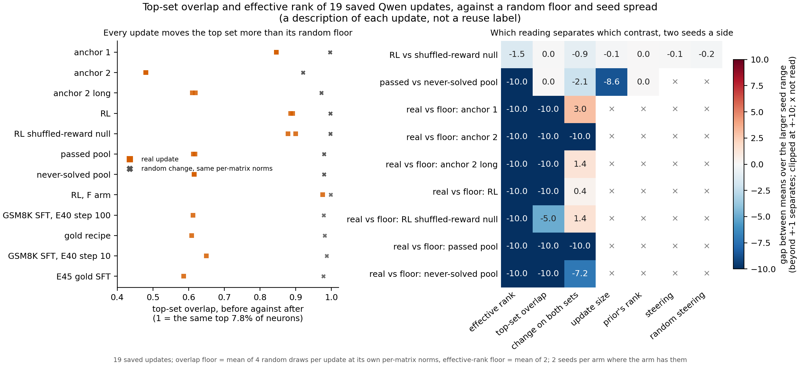

# On Qwen3-1.7B, do two cheap readings of a saved update tell RL from its null, or one maths pool from another?

*Cell P3.6, compare-lead, 2026-11-12. Experiments E162, run 1, and E166, run 2, cluster job 59473. Descriptive only:
one run each, no independent check, and no update here is labelled reuse or new. Plan
`reports/plans/2026-11-11_plan_qwen-cheap-readings.md`; rules `experiments/qwen_cheap_readings/results/predictions_run2.json`.*

We read 19 saved weight updates of Qwen3-1.7B with two readings that need no decomposition. One counts how many
directions an update spreads over; the other asks how many of the most strongly firing MLP neurons stay on top. Every update moves the
top-firing neurons far more than a random change of the same size does, and every update is far lower in rank than such a
change. Neither reading tells the RL run from its shuffled-reward null, so for `GOALS.md` these readings describe an update
without saying what it taught.

## The answer

Only the effective rank separates either contrast beyond seed spread. RL reads a lower effective rank than its
shuffled-reward null, by a gap of 1.5 times the seed range, a marginal call on two seeds a side. The pool the unchanged
model passed reads lower than the pool it never solved in 64 samples, on effective rank, on the share of the firing change
on neurons in both sets, and on update size. The top-set overlap separates neither contrast. Every update keeps fewer
top neurons than its random floor and spreads over fewer directions.

## What we were trying to test

Part 2 of the paper compares cheap readings of an update with the decomposition's readings. This cell asks whether two
cheap readings, applied to every saved Qwen update, can tell apart the arms that the project built to differ.

**The updates.** Nineteen saved updates. Fifteen come from the earlier instrument check.
Six are anchor fine-tunes, in three seeded pairs. Five are RL: two seeds of RL, two of the same RL with the reward
shuffled across answers, and one more RL arm. Four are supervised maths fine-tunes. Four come from the pass
pools: two seeds trained on maths problems the unchanged model passed, and two trained on problems it never solved in 64
samples, both read at step 100. Each update is read on the rows the steering comparison already used for its kind: anchor-1 rows, TOFU rows, or
GSM8K test answers.

**The readings.**

- The *effective rank* of a weight change is $\exp H(p)$ with $p_i = s_i / \sum_j s_j$ over its singular values $s$. It
  reads 1 for a rank-one change and $k$ for $k$ equal singular values. A state's value is the mean over its matrices,
  weighted by each matrix's share of the summed squares.
- The *top-set overlap* takes, at every answer position and in each of the 28 blocks, the 480 MLP neurons of largest
  absolute firing, which is 7.8% of the width. It is the Jaccard index of that set before and after the update, averaged
  over positions and blocks. It reads 1 when the same neurons stay on top and 0 when none do.
- The *change on both sets* is the share of the squared firing change that falls on neurons in both top sets. It reads 1
  when the change sits wholly on neurons that stayed on top.

Beside each update sit four columns from the earlier steering comparison: update size, the unchanged model's rank of the
first answer token, the steering share, and its random-direction control. That comparison had them for 11 updates. This run
filled size and rank for the other 8, and the steering columns for four of them; the pools have no steering reading.

**The floor.** For each update, a random Gaussian change with the update's own norm in every matrix. The overlap's floor
is the mean of four draws, as the user chose on 2026-11-12, after run 1's two draws missed their filed tolerance by about
two times. The effective rank's floor is the mean of run 1's two draws, which agreed.

**The contrasts.** RL against its shuffled-reward null asks whether a reading sees what a real reward adds. The passed pool
against the never-solved pool asks whether it sees the difference in what the model could already do. Real against floor
asks whether it sees anything beyond the update's size. Each uses the comparison's filed rule: a contrast counts when the
gap between the two sides' means is larger than the wider side's seed range, on two seeds a side.

## What we expected, and why

On the 67M model, real fine-tunes kept 0.34 to 0.69 of the top set, against 0.84 to 0.95 for random changes of the same
size. So we filed that more than half of the 19 would read below their own floor by more than the floor's band. We filed
the effective rank to separate both arm contrasts, from run 1's numbers, and expected the overlap's arm contrasts to be
unknown.

## What we observed

### Does any reading tell the arms apart beyond seed spread?

**Reading it.** Effective rank is the only reading that separates both arm contrasts, and the overlap separates neither.
On the left, every orange square sits left of its grey cross: each update keeps fewer top neurons than its random floor.
On the right, a cell beyond plus or minus 1 is a gap wider than the seed range. The top row is RL against its null: only
effective rank passes, at 1.5, and the overlap reads 0.03. The second row is the pool contrast: effective rank, the change
on both sets and update size pass, and the overlap reads 0.01. The rows below compare each pair with its floor. Effective
rank and overlap pass on all seven pairs. The change on both sets passes on six, three above the floor and three below.

**RL against its null.** Their overlaps match: 0.89 for both, against a floor of 0.997. RL's effective rank is 1,362
against the null's 1,381. That gap of 18 is just over the RL seeds' own range of 12. Update size, steering and its random
control all sit inside their seed spread.

**The two pools.** The passed pool and the never-solved pool both keep 0.62 of the top set, against floors of 0.979. The
passed pool reads a lower effective rank, 1,313 against 1,357. Its change on both sets is also lower, 0.849 against
0.861. Its update is smaller, 2.62e-3 against 2.76e-3 of the weights' norm. The two pools differ in size as well as in
which problems they trained on, so these gaps may follow the size difference; this run cannot tell.

**Real against floor.** Real overlaps run from 0.48 to 0.98, and their floors from 0.92 to 0.998. Each real overlap sits
5.5 to 41 floor distances below its floor, where one floor distance is the floor's own gap from 1. The band a real update
must clear is 0.049 floor distances, the spread of four draws. Real effective ranks run from 1,058 to 1,443, against
floors of 1,812 to 1,825. A trained update is never as spread out as Gaussian noise, so this contrast was expected to pass
and adds little.

### Every update, read

| update | rows | overlap | its floor | change on both | its floor | effective rank | its floor | update size |
|---|---|---|---|---|---|---|---|---|
| `a1_s0` | a1 | 0.846 | 0.996 | 0.903 | 0.897 | 1101 | 1816 | 3.71e-04 |
| `a1_s1` | a1 | 0.846 | 0.996 | 0.901 | 0.897 | 1102 | 1816 | 3.73e-04 |
| `a2_s42` | tofu | 0.481 | 0.920 | 0.738 | 0.852 | 1430 | 1812 | 1.38e-02 |
| `a2_s142` | tofu | 0.480 | 0.920 | 0.740 | 0.852 | 1431 | 1812 | 1.38e-02 |
| `a2long_s0` | tofu | 0.610 | 0.972 | 0.876 | 0.867 | 1066 | 1824 | 3.93e-03 |
| `a2long_s1` | tofu | 0.619 | 0.972 | 0.887 | 0.867 | 1058 | 1825 | 3.89e-03 |
| `R_s0` | gold | 0.891 | 0.997 | 0.901 | 0.904 | 1368 | 1813 | 2.68e-04 |
| `R_s70` | gold | 0.885 | 0.997 | 0.932 | 0.904 | 1356 | 1812 | 2.65e-04 |
| `N_s0` | gold | 0.878 | 0.997 | 0.930 | 0.904 | 1375 | 1817 | 2.82e-04 |
| `N_s70` | gold | 0.900 | 0.997 | 0.958 | 0.905 | 1386 | 1813 | 2.56e-04 |
| `known_s0` | gold | 0.613 | 0.979 | 0.848 | 0.899 | 1315 | 1823 | 2.63e-03 |
| `known_s1` | gold | 0.618 | 0.979 | 0.850 | 0.899 | 1311 | 1823 | 2.62e-03 |
| `new_s0` | gold | 0.616 | 0.979 | 0.863 | 0.899 | 1357 | 1824 | 2.76e-03 |
| `new_s1` | gold | 0.615 | 0.979 | 0.858 | 0.899 | 1357 | 1823 | 2.77e-03 |
| `F_s0` | gold | 0.976 | 0.998 | 0.939 | 0.906 | 1443 | 1823 | 2.09e-04 |
| `u1` | gold | 0.613 | 0.979 | 0.930 | 0.899 | 1330 | 1822 | 2.58e-03 |
| `u2` | gold | 0.608 | 0.981 | 0.920 | 0.899 | 1307 | 1817 | 2.18e-03 |
| `e40` | gold | 0.650 | 0.987 | 0.950 | 0.901 | 1249 | 1815 | 1.42e-03 |
| `gold_s0` | gold | 0.586 | 0.977 | 0.925 | 0.898 | 1255 | 1816 | 2.59e-03 |

`R_` is RL, `N_` its shuffled-reward null, `F_s0` the extra RL arm, `known_` the passed pool and `new_` the never-solved
pool. `u1` and `e40` are the GSM8K fine-tune at steps 100 and 10, `u2` the gold recipe, `gold_s0` the second gold
fine-tune. Update size is the update's norm over the weights' norm. The steering columns are in
`experiments/qwen_cheap_readings/results/run2_stage3.json`.

## What we learned

At Qwen scale, as on the 67M, a real update moves the top-firing neurons more than a random change of matched
per-matrix size. The 67M's fine-tunes kept 0.34 to 0.69 of the top set against 0.84 to 0.95 random. Qwen's
supervised updates keep about 0.6 against about 0.98. The overlap is a description, not evidence of reuse: on the 67M the
check that a high overlap means the same neurons firing harder failed. It also does not see the reward: RL and its
shuffled null move the top set alike. The effective rank sees a small RL gap and a pool gap, so of the two it is the
only one that tells these arms apart at all.

## How compelling is the evidence

- Two seeds a side. The rule counts a gap over the wider seed range; that describes these seeds and is not a test.
- RL against its null passes on effective rank by a gap of 1.5 seed ranges. A third seed could undo it.
- The pools differ in size, by about 5%, and in which problems they hold. Their gaps on effective rank and the change on
  both sets may follow the size; no size-matched pool contrast was read.
- The overlap's band is 0.049 floor distances, under the stop at 0.33. Three of the 19 floors, all on TOFU rows, spread
  wider than the band. Their real updates sit far below them, so the call does not rest on those floors.
- Controls held: the unchanged model read an overlap of exactly 1, and the earlier steering comparison's columns
  reproduced to the last digit.
- The overlap is read only on each update's comparison rows. The pools are read on GSM8K test answers, not their own
  training problems.

## Surprises

None reverses a filed prediction. The overlap's call came out as filed: all 19 read below their floor. The change on both
sets was filed to read below the floor for most; it reads above for 7, at for 6, below for 6.

## What next

- Read the pools' overlap and effective rank on their own training problems. If the pool gaps grow there, the reading
  sees what was trained; if they vanish, the gaps here follow size.
- A third RL and null seed would settle whether the effective-rank gap of 1.5 seed ranges holds.

## Scorecard

| id | claim in words | rule | read | verdict |
|---|---|---|---|---|
| C0 | the unchanged model reads overlap 1 | exact | overlap 1, the steering comparison exact | holds |
| C2 | the four-draw floor band is readable and under 0.33 | spread of four draws over room | 0.049 | holds |
| R2 | more than half of the 19 read below their overlap floor | below by more than band times room | 19 of 19 below | rival A, as filed |
| R3 | most read below their floor on the change on both sets | band 0.026 times the floor | 6 below, 6 at, 7 above | not as expected; recorded, no call |
| R4 | RL against null, by reading | gap over the wider seed range | effective rank only | effective rank as filed |
| R4 | passed pool against never-solved pool | same | effective rank, change on both sets, size | as filed where filed |
| R4 | real against floor, seven pairs | same | effective rank and overlap on all 7; change on both on 6 | as filed on effective rank and overlap |

## Departures from the literature

- The top set follows the 67M's reading: neurons ranked by absolute firing, where Goodfire's neurons-as-a-basis reading
  ranks by activation, so negative outputs count by their size too. The cut keeps the 67M's share of the width.
- The effective rank is Roy and Vetterli's, averaged over matrices by squared norm; each matrix's random floor
  depends only on its shape, and the update's norms set the weights.

## Not run

- The pools on their own training problems, and their steps 5 to 10.
- A size-matched pool contrast.
- A third seed of any arm.
- Any decomposition reading, and any reuse or new label on any Qwen update.
- The steering share and its random control on the pools.

Provenance: `experiments/qwen_cheap_readings/results/run1_stage{0,1,2}.json`, `run2_stage{0,1,2,3}.json`; figure
`experiments/qwen_cheap_readings/figures/run2.png`, drawn by `plot_run2.py`. Run 2 ran on a cluster L40, debug QoS, $0.
