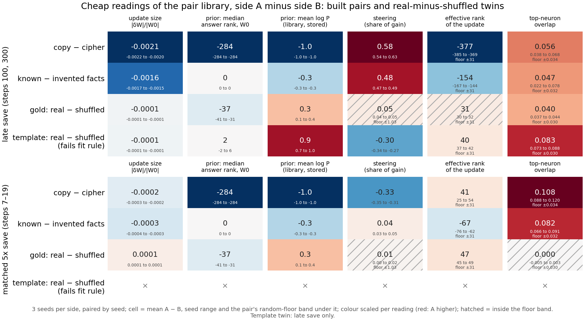

# Do the cheap readings tell the two sides of a Qwen pair apart, beyond update size?

We read five cheap measurements on every saved Qwen3-1.7B fine-tune in the pair library and plotted side A minus side B
against what random weight changes read. Top-neuron overlap and effective rank put several pairs outside their random
bands, but wherever the overlap did so side A was also the smaller weight change. For `GOALS.md` this describes the
library and answers nothing yet: no gap here can be told apart from update size, and no update is labelled.

## What was read

Four pairs, each side A minus side B, three seeds paired. Each built pair trains the same inputs to two targets. Copy
returns a word after a cue, and cipher returns it through a fixed letter substitution. Known and invented facts answer
the same kind of question about real and invented people. The two twins are real minus shuffled: gold maths
solutions, and an answer template, each trained once with its real answers and once with answers moved between prompts.
Each pair is read at two saves. The late save is step 300 for the built pairs and step 100 for the twins. The matched
save is the first step at which the update's output change reached five times the decomposition's masked error: steps
7 to 19. The template twin has no matched save.

- **Update size**: $\lVert\delta W\rVert / \lVert W_0\rVert$ over all 196 matrices.
- **Prior**: the unchanged model's median rank of each answer's first token on the side's rows, and beside it the
  library's stored mean log P per answer token under the training prompt.
- **Steering**: add to the unchanged model one vector, the update's mean shift of one block's input. The reading is the
  fraction of the update's log-probability gain on held-out rows this recovers; 1 means all of it.
- **Effective rank** of $\delta W$: Roy and Vetterli's, per matrix, averaged with weights $\lVert\delta W_m\rVert^2$.
- **Top-neuron overlap**: the fraction of the 480 of 6,144 MLP neurons per block that fire hardest at answer positions
  and are still in that top set after the update. 1 means unchanged.

The **random floor band** of a reading is what random changes read at the library's smallest and largest weight change,
$\lVert\delta W\rVert$ of 0.173 and 5.09, on both sides' rows. It is the largest gap between the two sides' floor means
plus the largest spread between draws. A cell is hatched when its mean gap lies inside the band.

**Reading it.** Several gaps lie outside their random bands, and update size could account for most of them. Top-neuron
overlap is higher on side A beyond its band on copy minus cipher at both saves, on the facts pair at the matched save,
and on both twins at the late save. The facts pair at the late save is mixed, one seed of three inside the band, and gold
at the matched save reads about 0. In every cell where the overlap gap passed its band, side A was also the smaller
weight change. The band is narrow by construction. Across the library's whole size range, a random change's overlap falls
only from about 0.998 to 0.97. Its effective rank rises only from about 1,812 to 1,844. Real updates move much
further with size: copy's own overlap falls from 0.77 at the matched save to 0.48 at the late one. So a real gap of a
few hundredths between updates of different size is not ruled out as size. And the sizes differ a lot. At the late save
cipher's and invented facts' weight changes are 2.0 to 2.4 times copy's and known facts'. The matched save matches
output change, not weight change, and there cipher's weight change is still 2.3 to 2.9 times copy's. Effective rank is
lower on side A at the late save on both built pairs, again the smaller side, by far more than its band of 31. Its sign
is not tied to size across pairs, though: the template twin's smaller real side reads higher, and copy minus cipher
turns positive at the matched save. Steering reads very differently between the two saves on copy minus cipher, +0.58
late and −0.33 matched, with no band to judge either. The two prior columns disagree in sign on copy minus cipher. The
unchanged model ranks copy's first answer token top, against a median rank of 285 for cipher, while the stored mean log P
is lower for copy by 1.0. On the rows read here its mean log P per answer token favours copy, −2.9 against −9.2, so the
disagreement is with the stored value, read under the training prompt on the trained items.

## Controls

- **Do-nothing**, first and alone on each of the four pairs. A zero update through the same path read overlap 1
  exactly, size 0 and no change in log P, with no steering layer and no effective rank.
- **Random floor bands**: overlap 0.030 to 0.034, effective rank 31 on every pair. Steering is unreadable on the built
  pairs and the template twin, because some random draws gained too little for the fraction to be defined. On gold it is
  ±1.03, as wide as the fraction's whole range, so gold's steering gaps say nothing.
- **State integrity**: every one of the 42 states matched the library's recorded sha256 and $\lVert\delta W\rVert$.

## Departures from the literature

- Top-neuron overlap ranks neurons by absolute firing, where Goodfire's neurons-as-a-basis reading ranks by activation,
  so large negative outputs count too.
- Effective rank is Roy and Vetterli's per matrix, averaged over matrices by squared norm.
- The steering vector is the update's own mean shift of a block's input, added unscaled at the layer that recovers most
  on half the rows and scored on the other half. Activation-steering work builds its vector from contrasting prompts and
  tunes a scale.
- The random floor band is this project's; it has no outside source.

## Not run

- The 15x saves.
- The template twin's matched save: neither side reached 5x in 100 steps.
- Floors on each seed's shuffled rows: seed 0's shuffled rows stand in for all three seeds.
- Any decomposition reading, and any reuse or new label.
- Run 2 of the cell: unused.

Provenance: `experiments/qwen_library_readings/results/<pair>/stage{0,1,2}.json`, `results/scorecard.json`, figure drawn
by `plot.py`. Three pods in parallel, about 70 to 80 min each: RunPod H100 for copy and cipher, Vast H100 for the twins,
Vast A100 for the facts pair.
