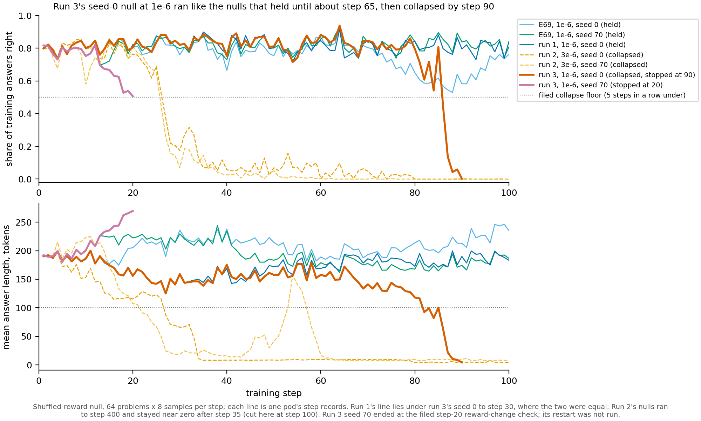

# Does reinforcement learning on Qwen3-1.7B beat a working shuffled-reward null at a size the decomposition can see?

*E178, cell P3.4, run 3 of 3, closing the cell. Provisional: no independent check. Figure: `experiments/qwen_rl_readable/figures/run3.png`.*

We trained only the shuffled-reward null, at the lower rate where earlier nulls had held, to stop each seed where its
output change matched reinforcement learning's saved state. The seed 0 null collapsed at step 90, short of that size,
and the seed 70 null was stopped at step 20 by a filed check on its falling reward. So the cell closes with no
comparison of reinforcement learning against a working null at a readable size, and part 3's behaviour question stays
open on Qwen.

## The answer

At its twice-the-error size, reinforcement learning raised Qwen3-1.7B's held-out maths pass rate from 0.78 to 0.88 on
both seeds, but that gain was never set against a working shuffled-reward null. The null collapsed at both rates
tried. At the higher rate it collapsed on both seeds within about 30 steps; at the lower rate seed 0 collapsed at step
90 and seed 70 was already falling by step 20. The filed verdict is "no call". Every update read sits outside the decomposition's
subcomponents as much as a random change does.

## What we were trying to test

Part 3 of the paper reads reinforcement-learning updates on the decomposition of Qwen3-1.7B. The cell asks first about
behaviour: at a size the decomposition can see, does reinforcement learning improve held-out maths by more than the
same training loop with the reward made meaningless?

The **output change** is the KL divergence from the unchanged model W0 to the trained model, in nats per token, over
every position of 128 maths rows of length 256; it reads 0 at W0. The **masked error** is what the decomposition alone
changes on the same rows, 0.0932 nats per token. Their ratio is the **multiple**: 1 means the update moves the output
as much as the decomposition's own error, so the cell wants updates at 2, 5 and 10.

The **shuffled-reward null** is E69's loop with each problem's rewards shuffled among its 8 sampled answers. It keeps
everything about the update except the link between reward and correctness, so it rules out that any update of this
kind, trained on the model's own answers, moves the pass rate as much.

Run 2 had already trained reinforcement learning at peak rate 3e-6 and saved it at step 75, at 2.09 times the error on
seed 0 and 3.06 on seed 70. Its null at the same rate collapsed. Run 3 trained only the null, with E69's recipe at peak
1e-6, where three nulls had held for 100 steps, on seeds 0 and 70. Each pod read the multiple every 5 steps and was to
stop at the first read at or above its seed's target, save the update there, and set its held-out pass rate against
reinforcement learning's. Two filed stops guarded it: a **collapse stop**, five steps in a row each with under half the
training answers right or a mean answer under 100 tokens, and an **early check** that the mean training reward of steps
11-20 was not more than 0.05 below that of steps 1-10.

## What we expected, and why

- **No collapse, with medium confidence.** At 1e-6 the three earlier nulls never fell below 0.53 of answers right or
  125 tokens in 100 steps. The risk was named: run 2's nulls collapsed at an update norm near 0.5, which this null was
  expected to reach near step 190.
- **Matched between steps 150 and 400 on seed 0, and 200 to 500 on seed 70.** Low confidence: no null had run past step
  100 at this rate.
- **Verdict "together", low confidence.** E69's two working nulls differed by 0.076 between seeds, more than the gaps
  reinforcement learning had over them.

## What we observed

### Did the null hold at the lower rate?

**Reading it.** No. On seed 0 the null ran with the nulls that held, the dark blue and green lines, until about step
65. Its answers then shortened from about 170 tokens to 4, and the share of answers right fell from 0.86 at step 79 to
0.002 at step 90. The collapse stop fired at step 90, when its multiple was 0.82 against a target of 2.09, so no state
was saved. On seed 70 the share right fell from 0.82 to 0.51 by step 20 while answers lengthened from 192 to 270
tokens. The filed early check stopped it there, with a change of −0.140 against a floor of −0.05; E69's null on the
same seed read −0.0096. The user overrode that stop, but the pod was lost to the idle watchdog, and its restart was
stopped by the lead before it ran, since the verdict needs both seeds. The collapse at 1e-6 came at an update norm
near 0.33, against about 0.5 for the two nulls at 3e-6.

One caveat sits in the light blue line: E69's own seed-0 null also lost answers right from step 75, to 0.53 at step 88,
before recovering to about 0.76 by step 100. Its answers stayed near 200 tokens throughout.

### Where did the seed 0 null part from the runs that held?

**Reading it.** It sampled the same answers as E69's seed-0 null for 12 steps and as run 1's null for 30. Each pod
draws its own answers, so the runs repeat each other only while their weights agree closely enough to sample the same
tokens.

| compared with | reward and length equal through step | update norm, relative difference at the last equal step | first step that differs |
|---|---|---|---|
| E69's null, seed 0 | 12 | 1.1e-6 | 13: mean length 190.4 tokens against E69's 191.4 |
| run 1's null, seed 0, H200 | 30 | 2.2e-7 | 31: share right 0.826 against run 1's 0.822 |
| E69's null, seed 70, against run 3's seed 70 | 12 | 6.8e-7 | 13: update norm 0.33% higher |

After step 13 run 3 and run 1 both gave shorter answers than E69, about 150 tokens against 210. After step 31 run 3
and run 1 stayed within about 20 tokens of each other until step 65, when run 3's answers began to shorten. Run 1 stayed near 180 tokens;
run 3 fell below 100 at step 82.

The cause of the collapse was not checked. Hypotheses, all untested and none favoured:

- the loop has no length normalisation, so a reward unrelated to correctness may favour shorter answers once answers
  start to shorten;
- once correct answers become rare, the few problems with a mix of right and wrong answers dominate the update;
- the null at this rate sits near an edge where small sampling differences decide whether it drifts, so one of
  three seed-0 runs drifting would be chance.

### The filed verdict

**Reading it.** "No call", as the filed rule gives when a seed's null did not end matched. `read3.py --stage verdict`
ran with no new states and wrote `results/run3_reads/verdict.json`. Its seed 0 reason is "collapsed". Its seed 70
reason reads "running", because the stopped attempt's record is kept as `N_s70_stop1.json` and the rule looks for
`N_s70.json`; the pod in fact ended at the step-20 early check. Reinforcement learning's side was read in run 2: pass
0.882 and 0.884 at step 75. The controls read before the pods were in their bands: W0 at 0.782, and E69's saved
reinforcement-learning update at step 100 at 0.881.

## The cell, all three runs

| run | what it trained | what it found |
|---|---|---|
| 1, E163 | reinforcement learning at three rates, one null at 1e-6 | the middle rate reached between two and three times the error with pass held; the null held, pass 0.778 |
| 2, E167 | reinforcement learning, null and own-samples fine-tune at 3e-6, two seeds | reinforcement learning at 0.882 and 0.884 at twice the error; the null collapsed, pass 0.039 and 0.000 |
| 3, E178 | the null at 1e-6, two seeds, stopped at reinforcement learning's size | collapsed on seed 0 at step 90 below its target; seed 70 stopped at step 20 |

The outside share, the part of an update's squared norm the subcomponents cannot reach, was read in run 2 against a
random change of the same norms. All nine states read between 0.979 and 0.993 of the random change's share, so every
update sits outside the subcomponents as randomly as noise. Run 3 saved no state, so it adds no share reading.

## What we learned

A shuffled-reward null for GRPO on Qwen3-1.7B does not hold long enough to reach reinforcement learning's twice-the-error
size at either rate tried. At 3e-6 it collapsed within about 30 steps; at 1e-6 it collapsed on one seed near step 90
and fell fast on the other, while the three earlier runs at 1e-6 held to step 100, one of them dipping. So the
behaviour question cannot be answered with this null on this model. Reinforcement learning itself raised held-out pass
by about 0.1 over W0 at twice the error on both seeds. Nothing in the cell says whether that gain needs the reward to be correct.

## How compelling is the evidence

The collapse on seed 0 is clear: answers of 4 tokens and 0.2% right are no working model. That the null would not have
held on seed 70 is less sure: it was stopped at step 20 by a filed check on its reward and never reached the collapse
rule, so its later course is unknown. Repeats of one recipe and seed part once their sampled answers differ, from step
13 here, so one collapse in three seed-0 runs at 1e-6 gives no rate of collapse. The verdict needed both seeds and has
neither.

## Surprises

- **Something unexpected happened that I cannot explain: the null collapsed at the rate where it had held.** Expected,
  with medium confidence, no collapse on either seed. Seen: seed 0 collapsed at step 90, on the same recipe and seed as
  E69's and run 1's nulls, which held to step 100.
- **The seed 70 null's reward fell from step 13.** E69's null on the same seed held near 0.8 over the same steps.

## What next

1. Close the cell as read: no working null was found at a readable size. If the user wants the behaviour question
   answered on Qwen, it needs a new cell with a different null, not more runs of this one.
2. A null that cannot collapse the same way, such as one with length-normalised loss or a reward drawn at random per
   answer, would separate "reinforcement learning needs the reward" from "this null breaks". Its result would decide
   whether part 3 reports a behaviour-backed reinforcement-learning update.

## Scorecard

| id | claim in words | rule | read | verdict |
|---|---|---|---|---|
| verdict, lean | together | `match3.verdict` | no call: seed 0 collapsed, seed 70 stopped | no call |
| collapse | not fired on either seed | `match3.collapse_step` | fired on seed 0 at step 90; seed 70 stopped at step 20 before it could | miss |
| match step, seed 0 | between steps 150 and 400 | first 5-step read at or above 2.088 | never matched; 0.82 at step 90 | no call |
| match step, seed 70 | between 200 and 500 or not by the cap | at or above 3.057 | never matched; stopped at step 20 | no call |
| early, step-1 reward | in [0.6, 0.88] | `early.reward_step1` | 0.799 and 0.816 | held |
| early, first step size and output change | in E69's bands | `early.dw_ratio`, `kl_first` | in band on both seeds | held |
| early, reward change by step 20 | above −0.05 | `early.reward_change_above` | +0.0164 on seed 0, −0.140 on seed 70 | seed 0 held, seed 70 missed: stop |
| early, update norm at step 20 | in [0.5x, 2x] of E69's | `early.dw_norm_step20` | 0.1332 on seed 0; seed 70 not checked after its stop | held on seed 0 |
| early, seed 0 multiple at step 100 | in [0.5825, 1.0489] | `early.multiple_step100_s0` | never reached step 100 | no call |
| logged, steps 1-5 equal E69's | reward and length equal, update norm within 0.1% | `early.steps_1_5` | equal on both seeds | held |
| controls | W0 and E69's step-100 update in their bands | `controls` | 0.782 and 0.881 | held |
| null held above 0.7597 | reported beside the verdict | `verdict.null_held_floor` | no state read | not read |

## Departures from the plan and the literature

- **The seed 70 early-check stop was waived by the user** after it fired; `run3.py` gained `--waive-reward-change` so
  a restart logs that check instead of stopping (decisions.md 2026-11-13, "E178 seed 70 step-20 stop overridden").
- **The restart of seed 70 did not run.** The pod with the override was lost to the idle watchdog, and the lead stopped
  the restart once seed 0 collapsed, since the filed verdict needs both seeds.
- **Seed 0 was restarted once.** Its first attempt ran out of GPU memory at step 11 and was restarted from step 1 with
  PyTorch's `expandable_segments` allocator setting. Its first 5 steps still equal E69's, so the setting changed no number
  we can see.
- **Seed 70 ran on an H200**, seed 0 on an H100, as the plan allowed.
- From the literature: none new in this run. The loop is E69's GRPO recipe unchanged.

## Not run

- The seed 70 null past step 20, with or without the waiver.
- Any L40 read of a run-3 state, its held-out pass, its outside share or its norms: none was saved.
- The matched-size verdict, and the check of the null's pass against W0's band.
- Any test of the collapse hypotheses above.
- A third seed, another rate, or another null.
- Five and ten times the error against any null.

## Provenance

- Run 3 pods: `experiments/qwen_rl_readable/results/run3/N_s0.{json,log}`, an H100 with 1.31 h of training and
  reads; `N_s70_stop1.{json,log}`, an H200.
- Earlier nulls. E69: `experiments/qwen_rl/results/lr1e-6w10/N.json`, `lr1e-6w10_s70/N.json`. Run 1:
  `experiments/qwen_rl_readable/results/N.json`. Run 2: `results/run2/N_s0.json`, `N_s70.json`.
- Controls: `results/run3_reads/controls.json`. Verdict: `results/run3_reads/verdict.json`.
- Rules: `results/predictions_run3.json`. Plan: `reports/plans/2026-11-13_plan_qwen-rl-readable-run3.md` and its
  gates appendix. Figure: `experiments/qwen_rl_readable/plot3.py`.
