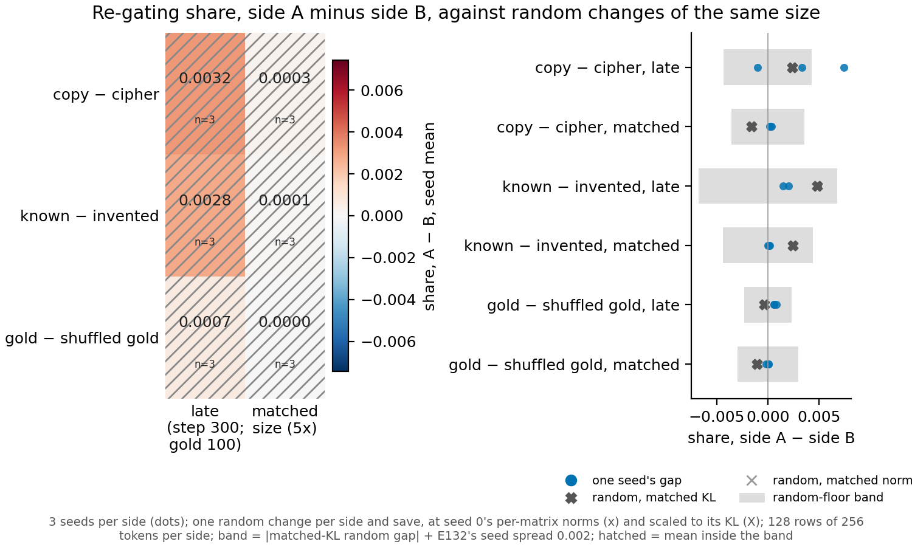

# P3.8: does the re-gating share tell the two sides of a pair apart on Qwen3-1.7B?

On Qwen3-1.7B's decomposition p-9707d6ff we read the re-gating share of every fine-tuned update in the pair
library, three seeds per side, at the late save and at the save matched in size. Every update, and every random
change of the same size, reads a share within about one percent of its ceiling, so no pair's two sides differ by
more than random changes do. On this decomposition the share is saturated and says nothing about which side of a
pair reuses existing parts; this is a description, with no reuse or new label.

## What was measured

The re-gating share asks how much of a fine-tune's effect on the model's outputs is recovered by keeping the
original subcomponents and changing only which of them are switched on: 1 means all of it, 0 none. It was read for
three pairs of fine-tunes (copy against a cipher, known facts against invented facts, gold answers against
shuffled gold answers), each side with three seeds, on the rows the side was trained on. Two saves were read: the
late one (step 300, step 100 for the gold twin) and the one where the update is five times its size floor, agreed
with compare-lead's P3.7. Before any of these, a random change of each side's per-matrix sizes was read alone, and
one scaled to the side's own output change; that second one sets the band: a gap inside it is no larger than what
random changes of that size give.

**Reading it.** Every side reads a share between 0.990 and 0.9998, and the random changes scaled to the same
output change read 0.992 to 1.009. The largest gap, side A minus side B, is 0.0032 (seed mean, copy minus cipher,
late save), and all six cells sit inside their random band. The share cannot separate these pairs here because a
random direction already reaches it: on this decomposition almost any change is recovered by switching the
original subcomponents on and off.

## How compelling it is

The band rests on one random draw per side and save, plus E132's seed spread. The random changes matched on
per-matrix size are unscored, as filed, and read 0.95 to 1.83. The share is blind to anything the masks can
absorb, which here is nearly everything; P3.9 reads the same pairs on the frozen-neuron decomposition, where a
random change does not saturate.

## Not run

- No second random draw per side and save.
- The reading was not repeated on the RL updates.
- No reading on attention-only or MLP-only sites on p-9707d6ff.
