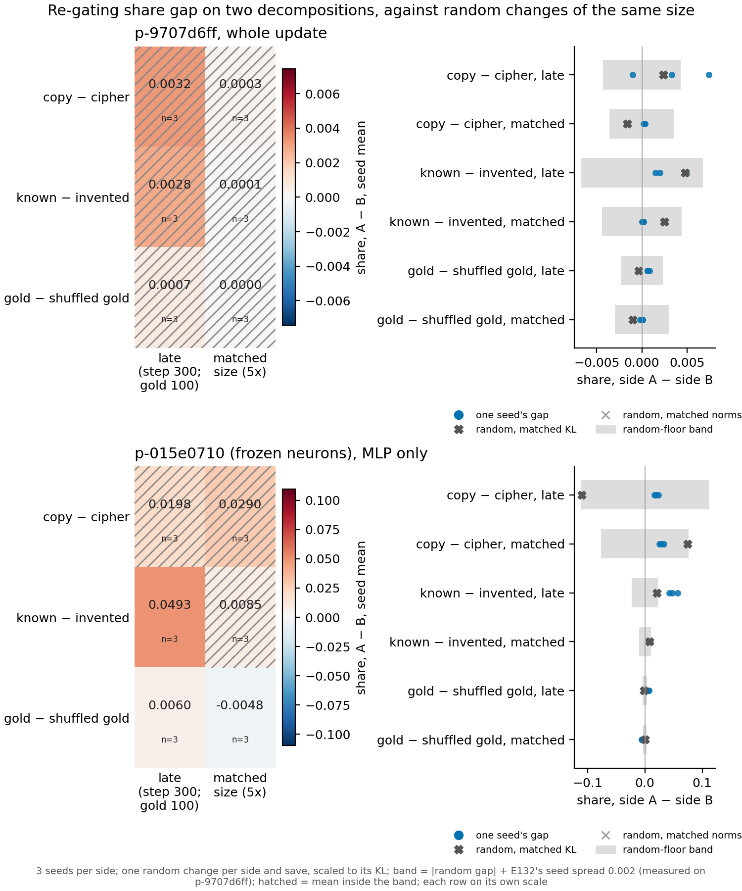

# P3.9: does the frozen-neuron decomposition tell the two sides of a pair apart where the other one could not?

We read the re-gating share of the same fine-tuned updates of Qwen3-1.7B as in P3.8, three seeds per side, on a
second decomposition whose subcomponents are fixed at the MLP neurons. On it the shares no longer sit at the
ceiling, and three of the six pair cells leave their random band, against none on the first decomposition. But the
gold answers against the shuffled gold answers, a pair meant to differ only in what the labels say, is one of the
three, so the band set from one random draw is too narrow here, and no pair can yet be said to differ.

## What was measured

The re-gating share asks how much of a fine-tune's effect on the outputs is recovered by keeping the original
subcomponents and changing only which are switched on: 1 means all of it. P3.8 read it on p-9707d6ff and found it
saturated, with real updates and random changes alike near 1. Here the same updates were read on `p-015e0710`, where
subcomponents are frozen at the MLP neurons and only the function deciding which are on was trained. The update and
the random change are restricted to the MLP matrices, because this decomposition covers nothing else; P3.8 read the
whole update, so the two rows of the figure differ in what is read as well as in the decomposition. As in P3.8, each
side and save got one random change scaled to its own output change, and the band is that random gap plus a seed
spread measured on the first decomposition.

**Reading it.** On the frozen-neuron decomposition the sides read shares from 0.921 to 0.995 and the random changes
0.81 to 1.06, so the reading is no longer pinned at the ceiling. Known minus invented facts at the late save reads
0.0493 against a band of 0.0231, and the gold pair reads beyond its band at both saves: 0.0060 at the late save and
-0.0048 at the matched one, against bands of 0.0035 and 0.0027. The gold pair's gaps change sign between saves and
the pair was built as a near-null, so the band is too narrow on this decomposition; copy minus cipher sits well
inside a band of 0.11 at the late save. The frozen-neuron decomposition reads more cells outside the band, but the
band, not the pairs, is the likeliest reason.

## How compelling it is

Each band rests on one random draw per side and save, and its seed spread was measured on the other decomposition,
a departure filed before the run. A spread measured on this decomposition, or several random draws per side, would
be needed before any cell here is read as a difference. The 36 library states and the 12 random changes all passed
their controls.

## Not run

- No second random draw per side and save on `p-015e0710`.
- No seed spread measured on `p-015e0710`.
- No MLP-only reading on p-9707d6ff, which would separate the change of decomposition from the change of sites.
