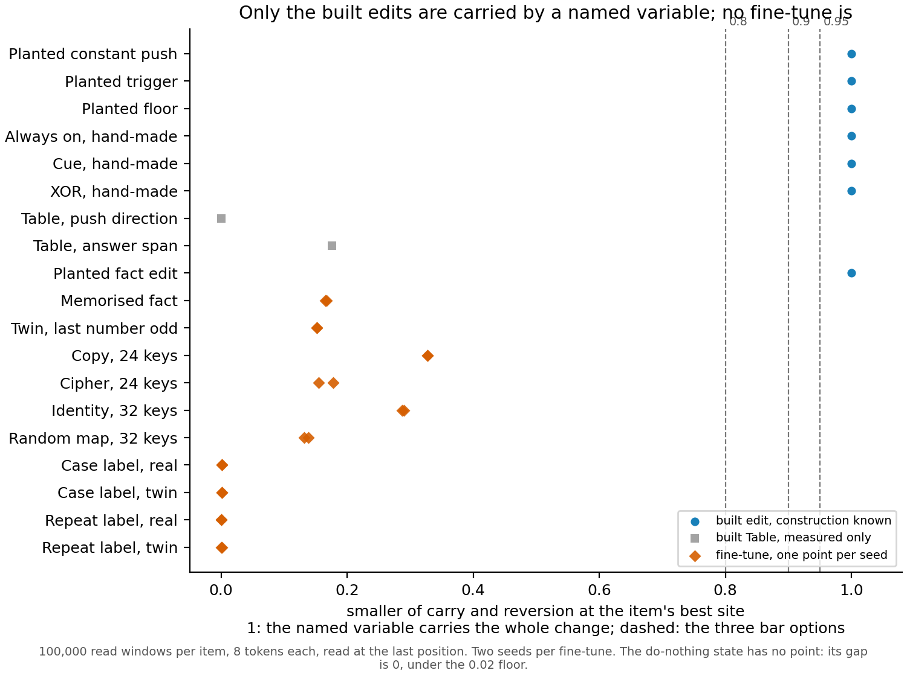

# Does the third wording of reuse give a reading once it is measured?

*2026-11-13, definition-lead, cell P1.19. Four debug jobs on the cluster, no training, $0. The third wording is for
testing only and is not adopted: every grade on this page is **under the third wording, provisional (testing only, not
adopted)**, and `decisions.md` is unchanged. Plan `reports/plans/2026-11-12_plan_soft-intervention-wording.md` and its
appendix; filed rules `experiments/soft_intervention/results/predictions.json`; the zero-run page that read the same
wording by argument is `reports/analyses/2026-11-12_analysis_third-wording-no-reading.md`.*

We measured the third wording of reuse, for testing only and not adopted, on hand-built edits, the memorised fact and
its twin, and eight old matched pairs. Every built edit read as it was built, but no fine-tune at either seed had a
named variable that carried even two thirds of its change. So, with variables named by hand, the wording reads built
edits correctly and gives no reused-or-new verdict on any fine-tune tried.

## The answer

The measurement works: each hand-built edit came back with the grade it was built to have, at all three bar options.
It found nothing to grade on real fine-tunes. On all twenty, swapping the named variable's value closed at most two
thirds of the change one way and a third the other, against a bar of 0.8 or more.
So the wording, measured this way, says "no carrying variable among the named ones" for the memorised fact, its twin
and every old pair. The reuse side of each pair did track its named trigger more closely, but that is description, not
a grade.

## Terms

- $M$ is the plain 67M model; $F$ is an edit written into it or a fine-tune of it.
- $V$ is a named variable: a direction, or a span of directions, at one site of $M$, fixed on $M$ before any $F$ is read.
- The **gap** is the mean total variation between $F$'s and $M$'s next-token distributions at the last position.
- **Carry** $c = 1 - \overline{TV}(M[V \leftarrow V_F], F)/\text{gap}$: the share of the gap closed when $M$ is given $F$'s
  value of $V$. 1 means $V$ alone carries the change; 0 means it carries none of it.
- **Reversion** $r = 1 - \overline{TV}(F[V \leftarrow V_M], M)/\text{gap}$: the share closed when $F$ is given $M$'s value.
- $\Delta = V_F - V_M$, the change in the variable, window by window. A **fit share** is $1 - \text{SSE}/\text{SS}$ for a
  least-squares fit of $\Delta$ on held-out windows: from $V_M$ alone ("own value"), plus one named trigger ("one-variable
  class"), or plus a table of the task token ("per-token class"). 1 means the class explains all of $\Delta$.
- **Trigger interchange** $i$: in both models, give a window the trigger value of a window from the other trigger class
  and see how far $\Delta$ moves, as a share of what the fitted one-variable equation predicts. 1 means $F$ reads $M$'s
  own trigger; 0 means it ignores it.

The grade at a bar is: no reading if the gap is under 0.02; "no carrying variable among the named ones" if the smaller
of carry and reversion is under the bar at every site; then pure re-setting if $\Delta$ is constant or the own-value
share passes; an old unit with a new trigger if a class's share passes, with the interchange too for the one-variable
class; else new computation. Bars are read at three options, 0.8, 0.9 and 0.95, which the user chooses between.

## What was tested

The third wording says a fine-tune reuses a variable of the original when it is the original with only that variable's
rule changed, checked by interchange interventions through an alignment fixed on the original. We named each item's
variable by hand from its task and read it at a few sites.

- **Built edits**, where the right grade is known. A constant push along a fixed direction, a push gated by the parity
  of the last number, a push gated by a random bit per ordered pair of numbers as the floor, the hand-made Always on,
  Cue and XOR edits, and E168's planted fact edit. The variable is the push direction at blocks 2 and 3. The Table edit
  was read too but is measured only, by the user's choice before its run, since its write is full rank and no 32-key
  variable can hold it.
- **The memorised fact and its twin**, two seeds each: fine-tunes that learned a one-bit fact about each number token,
  and the same push driven by the last number's parity. The variable is the same push direction; the twin's named
  trigger is the original's own parity direction.
- **Old matched pairs**, two seeds a side: copy against cipher at 24 keys, identity against a random map at 32 keys, a
  case label against its twin, and a repeat label against its twin. For the key tables the variable is the span of the
  answer tokens' output rows at the last layer. For the case and repeat pairs it is one direction there, from one label
  token's output row to the other's.

The do-nothing state, a copy of $M$, checks that loading is the identity. The planted floor is the null of the fits: an
option it passes would be void.

## What we expected

The built edits should read as built, with carry and reversion within 0.001 of 1 at the write site. The filed note for
the fact and twin said they would likely have no carrying variable, because the second wording's best one-site variable
had closed at most 0.37 and 0.47 of their gaps. The card's comparison was the twin's interchange: at least 0.5 on both
seeds if the twin reads the original's parity, under 0.5 if it memorised a table. It could be read only where the
twin's one-variable share reached the lowest bar.

## Every built edit read as it was built

| Built edit | Carry and reversion at block 2's input | Own value | Plus trigger | Plus per-token table | Interchange | Grade at 0.8 / 0.9 / 0.95 |
|---|---|---|---|---|---|---|
| Do-nothing copy | gap 0, not read | | | | | no reading at every bar |
| Constant push | 1.0000, 1.0000 | the change is constant | | | not readable | pure re-setting at every bar |
| Push gated by parity | 1.0000, 1.0000 | 0.007 | 1.000 | 1.000 | 1.000 | new trigger, one-variable class, at every bar |
| Floor, random bit per pair | 1.0000, 1.0000 | 0.004 | 0.004 | 0.18 | 0.000 | new computation at every bar |
| Always on | 1.0000, 1.0000 | the change is constant | | | no pairs | pure re-setting at every bar |
| Cue | 1.0000, 1.0000 | 0.002 | 1.000 | 0.9996 | 1.000 | new trigger, one-variable class, at every bar |
| XOR | 1.0000, 1.0000 | about 0 | about 0 | about 0 | no pairs | new computation at every bar |
| Planted fact edit | 1.0000, 1.0000 | 0.05 | 0.08 | 0.87 | 1.36, not readable | new trigger, per-token class / new computation / new computation |
| Table, push direction, measured only | best at block 3's input: 3.0e-4, 5.7e-4 | 0.18 | 0.19 | 0.57 | | no carrying variable at every bar |
| Table, answer span, measured only | last layer: 0.66, 0.18 | 0.18 | 0.19 | 0.82 | | no carrying variable at every bar |

**Reading it.** Every built edit that the stop rule covers read its constructed grade at all three bars, so the
apparatus can tell a re-setting, a new trigger and a new computation apart when the variable is right. Carry and
reversion were within 2e-5 of 1 at the write site, under the 0.001 tolerance. The floor's fit shares stayed at 0.004
and 0.18, under every bar, so no bar option is void. The planted fact edit's grade depends on the bar: its per-token
share of 0.87 passes 0.8 only. The Table, which is measured only, read "no carrying variable" under both alignments. Its
filed expectation of a per-token new trigger under the answer span was missed, because reversion there was 0.18.

## No fine-tune is carried by a named variable

| Fine-tune | Best site | Carry, seeds 0 and 1 | Reversion, seeds 0 and 1 | Grade at 0.8, 0.9 and 0.95 |
|---|---|---|---|---|
| Memorised fact | in3 | 0.16, 0.17 | 0.17, 0.17 | no carrying variable among the named ones |
| Twin, last number odd | in3 | 0.16, 0.16 | 0.15, 0.15 | no carrying variable among the named ones |
| Copy, 24 keys | final | 0.62, 0.63 | 0.33, 0.33 | no carrying variable among the named ones |
| Cipher, 24 keys | final | 0.18, 0.15 | 0.18, 0.17 | no carrying variable among the named ones |
| Identity, 32 keys | final | 0.63, 0.63 | 0.29, 0.29 | no carrying variable among the named ones |
| Random map, 32 keys | final | 0.22, 0.23 | 0.14, 0.13 | no carrying variable among the named ones |
| Case label, real | final | 1.6e-3, 1.6e-3 | 0.02, 2.6e-3 | no carrying variable among the named ones |
| Case label, twin | final | 3.1e-3, 1.1e-3 | 9.9e-4, 1.5e-3 | no carrying variable among the named ones |
| Repeat label, real | final | 4.4e-4, 2.6e-4 | 7.2e-4, 7.0e-4 | no carrying variable among the named ones |
| Repeat label, twin | final | 6.7e-4, 1.2e-3 | 8.1e-4, 1.8e-3 | no carrying variable among the named ones |

All grades in this table are under the third wording, provisional (testing only, not adopted). Site `in3` is block 3's
input; `final` is the last layer, the input to the unembedding after the final layer norm.

**Reading it.** No fine-tune has a named variable that carries its change, at any bar and on either seed. The built edits
sit at 1 on the figure and every fine-tune sits at 0.33 or below. The fact and twin, read along the push direction, close
about a sixth of the gap both ways. The key tables, read on their whole answer span, carry up to 0.63 one way but at
most 0.33 the other. The case and repeat pairs carry almost nothing, under 0.02. The section on the case and repeat
pairs below says why, from the code: a property of the variable the plan named, not a code error.

## The reuse side tracks its named trigger more closely, as description only

| Fine-tune | Own value alone | Plus the one named trigger | Trigger's added share | Plus a per-token table | Trigger interchange |
|---|---|---|---|---|---|
| Memorised fact | 3.7e-3, 3.7e-3 | 5.8e-3, 5.9e-3 | 2.1e-3, 2.2e-3 | 0.97, 0.97 | 1.06, 1.08 |
| Twin, last number odd | 5.8e-3, 5.3e-3 | 0.75, 0.75 | 0.75, 0.75 | 0.97, 0.97 | 0.38, 0.37 |
| Copy, 24 keys | 0.21, 0.22 | 0.56, 0.58 | 0.35, 0.37 | 0.76, 0.76 | not applicable |
| Cipher, 24 keys | 0.32, 0.32 | 0.32, 0.32 | 5.0e-4, 4.6e-5 | 0.67, 0.64 | not applicable |
| Identity, 32 keys | 0.27, 0.27 | 0.60, 0.59 | 0.33, 0.32 | 0.74, 0.73 | not applicable |
| Random map, 32 keys | 0.26, 0.26 | 0.26, 0.26 | 4.9e-4, 3.4e-4 | 0.68, 0.67 | not applicable |
| Case label, real | 4.2e-3, 5.4e-3 | 0.45, 0.42 | 0.45, 0.41 | 0.61, 0.61 | 1.17, 1.20 |
| Case label, twin | 0.03, 0.04 | 0.03, 0.05 | 1.3e-3, 0.01 | 0.61, 0.63 | 0.11, -0.13 |
| Repeat label, real | 0.03, 0.12 | 0.41, 0.55 | 0.38, 0.42 | 0.50, 0.62 | 0.80, 0.84 |
| Repeat label, twin | 0.03, 0.03 | 0.04, 0.03 | 9.8e-3, 1.4e-3 | 0.61, 0.61 | 0.17, 0.74 |

Seed 0 first in each cell. For the key tables the trigger is the key's own output row, which no interchange can swap.
The case pair was also read with the word's embedding as a named variable: 0.64 on both real seeds, 0.44 and 0.47 on the
twin.

**Reading it.** On every pair, and for the twin against the fact, the side built to reuse an old variable has a larger
share explained by its one named trigger, and on the side built to be new the trigger adds almost nothing. The twin's
trigger explains 0.75 of its change and the fact's 0.002. These shares describe how the named variable moved. They are
not grades, because no fine-tune passed the carry step, and for the case and repeat pairs the variable carries almost
none of the change. The per-token table explains 0.50 to 0.97 on both sides of every pair, so that class would not
separate them.

**The twin against the fact, as filed.** The card's comparison gives no call. The twin's one-variable share, 0.75 on both
seeds, is under the lowest bar of 0.8, so the rule reads no interchange. Read anyway, the twin's interchange was 0.38 and
0.37, under the card's 0.5. That is description, not the filed rule.

## Four anomalies, run down from the code and the saved results

**A fit share of minus 1.8e10 on Always on.** The share is $1 - \text{SSE}/\text{SS}$, and Always on's change in the variable
is a constant push. Its centred sum of squares is 1.5e-9 against an uncentred 4.4e5, float rounding of a constant. Any
small error in the per-token fit, divided by that near-zero denominator, gives the huge number.
The planted constant push has the same near-zero denominator, 1.5e-9, so its three shares near zero mean nothing either.
The grade is not affected: the rule tests for a constant before it reads any share, and both items read pure re-setting
as built. Every other item's centred sum is at least a quarter of its uncentred one, so no other share is affected. Not a
code error; the shares of these two items should be reported as undefined.

**Interchange values where the fitted trigger gain is near zero.** The interchange divides the measured move by the
fitted gain times the trigger's swing, so a gain near zero makes it a ratio of two near-zero numbers. The planted
constant push has a gain of 2e-10, and its 3.72 means nothing. The grade reads the interchange only where the
one-variable share passes a bar, which happened only for the gated push and Cue, both at 1.000. A usable test of
readability is the trigger's added share. It is above 0.7 on the gated push, Cue and the twin, and 0.38 to 0.45 on
the real case and repeat labels. On the fact, the planted fact edit, the case twin and the repeat twin it is 0.03 or
less, and their interchange values are unreadable. The repeat twin's two seeds, 0.17 and 0.74, show it. The floor's
0.000 is a structural zero: swapping the trigger moves nothing, which is how the floor was built. Not a code error, and
no grade rests on an unreadable value.

**Near-zero carry on the case and repeat pairs.** In the code the variable for these four items is one unit direction
at the last layer, the difference of the two label tokens' output rows, as the plan's appendix names it. The site is
the input to the unembedding after the final layer norm, so logits are linear in it, and the write is the same function
that gives 0.62 carry on the key tables at the same site. The fine-tune's model is a separate copy of the weights, so no
hook ordering is involved, and the write sets a value, so the sign of the direction does not matter. What the direction
cannot do is move probability from the rest of the vocabulary onto the two labels: it only shifts one label against the
other. These fine-tunes were trained to put probability on a label after the marker, where the plain model puts little,
so most of the gap is that move onto the labels. Giving the plain model the fine-tune's label contrast leaves its labels
improbable, and giving the fine-tune the plain model's contrast leaves its labels probable. The key tables' answer span
contains each answer's own direction, which is why it carries more. This is a property of the variable the plan named,
not a code error; the direct check, the probability each model puts on the two labels, needs a forward pass and was not
run.

**"FINISHED" never appears in the logs.** The script never prints it: its last line is "run N DONE", and all five logs
end with it. Each item logs its gap from its own job, so nothing was skipped by the resume path, and each summary file
says passed. Run 1's two summaries list no misses and no void bar.

## Where the third wording gave no reading, as measured

The zero-run page listed, by argument, where the wording would give no reading. Measured:

- **"The one hand-named model may not carry the change": held.** Every fine-tune read "no carrying variable among the
  named ones", the fact and twin and all four old pairs as the page expected.
- **The floor and XOR as new computation: held** at every bar.
- **Always on and the Table without a reading, since their variable is the edit's own: not tested.** The run reads a
  variable fixed on $M$ only by how it is named. Always on read pure re-setting along the push direction; the Table read
  no carrying variable.
- **The gated push not exact as built: resolved by the rebuild.** Reading parity one block before the push gave carry,
  reversion, one-variable share and interchange all at 1.
- **The planted fact edit, new trigger under the per-token class "to the fit": held** at 0.8 only, with share 0.87.
- **Per-token tables make every new side a new trigger: held in the fits.** The per-token share was 0.97 on the fact and
  0.61 to 0.68 on the new sides of the pairs, but no grade reached that step.
- **The alignment is too small for the key tables: held in effect.** Even the full 24- or 32-direction answer span
  carried at most 0.63 one way and 0.33 the other.
- **A slice of the output as the variable: newly seen.** The single label direction carries almost nothing for the case
  and repeat pairs, for the reason above. The page did not foresee that.
- **The twin and fact separated only by an interchange: not read.** The twin's share stayed under the lowest bar.

## What we learned

The third wording can be measured: the apparatus grades built edits correctly, including a new computation the second
wording could only call "no map found". On real fine-tunes, with variables named by hand from the task, it finds no
carrying variable, so it gives no reused-or-new verdict on any of them. Whether that is the wording's answer or the
naming's is open: the wording's "neither" needs that no variable of any causal model found on $M$ carries the change,
and only one model per item was named. The descriptive trigger shares order every pair the same way as the second
wording's re-weighting share did.

## How compelling the evidence is

Two seeds per fine-tune, which agree closely on carry and reversion, as the table shows. The built edits close the gap to within 2e-5,
against a run-to-run floor of about 1e-5 in total variation. The readings are blind to a change that runs through a
direction other than the named one, through several sites, or through more than one variable. The case and repeat
pairs' near-zero carry is explained from the code, not measured.

## Surprises

The case and repeat pairs' carry, under 0.02 against the key tables' carry of 0.15 to 0.63, was not expected; it comes from naming
a label contrast as the variable. The Table's answer-span reading missed its filed expectation, but it is measured only.

## Open for the user

Each is the user's to decide; no recommendation is made.

- Should "no carrying variable among the named ones" on a hand-named variable count as the wording's "no reading", or
  should a variable be searched for on $M$ before a fine-tune gets that label?
- For output tasks, should the variable be the label contrast, the span of the label rows, or the span plus the rest of
  the vocabulary's mean direction?
- Which bar holds, 0.8, 0.9 or 0.95? It changes only the planted fact edit's grade here.
- Should a fit share be reported beside the grade, as the trigger shares are here?
- Should the reserved fourth run be spent, and on what?

## Scorecard

| Id | Claim in words | Rule | Read | Verdict |
|---|---|---|---|---|
| C1 | Each built control reads its constructed grade | grade at bar 0.9, and carry, reversion and interchange within 0.001 of 1 on exact edits | all eight stop items as built, at all three bars | held; Table measured only, missed its span expectation |
| C2 | The floor's fit shares stay under the lowest bar | one-variable and per-token shares under 0.8 | 0.004 and 0.18 | held; no void bar |
| R1 | Fact and twin grades, descriptive | expected no carrying variable on all four | no carrying variable on all four | as expected |
| R2 | The twin reads the original's parity | interchange at least 0.5 on both seeds where the one-variable share reaches 0.8 | share 0.75 on both seeds | no call |
| R3 | Planted fact edit, descriptive | new computation under one-variable; per-token by its share | per-token new trigger at 0.8; new computation at 0.9 and 0.95 | as expected |
| R4 | Old pairs, descriptive | reuse side new trigger if carry, reversion and interchange pass | no carrying variable on all sixteen | carry failed on every item |

## Departures from the literature

- Geiger et al. 2025 score interchange accuracy on a symbolic output. Here carry and reversion are shares of the gap in
  total variation over the whole next-token distribution, our measurement choice.
- Distributed alignment search learns each variable's direction by interchange training. Here every direction is named
  by hand from the task: the push direction, a class-mean direction for each trigger, the answer rows for each output.
- The one-variable, named-variables and per-token classes, and the fit share used to test them, are ours; the wording
  says only that a class is stated in advance.

## Not run

- Run 4, the cell's reserved repair run.
- The probability each model puts on the two labels of the case and repeat pairs, which would confirm the reason their
  carry is near zero.
- Any search for a variable on $M$ by interchange training.
- The interchange for any item where the one-variable share stayed under the bar, as a filed rule.
- The in-context copy and lookup pair, left out by the plan.
- Any change to the third wording, the second wording or `decisions.md`.

*Provenance: `experiments/soft_intervention/results/*.json` (one file per item; summaries `run1a.json`, `run1b.json`,
`run2.json`, `run3a.json`, `run3b.json`); logs `cluster/logs/commute-e173-{59632,59850,59857,59855,59856}.out`, the debug
QoS on the cluster's L40, under 10 min each; code `experiments/soft_intervention/run.py`, `src/commute/soft_read.py`;
figure `experiments/soft_intervention/figures/carry.png` with its numbers in `carry.csv`; experiment numbers E173, E176
and E177. Numbers ledger beside this file.*
