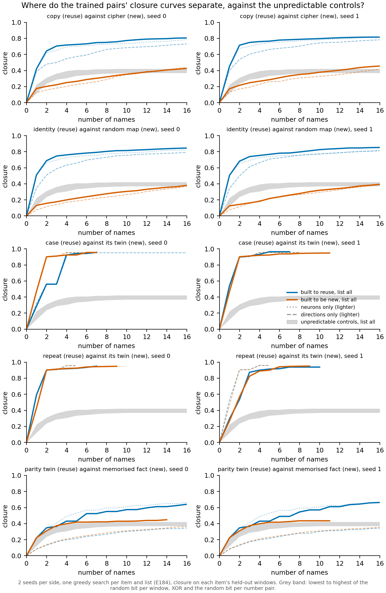

# Do the trained matched pairs' closure curves separate from each other and from the unpredictable controls?

*2026-11-16, definition-lead. Cell P1.22, experiment E191: a re-read of the saved item files of E184, with no new search.
Descriptive at the user's request. The fourth reuse wording is still tested, not adopted, and nothing below is a verdict
on any reuse definition. Script `experiments/e184_curves/plot.py`; numbers `experiments/e184_curves/results/curves.json`;
figure `experiments/e184_curves/figures/curves.png`; card `experiments/e184_curves/card.md`.*

We re-read the earlier ranking run as curves of how much of each fine-tune's gap a few of the original's own variables
close. On copy and identity the side built to reuse rises far above the unpredictable controls and the new side does
not, on case and repeat the two sides overlap, and the parity twin and the memorised fact part only past four names. So
these curves order two of the five trained pairs as built and a third only partly, which is evidence for the working
definition to weigh, not a verdict.

## The answer

On copy against cipher and identity against random map, the reuse side's curve sits far above the new side's on both
seeds. Only the reuse side clears the unpredictable controls early. On case and repeat the two sides overlap: both
close nine tenths of a large gap with two to four names, and on one seed of case the new side is ahead. The parity
twin and the memorised fact match up to four names; past that the twin keeps rising and the fact flattens just above
the controls' top edge.

## What we were trying to test

The earlier ranking run searched, for each fine-tune F of the 67M model M, for a small intervention on M's own variables
that makes M behave like F. M's list of variables, called the list below, holds its 4 × 3,072 MLP neurons, the top 64
principal directions of the residual stream at five sites, the input tokens at the last two positions and the output
logits. A name is one variable the intervention shifts or rescales, or one variable such a shift reads. A greedy search
adds one name at a time, refits every number, and records how far it got.

The quantity read is the closure, $1 - \mathrm{KL}(F \| M_I) / \mathrm{KL}(F \| M)$ at the last position on held-out
windows, where $M_I$ is M under the intervention. It reads 0 when the intervention removes none of the gap between M
and F and 1 when it removes all of it. The curve plotted for each item is, at each number of names n, the best closure
either greedy pass found with at most n names. The empty intervention closes 0, so every curve starts there.

The ranking run reduced each curve to one grade at a bar. This re-read keeps the whole curve, on three versions of the
list: all of it, neurons only and directions only. Nothing was searched again.

Five trained matched pairs are compared, each on two seeds. In each pair one side was built to reuse something M
already does and the other to be new, on the same inputs:

- **copy against cipher**, 24 keys each: a table of key words after a marker, answered on the reuse side by copying
  and on the new side by a fixed random partner word, a cipher;
- **identity against random map**, 32 keys each: the same kind of table from an earlier run, each key followed by
  itself or by a fixed random partner;
- **case against its twin**: the reuse side labels whether the word before a marker is capitalised, the twin sees the
  same words with labels shuffled per word, so it can only memorise;
- **repeat against its twin**: the reuse side labels whether that word occurred earlier in the window, with the same
  kind of shuffled twin;
- **parity twin against memorised fact**: both push the output after a number; the twin when the last number is odd,
  a fact M already reads, the fact when a random one-bit label per number token is 1.

Three controls set the floor. Each makes a change that no small intervention on M's variables can predict on held-out
windows: a random bit per window, written into the residual stream; XOR, the parity of four token bits; and a random
bit per ordered pair of numbers. The grey band in the figure runs from the lowest to the highest of their three curves
on list all, at each number of names. It is where an item sits if the search reaches the gap only the way it reaches a
change it cannot predict.

The planted hand-direction edits from earlier experiments and the two controls built on the list are apparatus checks,
in the appendix. The free-direction fits, the third grade of the ranking run, are left out.

## What we expected, and why

The card names two rivals, and this page only says which one each pair's picture looks like.

- **First rival.** The side built to reuse sits closer to something already on M's list than the side built to be new.
  It predicts that on every pair and seed the reuse side's curve on list all rises above the unpredictable band with
  fewer names than the new side's.
- **Second rival.** The greedy search closes the gap of any fine-tune that moves a few output logits, whatever it
  reused, and of none that does not. It predicts the two sides overlapping where both move a few logits, as on case
  and repeat, and both near the band elsewhere, with no side consistently ahead.

No rule was filed; the card is descriptive. Its spread is the seed gap of copy's closure at four names, 0.72 against 0.76.

## What we observed

*One row per pair, one column per seed. Blue: built to reuse; orange: built to be new. Thick lines: list all; dotted:
neurons only; dashed: directions only. Grey band: the three unpredictable controls on list all. A curve ends where its
search stopped: at sixteen names, at a closure of 0.95, or after three steps that each added under 0.005.*

### Copy against cipher, and identity against random map: the sides separate

**Reading it.** These two pairs separate on both seeds at every number of names. With two names copy closes 0.64 and
0.71 of its gap, while the cipher closes 0.20 and 0.22. With sixteen names copy reaches 0.81 and 0.82 and the cipher
0.43 and 0.46. Identity closes 0.69 and 0.68 with two names, the random map 0.16 and 0.14. With sixteen names
identity reaches 0.84 and 0.85, the random map 0.38 and 0.39.

Against the band the picture is the same. The reuse sides sit above its top from the first name, where the band tops
out at 0.22 and copy and identity already read 0.42 to 0.51. The cipher stays inside or below the band until the last
few names, and clears its top only at sixteen names on seed 0 and from fourteen on seed 1. The random map never clears
it. At two names the gap between the sides is 0.44 to 0.54, many times the gap between the two seeds of one side. This
is the first rival's picture.

### Case and repeat: the sides do not separate

**Reading it.** Neither pair separates. Both sides of both pairs close about 0.90 of a gap of about eight nats with two
to four names, far above the band. On case seed 1 the reuse side and its twin read 0.90 and 0.90 at two names. On case
seed 0 the order is reversed: the twin reads 0.90 at two names and the reuse side 0.56, and both read 0.92 by four. On
repeat seed 0 both read 0.90 at two names. On repeat seed 1 the reuse side reads 0.53 and the twin 0.57 at two names,
and 0.90 against 0.89 at four.

No side is ahead on both seeds of either pair, and the one large gap, case at two names on seed 0, favours the new side.
This is the second rival's picture. On five of the eight items the first two names the writes-only pass added were the
output logits of the two label words, on either side of a pair. On repeat seed 1 both sides added one neuron first and
the two logits next, and on case seed 0 the reuse side reached a label logit only through the pass that also reads. The searches stop at a closure of 0.95 or when gains stall,
so these curves end at seven to eleven names.

### Parity twin against memorised fact: equal at first, apart past a few names

**Reading it.** These two match up to four names and then part, on both seeds. At four names the twin reads 0.43 on
both seeds and the fact 0.40. From six names on the twin keeps rising, to 0.64 and 0.66 at sixteen. The fact flattens
at 0.45 and 0.44, where its searches stopped at fourteen and eleven names for lack of gain.

Against the band both sit at its top edge for the first few names. The twin clears the top from two names, the fact
from three; at two names the fact reads 0.31, level with the band's top. At sixteen names the fact sits just above the
band's top of 0.42, and the twin well above it. So the pair looks like the second rival for the first four names and
like the first rival past them. The gap here is small, 0.65 to 0.67 nats, so a given closure is a much smaller change
in nats than on the other pairs.

### The neuron-only and direction-only lists

**Reading it.** On every pair except the parity twin against the fact, the two narrower lists tell the same story as
list all, with most curves a little lower. On copy and identity the neuron-only curves sit close under list all and the
direction-only curves mostly lower still, while the order between the sides holds on both. On case and repeat the direction-only
searches reach 0.90 at two names on every item but case seed 0's reuse side.

On the parity twin against the fact the two lists differ. Neurons only, the twin reaches 0.66 at sixteen names on both
seeds, at or above its list-all curve. Directions only, both sides rise slowly: 0.13 to 0.14 at two names and 0.34 to
0.37 at sixteen, at or below the bottom of the band drawn for list all. The unpredictable controls on the direction-only list read 0.20 to 0.34 at sixteen
names, so on that list the twin and the fact sit at or just above the controls' top, with no gap between them.

The figure draws only the list-all band, so the neuron-only and direction-only curves are compared to their own bands
in the table below, not in the figure.

## Tables

**List all**, best closure with at most n names. The KL gap is $\mathrm{KL}(F \| M)$ in nats on the item's held-out
windows; "ended" is the largest number of names either greedy pass reached, after which the best value is carried.

| item | seed | KL gap | 1 name | 2 names | 4 names | 16 names | ended |
|---|---|---|---|---|---|---|---|
| copy | 0 | 3.23 | 0.42 | 0.64 | 0.72 | 0.81 | 16 |
| cipher | 0 | 3.58 | 0.18 | 0.20 | 0.25 | 0.43 | 16 |
| copy | 1 | 3.67 | 0.45 | 0.71 | 0.76 | 0.82 | 16 |
| cipher | 1 | 3.55 | 0.17 | 0.22 | 0.27 | 0.46 | 16 |
| identity | 0 | 4.19 | 0.51 | 0.69 | 0.76 | 0.84 | 16 |
| random map | 0 | 4.91 | 0.13 | 0.16 | 0.20 | 0.38 | 16 |
| identity | 1 | 4.34 | 0.50 | 0.68 | 0.75 | 0.85 | 16 |
| random map | 1 | 4.96 | 0.12 | 0.14 | 0.18 | 0.39 | 16 |
| case | 0 | 8.20 | 0.29 | 0.56 | 0.92 | 0.96 | 7 |
| case twin | 0 | 8.14 | 0.47 | 0.90 | 0.92 | 0.96 | 7 |
| case | 1 | 8.18 | 0.54 | 0.90 | 0.93 | 0.96 | 7 |
| case twin | 1 | 8.10 | 0.47 | 0.90 | 0.92 | 0.95 | 11 |
| repeat | 0 | 8.06 | 0.59 | 0.90 | 0.92 | 0.95 | 7 |
| repeat twin | 0 | 7.90 | 0.43 | 0.90 | 0.92 | 0.95 | 9 |
| repeat | 1 | 7.96 | 0.29 | 0.53 | 0.90 | 0.94 | 10 |
| repeat twin | 1 | 7.90 | 0.27 | 0.57 | 0.89 | 0.95 | 9 |
| parity twin | 0 | 0.65 | 0.22 | 0.35 | 0.43 | 0.64 | 16 |
| memorised fact | 0 | 0.67 | 0.22 | 0.31 | 0.40 | 0.45 | 14 |
| parity twin | 1 | 0.65 | 0.22 | 0.35 | 0.43 | 0.66 | 16 |
| memorised fact | 1 | 0.67 | 0.22 | 0.31 | 0.40 | 0.44 | 11 |
| random bit per window | – | 0.48 | 0.14 | 0.24 | 0.32 | 0.38 | 13 |
| XOR | – | 0.07 | 0.12 | 0.25 | 0.31 | 0.37 | 16 |
| random bit per number pair | – | 0.71 | 0.22 | 0.31 | 0.39 | 0.42 | 11 |
| band, lowest to highest | – | – | 0.12 to 0.22 | 0.24 to 0.31 | 0.31 to 0.39 | 0.37 to 0.42 | – |

**Neurons only and directions only**, best closure with at most 2 and 16 names. The band on neurons only equals the
band on list all at every number of names; the band on directions only is its own last row.

| item | seed | neurons, 2 | neurons, 16 | directions, 2 | directions, 16 |
|---|---|---|---|---|---|
| copy | 0 | 0.62 | 0.78 | 0.48 | 0.73 |
| cipher | 0 | 0.20 | 0.43 | 0.16 | 0.44 |
| copy | 1 | 0.68 | 0.82 | 0.54 | 0.78 |
| cipher | 1 | 0.22 | 0.46 | 0.17 | 0.42 |
| identity | 0 | 0.66 | 0.82 | 0.51 | 0.79 |
| random map | 0 | 0.16 | 0.38 | 0.12 | 0.37 |
| identity | 1 | 0.66 | 0.82 | 0.50 | 0.81 |
| random map | 1 | 0.14 | 0.39 | 0.12 | 0.38 |
| case | 0 | 0.56 | 0.96 | 0.56 | 0.95 |
| case twin | 0 | 0.90 | 0.96 | 0.90 | 0.96 |
| case | 1 | 0.90 | 0.96 | 0.90 | 0.95 |
| case twin | 1 | 0.90 | 0.95 | 0.90 | 0.96 |
| repeat | 0 | 0.90 | 0.95 | 0.90 | 0.96 |
| repeat twin | 0 | 0.90 | 0.95 | 0.90 | 0.96 |
| repeat | 1 | 0.53 | 0.94 | 0.91 | 0.96 |
| repeat twin | 1 | 0.57 | 0.95 | 0.90 | 0.96 |
| parity twin | 0 | 0.35 | 0.66 | 0.13 | 0.35 |
| memorised fact | 0 | 0.31 | 0.45 | 0.14 | 0.37 |
| parity twin | 1 | 0.35 | 0.66 | 0.13 | 0.34 |
| memorised fact | 1 | 0.31 | 0.44 | 0.14 | 0.35 |
| band on directions only | – | – | – | 0.07 to 0.13 | 0.20 to 0.34 |

## What we learned

Read as curves, the ranking run's search tells the copy and identity sides apart from their new sides by a wide margin
on both seeds, and does not tell the case and repeat sides apart at all. The parity twin and the memorised fact match
for the first few names and differ only past them, and only on lists that include neurons. The two pairs that overlap
are also the two with the largest gaps, near eight nats, where two output-logit names close most of either side; this
re-read cannot say whether that is why they overlap. For a working definition of reused against new, the curves of this
search order two of the five trained pairs as built, a third only past four names, and not the case and repeat pairs.

## How compelling is the evidence

- **Two seeds per side, one search per item and list.** The search is greedy, so each curve is a lower bound on the
  best closure at that number of names; a better search could only raise it.
- **Closure is a share of each item's own gap, and the gaps differ a lot.** The first table lists them: case and
  repeat move about eight nats, copy and cipher 3.2 to 3.7, and identity and random map 4.2 to 5.0. The parity twin
  and the fact move 0.65 to 0.67 nats, and the controls 0.07 to 0.71. The same closure is a very different number of nats from one pair to the next, and only the
  two sides of one pair have gaps of about the same size.
- **XOR is a fixed function.** It is unpredictable only to the linear reads the search can make, not in principle;
  the two random bits are unpredictable on held-out windows by construction.
- **The search stops at closure 0.95, or after three steps that each add under 0.005.** The case and repeat curves end
  at seven to eleven names, and the value at sixteen names is the value where they stopped. The fact's searches
  stopped at fourteen and eleven names.
- **The band is drawn on list all only.** The neuron-only band is identical; the direction-only band is lower and is
  given in the second table, not drawn.
- **Linear reads at the last position only,** on each item's held-out windows.

## Surprises

None against a filed expectation, since none was filed. Two things were not foreseen on the card. Case seed 0 reverses
the reuse order at two names, 0.56 for the reuse side against 0.90 for its twin, though both meet by four names. And on
directions only the parity twin and the fact sit at or below the bottom of the list-all band. The twin's lead shows
only on lists that hold neurons.

## What next

- Whether a reading on curves is worth filing as a definition is the user's choice; this page does not propose one.
- If the case and repeat overlap is to be read further, the question is whether any list tells two fine-tunes apart
  when two output-logit names close nine tenths of both. That would need a new cell from the user.

## Departures from the literature

None. The closure and the search are this project's own, from the ranking run's plan
`reports/plans/2026-11-13_plan_simplest-intervention-ranking.md`; this page only re-reads their saved output.

## Scorecard

No predictions were filed for this re-read; the card marks it descriptive at the user's request, 2026-11-16.

| pair | picture on list all | looks like |
|---|---|---|
| copy against cipher | reuse side far above, new side in or below the band, both seeds | first rival |
| identity against random map | reuse side far above, new side below the band, both seeds | first rival |
| case against its twin | overlap above the band; seed 0 reversed at two names | second rival |
| repeat against its twin | overlap above the band on both seeds | second rival |
| parity twin against memorised fact | equal up to four names, twin ahead past six | second, then first |

## Appendix: apparatus checks

The planted hand-direction edits from earlier experiments and the two controls built on M's list, on list all. These
check the search, not the pairs. The two controls built on the list read as built: one shifted neuron is closed fully
by one name, and one neuron shifted by a principal direction's value fully by two. None of the hand-direction edits
comes near full closure within sixteen names. The planted constant push and always on sit above the band from the
first name, and reach 0.72 at sixteen. The planted trigger clears the band's top from seven names, the cue only from
thirteen. The planted fact edit stays at or below the band at every number of names. On the table edit the list-all
search added no name at all, so its curve stays at 0. The do-nothing has no gap and was never searched.

| item | KL gap | 1 name | 2 names | 4 names | 16 names | ended |
|---|---|---|---|---|---|---|
| one neuron shifted | 0.20 | 1.00 | 1.00 | 1.00 | 1.00 | 1 |
| one neuron shifted by a direction's value | 0.27 | 0.38 | 1.00 | 1.00 | 1.00 | 7 |
| planted constant push | 0.23 | 0.38 | 0.47 | 0.55 | 0.72 | 16 |
| planted trigger | 0.37 | 0.12 | 0.26 | 0.35 | 0.54 | 16 |
| planted fact edit | 0.37 | 0.07 | 0.16 | 0.21 | 0.42 | 16 |
| always on | 0.14 | 0.28 | 0.52 | 0.61 | 0.72 | 16 |
| cue | 0.04 | 0.19 | 0.26 | 0.33 | 0.44 | 16 |
| table | 6.27 | 0.00 | 0.00 | 0.00 | 0.00 | 0 |

## Not run

- No new search: no larger cap than sixteen names, no other start, no other list.
- The do-nothing was never searched; it has no curve.
- The free-direction fits are in the item files and left out here, at the user's request.
- No band per list drawn in the figure; the direction-only band is in the table only.
- No closure in nats rather than as a share, so pairs with different gaps are not compared on one scale.
- No third seed, and no seed spread beyond the two seeds per side.
- No rule, bar or grade on the curves, and no verdict on reuse under any wording.

Provenance: E184's item files `experiments/simplest_intervention/results/<item>.json`, keys "1" and "2" per list; the
curves and bands are written by `experiments/e184_curves/plot.py` to `experiments/e184_curves/results/curves.json`,
run on CPU with no GPU and no cost.
