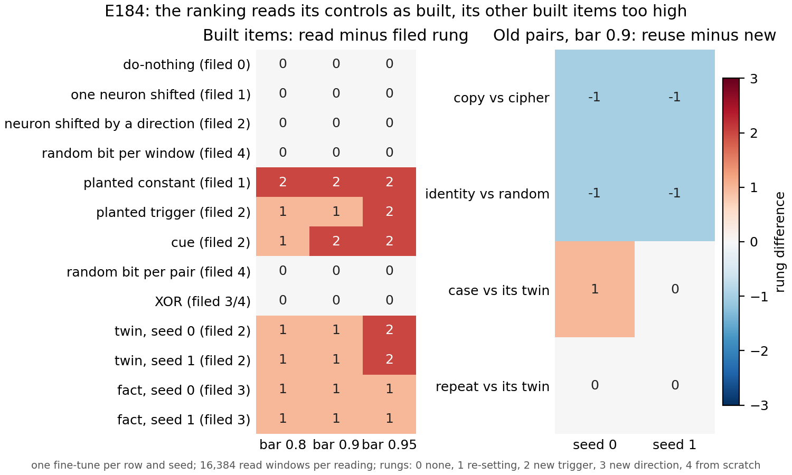

# Does a ranking of interventions on the original's own variables grade fine-tunes as built?

*2026-11-16, definition-lead. Cell P1.20, experiment E184, the cell's fourth and last run. Provisional: the fourth reuse
wording is tested here, not adopted, and nothing below is a verdict on any reuse definition. Code
`experiments/simplest_intervention/run.py`, `src/commute/rank_read.py`; filed rules `results/predictions.json`; plan
`reports/plans/2026-11-13_plan_simplest-intervention-ranking.md`; figure `experiments/simplest_intervention/figures/rungs.png`.*

We graded built edits and real fine-tunes of the 67M model by the simplest intervention on the original model's own
neurons and principal directions that reproduces each fine-tune. The four controls read exactly as built, but seven of
the nine other items read higher than filed, mostly because the search over the original's variables never got near
the bar. For the goal of a working definition of reused against new, this ranking does not yet separate a twin task
that reuses an existing variable from a memorised fact under the filed rule, and the cell closes with that reading.

## The answer

The ranking reads its four hand-built controls exactly as built, so the apparatus works where the answer is a single
variable on its list. It does not work on edits built along a hand-chosen direction: a planted constant push, a planted
trigger and a cue all needed a free new direction, or more. The twin fine-tune ranked one grade below the memorised fact
on both seeds, but both sat above the reuse grades, so the filed comparison makes no call. On the old matched pairs, the
reuse side ranked at or below the new side in seven of eight cases.

## What we were trying to test

The fourth reuse wording says a fine-tune F reuses the original M to the extent that F is M under a simple intervention
on M's variables, graded by how short that intervention is to describe. Shortest description cannot be computed, so the
plan stands in a ranking of five grades, called rungs:

- rung 0, none: F already matches M;
- rung 1, re-setting: shift or rescale some of M's variables, with no inputs;
- rung 2, new trigger: as rung 1, but a shift may read other variables on M's list;
- rung 3, new direction: rung 2's best intervention plus one or two free rank-one edits, each reading and writing a
  direction that is not on the list;
- rung 4, from scratch: nothing cheaper reproduces F.

M's list of variables is fixed on M alone: its 4 × 3,072 MLP neurons, the top 64 principal directions of the residual
stream at five sites, the input tokens at the last two positions, and the output logits. An intervention's size n is the
number of variables it writes plus the number it reads, and rungs 1 and 2 are capped at 16 names.

The closure of an intervention I is $1 - \mathrm{KL}(F \| M_I) / \mathrm{KL}(F \| M)$ at the last position, on held-out
windows: 0 means I removes none of the gap between M and F, 1 means all of it. An item's reading at a bar is the lowest
rung whose found intervention closes at least that bar, and the smallest n within it. Every reading is given at bars
0.8, 0.9 and 0.95 and on three lists: neurons only, directions only, and all. The filed comparisons use list all at bar
0.9. A greedy search finds the interventions, so each reading is an upper bound: a better search can only lower a rung.

Three groups of items were read. Run 1 had four controls built on M's own list: the do-nothing; one neuron shifted; one
neuron shifted by the value of a principal direction; and a random bit per window, which no simple intervention can
predict. Run 2 had edits built along hand-chosen directions in earlier experiments, plus the memorised fact and its twin
on two seeds each. Run 3 had the four old matched pairs, where one side was built to reuse the original's skill and the
other to be new.

## What we expected, and why

The controls should read their built rungs: 0, 1 with the one shifted neuron, 2 with two names, and 4. The planted
constant push lies in the span of the answer tokens' unembeddings, so it was filed at rung 1 with at most four names.
The planted trigger and the cue read a variable M already has, so they were filed at rung 2. The random bit per pair of
numbers was filed at rung 4 and XOR at rung 3 or 4.

The filed question about real fine-tunes compares two accounts. In the first, the twin reuses a variable M already has,
the parity of the last number, while the fact's random token set is not on M's list; then the twin reads rung 2 or below
and the fact rung 3 or above, on both seeds. In the second, both memorised a table that no 16 of M's names reproduce, so
both read the same rung. Any other outcome is "no call". For the old pairs, the filed claim was that the reuse side's
rung is at or below the new side's for every pair and seed.

## How the cell's four runs went

The cell had four runs. The first, as E180, never read past its first stage: the search's step sizes blew up on rare
tokens. The second, as E182, stopped on its controls: the search took no step on the neuron shifted by a direction,
which is exactly one pair on the list. The third, as E183, found that pair but kept one extra name, three against at
most two, and stopped again. The refit was fixed and the fourth run, E184, ran the controls first and then every item.
This page reads E184 alone.

## The controls read as built

**Reading it.** All four controls read their built rung at every bar on list all, shown as zeros in the top four rows of
the figure's left panel. The one shifted neuron read rung 1 with that neuron alone, and closed 1.000 of the gap. The
neuron shifted by a direction read rung 2 with exactly its two names, closing 1.000. The random bit read rung 4: its best
intervention, with two free edits, closed 0.48, far below the lowest bar of 0.8. So the ranking finds an intervention
when it is one or two names on M's list.

## The built items read higher than filed

**Reading it.** This reverses the filed expectations for seven of the nine items in run 2. The planted constant push,
filed at rung 1, read rung 3 at every bar: sixteen names on the list closed at most 0.72 of its gap, and one free
direction then closed 0.97. The planted trigger read rung 3 against a filed 2, closing 0.91 with one free direction.
The cue read rung 4 against a filed 2: its best single free direction closed 0.83. The twin read rung 3 on both seeds
against a filed 2, and the fact read rung 4 against a filed 3. The random bit per pair and XOR read rung 4, as filed.

In every miss, the searches on the list stopped well short of the bar, and the rung-3 intervention on top of them kept
all 16 names the cap allows. The numbers are consistent with the list searches running out at their cap rather than
finding the sparse edit each item was built with. That is a reading of the numbers, not a verified cause: the page has
no run that shows the search would find the built edit with a larger cap or a different start.

## The twin against the fact: no call

**Reading it.** The filed rule makes no call. The twin read rung 3 on both seeds and the fact rung 4 on both seeds: the
twin did rank one grade below the fact, in the direction the first account predicts, but both readings sit above rung 2,
where that account put the twin. The rule files "different rungs both over 2" as no call, and that is what was read.

The margins are thin on the twin's side. With one free direction the twin closed 0.895 and 0.897 on the two seeds, just
under the 0.9 bar; with two it closed 0.909 and 0.907. The searches on the list alone closed at most 0.64 and 0.66. The
fact's best closed 0.74 on both seeds, with two free directions, and its list searches at most 0.45 and 0.44.

## The old pairs: seven of eight hold

**Reading it.** The filed claim does not hold for every pair: the reuse side ranked at or below the new side in seven of
eight pair-seeds, shown in the figure's right panel. Copy against cipher and identity against random read rung 3 on the
reuse side against rung 4 on the new side, on both seeds. Repeat and its twin read rung 1 on both sides and both seeds,
and so did case and its twin on seed 1. Case and its twin on seed 0 fails: the reuse side read rung 2 and the new side
rung 1.

## What we learned

The ranking works on interventions that are one or two names on the original's list, and the controls show it. It does
not recover edits built along hand-chosen directions, which are the cases that look like reuse to a human reader. So on
this search the fourth wording grades most fine-tunes at rung 3 or 4, and the reuse grades are reached only by the case and
repeat pairs, where shifting two output logits closes the gap. The twin did rank below the fact, which is the ordering the wording was
meant to produce, but not across the boundary between reuse and new.

## How compelling the evidence is

- Two seeds per real fine-tune; one built instance per planted item.
- Every reading is an upper bound on the rung. The misses in run 2 could come from the wording or from the greedy
  search; this run does not separate the two.
- Linear reads only, at the last position, on each item's own windows.
- The readings at bars 0.8 and 0.95 and on the neuron and direction lists are in the item files; at list all the
  run-2 items read rung 3 or 4 at every bar, so the misses do not depend on the bar.

## Surprises

Something unexpected happened that I cannot explain: every built item past the controls whose filed rung was 1 or 2
read rung 3 or 4. The planted constant was predicted at rung 1 with four names or fewer and read rung 3 at every bar.

## What would change this

A search that recovers the planted constant at rung 1 would show the misses were the search, not the wording; that is a
new cell for the user, since this cell's runs are spent.

## Departures

- From the plan: none in the rules. The plan prices names at about 15 bits and a free direction at 768 numbers; the run
  does not count bits, only rungs and names, as the plan's ranking says.
- From the literature: the wording stands in a ranking for the shortest description length of the intervention, which
  cannot be computed. This is stated in the plan and is not a departure from any cited procedure.

## Scorecard

| id | claim in words | rule | read | verdict |
|---|---|---|---|---|
| run-1 stop | the four controls read their built rungs | do-nothing 0; one neuron 1 with n 1 at 0.95; triggered neuron at most 2 with n at most 2 at 0.95; random bit not at or below 3 at 0.8 | 0, 1 with n 1, 2 with n 2, 4 | passed |
| expected | each built item reads its filed rung at list all, bar 0.9 | descriptive | planted constant 3 against 1; planted trigger 3 against 2; cue 4 against 2; twin 3 against 2 on both seeds; fact 4 against 3 on both seeds; floor 4 and XOR 4 as filed | 7 of 9 missed |
| R1 | the twin at most rung 2 and the fact at least rung 3 on both seeds, or both equal | run2.json R1 | twin 3, 3; fact 4, 4 | no call |
| R2 | each old pair's reuse side at or below its new side, every seed | run3.json R2 all_hold | 7 of 8 hold; case and its twin, seed 0: 2 against 1 | does not hold |

## Not run

- No search with a cap above 16 names, or started from the built edit, to tell a search miss from a wording result.
- No reading of always on, the table and the planted fact against an expectation: the plan filed none, and their
  readings are in the item files only.
- No count of bits; the ranking reports rungs and names.
- No nonlinear variables and no positions other than the last.
- The figure is not drawn yet: the compute node was down on 2026-11-16, so `plot.py`, `check.py` and lint have not
  run. Draw it with `~/commute-agents/fleet/cpu-run --mem 2G python experiments/simplest_intervention/plot.py`.

Provenance: `experiments/simplest_intervention/results/run1.json`, `run2.json`, `run3.json` and one JSON per item in
the same folder; earlier stops in `results/e182_run1/` and `results/e183_run1/`.
