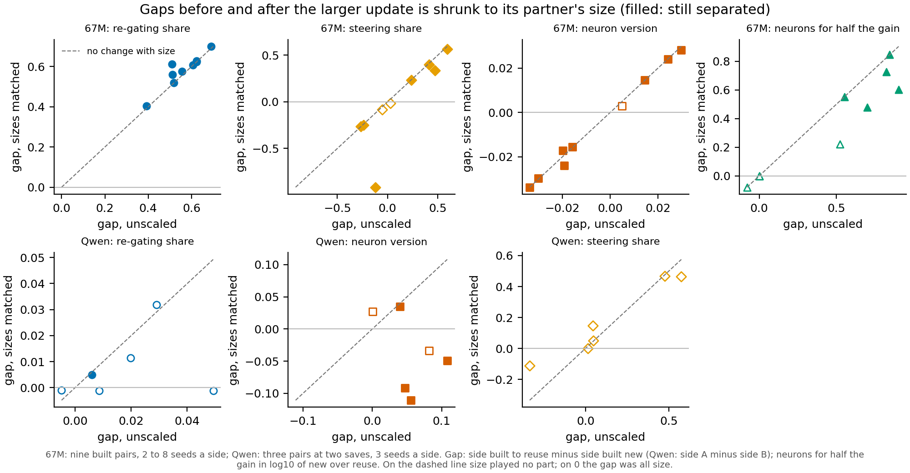

# Do the share and the cheap readings still separate the pairs once the two sides match in update size?

*Cell P2.28, experiment E187, compare-lead, 2026-11-16. Plan `reports/plans/2026-11-16_plan_p2-28-size-matched.md`;
every number from `experiments/size_matched/results/summary.json`. Descriptive: no reading is called reused or new.*

We took each pair of fine-tunes, shrank the side with the larger weight change by one number until both sides changed
the weights by the same amount on average, and read the share and the cheap readings again on that side. On the small
model nothing that separated a pair before stopped doing so except two neuron readings on one pair each, while on Qwen
the share's separation mostly went away and the top-neuron overlap moved when only size changed. For the goal, the share's
separation of the small model's pairs is not update size, and on Qwen only a gold cell that barely needed shrinking still separates.

## The answer

On the 67M, size matching changes almost nothing: the re-gating share still separates all nine built pairs, steering
the same seven, and the two neuron readings each lose one pair. On Qwen, the share separated three of six pair-and-save
cells before and one after, and that one was shrunk by only a few percent. The top-neuron overlap there reverses on the
copy and cipher pair at both saves. Steering on Qwen stays unreadable on four cells.

## What was done

A pair is two sets of fine-tunes of one model; on the 67M one side was built to reuse an existing ability and the other
to need a new one, and on Qwen the sides are named per pair: copy and cipher, known and invented facts, gold and
shuffled gold. Update size is the norm of the weight change over the norm of the original weights. Every saved update
of the larger side was multiplied by one number, its partner's mean size over its own, and read again; the smaller side
keeps its saved readings. A gap is one side's mean minus the other's, and a cell counts as separated when the seed
ranges do not overlap on the 67M, or when the gap clears its random-change band on Qwen. Effective rank cannot change
under one scalar, which the run checked on every state, so it is not drawn.

**Reading it.** Each point is one pair; on the dashed diagonal shrinking changed nothing, and on the horizontal line the
gap was all size. The top row, the 67M, sits on the diagonal for the share and for most other points. The bottom row,
Qwen, falls off it: five of six share points move toward zero, three of them to about zero, and four overlap points cross below zero.

## What each reading did

- **Share, 67M.** Kept on all nine pairs; no gap shrank toward zero, and on the stand-alone cipher pair, shrunk most, it grew from 0.51 to
  0.61.
- **Steering, 67M.** Kept on seven; the other two made no call before or after. On the stand-alone cipher pair, whose new
  side was about twice its partner's size and was shrunk to 0.52, the gap went from -0.12 to -0.92. The files show the shrunk
  side's per-key steering share rising from about 1.03 to about 1.83, while the other side stays near 0.91; why, this
  run does not say.
- **Top neurons, 67M.** Kept on eight; lost on the identity against random map pair, whose gap fell from 0.005 to 0.003.
- **Neurons for half the gain, 67M.** Kept on five, no call on three both times, lost on the stand-alone cipher pair.
- **Share, Qwen.** Lost on known and invented facts at the late save, whose gap fell from 0.049 to about zero, and on
  gold at the 5x save. Kept only on gold at the late save, where the shrink factor was 0.97.
- **Top-neuron overlap, Qwen.** On copy and cipher the gap went from 0.06 to -0.11 at the late save and from 0.11 to
  -0.05 at the 5x save: the shrunk cipher side's overlap rose past the copy side's. Known and invented facts lost the
  call at one save and gained an opposite-signed one at the other; gold kept its late-save call.
- **Steering, Qwen.** Unreadable on copy and cipher and on the facts pair, which have no random floor; inside the floor
  on gold, before and after.

## Doubts for the gate

The premise check called the run doubtful: on the 67M "the size question looks settled", and on Qwen "a scaled-down
update is not a model that learned less", so the run "can't tell size from distortion".

## Departures from the literature

- A rescaled update is not a trained state: no source shrinks a saved fine-tune to stand for a smaller one.

## Not run

- Retraining the larger side to a smaller update instead of rescaling it.
- A Qwen steering floor for copy and cipher or the facts pair: those cells stay unreadable.
- New pairs, or new seeds on the existing ones.
- The new Qwen decomposition, where every update reads near the ceiling.
- `check.py`: `cpu-run` is down with the compute node.
