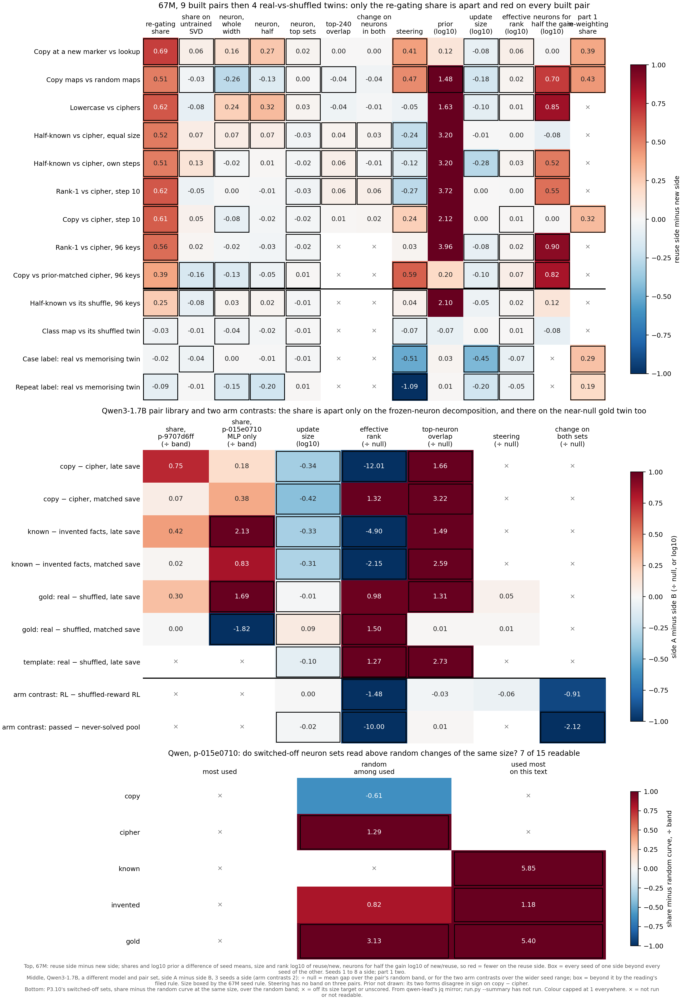
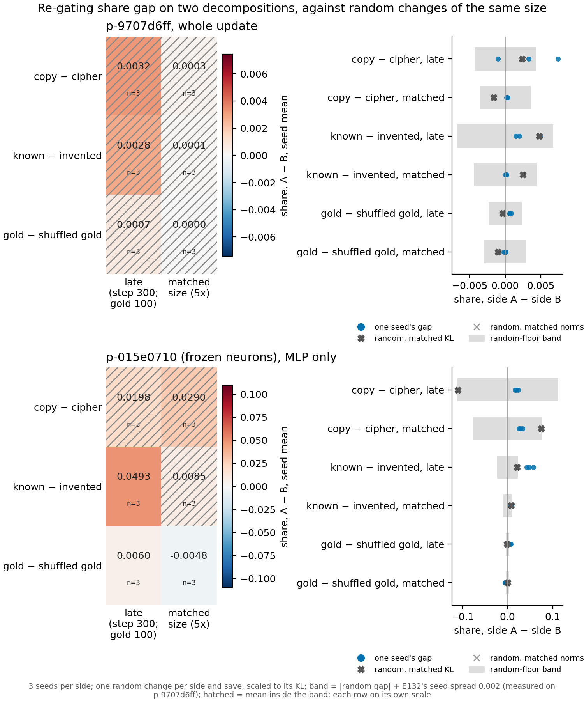

# The part 2 gate page, brought up to date for 18 November

*Cell `P2.26`, compare-lead, 2026-11-16, for the gate of 2026-11-18 and the paper draft. No run, no GPU, $0: saved
results only. It updates the [11 November gate page](2026-11-11_analysis_part2-gate-page.md); what is unchanged is there.
Sides are named as each pair was built. No verdict of reused or new is given, and no column is joined into a score.*

We added every reading saved since 12 November to the part 2 scorecard, on the small model and on Qwen3-1.7B. On the
small model the re-gating share is still the only reading that puts the reuse side higher on every built pair, even
where both sides changed the weights equally. On Qwen it separates no pair beyond noise, so for `GOALS.md` its pattern
is not yet shown to carry over, or to be reuse.

**The terms**, as on the 11 November page. A **built pair** is two sets of fine-tunes, one built to reuse something the
model already does and one built to be new. A **twin** is a real fine-tune against one trained on shuffled answers. The
**re-gating share** is the part of a fine-tune's gain reproduced by changing only which original subcomponents Γ
switches on: 0 means none, 1 all. A **gap** is the reuse side minus the new side, or on Qwen side A minus side B. Two
sides are **apart** when every seed of one lies beyond every seed of the other. On Qwen they must also clear the band
that random weight changes of the same size give.

## The figures

Every pair by every method, the 67M built pairs and twins on top and the Qwen readings below on the same colour rule:

**Reading it.** The first column is the only one red on all nine built pairs. Since 11 November one rule colours every
cell, which moved 23 cells from no call to apart and none back. The last column, neurons for half the gain, is now
filled on every built pair. Effective rank now covers the 96-key rows, where every row is apart with the reuse side
higher, by 0.01 to 0.07 in log10. The update-size column is blue or grey on every built pair. It is grey on the three
pairs whose sides changed the weights by the same amount, and the share is still red there. Two of the twins now read
the other way: on the class map and on the repeat label, the shuffled side reads the higher share. On the repeat label
that puts the share against part one's reading. Part one reads the real fine-tune higher by 0.19, and the share reads the
twin higher by 0.09.

The Qwen readings of the share, on a different model, decomposition and set of pairs:

**Reading it.** On the new decomposition every cell is hatched, inside its random band. On the frozen-neuron
decomposition three of six cells leave it: known against invented facts at the late save, and the gold twin at both
saves, with opposite signs. The middle and bottom panels of the first figure set these beside the cheap Qwen readings and
the switched-off neuron reference.

## What the share adds over the cheap readings

On the 67M the share puts the reuse side higher on all nine built pairs, by 0.39 to 0.69 of the gain, and no cheap
reading does. Update size cannot be the whole of it. Three built pairs changed the weights by the same amount on both
sides, and there size makes no call while the share's gaps run from 0.52 to 0.62. The other readings each miss or
reverse some built pair. Steering reverses three, and the neurons for half the gain make no call on three. Effective rank leans the
share's way by at most 0.07 in log10 and calls two no difference. The neuron readings split, the whole-width form three with
the share and four against. The prior points the share's way on all nine, but with one value a side on eight, and with
steering it already gives the same nine directions. So on the 67M the share adds a call on size-matched pairs and gap
sizes no cheap reading predicts, not a new direction. On Qwen it adds nothing yet. On the new decomposition every
update and every random change reads within about one percent of the ceiling, so no pair leaves its band. On the
frozen-neuron decomposition the share has room to move. Yet in all six pair cells there, the side with the smaller
weight change reads the higher share. That includes the gold twin, whose sign flips between saves along with which side
is larger. Until a Qwen pair matched in size separates, the share there cannot be told from update size.

**Size matched (P2.28, added 11-16 evening).** Each pair's larger update was shrunk by one number to its partner's mean
size and read again (`reports/analyses/2026-11-16_analysis_p2-28-size-matched.md`). On the 67M this changes almost
nothing: the share still separates all nine built pairs, steering keeps its seven, and the top neurons and the neurons
for half the gain each lose one pair. On Qwen the share separates one of the six pair-and-save cells it separated three
of before, and that one, gold at the late save, needed shrinking by only a few percent. The top-neuron overlap reverses
sign on copy and cipher at both saves, and steering stays unreadable on four cells. So on the 67M the share's
separation is not update size, while on Qwen no reading is yet shown to separate a pair beyond size. The premise check
doubts the method: shrinking a saved update by one number is not a model that learned less.

## The premise doubts, and what each limits

- **The redraw.** A column apart by seed range is not a method that tells the pair apart. Update size is itself a
  baseline, and "apart" never asks whether a reading separates a pair beyond what size already does. The redraw also
  moved 23 cells by a rule change alone. This limits every tally on the page to a count of seed-range calls. Only the
  three size-matched pairs bear on what a column adds beyond size.
- **Neurons for half the gain.** The count may follow update size or how much was learned. Five of the six pairs it
  separates also differ in size. The sixth rests on a cipher that had not learned its task, with a held-out probability
  of the target of 0.32 to 0.45 against a learned bar of 0.5. This limits the column to a description, not a rival.
- **Effective rank on the 96-key rows.** The check held. Rank moves opposite to size on three rows, and on the class twin,
  where sizes are within 1.01 times, it still separates.
- **The Qwen cheap readings on saved updates.** Their arm contrasts, RL against its shuffled-reward null and a passed
  pool against a never-solved one, are not pairs built to differ in reuse. Effective rank separates RL from its null by
  1.5 seed ranges on two seeds a side, and the two pools also differ in size. This limits them to describing the
  updates; they say nothing about what the share adds.
- **The Qwen cheap readings on the pair library.** Every top-neuron overlap gap that passed its band came with side A
  the smaller weight change, and so did effective rank's on the two built pairs at the late save. At the late save cipher and invented facts are 2.0 to 2.4 times their partners. This limits every cheap
  Qwen cell: none is told apart from update size.
- **The share on the new decomposition.** Real updates read like random changes, so the share has no room to separate
  pairs there. This limits the six cells on that decomposition to "saturated", not "no difference".
- **The share on the frozen-neuron decomposition.** The gold twin is beyond its band at both saves with opposite signs:
  0.0060, then -0.0048. Its bands are 0.0035 and 0.0027. Each band rests on one random draw and on a seed spread taken from
  the other decomposition. This limits every cell there: none is read as a difference, the facts pair's 0.0493
  against 0.0231 included.
- **The reference for the frozen-neuron share.** Switching off neurons the model uses was meant to show what a
  re-gating change reads. Only 7 of 15 built changes landed at their size, against the 9 the filed rule needs, so it makes
  no call. Of the fine-tunes, 25 of 36 read above the random curve, the gold twin among them. Copy rows' band is about
  four times the others'. Its numbers come from a jq mirror of the summary script, which has not run. This limits the
  frozen-neuron share: no reference yet shows it reads re-gating at all.

**Which save is "matched".** The cheap library readings and both share readings use the same save, the library's
five-times save at steps 7 to 19. Two differences sit side by side in the figures. The frozen-neuron share reads the MLP
matrices only, and the share reads the gold twin on held-out gold rows, where the cheap readings used its training rows.

## What is still not shown

- That the 67M pattern is reuse. The sides carry the builders' intentions, part 1 reads only five of the pairs and now
  disagrees with the share on the repeat-label twin, and the definition is under revision.
- A size-matched test of any cheap reading. Rank, neurons for half the gain and the top-neuron overlap were never
  read with the larger update rescaled to the smaller one's size.
- A pair where the prior and steering point opposite ways. The attempt stopped before training.
- Any Qwen pair whose two sides learned and match in weight-change size, other than the gold twin built to show nothing.
- A Qwen random band from more than one draw, and a seed spread measured on the frozen-neuron decomposition.
- That the frozen-neuron share reads a known switching-off above random changes.
- How far any of this generalises: one small model, one family of key-to-value tasks, at most nine pairs, no
  significance test.

## Not run

- The writeup checker on this page: the worker node has been down since 2026-11-13, and Python cannot run on the dev
  node. The combined figure was drawn on a pod instead (cell P2.27); its script passes ruff, and pyright on the pod
  could not resolve matplotlib imports.
- Any new measurement, any verdict of reused or new, and any combined score over the columns.
- A size-matched rescale of any update, on either model.
- Neurons for half the gain on the case and repeat label twins.
- The top-neuron overlap on the 96-key pairs and on any twin.
- Part 1's reading on the six built pairs and two twins it does not read.
- The prior on the Qwen panel: its two forms disagree in sign on copy against cipher.
- The reference run's own summary file and figure.

## Departures from the literature

- The top-neuron overlap ranks neurons by absolute firing, where Goodfire's neurons-as-a-basis reading ranks by
  activation, so negative outputs count by their size too. Both models.
- Steering on the 67M is fitted on the fine-tune's own training windows and has a per-key form. On Qwen it is the
  update's own mean shift of one block's input, added unscaled; activation-steering work builds its vector from
  contrasting prompts and tunes a scale.
- Effective rank is Roy and Vetterli's per matrix, averaged over matrices by squared norm.
- The untrained stand-in for the share is an SVD with a fixed switching rule.

*Sources: `experiments/method_table/results/final.json`, `experiments/k_half_fill/results/cells.json`,
`experiments/refit_rank/results/cells.json`, `experiments/qwen_cheap_readings/results/run2_stage3.json`,
`experiments/qwen_library_readings/results/`, `experiments/qwen_library_share/results/summary.json` and its
`p-015e0710/` twin, `experiments/qwen_share_reference/results/` with qwen-lead's jq mirror
`~/commute-data/scratch/qwen-lead/e181-analysis/jq_summary.json`. Pages: [the redraw](2026-11-12_analysis_p2-23-e133-redraw.md),
[neurons for half the gain](2026-11-12_analysis_p2-24-neurons-for-half-gain.md),
[refit rank](2026-11-12_analysis_p2-25-refit-rank.md), [Qwen cheap readings](2026-11-12_analysis_p3-6-qwen-cheap-readings.md),
[library cheap readings](2026-11-12_analysis_p3-7-library-cheap-readings.md),
[library share](2026-11-13_analysis_p3-8-library-share.md), [frozen-neuron share](2026-11-13_analysis_p3-9-frozen-neuron-share.md)
and [share reference](2026-11-13_analysis_e181-qwen-share-reference.md). Premise checks in `~/commute-data/premise/`. Every decimal is in the ledger beside this page.*
