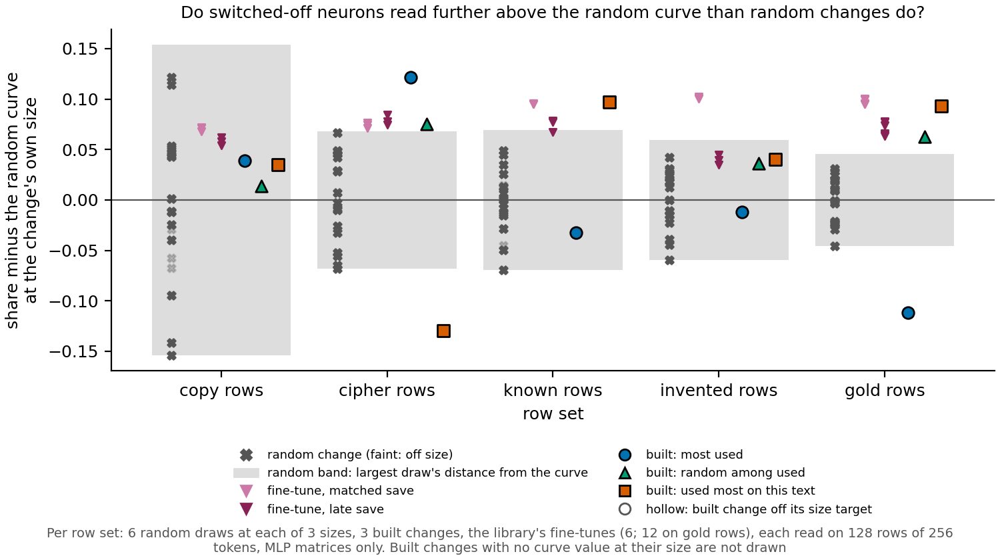

# With a finer size search and six random draws, does the share on frozen-neuron Qwen see switched-off neurons?

*2026-11-17, qwen-lead's writer. Cell P3.11, run E186 on H100 NVL pods, all terminated. Card
`experiments/qwen_share_reference_repair/card.md`; rules `experiments/qwen_share_reference_repair/results/predictions.json`;
plan `reports/plans/2026-11-16_plan_p310-reference-repair.md`. It repairs the earlier cell P3.10, run E181,
`reports/analyses/2026-11-13_analysis_e181-qwen-share-reference.md`.*

We switched off sets of MLP neurons that Qwen3-1.7B uses on five kinds of text again, this time sizing each change
finely enough to hit its target, and compared the share they read with that of twice as many random changes. Fourteen
of the fifteen switched-off sets could now be compared, so the filed rule makes a call: mixed, with five above the
random changes, seven inside their spread and two below it. For `GOALS.md` this means the share on the frozen-neuron
decomposition does not reliably tell a known switching-off from random noise of the same size, so it is not yet a
reference reading for the Qwen part of the paper.

## The answer

The filed rule now reads, and it reads mixed. Of fourteen comparable switched-off sets, five sat above the random
changes by more than their spread, seven inside it and two below it; the rule needed four in five on one side. The
random spread grew on every kind of text against the earlier run, because the three new random draws read lower shares
than the three old ones on all five. The sets of the few most-used neurons, which are the plainest switching-off, read
inside or below the random spread on four of five kinds of text. The library's fine-tunes also split. This page gives no
reading of reuse or new learning.

## What we were trying to test

The share is E57's re-gating share on the frozen-neuron decomposition `p-015e0710`: subcomponents fixed at the 516,092
live MLP neurons, only the causal-importance function Γ trained, the 84 MLP matrices only. For a weight change $\delta W$
it is $(K_{00} - K_{01}) / (K_{00} - K_{11})$. Here $K_{00}$ is the mean KL per position between the changed model and
the original subcomponents under the original model's masks. $K_{01}$ is the same with Γ's masks recomputed on the
changed model, and $K_{11}$ adds the least-squares split of $\delta W$ as well. A share of 1 means Γ's recomputed masks on
the original subcomponents recover all that the split recovers; 0 means they recover none. We call $K_{00}$ the
change's size, read over a row set's 128 rows of 256 tokens.

Three kinds of change were read on each of the pair library's five row sets: copy, cipher, known, invented and gold.

- **Built changes**, the positive control. A set of neurons the model uses on those rows is switched off by zeroing
  their `gate_proj` rows. Each neuron is one subcomponent, so the change is a mask of 0 on it. Three orders of the used
  pool, as in the earlier run: the most used, a random order among the used, and those used most on this text against
  the other four. New here, the size is continuous: the first whole neurons of the order are zeroed and the next is
  turned down partway, its row scaled by a factor between 0 and 1. The size search aims at the middle of the row set's
  fine-tunes' sizes.
- **Random changes**, the reference. Gaussian noise on the 84 MLP matrices at a fine-tune's per-matrix norms, scaled to
  the lowest, middle and highest fine-tune size. New here, six draws instead of three: the earlier run's three are reused
  as they stand, and three more were read by the same code. The random curve is share against size through their
  average at each size; the random band is the largest distance of any usable draw from that curve.
- **Fine-tunes**: the library's 36 read fine-tunes from cell P3.9, placed on the same curve at their own size. No state
  was refetched.

The built change rules out the reading that the share only tracks size: it is a switching-off by construction, so a
share that sees switching-off should place it above random changes of the same size. The earlier run could not say,
because only seven of fifteen built changes landed at their size: a few giant neurons made whole counts jump past the
target.

## What we expected, and why

Two rivals were filed before the run, unchanged from the earlier cell. The first says Γ reads each neuron's actual output
at `down_proj`, so a zeroed neuron is switched off by Γ's own masks. Under it at least four in five of the comparable
built changes sit above the band, with at least nine comparable. The second says the share on this decomposition tracks
only output size, as it did on the other two Qwen decompositions. Under it four in five sit inside the band. The filing
leaned weakly to the first, as the earlier run's comparable reads did. It also warned that more draws could widen the
band, since the band is a maximum.

## What we observed

**Reading it.** The built changes do not sit on one side of the random band, so the rule reads mixed. The figure plots
each change's share minus the random curve at its own size; the grey box is the band and the crosses are the random
draws. On cipher, known and gold rows some built changes sit above the band and others below it. On copy and invented
rows all three sit inside. The two below are the set used most on cipher text, at -0.129 against a band of 0.068, and
the most-used set on gold, at -0.112 against 0.046. The most-used sets touch only two or three giant neurons; they read
inside or below the band everywhere but cipher. So the plainest switching-off is the one the share least separates from
noise.

### The full placement of the built changes

| row set | set choice | size x | $K_{00}$ | share | gap to curve | band | class |
|---|---|---|---|---|---|---|---|
| copy | most used | 1.41 | 0.85 | 0.983 | 0.039 | 0.154 | inside |
| copy | random among used | 1326.77 | 0.91 | 0.957 | 0.014 | 0.154 | inside |
| copy | used most on this text | 197.54 | 0.87 | 0.979 | 0.035 | 0.154 | inside |
| cipher | most used | 2.83 | 1.22 | 1.033 | 0.121 | 0.068 | above |
| cipher | random among used | 1807.46 | 1.20 | 0.986 | 0.076 | 0.068 | above |
| cipher | used most on this text | 282.93 | 1.26 | 0.781 | -0.129 | 0.068 | below |
| known | most used | 2.88 | 0.49 | 0.863 | -0.033 | 0.070 | inside |
| known | random among used | 1471.63 | 0.47 | 0.938 | none | 0.070 | unscored |
| known | used most on this text | 190.21 | 0.45 | 0.992 | 0.097 | 0.070 | above |
| invented | most used | 2.90 | 0.92 | 0.880 | -0.012 | 0.059 | inside |
| invented | random among used | 2170.01 | 0.93 | 0.928 | 0.036 | 0.059 | inside |
| invented | used most on this text | 815.64 | 0.91 | 0.932 | 0.040 | 0.059 | inside |
| gold | most used | 2.94 | 0.67 | 0.771 | -0.112 | 0.046 | below |
| gold | random among used | 3632.68 | 0.68 | 0.946 | 0.063 | 0.046 | above |
| gold | used most on this text | 893.31 | 0.67 | 0.976 | 0.093 | 0.046 | above |

Size x counts neurons: its whole part is zeroed and the next neuron is turned down by its fraction. $K_{00}$ is in nats
per position over 128 rows. Every built change landed within 10% of its target, the middle fine-tune size of its row
set. The known "random among used" change is unscored by the share's status
rule: its split left more than half of the change's size outside the subcomponents. By set choice, the most used read
one above, three inside and one below of five; random among used two above and two inside of four; used most on this text
two above, two inside and one below of five.

### Why the band widened

| row set | band, earlier run | band, this run | mean share, old draws | mean share, new draws |
|---|---|---|---|---|
| copy | 0.059 | 0.154 | 0.990 | 0.860 |
| cipher | 0.036 | 0.068 | 0.930 | 0.854 |
| known | 0.016 | 0.070 | 0.907 | 0.891 |
| invented | 0.018 | 0.059 | 0.905 | 0.868 |
| gold | 0.014 | 0.046 | 0.901 | 0.862 |

The means are over usable draws at all three sizes. The three new draws read lower shares than the earlier run's three
on every row set, so the curve sits between two clusters and the band stretches to reach both. On copy rows the widest
miss is the sixth draw at the lowest size, with a share of 0.770 where the curve reads 0.923. The band roughly doubled to
quadrupled on every row set. Since the band is the largest distance over all draws, a split like this widens it far
more than fresh draws from one population would.

### The fine-tunes

| row set | fine-tunes | above the band | inside | gap range |
|---|---|---|---|---|
| copy | 6 | 0 | 6 | 0.054 to 0.072 |
| cipher | 6 | 6 | 0 | 0.071 to 0.085 |
| known | 6 | 5 | 1 | 0.067 to 0.096 |
| invented | 6 | 3 | 3 | 0.035 to 0.102 |
| gold, both arms | 12 | 12 | 0 | 0.063 to 0.101 |

Twenty-six of 36 sit above the band and ten inside, so this description reads mixed, as it did before. Every fine-tune's
gap is now positive, against some negative gaps in the earlier run, because the lower new draws pulled the curve down.
On invented rows the three above are the early saves and the three inside are the late saves.

## What we learned

With every built change at its size, the share on the frozen-neuron decomposition still does not place a known
switching-off on one side of random changes. Switching off the two or three most-used neurons, the cleanest case, mostly
reads like random noise or below it. The random reference itself is less stable than the earlier run showed: a second
set of three draws moved the curve down on every row set. So the share is not yet a reference reading for the Qwen part
of the paper, and any reading built on its random band inherits that band's instability.

## How compelling is the evidence

The call itself is firm: fourteen of fifteen comparable reads, against a minimum of nine, and no side reaches four in
five. What it means is weaker. Each built change has one seed and one order per set choice, so one read decides each
table cell. The band is a maximum over up to eighteen draws and is moved by the split between old and new draws. The
seed spread of one fine-tune's share in P3.9 was at most 0.0063, under a seventh of the smallest band here. The share is
blind to which neurons moved; the built change tests switching off, and turning one neuron down partway, never switching
on. Attention matrices are left unchanged by every change, since the decomposition does not cover them.

## Surprises

- **Something unexpected happened that I cannot explain.** The three new random draws read lower shares than the
  earlier run's three on all five row sets, and the sixth draw is the lowest of the six on every row set. Independent
  Gaussian draws at matched sizes should not order like this. The new draws come from the same function, moved from the
  earlier run's script unchanged, on the same decomposition, with the same floor on every read. The earlier run's draws
  on copy, cipher and known rows were read on an H100 PCIe and the new ones on an H100 NVL, but invented and gold were
  read on H100 NVL both times and show the same drop. Until this is run down, the band and curve here carry it.
- Two built changes read below the band, which neither rival predicted: a switching-off that Γ's recomputed masks
  recover less of than random noise of the same size.
- The filing expected every random draw's share between about 0.80 and 1.06; copy's sixth draw at the lowest size read
  0.770.

## What next

- Find why the new draws read lower: re-read one of the earlier run's draws on this run's pod and code. If it reproduces
  its old share, the draws differ in something real and the band needs many more draws; if not, the earlier reads were
  taken under some difference to be named. This needs a new cell from the user; this cell's one run is spent.
- If the band holds after that, part 3 could drop this share as the Qwen reading of switching-off and say why. That
  is the user's call, since the card's stop line names it only for a call that the built changes read like random.

## Scorecard

| id | claim in words | rule | read | verdict |
|---|---|---|---|---|
| stage 0, W0 | the unchanged model reads its own floor | all four cells equal the floor per row set, on 16 rows | equal on all five row sets | holds |
| stage 0, do-nothing | the split path returns a share of 1 | share equals 1 | 1 on copy rows, pod A, and invented rows, pod B | holds |
| K0 floor | every read used the same rows as P3.9 | the floor against P3.9's floors | 60 of 60 checks ok in the pod logs | holds |
| built x | the size search lands inside giant neurons | partial factor between 0 and 1 for the most-used orders | all five most-used x between 1 and 3 | holds |
| built matched | at least 13 of 15 within 10% of target | 128-row size against target | 15 of 15 matched, 14 scored | holds |
| built | rival A, switched-off sets above random; rival B, inside | at least 80% of at least 9 readable of 15 | 14 readable: 5 above, 7 inside, 2 below | mixed |
| fine-tunes | where the library's fine-tunes sit | at least 80% of at least 27 readable of 36 | 36 readable: 26 above, 10 inside | mixed |

## Departures

- From the earlier run's design: the built change's size is continuous, with one neuron turned down partway rather than
  only whole neurons zeroed. That neuron's mask is between 0 and 1, so each built change is a switching-off plus one
  partial turning-down. The search had up to 20 evaluations instead of 8.
- From the earlier run's design: six random draws per size instead of three; draws 0 to 2 are the earlier run's reads,
  kept as they stand, not re-read.
- All fifteen built changes were read again; none was kept from the earlier run.
- From the plan: pod B's runner stopped after seven of its eighteen random reads, having taken the session's spend for
  its cap. Pod A then read the remaining eleven on invented and gold rows as a further stage. The do-nothing control ran
  on copy rows on pod A and on invented rows on pod B, not on every row set.
- From the literature: none beyond those of E57's share, recorded with that experiment.

## Not run

- Any re-read of the earlier run's draws on this run's pod and code, which would separate a real difference between
  draws from a difference in how they were read.
- More than six draws per size, and any second seed of a built change.
- A switching-on control, which this construction cannot build.
- A check of each new draw's scale against the filed range of the earlier draws' scales.

## Provenance

Reads: `experiments/qwen_share_reference_repair/results/{control,built,random}/*.json`, plus the earlier run's draws
0 to 2 in `experiments/qwen_share_reference/results/random/`. Placement: `results/summary.json` from `run.py --summary`,
through `commute.share_reading`. Pod logs on H100 NVL cards: `run_a_pod.log` for copy, cipher and known, about 220
minutes; `run_b_pod.log` for invented and gold until it stopped, about 69 minutes; `run_a2_pod.log` for the rest, about
48 minutes. Fine-tunes: P3.9's `experiments/qwen_library_share/results/p-015e0710/run2/`. Cost is in the runners'
reports, not in these files.
