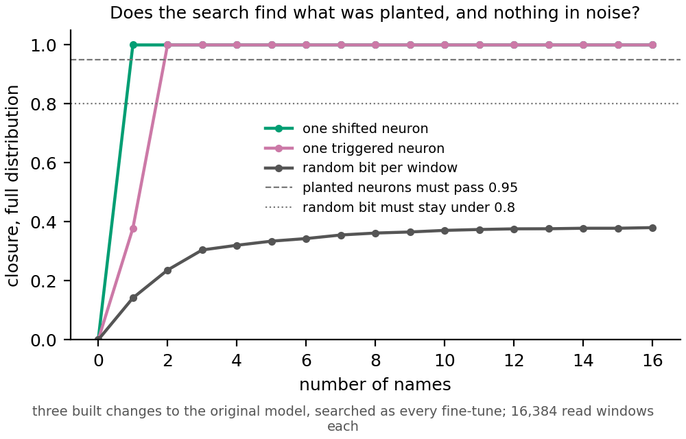
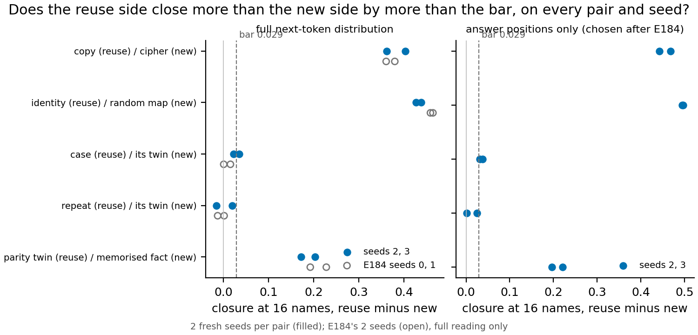
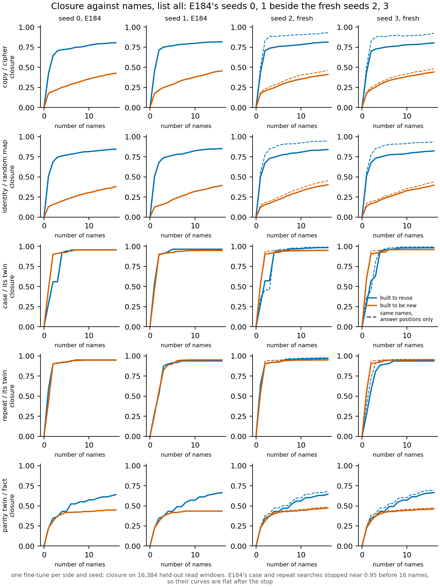

# Does the closure curve tell every trained pair apart on fresh seeds?

*2026-11-17, definition-lead. Cell P1.23, experiment E192: a filed test, on fresh seeds 2 and 3, of the curve reading
from the earlier ranking run E184 and its re-read E191. Card `experiments/curve_test/card.md`; filed rule
`experiments/curve_test/results/predictions.json`; scores `experiments/curve_test/results/score.json`; figures
`experiments/curve_test/figures/{controls,gaps,curves}.png` from `experiments/curve_test/plot.py`. The fourth reuse
wording is tested here, not adopted, so nothing below is a reused or new verdict on any fine-tune.*

We trained two fresh seeds of each of the five built pairs and ran the same search over the original model's variables
on all twenty fine-tunes. Three pairs separate as built, by a wide margin on both seeds, but repeat does not separate on
either seed and case only barely, so the filed rule fails under both readings. The curve reading orders three of five
built pairs reliably, and the open question is whether the case and repeat pairs really differ in what they reuse.

## The answer

The filed rule fails on both readings. It needed the side built to reuse to close more of its gap than the side built to
be new, by more than the largest seed-to-seed difference seen before, on all ten pairs and seeds. On the full next-token
distribution it held on seven of ten; on the answer tokens alone, on eight. Copy against cipher, identity against random
map and parity twin against memorised fact separate on every seed. Repeat never does, and case clears the bar only
narrowly. This is the outcome the filed rival expected.

## What we were trying to test

Each fine-tune F of the 67M model M is compared with M through a search for a small intervention on M's own variables
that makes M behave like F. The list of variables holds M's MLP neurons, the top principal directions of the residual
stream at five sites, the input tokens at the last two positions and the output logits. A name is one variable the
intervention shifts or rescales, or one variable such a shift reads. A greedy search adds one name at a time, refits
every number, and records how far it got.

The quantity read is the closure, $1 - \mathrm{KL}(F \| M_I) / \mathrm{KL}(F \| M)$ at the last position, where $M_I$ is
M under the intervention. It reads 0 when the intervention removes none of the gap between M and F and 1 when it removes
all of it. Each item's curve is, at each number of names n, the best closure either greedy pass found with at most n
names. The empty intervention closes 0, so every curve starts there.

The earlier run read these curves on seeds 0 and 1 of five built matched pairs. In each pair one side was built to reuse
something M already does and the other to be new, on the same inputs:

- **copy against cipher**: a table of key words after a marker, answered on one side by copying the key and on the other
  by a fixed random partner word;
- **identity against random map**: the same kind of table, each key followed by itself or by a fixed random partner;
- **case against its twin**: one side labels whether the word before a marker is capitalised; the twin sees the same
  words with labels shuffled per word, so it can only memorise;
- **repeat against its twin**: one side labels whether that word occurred earlier in the window, with the same kind of
  shuffled twin;
- **parity twin against memorised fact**: both push the output after a number. The twin pushes when the last number
  is odd, which M already reads; the fact pushes when a random label fixed per number token is 1.

This run trained seeds 2 and 3 of all ten sides with their original recipes. It ran the same search on each over the
whole list, up to 16 names. The search did not stop when the closure passed 0.95, and fitted no free directions. One search was run per
fine-tune, ranked on the full distribution. The same names were then read twice:

- **the full reading**: closure on the full next-token distribution over all 16,384 held-out read windows, the earlier
  run's measure;
- **the answer reading**: the same ratio over only those windows whose last position is the task's answer position.
  This reading was chosen after seeing the earlier run's results, and the user asked for it to be marked so.

Three controls ran first and alone, before any training, as in the earlier run. Two plant a change built from the list
itself: one neuron shifted everywhere, and one neuron shifted only when a residual direction fires. A search that works
must recover each with one and two names. The third writes a random bit per window into the residual stream, which no
small intervention can predict on held-out windows; the search must stay under 0.8 on it.

## What we expected, and why

The rule was filed before any read: at 16 names, the reuse side's closure exceeds the new side's by more than the bar, on
every pair and seed. The bar is the largest difference between seeds 0 and 1 on any one side in the earlier run, which
was the cipher side at 0.0295. The same bar applies to both readings, although it was measured on the full reading only.

Two rivals were filed. The first said the reuse side sits nearer to something already on M's list, so a few names close
more of its gap, and the rule would hold on all ten. The second said the search closes any fine-tune that moves a few
output logits about equally well, whatever it reused, so at least one pair-seed would fail, most likely case or repeat.
Run on the earlier seeds 0 and 1 before filing, the rule failed there too, holding on six of ten, all four misses on case
and repeat.

## What we observed

### Does the search find what was planted, and nothing in noise?

**Reading it.** Yes: the apparatus passed every control before anything was trained. The shifted neuron is recovered by
its own single name and the triggered neuron by two names, each closing its whole gap, against a required 0.95. The
random bit is closed to only 0.38 after 16 names, well under its ceiling of 0.8, so a closure near that level is what
the search reaches on a change it cannot predict.

### Does the reuse side close more than the new side, by more than the bar, on every pair and seed?

**Reading it.** No: the rule fails on both readings. Each dot is the reuse side's closure at 16 names minus the new
side's; the dashed line is the bar and the grey line at zero means no difference. Copy against cipher, identity against
random map and the parity twin against the fact sit far right of the bar on both seeds and both readings, at 0.17 to
0.50. Repeat sits at or below the bar on both fresh seeds, at 0.020 and minus 0.015 on the full reading, as it did on
seeds 0 and 1. Case clears the bar on seed 2 but misses on seed 3 at 0.023 on the full reading; on the answer reading
both case seeds clear it, by a few thousandths. The open circles are the earlier seeds 0 and 1, full reading only.

| pair, seed | full: reuse | full: new | full: gap | holds | answer: reuse | answer: new | answer: gap | holds |
|---|---|---|---|---|---|---|---|---|
| copy / cipher, 2 | 0.81 | 0.41 | 0.402 | yes | 0.93 | 0.46 | 0.468 | yes |
| copy / cipher, 3 | 0.80 | 0.44 | 0.361 | yes | 0.92 | 0.48 | 0.443 | yes |
| identity / random map, 2 | 0.84 | 0.40 | 0.438 | yes | 0.95 | 0.45 | 0.494 | yes |
| identity / random map, 3 | 0.82 | 0.40 | 0.426 | yes | 0.94 | 0.44 | 0.497 | yes |
| case / its twin, 2 | 0.98 | 0.95 | 0.035 | yes | 0.99 | 0.95 | 0.038 | yes |
| case / its twin, 3 | 0.98 | 0.96 | 0.023 | no | 0.99 | 0.96 | 0.032 | yes |
| repeat / its twin, 2 | 0.97 | 0.95 | 0.020 | no | 0.98 | 0.95 | 0.025 | no |
| repeat / its twin, 3 | 0.94 | 0.95 | -0.015 | no | 0.96 | 0.96 | 0.002 | no |
| parity twin / fact, 2 | 0.64 | 0.47 | 0.172 | yes | 0.68 | 0.49 | 0.196 | yes |
| parity twin / fact, 3 | 0.66 | 0.46 | 0.203 | yes | 0.70 | 0.47 | 0.221 | yes |
| **holds** | | | | **7 of 10** | | | | **8 of 10** |

The same gaps on the earlier seeds, full reading, at the best closure with at most 16 names:

| pair | seed 0 gap | seed 1 gap |
|---|---|---|
| copy / cipher | 0.379 | 0.360 |
| identity / random map | 0.464 | 0.458 |
| case / its twin | 0.001 | 0.016 |
| repeat / its twin | 0.002 | -0.012 |
| parity twin / fact | 0.192 | 0.228 |

In the earlier run the case and repeat searches stopped near 0.95, at 7 to 11 names, before reaching 16. Their earlier
numbers are therefore the closure at the stop, not at 16 names, and are not like-for-like with seeds 2 and 3. The fresh
case gaps are a little larger than the earlier ones, which may be the extra names past 0.95 rather than the seeds.

### Is the split by pair the same on fresh seeds as on the earlier ones?

**Reading it.** Yes: the curves on seeds 2 and 3 have the same shapes as on seeds 0 and 1, pair by pair. On copy and
identity the reuse side rises to about 0.7 within three names and the new side climbs slowly to about 0.4. On case and
repeat both sides close nine tenths of a large gap within two to four names. They end within a few hundredths of each
other, and on seed 3 of both pairs the new side is ahead for the first few names. The parity twin and the fact
match up to four names, after which the twin keeps rising and the fact flattens. The dashed answer-reading curves end a
little above the full ones on every item and keep each pair's order, so the answer reading changes no picture, only
case seed 3's margin.

## What we learned

On fresh fine-tunes the curve reading separates three of the five built pairs by a wide margin and fails to separate
the other two, the same split as on the first two seeds. So the failure of the filed rule is not seed noise: it comes
from the case and repeat pairs, where both sides are closed to about 0.95 by a handful of names. For the working
definition this means the curve reading, as measured, gives a stable ordering on three built pairs and no ordering on
two. Reading only the answer tokens does not rescue it.

## How compelling is the evidence

- **Seeds and pairs.** Two fresh seeds on each of five pairs, one fine-tune per side and seed, read on 16,384 held-out
  windows. The three separating pairs clear the bar by about six to seventeen times on every seed; the misses on repeat
  are at or below zero difference on one seed.
- **Noise floor.** The bar is the largest seed-to-seed difference on any one side in the earlier run; it was measured on
  the full reading, so the answer reading's floor is not measured.
- **Blind spots.** Every closure is a lower bound: the greedy search can miss better interventions, and it sees only the
  last position and changes linear in the listed variables. The answer reading ignores what the fine-tune does on windows
  without the task's cue.
- **Like-for-like.** The earlier case and repeat numbers stopped near 0.95 before 16 names, so the comparison with them
  is about the shape, not the decimals.

## Surprises

None. The rule failed, and the filed second rival named case or repeat as the likely misses; both appeared. The case
pair clearing the bar on the answer reading on both seeds, while missing on one seed on the full reading, is a narrow
margin, not a reversal.

## Open question for the gate

An advisory premise check on this cell came back "doubtful". Its point is that the split by pair is stable across all
four seeds: copy against cipher, identity against random map and the parity twin against the fact separate, while case
and repeat do not. So the question left open is whether the case and repeat pairs' two sides really differ in reuse
against building. Apart from how they were constructed, nothing has yet shown that they do. The check advises only; this
page makes no recommendation on it.

## What next

- Suppose an account of what the case and repeat sides compute, made without this measure, shows both sides reuse M
  alike. Then their failure here lies in the pairs, not the reading, and the reading's record becomes three of three.
- If such an account shows the sides differ, the curve reading misses a real difference, and the gate page lists case and
  repeat as places where it gives no reading.

## Scorecard

| id | claim in words | rule | read | verdict |
|---|---|---|---|---|
| controls | the search finds the planted neurons and not the random bit | shifted neuron at 1 name and triggered at 2, closure at least 0.95; random bit under 0.8 in 16 names | 1 name, 2 names, random bit 0.38 | pass |
| learned | every fresh fine-tune learned its task | each recipe's own criterion | 20 of 20 | pass |
| rival A, full | the reuse side's closure at 16 names exceeds the new side's by more than 0.0295 on all ten pair-seeds | gap above bar on all ten | 7 of 10 | fails |
| rival B, full | at least one pair-seed at or under the bar, most likely case or repeat | any pair-seed at or under bar | case seed 3, repeat seeds 2 and 3 | holds |
| answer reading, reported beside | same rule, same bar, answer windows | gap above bar on all ten | 8 of 10; repeat seeds 2 and 3 miss | fails |

## Not run

- No answer reading on the earlier seeds 0 and 1: their files saved only the full closure.
- No noise floor measured for the answer reading; the full reading's bar was reused.
- No second search ranked on the answer tokens; the answer reading reads the full search's names.
- No free-direction fits, the third grade of the earlier ranking.
- No re-run of the earlier case and repeat searches to 16 names without the 0.95 stop.
- No further seeds and no account, independent of this measure, of what the case and repeat sides compute.
- Only one of the earlier run's unpredictable controls, the random bit, was rerun; the other two were not.

## Departures from the literature

None new in this run. The list, the greedy search and the closure are the earlier ranking run's, unchanged, and that
run's write-up lists its own departures.

## Provenance

- Results: `experiments/curve_test/results/` — `controls.json`, `train.json`, `score.json`, `run.log`, and one file per
  fine-tune, `<item>_s2.json` and `<item>_s3.json`.
- Earlier curves: `experiments/e184_curves/results/curves.json`; earlier search code `experiments/simplest_intervention/`.
- Card: one RunPod H100 SXM, about 1.6 h end to end; cost $7.75.
