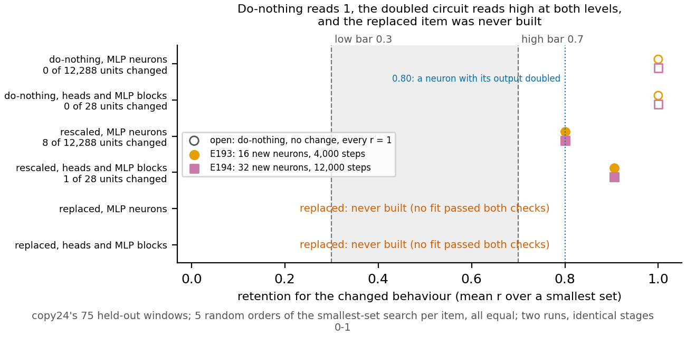
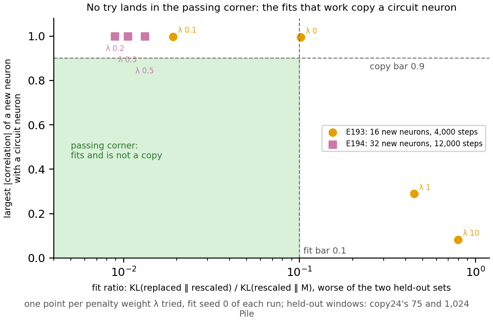

# Can causal-rule retention tell a kept circuit from a replaced one?

*2026-11-17, definition-lead. Cell P1.24, two runs on the 67M model. The definition is tested here, not adopted:
nothing in `decisions.md` changes, and no fine-tune gets a reused or new verdict.*

We tried to calibrate a new candidate definition of reuse, causal-rule retention, on three edits of the 67M model whose
machinery we built by hand. The unchanged model and a circuit with its output doubled read as predicted, but the third
edit, a circuit replaced by different neurons computing the same values, could not be built in two attempts. So the definition is neither confirmed nor refuted as a test of reuse, and the trained fine-tunes were not
read.

## The answer

The calibration is half done. Unchanged units score a retention of one, and a circuit whose output is doubled scores
high at both levels we tried, as it should. The case that matters, a circuit swapped for new neurons that compute the
same thing, was never built. Every set of fresh neurons that reproduced the circuit's effect did so by copying one of
the circuit's own neurons. Every set pushed away from copying failed to reproduce it. Both runs of the cell are spent,
no level is frozen, and an open question goes to the user.

## What the definition says

Describe the original model and an edited copy as two diagrams of units at the same declared level. Each unit has a rule:
what it writes, given what it reads. Pair each unit of the copy with the unit in the same place in the original. A unit
is retained to the degree that its rule is unchanged. For a change in behaviour, the reading is how well retained the
units are that the copy needs to produce that change. Low retention there would mean the behaviour runs on new
machinery; high retention would mean it runs on old machinery, perhaps turned up or down.

Two levels were declared before any reading:

- **MLP neurons.** A unit is one neuron of the 4 MLP layers, 12,288 in all. Its output is its activation times its
  output weights.
- **Heads plus MLP blocks.** A unit is one attention head or one whole MLP block, 28 in all.

## The retention score

For each unit $u$, both networks' versions of the unit are fed the original model's input at that layer, so only the
rule can differ. Write $f_M$ and $f_F$ for the two outputs over every held-out window and position. The retention is

$$r(u) = 1 - \min\Big(1, \frac{\lVert f_F - f_M \rVert^2}{\lVert f_F \rVert^2 + \lVert f_M \rVert^2}\Big).$$

It reads 1 when the rule is unchanged. A unit whose output is doubled reads 0.80, by the formula alone. A unit that
writes zero reads 0, and so does a new unit with no partner in the original model.

The **retention for the changed behaviour** is read on the smallest sets of changed units that still produce the
behaviour. A set qualifies when putting every changed unit outside it back to the original rule keeps at least 0.9 of
the edit's effect, measured as the KL divergence between the edited and original next-token distributions. The search
runs in five random orders, and the reading is the mean retention over each set found.

Before any reading the definition also asks for a **faithfulness check**: the units' outputs, added back up, must
reproduce the network's logits to within a relative error of 1e-3. At both levels used here the units are the network's
own computation split into parts, so the check holds by construction. It passed, but it tested nothing; it could only
bite on a fitted level, and none was run.

## The three built items, and why

Each item is an edit whose machinery is known, so the score has a right answer to hit. The circuit $C$ is the 8 neurons
of one MLP layer that carry the most attribution, activation times gradient of the answer logit, on the copy24 key-table
task. That layer turned out to be layer 1.

1. **Do-nothing.** An exact copy of the model. Every unit should read 1. This checks the apparatus.
2. **Rescaled.** $C$'s output doubled. This is reuse in its plainest form: the same machinery, turned up. It should read
   high, at or above 0.7.
3. **Replaced.** $C$'s output set to zero and fresh neurons added to the same layer, trained so the model matches the
   rescaled item's predictions. This is meant to be new machinery doing the old job, so it should read low, at or below
   0.3. To count as built, a try had to pass two held-out checks. Its remaining KL to the rescaled item had to be at most
   0.1 of the rescaled item's own KL to the original. And no new neuron's activation could correlate above 0.9 in
   absolute value with a neuron of $C$, since a copy is old machinery under a new name.

The filed rule: a level passes when do-nothing reads 1 everywhere, rescaled reads high and replaced reads low. We
expected the neuron level to pass. We expected the coarser level to read the replaced item high and fail, because the
swap happens inside one MLP block, and a block-level unit cannot see inside itself. That blindness is one of the
definition's own stated limits.

## The control and the doubled circuit read as predicted

**Reading it.** Both items that were built land where the arithmetic says they must, in both runs. The do-nothing copy
reads 1 on all 12,288 neurons and all 28 heads and blocks, the open markers at the right. The doubled circuit changes 8
neurons, and each reads 0.80, the dotted line. Every smallest set the search found lies inside the circuit, so the
retention for the changed behaviour is 0.80 in all five orders. At the coarser level only layer 1's MLP block changed,
and it reads 0.906, above the high bar. That value follows from the circuit writing about a third of its block's output.
The two runs agree to every digit here because their first two stages are the same computation.

One property shows here that matters later. The score is sensitive to size, not only to identity: a circuit that is
plainly reused, only louder, reads 0.80 rather than 1. Doubling a unit and leaving it alone are not the same rule under
this distance, which is the intended behaviour, but a reader should not take 0.80 as "partly new".

## The replaced item could not be built

**Reading it.** No try reached the green corner where the new neurons both reproduce the circuit's effect and are not a
copy of it. In the first run, with 16 new neurons, the two lightest penalties fit the target but copied: the largest
correlation with a circuit neuron was 0.996 and 0.998. The two heaviest penalties stopped the copying but lost the fit,
leaving 0.44 and 0.78 of the effect unexplained. The second run doubled the neurons, tripled the training steps and tried
penalties between those two. All three fit well, within about one percent of the effect, and all three still copied, at
0.999 and above.

The penalty was the mean squared correlation between new and circuit neurons, and it did its job on all but one neuron.
Count the copies: with no penalty, 10 of 16 new neurons tracked a circuit neuron above 0.9; at the lightest penalty, 2 of
16; in every try of the second run, exactly 1 of 32. That one neuron correlated above 0.9 with five of the circuit's eight
neurons at once, so those five fire nearly in step. The fit seems to need one neuron along their shared input direction.
A penalty on the average could not dislodge it without the fit giving way.

Both runs stopped at their first fit seed, as the filed rule required. So there is no replaced reading at either level,
no level was frozen, and the five trained matched pairs were not read.

## What the failure means

This is a finding about the construction, not a verdict on the definition. The definition was never shown a replaced
circuit, so it was never asked to tell one apart. What we learned is narrower. In this model, fitting fresh neurons to
the circuit's values pulls at least one of them onto a circuit neuron's own input direction. Pushing them all away loses
the fit. "Same values, different neurons" was not easy to make by gradient descent inside one layer.

That raises a question the definition does not yet answer. If a fine-tune's new units reproduce an old circuit's
outputs, what should the definition call that, and what observation would decide it? The definition, read at the
neuron level, would score such units zero, since they have no partner in the original model. A copy test like ours
would call them old machinery. These are different answers, and the choice between them is a definition change that
only the user makes.

## What this changes for the goals

The search for a working definition of reused against new learns two things here. First, the apparatus for causal-rule
retention works: the analytic readings came out exact and the control ran clean. Second, its calibration depends on a "replaced" item that our method could not produce, so the definition's
power to separate reuse from new machinery is still untested. The magnitude sensitivity is a cost to weigh against any
rival wording, since a re-weighting that only turns a circuit up will not read as fully retained.

## How compelling is the evidence

The do-nothing and rescaled readings are exact and repeat across both runs, so they are as solid as arithmetic. The
replaced failure rests on one fit seed per run, seed 0, seven penalty settings in all, and one circuit on one task. A
different seed, circuit or layer might build. The copy check is a correlation over held-out Pile and copy24 positions.
It cannot see a copy spread thinly across several new neurons, but what we saw was the opposite: one neuron copying
outright.

## Surprises

The replaced item resisted construction twice. The second run's longer, larger fits did not help: they fit better than
the first run's and copied just as hard. We had expected the penalty grid between the first run's copy and misfit to
contain a working value.

## Options for the next cell

These are for the user to choose from. The cell's two runs are spent, so each needs a new cell.

- **Build the replaced item by training, not by a target fit.** Knock the circuit out and fine-tune all weights of
  layers 1 to 3 to recover the rescaled item's outputs. Then run the copy check over every unit that changed, not only
  added neurons. This tells us whether a realistic update ever produces "same values, different machinery" in this
  model, and gives the definition a replaced item if it does.
- **A hard constraint.** Remove from the new neurons' input weights every component along the circuit's input
  directions, so a copy is impossible. This tells us whether the effect can be produced off those directions at all. The
  fit may fail, as the two heaviest penalties suggest.
- **Accept a moved copy as the replaced item.** This tests location only: whether the score sees a circuit that moved to
  new neurons. It does not test new computation.
- **Read the five trained pairs on do-nothing and rescaled calibration only.** This gives readings now, with the
  replaced case still uncalibrated.

**Recommendation: the first option.** It is the only one that answers the user's open question with an observation. It
shows what a realistic update does when it must rebuild a circuit's effect. A copy found there would be an answer, not a
failed build.

## Scorecard

| id | claim in words | rule | read | verdict |
|---|---|---|---|---|
| do-nothing, neurons | every unit unchanged | r = 1 within 1e-6 on all units | 12,288 of 12,288 at 1 | as filed |
| do-nothing, heads and blocks | every unit unchanged | r = 1 within 1e-6 on all units | 28 of 28 at 1 | as filed |
| rescaled, neurons | high | retention at least 0.7 in every order | 0.80 in all five | as filed |
| rescaled, heads and blocks | high | retention at least 0.7 in every order | 0.906 in all five | as filed |
| replaced, both levels | low | retention at most 0.3 at every fit seed | not built | no reading; stop |
| faithfulness check | holds | relative logit error at most 1e-3 | 1.48e-5 at most | holds by construction |
| level frozen for the pairs | a level passes all three | rule.py | none | no level |

Full numbers for every try at the replaced item, fit seed 0:

| run | new neurons, steps | penalty | fit ratio copy24 | fit ratio Pile | largest abs corr | copying neurons |
|---|---|---|---|---|---|---|
| first | 16, 4,000 | 0 | 0.1017 | 0.0992 | 0.9955 | 10 of 16 |
| first | 16, 4,000 | 0.1 | 0.0133 | 0.0190 | 0.9983 | 2 of 16 |
| first | 16, 4,000 | 1 | 0.436 | 0.448 | 0.289 | 0 of 16 |
| first | 16, 4,000 | 10 | 0.783 | 0.798 | 0.083 | 0 of 16 |
| second | 32, 12,000 | 0.2 | 0.0071 | 0.0089 | 0.9990 | 1 of 32 |
| second | 32, 12,000 | 0.3 | 0.0097 | 0.0105 | 0.9990 | 1 of 32 |
| second | 32, 12,000 | 0.5 | 0.0121 | 0.0132 | 0.9996 | 1 of 32 |

The bars are 0.1 on both fit ratios and 0.9 on the correlation. The first run's unpenalised try missed the fit bar too,
narrowly, on copy24.

Other readings: the rescaled item's KL to the original is 0.101 nats on copy24's held-out windows and 0.101 on Pile's.
The circuit writes a share of 0.322 of its block's output, measured as squared norm. The smallest sets at the neuron
level held 4 or 5 of the 8 circuit neurons and kept 0.913 to 0.924 of the effect.

## Not run

- The replaced item at fit seeds 1 to 3, in either run: both runs stopped at seed 0.
- Any replaced reading at either level, so neither rival about the coarser level was tested.
- The five trained matched pairs.
- A level of decomposition components, or any fitted level, the only kind on which the faithfulness check could fail.
- A replacement spread across two blocks; built items with other doubling factors; a held-out family of constructions.
- A hard constraint on the new neurons' input weights, or a replaced item made by fine-tuning whole layers.

## Departures from the literature

- **Causal abstraction.** Geiger and colleagues' causal abstraction aligns a high-level model to a network through
  interventions and searches over alignments. Here the alignment is fixed to the identity at the same place in both
  networks, with no search, because the definition declares it location-preserving. A moved mechanism therefore reads as
  unmatched.
- **Faithfulness.** Work that assesses abstractions empirically, such as Chalupka and colleagues and Pîslar and
  colleagues, tests a fitted abstraction against held-out interventions. Our check only adds the units back up, which
  holds by construction at architecture levels and so is not a test.
- **The aggregate.** Retention over smallest sufficient sets is this project's proposal; no published definition of
  mechanism reuse between two networks in this form was found.

## Provenance

- First run, E193: `experiments/rule_retention/results/stage{0,1,2}.json`, `run.log`, filed `predictions.json`,
  card `experiments/rule_retention/card.md`. Second run, E194: the same files under `results/amend1/`, card
  `card_amend1.md`.
- Code: `src/commute/rule_retention.py`, `experiments/rule_retention/run.py`; figures from
  `experiments/rule_retention/plot.py --report`.
- Plan `reports/plans/2026-11-17_plan_causal-rule-retention.md`; definition
  `~/commute-data/scratch/definition-session/2026-11-17_causal-rule-retention.md`; premise check
  `~/commute-data/premise/P1.24.md`.
- Cost about $1.20 for the first run and $2.25 for the second, on RunPod. Peak host memory 6.1 GB in each.
