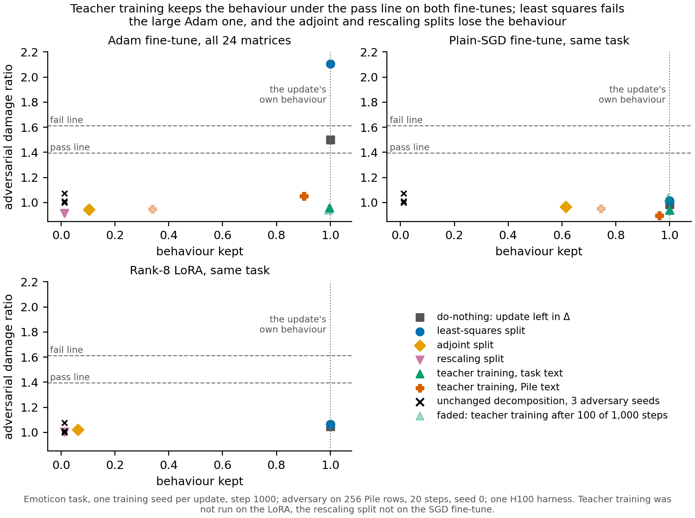

# Figure A1: which ways of carrying an update keep its behaviour and stay faithful?

We redrew, from saved results only, how well each way of carrying a finished emoticon update onto the 67M decomposition keeps the update's behaviour and stays faithful under the adversary. Teacher training keeps the behaviour and passes the adversarial check on both fine-tunes it was run on, while the least-squares split fails the check on the large Adam fine-tune and the adjoint and rescaling splits lose most of the behaviour. For `GOALS.md` this is the appendix picture behind "teacher training is the commute map on the 67M": it is the only method in the set that keeps both properties on every update it was given.

## What the figure shows

Each panel is one finished update of the emoticon task at training step 1000, carried onto the same decomposition in several ways. The horizontal axis is behaviour kept: the carried state's held-out probability of the target token, divided by the same probability for the do-nothing state. The do-nothing state leaves the whole update in Δ, the residual weights the subcomponents do not cover, so it computes the fine-tuned model exactly and reads 1 by construction. The unchanged decomposition reads about 0.01, its prior on the target.

The vertical axis is the adversarial damage ratio. An adversary searches for 20 steps over masks of the subcomponents and Δ on 256 Pile rows for the largest damage it can do. The ratio divides that damage by the damage it does to the unchanged decomposition, so the unchanged decomposition reads 1. Its spread over three adversary starts sets the two lines. Under the pass line counts as faithful, over the fail line as not faithful, and between them is inconclusive.

The three panels are an Adam fine-tune of all 24 matrices, a plain-SGD fine-tune that moves the weights less, and a rank-8 LoRA. All three are trained on the same task for the same 1,000 steps and read in the same H100 harness against the same unchanged-decomposition readings. Teacher training was run on the two fine-tunes, once on the task's text and once on plain Pile text. Faded markers show its students after 100 of their 1,000 steps.

## Reading it

On the Adam fine-tune, teacher training on task text keeps the whole behaviour at a ratio of 0.96, inside the pass line. The least-squares split also keeps the whole behaviour, but its ratio of 2.11 is past the fail line. It leaves 0.38 of the update in Δ as well. Do-nothing reads 1.50, between the lines. The adjoint split stays faithful but keeps only 0.10 of the behaviour, and the rescaling split keeps none of it. Teacher training on Pile text keeps 0.90 at a ratio of 1.05. After only 100 student steps it had kept just 0.34.

On the plain-SGD fine-tune everything passes, the do-nothing state included at 0.98. That update is smaller, and small updates passed under every placement in the earlier split work. Least squares keeps the behaviour here at 1.01, though it still leaves 0.30 of the update in Δ. The adjoint split keeps 0.61. Both teacher-training copies keep at least 0.96 of the behaviour and pass. On the LoRA every state passes. Only least squares keeps the behaviour among the splits, and it leaves 0.54 of the LoRA's update in Δ. The adjoint split keeps 0.06 and the rescaling split about 0.01.

So the one method that keeps the behaviour and passes on every fine-tune it was given is teacher training. The figure shows one training seed per update, one task and one adversary start per state. The spread it can show is the unchanged decomposition's three adversary starts, which differ by up to 0.07 in ratio.

## Caption draft

**Figure A1. Carrying a finished update onto the decomposition: behaviour kept against adversarial faithfulness.** Each panel is one update of the 67M model on the emoticon task at step 1000. Points are ways of carrying it onto the parameter decomposition: do-nothing, which leaves the update in the residual Δ; the least-squares, adjoint and rescaling splits; and teacher training on task text or on Pile text, run on the two fine-tunes only. Horizontal: the carried state's held-out probability of the target token over the update's own. Vertical: damage under a 20-step mask adversary on 256 Pile rows, over the same adversary's damage to the unchanged decomposition. Black crosses: the unchanged decomposition under three adversary starts, whose spread sets the pass and fail lines. Only teacher training keeps the behaviour under the pass line on both fine-tunes. One training seed per update.

## Numbers

All at step 1000; the ratio is against the unchanged decomposition under adversary start 0.

| update | state | behaviour kept | damage ratio | share of update left in Δ |
|---|---|---|---|---|
| Adam fine-tune | do-nothing | 1.00 | 1.50 | all |
| | least-squares split | 1.00 | 2.11 | 0.38 |
| | adjoint split | 0.10 | 0.94 | none |
| | rescaling split | 0.01 | 0.92 | none |
| | teacher training, task text | 1.00 | 0.96 | none |
| | teacher training, Pile text | 0.90 | 1.05 | none |
| plain-SGD fine-tune | do-nothing | 1.00 | 0.98 | all |
| | least-squares split | 1.00 | 1.01 | 0.30 |
| | adjoint split | 0.61 | 0.97 | none |
| | teacher training, task text | 1.00 | 0.94 | none |
| | teacher training, Pile text | 0.96 | 0.90 | none |
| rank-8 LoRA | do-nothing | 1.00 | 1.05 | all |
| | least-squares split | 1.00 | 1.07 | 0.54 |
| | adjoint split | 0.06 | 1.02 | none |
| | rescaling split | 0.01 | 1.00 | none |

"None" means under one part in a thousand. The pass line is 1.40 and the fail line 1.61, from the unchanged decomposition's spread of 0.075 across adversary starts. The full-precision values, with each point's source file and key, are in `experiments/split_comparison/figures/paper_figA1_carrying.csv`.

## Sources

- Adam fine-tune and LoRA, every split and do-nothing: `experiments/split_comparison/results/split_comparison.json`, `.rows[10..13]` and `.rows[25..28]`, from the five-operations comparison run on one H100.
- Plain-SGD fine-tune, do-nothing and the two splits: `experiments/small_finetune_splits/results/small_finetune_splits.json`, `.rows[6..8]`, from the small fine-tunes' splits run.
- Teacher training of both fine-tunes: `experiments/teacher_training/results/teacher_training_emoticon.json`, `.teachers.adam` and `.teachers.sgd`, arms `A` for task text and `B` for Pile text, keys `"100"` and `"1000"` for the student step.
- Unchanged decomposition: `.W0.pile` of the first file. The three files hold the same unchanged-decomposition readings to every digit; the script asserts it.
- Script: `experiments/split_comparison/paper_figA1.py`.

## What was comparable and what was not

Comparable: the three updates above. They share the task, the 1,000 training steps, the held-out text, the H100, the 256-row 20-step adversary and the unchanged-decomposition readings. The teacher-training file's do-nothing ratios equal the split files' ratios for the same fine-tunes to every digit, so the copies were made from the same saved fine-tunes. The script checks both facts before drawing.

Not put on these axes:

- The other four fine-tunes teacher training copied, two trigger tasks each under SGD and Adam. They have teacher training, do-nothing and the adjoint split, but no least-squares or rescaling state, so they would add rows with most methods missing.
- The adjoint split on more tasks and seeds. It was read on L40 and L40S cards with a different spread across adversary starts, so its ratios sit against different lines.
- The Pile-text copy of the Adam fine-tune was later re-run at three batch orders on an L40. It did not reproduce well there, so the point here is one draw from a spread. That spread is not on this card and is not drawn.
- Component training, which trains the subcomponents on the task in place of the update. It does not carry a finished update, so it is not one of the methods here.
- The unscaled adjoint split, read by a later run on the emoticon fine-tunes; this figure keeps to the scaled split that the Terms define.

## Departures from the literature

- The adversarial ratio is this project's harness: a 20-step mask search on 256 Pile rows after the fact, divided by the same search on the unchanged decomposition. The VPD paper uses its adversarial loss during decomposition training and reports no ratio of this kind.
- Behaviour kept is the probability of one target token, not a task accuracy from a benchmark.

## Not run

- Teacher training on the LoRA.
- The rescaling split as a state on the plain-SGD fine-tune.
- A second training seed for any of the three updates at this card.
- More than one adversary start per carried state; each carried point is one start, so a pass is a lower bound on damage.
- Steps 10 and 100 of the updates, which the split files hold but this figure leaves out to keep one point per method.
