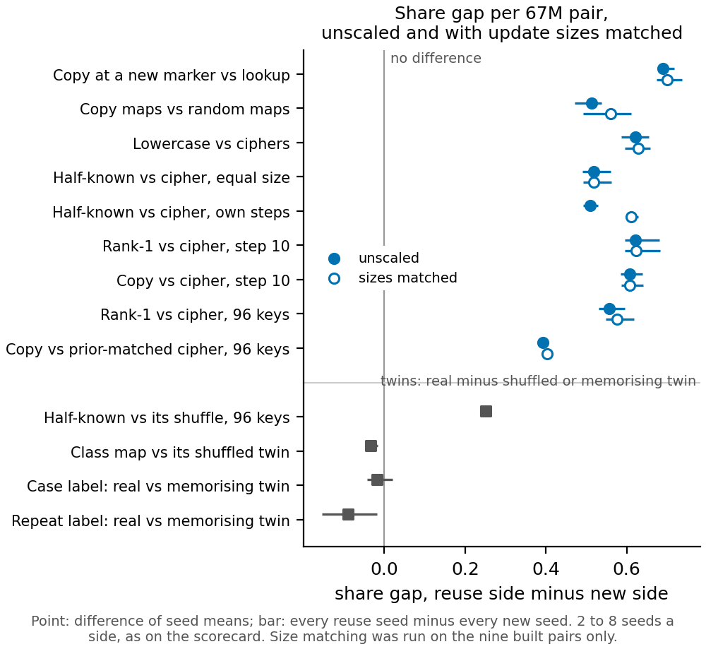
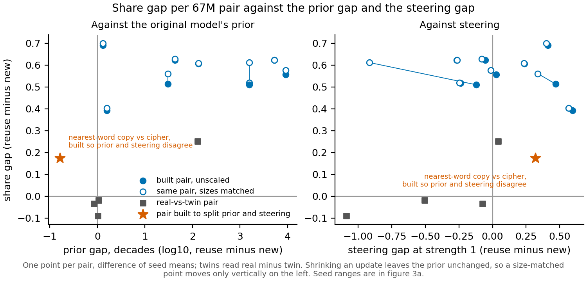

# How does the share separate the small model's pairs, and how does it sit against the prior and steering?

*Cell P2.36, regating-lead, 2026-11-17. Saved results only: no run, no model loaded. Script
`experiments/method_table/paper_figs.py`. Descriptive only: no side is called reused or new, since the definition is
the user's.*

We drew two paper figures from saved small-model results: the share's gap per pair, with and without matched update
sizes, and that gap against the prior and against steering. On every pair built to differ, the reuse side reads the
higher share whether or not sizes are matched, while the prior and steering gaps vary widely. For the paper, the share's
separation of the built pairs tracks neither cheaper reading, and one pair built so the two disagree sits with steering.

**Terms.** A *pair* is two sets of fine-tunes of the 67M model, one side built to reuse an ability the model already
has and one built to need a new one. The *share* is the part of a fine-tune's gain that comes from changing only which
subcomponents Γ switches on: 0 means none of the gain, 1 all of it. A *gap* is the reuse side's seed mean minus the new
side's; for the four *twins* it is the real task minus its shuffled or memorising twin. The *prior* is the original
model's probability of the trained answer, in decades. *Steering* adds the fine-tune's mean activation change to the
original model and reads the share of the gain it recovers. *Size-matched* means the side with the larger weight change
was multiplied by one number until both sides changed the weights equally on average.

## Figure 3a: the share gap per pair, unscaled and size-matched

**What it shows.** One row per scorecard pair, nine built pairs above the line and four twins below it. Each dot is the
gap of seed means. Its bar spans every reuse seed minus every new seed, so a bar clear of zero means every seed of one
side lies beyond every seed of the other. Filled dots are the saved fine-tunes, hollow
dots the same pair after size matching.

**Reading it.** Every built pair reads a positive share gap with its bar clear of zero, from 0.39 on copy against the
prior-matched cipher to 0.69 on copy at a new marker against lookup. Matching sizes moves no built pair's gap by more
than 0.10, and that largest move is upward, on the half-known task against a cipher trained for its own number of steps.
The twins read differently: three sit near or below zero, from -0.090 to -0.018, and the half-known task against its
shuffle reads 0.25. On the case-label twin the bar crosses zero.

**Caption draft.** *Share gap per pair on the 67M model: the share of the fine-tune's gain carried by changing which
subcomponents are switched on, side built to reuse minus side built new, or for the twins real task minus its shuffled
or memorising twin. Dots are differences of seed means and bars span every reuse seed minus every new seed, 2 to 8 seeds
a side. Filled: saved fine-tunes. Hollow: the side with the larger update shrunk by one scalar to its partner's mean
update size. Size matching was run on the nine built pairs only.*

**Sources.**
- Unscaled: `experiments/method_table/results/final.json`, `.cells[] | select(.pair==P and .method=="share")`, fields
  `.reuse` and `.new`; that file names each value's origin in its `.source`.
- Size-matched: `experiments/size_matched/results/summary.json`,
  `.cells[] | select(.model=="67M" and .pair==P and .reading=="share") | .matched_values`.
- Plotted numbers with their file and key: `experiments/method_table/figures/paper_fig3a_share.csv`.

**Not run.**
- Size matching on the four twins: the size-matched run covered the nine built pairs only.
- Any seed range for a size-matched gap beyond the saved seeds; the shrunk side keeps its own seed count.

## Figure 4: the share gap against the prior gap and the steering gap

**What it shows.** Two panels sharing the share gap on the vertical axis. On the left the horizontal axis is the prior
gap in decades; on the right, the steering gap at strength 1. Filled blue dots are built pairs, and hollow ones the same pairs
size-matched, joined to them. Grey squares are the twins. The orange star is a pair built so that the prior and steering
point opposite ways. Shrinking an update does not change the original model, so the prior is unchanged and a
size-matched point moves only vertically on the left.

**Reading it.** The built pairs' prior gaps span 0.12 to 3.96 decades, and the pair with the smallest prior gap has the
largest share gap. Their steering gaps run from -0.27 to 0.59. Steering's gap is below zero on four built pairs, three of them with
seed ranges apart, where the share's gap is above zero. Size matching moved one steering gap far, on the half-known task against its
own-steps cipher, from -0.12 to -0.92; the size-matched report says the run does not explain it. On the starred pair the
prior gap is -0.79 decades and the steering gap 0.32, and the share gap of 0.175 lies on the steering side. The two
label twins read steering gaps of -0.51 and -1.09 with share gaps near zero.

**Caption draft.** *Share gap per pair against the gap in the original model's prior, left, and against the gap in
steering at strength 1, right; all gaps side built to reuse minus side built new, or real task minus twin. Blue dots:
built pairs, filled for saved fine-tunes, hollow and joined for the same pair with update sizes matched; size matching
leaves the prior unchanged. Grey squares: real-versus-twin pairs. Star: a nearest-word copy against a cipher, built so
that the prior and steering point opposite ways; no size-matched reading. Seed ranges are in Figure 3a.*

**Sources.**
- Unscaled share, prior and steering: `experiments/method_table/results/final.json`,
  `.cells[] | select(.pair==P and .method==M)`.
- Size-matched share and steering: `experiments/size_matched/results/summary.json`,
  `.cells[] | select(.model=="67M" and .pair==P and .reading==M) | .matched_values`.
- Starred pair: `experiments/disagreeing_pairs2/results/stage2.json`, `.inputs.prior_gap`, `.inputs.share`,
  `.inputs.steering`.
- Plotted numbers with their file and key: `experiments/method_table/figures/paper_fig4_share_vs_prior_steering.csv`.

**Not run.**
- Size-matched points for the four twins and the starred pair: neither was in the size-matched run.
- Seed ranges on this figure; they are in Figure 3a, and the starred pair's are in its own report.
- The Qwen3-1.7B pairs, which use a different decomposition and pair set.

## Things in the inputs to know

- The two half-known pairs share one reuse side, the same five fine-tunes, and the same prior maps, so their prior gaps
  are equal and they are not independent points.
- Steering is read pooled over keys on most pairs but per key on the two half-known pairs, and as a label contrast on the
  two label twins, as the scorecard records in each cell's `form`.
- The starred pair's cipher side reads a share of 0.37 to 0.38 through its own reader, close to the scorecard's
  prior-matched cipher; its gap is taken against that partner, not against a scorecard pair.

## Departures from the literature

None: this page plots saved readings and adds no measurement.
