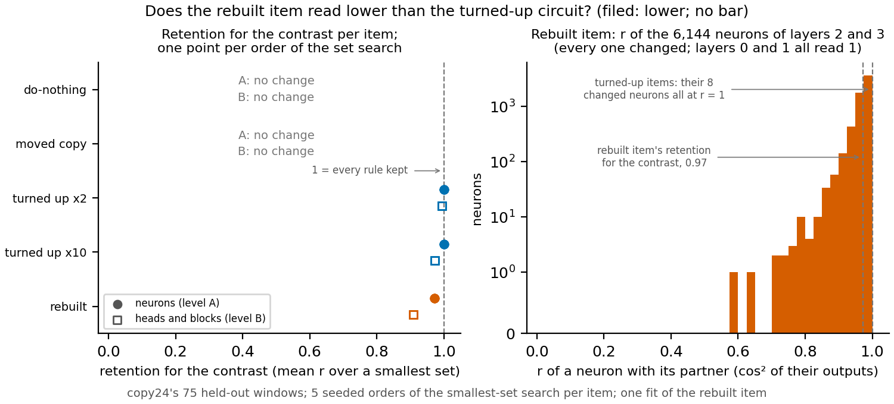

# Does a circuit knocked out and rebuilt by fine-tuning read as less retained than one turned up?

*2026-11-17, definition-lead. Cell P1.25, run 1 of 2, experiment E195. Calibration of a candidate definition of
"reused against new", tested here and not adopted. No fine-tune is called reuse or new on this page.*

We tested a candidate definition, causal-rule retention at the level of single MLP neurons, on edits of the 67M model
whose machinery we built ourselves. Its code checks held, and a circuit switched off and rebuilt by fine-tuning two
later layers read 0.97 retained, against 1 for the same circuit turned up. For `GOALS.md`, the neuron-level reading
separates a rebuilt computation from a turned-up one only narrowly, because a gentle fine-tune moves every later
neuron a little.

## The answer

Under the fixed choices, the definition behaves as its arithmetic says on every built check: doing nothing, moving
the circuit onto fresh neurons, and turning it up all read as fully retained. The rebuilt circuit reads lower, as
the user filed, in every one of five search orders. But the gap is small, 0.97 against 1. The smallest set that
carries the change is thousands of slightly changed neurons, and its mean is close to the average over every
changed neuron. Switching the circuit off is not seen at all at the neuron level.

## What we were testing

**The definition, in plain words.** Take the original model M and a changed model F. A *unit* is one MLP neuron;
its *rule* is what it writes into the residual stream as a function of its layer's input. To compare a neuron of F
with one of M, feed both the same input, namely M's own input to that layer on 75 held-out copy-task windows, and
compare what the two neurons write. Their *rule similarity* $r$ is the squared cosine between the two outputs over
those inputs: $r = 1$ means the same rule up to a change of size, $r = 0$ means unrelated outputs. A change of size
costs nothing, and the fitted gain is reported beside $r$. Neurons may be re-paired within a layer, one to one, in
the way that gives the greatest total $r$, because reordering neurons inside a layer does not change what the
network computes.

The *retention* for a behaviour change is then read as follows. The change is $\mathrm{KL}(F \| M)$, the next-token
divergence of F from M on the same windows. Find a smallest set of F's changed neurons that, kept as they are in F
while every other changed neuron is put back to its M rule, still recovers 0.9 of that divergence. The retention is
the mean $r$ over that set. The search drops neurons in a random order, so it is run in 5 seeded orders and the range
is reported. A neuron that writes zero has no $r$ and can never be in the set. The same reading is also taken one
level up, with attention heads and whole MLP blocks as the units; that side reading has no expectation filed.

**The items.** All are edits of the 67M model around one circuit: the 8 layer-1 neurons that carry most of the
copy task's answer, found by attribution.

- *Do-nothing*: F is a copy of M. It must read "no change".
- *Moved copy*: the circuit's 8 neurons are switched off and copied exactly onto 8 new neurons in the same layer. It
  tests the re-pairing; F computes exactly what M computes, so it must read "no change".
- *Turned up ×2 and ×10*: the circuit's output weights multiplied by 2 or 10. The same rules at a larger size, so
  they must read retention 1.
- *Rebuilt*: the circuit's 8 neurons are switched off, then only the MLP weights of layers 2 and 3 are fine-tuned for
  4,000 steps so that F's outputs match the ×2 item's, on half Pile and half copy-task windows. Here the old circuit
  is gone and its effect is rebuilt elsewhere, so it is the case where a sensible definition should read lower.

The four built checks are not tests of the definition; their readings follow by arithmetic. They test the code.

## What we expected

The user filed one prediction, descriptive with no bar: the rebuilt item reads lower than the turned-up items in
every order. Two outcomes were in view. If the fine-tune rebuilds the effect by changing what later neurons respond
to, the rebuilt item reads clearly below 1. If it reaches the target by small changes of size on neurons that keep
their direction, the rebuilt item reads close to 1, and the neuron level cannot tell a rebuilt computation from a
turned-up one.

## What we observed

### Do the built checks read as the arithmetic says?

**Reading it.** Yes, every one. Do-nothing and the moved copy read "no change" at both levels, with every neuron
paired to the right partner at $r = 1$. The ×2 and ×10 items read retention 1 at the neuron level in all 5 orders.
Each smallest set held 4 to 6 of the circuit's 8 neurons, every one at gain 2 or 10. One level up, the circuit
sits inside the layer-1 MLP block, and that block's output changes by more than a size when part of it is turned up.
So the side reading at heads and blocks is 0.995 for ×2 and 0.973 for ×10, the open squares in the left panel.

### Does the rebuilt circuit read lower than the turned-up one?

**Reading it.** Yes, as filed, but only by about 0.03. At the neuron level the rebuilt item reads 0.97 in all five
orders, against 1 for both turned-up items; the five values agree to the third decimal. At the level of heads and
blocks it reads 0.909, against 0.995 and 0.973. The rebuilt item is a partial rebuild, which the reader should keep
in mind. Its held-out divergence from the ×2 target fell from 0.283 to 0.094 by step 200 and to 0.034 at the end.
Its remaining divergence from the target is still 0.35 of the target's own divergence from M on copy-task windows,
and 0.38 on Pile. So the rebuilt F is closer to the target than M is, but well short of it.

### What do the neurons in the smallest set look like?

**Reading it.** The set is not a few rebuilt neurons; it is thousands of slightly changed ones. The right panel shows
$r$ for all 6,144 neurons of layers 2 and 3, and every one changed. Each neuron's best partner is itself. Only 125 neurons read below 0.9, and the lowest reads 0.58. Layer 2 moved more than layer 3:
in the smallest sets its neurons average 0.96 and layer 3's average 0.99. Each order's smallest set holds 4,183 to
4,392 of the 6,144 changed neurons, split roughly evenly between the two layers. Which neurons make up the set
depends on the order: only 1,373 are in all five sets, while 6,021 appear in at least one. The gains on the set run
from 0.66 to 1.90, with a mean of 1.04. So the reading of 0.97 is close to the plain average $r$ over every changed
neuron, which is 0.973; the smallest-set step changes the answer little here.

The knockout itself is invisible at the neuron level. The circuit's 8 neurons write zero in F, so under the fixed
choices they have no $r$ and cannot enter the set. Putting every changed neuron back to its M rule leaves a model
whose divergence from F is about twice M's, since the circuit stays switched off. The heads-and-blocks reading does
see the knockout: the layer-1 block reads $r$ 0.94 with gain 0.44, and the fine-tuned layer-2 block reads 0.80.

| item | KL(F‖M), copy windows | neuron level, 5 orders | heads and blocks |
|---|---|---|---|
| do-nothing | 0 | no change | no change |
| moved copy | about 0 | no change | no change |
| turned up ×2 | 0.101 | 1 in all 5 | 0.995 |
| turned up ×10 | 0.714 | 1 in all 5 | 0.973 |
| rebuilt | 0.120 | 0.97154 to 0.97183 | 0.909 |

## What we learned

The fixed choices pass their code checks, so run 2 can be read with the apparatus trusted. On a circuit we built,
the neuron-level reading does rank a rebuilt computation below a turned-up one, as the user filed. The size of the
gap is the finding. A small-learning-rate fine-tune spreads its change thinly over every neuron it can touch. Each
neuron keeps most of its direction, and the mean over thousands of them sits near 1. This is the draft's own stated
limit, that a neuron-level reading sits close to a weight comparison, now measured: a rebuilt circuit and a
turned-up one differ by 0.03 on a scale from 0 to 1. The definition also does not count the loss of the old
circuit, because switched-off neurons never enter the set. Whether 0.03 is a large or a small gap can only be
judged against run 2's trained pairs, which is what run 2 is for.

## How compelling is the evidence

- One circuit, one rebuilt fit, one fit seed, one learning rate. A larger learning rate or a longer fit might move
  fewer neurons further, and could read lower.
- The rebuild is partial: its divergence from the target is about a third of the target's divergence from M.
- The five orders agree to the third decimal, so the search order is not a source of noise here. The chunked search
  does not guarantee a set that is minimal one neuron at a time.
- Every reading uses copy-task windows only. A neuron's rule elsewhere is not read.
- No bar was filed, by the user's instruction, so "lower" is read as a direction only.

## Surprises

None against the filed prediction. One thing not anticipated in the plan: the smallest set is most of the changed
neurons, so the reading is close to a plain average of the per-neuron profile.

## What next

- Run 2: the five trained matched pairs on seeds 0 and 1, filed as "the reuse member reads higher than its twin".
  If the pairs' gaps are also a few hundredths, the neuron level cannot separate them better than it separates a
  rebuilt circuit from a turned-up one, and the gap seen here is the reading's resolution.
- Whether switched-off units should count against retention is a definition question for the user, not a
  measurement choice.

## Scorecard

| id | claim in words | rule | read | verdict |
|---|---|---|---|---|
| stage 0 | do-nothing, moved copy, ×2, ×10 read as the arithmetic says | stop on any miss | no misses | held |
| stage 1 | rebuilt fit's held-out loss falls by step 200 | below step 0 | 0.283 → 0.094 | held |
| filed | rebuilt reads lower than the turned-up items in every order | every order below 1, no bar | 0.97 in all 5, gap 0.03 | holds |
| side | heads and blocks | none filed | 0.995, 0.973, 0.909 | reported |

## Departures

- *From the literature.* The same-rule test is the interchange intervention of causal abstraction, Geiger et al.
  There it compares a network with a written algorithm; here it compares two networks, as Prakash et al. 2024 patch
  between a model and its fine-tune. Here the parents are the layer's own input, so a rule is one layer deep, and the
  distance ignores a change of size. Both are the draft's fixed choices.
- *From the filed text.* The predictions file's item description of the rebuilt fit names a learning rate of 1e-3,
  copied from the earlier fit recipe. Its settings and its threshold sources name 3e-5, set before any run, and the
  run log confirms 3e-5 was used.
- *From the earlier fit recipe.* Whole MLP layers train instead of appended neurons, there is no correlation
  penalty, and the loss is $\mathrm{KL}(\times 2 \| F)$, as the plan states.

## Not run

- Run 2: the five trained matched pairs on seeds 0 and 1.
- A check that the rebuilt layers did not simply copy the circuit, by the user's instruction: "no copy check".
- Bars of any kind, by the same instruction.
- A second fit seed, another learning rate, or another circuit.
- Decomposition components as units, and pairing across layers.

## Provenance

- Results: `experiments/rule_retention_fixed/results/stage0.json`, `stage1.json`, `stage2.json`,
  `units_rebuilt.npz`, `run.log`; filed predictions `predictions.json`; card `experiments/rule_retention_fixed/card.md`.
- Code: `src/commute/rule_retention_fixed.py`, `experiments/rule_retention_fixed/run.py`, figure `plot.py`.
- Plan: `reports/plans/2026-11-17_plan_rule-retention-fixed-choices.md`. Definition draft:
  `~/commute-data/scratch/definition-session/2026-11-17_causal-rule-retention.md`, "Choices fixed for the test".
- Per-layer profile numbers from `units_rebuilt.npz` were computed by
  `~/commute-data/scratch/definition-lead/writer-E195/profile.py`.
- One GPU pod run, rerun after a config fix that changed no value, 2026-11-17; commit a1b68336.
