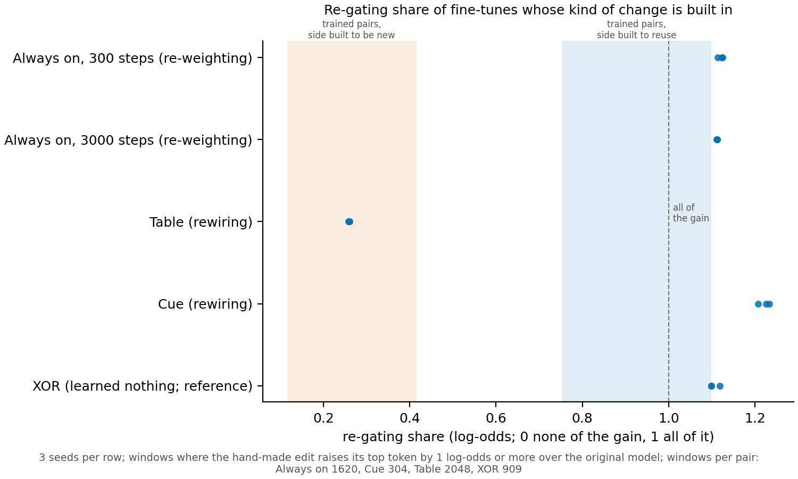

# Does the re-gating share read the kind of change built into a fine-tune?

*Cell P2.33, regating-lead, 2026-11-17. Experiments E200 and E202, `experiments/share_built_kind/`. Plan
`reports/plans/2026-11-17_plan_share-built-kind.md`. Provisional: no independent check. No reuse verdict is given.*

## The answer

No, not on these fine-tunes. Where each built edit really moves the output, the re-gating share puts the Table
fine-tunes near a quarter and every other fine-tune a little above one. A re-weighting fine-tune, a rewiring fine-tune
and one that learned nothing read about the same. What the share separates is the one group with a large gain from the
three with small gains; with one large-gain group, whether it tracks gain size is not tested.

## In plain words

We read the re-gating share of fifteen 67M fine-tunes, each trained to imitate a hand-made edit whose kind of change
we built. The share read about one quarter for Table and a little above one for the other three groups, so Always on
beat Table as predicted but fell below Cue. For `GOALS.md` part 2, the share does not label re-weighting against
rewiring here; its one clear split follows gain size, which this run cannot tell apart from built kind.

## What we were trying to test

**The share.** Take a window, a target token, the original model M with weights W₀ and a fine-tuned state. Let T0 and T1
be the target's log-odds under M and under the fine-tune; the gain is T1 − T0. Let L(C, G) be the log-odds of the
model run with components C and gate pattern G, with Δ left out. Subscript 0 means W₀'s and 1 the fine-tune's. The re-gating
share is $r = (L(C_0, G_1) - L(C_0, G_0)) / (T_1 - T_0)$: the share of the gain that appears when the original
subcomponents are kept and only the frozen Γ switches them differently on the fine-tune's activations. A share of 0
says the gain needs new weights; a share of 1 says re-switching old subcomponents gives all of it. It is read only when
the gain is at least one log-odds.

**The fine-tunes.** An earlier experiment built four hand-made edits to the 67M as forward hooks, then trained ordinary
all-weights fine-tunes to imitate each, three seeds apiece. Always on adds a fixed push to the output, which is built
re-weighting of what the model already computes. Table and Cue each compute a new map, which is built rewiring. XOR's
fine-tunes did not learn their edit and serve as a reference. Always on has two recipes, 300 and 3000 steps, so six
states. The Cue states were trained again here with a corrected early check.

**The windows.** Each window's target is the token the hand-made edit makes most likely. The first run used the first
2048 held-out windows where that token differs from M's top token. The second run, chosen by the user after the first,
kept only windows where the edit also raises that token by at least one log-odds over M. That left 1620 windows for
Always on, 304 for Cue, 909 for XOR and 2048 for Table.

**Controls, run first and alone.** The unchanged model read as a fine-tune at zero steps must give a gain, a share
numerator and a gate change of exactly zero. A trained state from the scorecard, loaded through the same whole-state
path, must reproduce its saved share 0.802 within 0.001.

## What we expected, and why

The user expected Always on to read a higher share than Table and than Cue: a fixed push should be reachable by
switching existing subcomponents, while a new map should need new weights. Each comparison pools Always on's six shares
against the three of the other group, with a bar of 0.057 taken from the largest seed spread on the scorecard. The
rival reading was that the share follows where an all-weights fine-tune stores its change, not the built kind.

## What we observed

### Do the controls hold?

Yes, in both runs. The unchanged model read zero gain, zero numerator and zero gate change on all four pairs' windows.
The positive control reproduced its saved share exactly, 0.802 against 0.802, with a gain of 14.0 log-odds.

### Run 1: is there enough gain to read?

No, except for Table. On the first windows the Always on, Cue and XOR fine-tunes raised their target by only 0.14 to
0.38 log-odds, under the one log-odds floor, so both predictions read "unreadable". Table's gain was 16.3 and its share
0.26 on all three seeds.

### Run 2: does the share separate the built kinds?

**Reading it.** It separates Table from everything else, not re-weighting from rewiring. Table's three seeds sit at
0.26, inside the range of trained pairs built to be new. The six Always on states read 1.11 to 1.13. Cue read 1.21 to
1.23 and XOR 1.10 to 1.12. All of these sit right of the dashed line where re-switching gives the whole gain. Always on beats Table by
0.857, well over the bar, but sits 0.106 below Cue, the opposite of the filed direction. Cue is built rewiring, and XOR
learned nothing, yet both read like the re-weighting fine-tune.

### What the large shares have in common

The three groups above one all have small gains. Always on gained 1.64 to 1.77 log-odds. Cue gained 1.07 to 1.12 and
XOR 1.07 to 1.11. Table gained 19.1. A share above one means the original subcomponents, switched by the fine-tune's gates, give more
than the fine-tune's whole gain; for Always on's first seed the re-switched part is 1.85 against a gain of 1.66. So the
other weights of the fine-tune partly cancel what the re-switching adds. Table is the only group with a large gain,
so this run cannot say whether the share tracks gain size or the built kind of Table alone.

### Where the change sits

Most of each fine-tune's change lies outside the 24 decomposed matrices, in embeddings, norms and the unembedding. For
Always on's first seed the change inside has norm 1.06 and outside 2.15; for Table's first seed 1.86 and 3.59. The share
keeps all of W₀'s weights in its masked forward and lets only the gates move, so a change outside the decomposition
reaches it only through the activations Γ reads.

## What we learned

On the 67M, the re-gating share does not read built re-weighting against built rewiring through these imitating
fine-tunes. A rewiring fine-tune and a fine-tune that learned nothing read the same as the re-weighting one, slightly
above one. The one group it sets apart, Table, is also the only one with a large gain, so the reading is confounded with
gain size. These fine-tunes therefore end as a label set for the share on the 67M, as the card's stop rule says.

## How compelling is the evidence

Three seeds per group, one model, four built edits. The seed spread inside each group is a few hundredths, far under
the gaps between groups, so the ordering is stable. The share is blind to any change outside the decomposed matrices
except through Γ's inputs, and here that is most of each change. The windows were picked from the hand-made edit and M
alone, before any fine-tune was read. The Cue pool is the smallest, 304 windows. No independent check was run.

## Surprises

The Cue comparison reversed: Always on was predicted to read higher than Cue and read 0.106 lower. Shares above one on
three of four groups were not in the plan's expected bands, which put Always on between 0.3 and 0.8. A fine-tune that
learned nothing reading a share as high as the re-weighting one was not foreseen.

## What next

- A fine-tune that changes only the decomposed matrices, to remove the outside change: if Always on then reads below
  one and above Cue, the outside change caused this reading.
- A second large-gain group of a different built kind: if it reads near one, the share follows the built kind; if near
  Table, it follows gain size.

## Scorecard

| id | claim | rule | read | verdict |
|---|---|---|---|---|
| P1 | Always on reads a higher share than Table | difference of means at least the bar | 0.857 against 0.057 | pass, run 2 |
| P2 | Always on reads a higher share than Cue | difference of means at least the bar | −0.106 against 0.057 | miss, "lower", run 2 |
| P1, P2 | as above, run 1 | as above | fewer than two finite shares | unreadable, run 1 |

## Departures from the literature

- The share is this project's quantity on VPD's subcomponents and Γ, as defined in `GOALS.md`; VPD itself has no such
  share. Its route split assumes a change to the decomposed matrices only. These fine-tunes change every weight, so the
  whole fine-tune sets T1 and Γ's gates while the masked forward keeps all of W₀'s weights.
- The target is the token the hand-made edit makes most likely, not a trained answer at a trigger, since these edits
  have no single target.
- The bar's spread comes from the scorecard's trained pairs, not from these states.

## Not run

- A fine-tune that changes only the decomposed matrices.
- A second large-gain group, to separate gain size from built kind.
- An independent check of either run.
- The share on the hand-made edits themselves: they are hooks, not weights.
- A positive control on a state that changed every weight; the control's state changed the decomposed matrices only.

## Provenance

E200: Slurm job 60937, debug L40, $0, results `experiments/share_built_kind/results/`. E202: job 60967, debug L40, $0,
results `experiments/share_built_kind/results/run2/`. Figure `experiments/share_built_kind/plot.py run2`.
