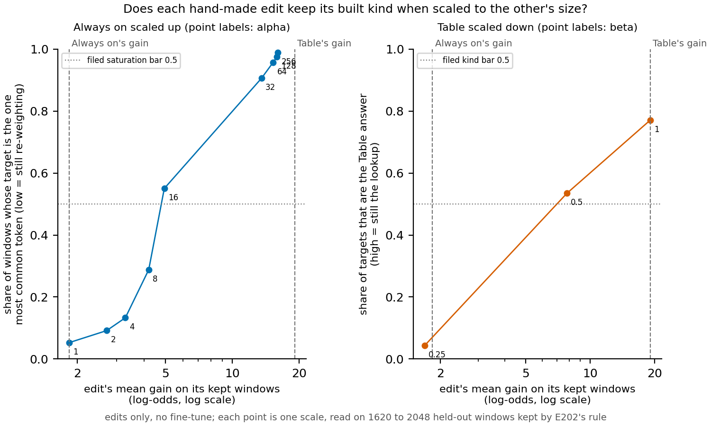

# Does the re-gating share follow the kind of change or its size?

*Cell P2.34, regating-lead, 2026-11-17. Experiments E204 and E207, `experiments/share_size_matched/`. Plan
`reports/plans/2026-11-17_plan_share-size-matched.md`, both runs. Both runs stopped at a filed check before any
fine-tune, so no share was read. No reuse verdict is given. The cell's two runs are spent and it closes here.*

## The answer

No call. To tell kind from size we needed a re-weighting edit as large as the rewiring one, or a rewiring edit as small
as the re-weighting one. Neither exists here. Scaled up, the fixed push stops re-weighting and sends almost every window
to one token before it reaches the lookup's size. Scaled down, the lookup stops answering from its table before it
reaches the push's size. Each hand-made edit keeps its built kind only near its own size, so the earlier reading stands
unchanged: the share's one split coincides with the one large change.

## In plain words

We tried to build a pair of edits to the 67M that differ in kind but match in size, by scaling one hand-made edit up
and, in a second run, another one down. In both directions the scaled edit lost the kind it was built to have before
its size matched the other, and each run stopped at its filed check before training anything. For `GOALS.md` part 2,
whether the re-gating share reads re-weighting against rewiring or only the size of a change stays untested with these
edits.

## What we were trying to test

**Where this comes from.** The re-gating share is the part of a fine-tune's gain on its target token that appears when
the original subcomponents are kept and only Γ switches them differently on the fine-tune's activations. A share of 1
says re-switching old subcomponents gives all of the gain; 0 says it needs new weights. The previous cell read it on
fine-tunes trained to imitate four hand-made edits. Table's fine-tunes read 0.26; every other group read 1.10 to 1.23.
Table, a full-rank lookup from the last token to an answer, is built rewiring. Always on, one fixed push added to the
stream, is built re-weighting. But Table was also the only edit with a large gain: 19.13 log-odds on its windows against
1.83 for Always on. So the low share could follow either the kind or the size.

**The first run.** Multiply Always on's push by a factor alpha, doubling from 1 to 256, until its gain on its own
windows matches Table's. Then train three fine-tunes to imitate it and read their share beside Table's. A filed
saturation check stopped the run if the most common target took more than half of the kept windows. A push that sends
every input to one token no longer re-weights what the model computes.

**The second run.** Do it the other way: multiply Table's map by a factor beta below 1 until its gain matches Always
on's. A filed kind check stopped the run if fewer than half of the scaled edit's targets were still the Table answer
for the window's last token. An edit that no longer looks up its table is not built rewiring.

**Controls, first and alone, in both runs.** The unchanged model read as a fine-tune at zero steps must give a gain and
a gate change of exactly zero. A trained state from the scorecard must reproduce its saved share within the filed
tolerance.

## What we expected, and why

The plan expected the scaled push to reach Table's gain somewhere between alpha 4 and 64 while still pushing many
different tokens, since it adds the same vector to every input. For the second run the plan noted that at full size at
most about three quarters of Table's targets are Table answers, and expected a smaller copy to keep its lookup. Neither
expectation was measured before the runs.

## What we observed

### Do the controls hold?

Yes, in both runs. The unchanged model gave zero gain and zero gate change on the scaled edits' windows. The scorecard
state reproduced its saved share, 0.803 against 0.802, with a gain of 14.0 log-odds.

### Does either edit keep its kind at the other's size?

**Reading it.** No, in either direction. On the left, the share of windows sent to one single token is 0.05 at alpha 1.
It passes half at alpha 16 and reaches 0.91 at alpha 32. Past the dotted line the push no longer re-weights many outputs;
it overwrites them with one. The gain still never reaches Table's dashed line: it levels off at 16.0 log-odds by alpha
256, and the run stopped on that. On the right, 0.77 of the full Table edit's targets are Table answers. At beta 0.5 the
gain is 7.8 and that share is 0.53. At beta 0.25 the gain is 1.69, close to Always on's, but only 0.04 of the targets
are Table answers, and the run stopped on the kind check.

## What we learned

With these hand-made edits, size and kind cannot be separated by scaling: the push becomes a constant output when made
large, and the lookup stops looking up when made small. So this cell gives no call on whether the re-gating share
follows kind or size. The previous cell's reading stands as it was: the share's one split, Table against the rest,
coincides with the one large change, and which of the two drives it is untested. Telling them apart needs a new edit
whose kind holds at the other's size, which is a new cell, not a rescue of these runs.

## How compelling is the evidence

Each check was read on the edit and the original model alone, on 1620 to 2048 held-out windows per scale, before any
fine-tune. The checks are filed bars at one half, and every stopping point sits far from its bar: 0.91 and 0.04. The
scans are coarse, doubling or halving per step, so the exact scale where each kind breaks is not located. Both checks
are this project's own descriptions of the built kind, not a standard measure.

## Surprises

The push never reached Table's gain at any scale, which the plan did not expect. The lookup lost its answers fast:
half the size kept about half its Table answers, a quarter kept almost none.

## What next

None in this cell; the user asked that the cell close here rather than try rescue variants. A new cell would need an
edit pair whose kinds are shown to hold at matched size before any fine-tune is trained.

## Scorecard

| id | claim | rule | read | verdict |
|---|---|---|---|---|
| K, run 1 | scaled-up Always on reads above Table's share by the bar | difference of means | not read: stopped at the scan | no call |
| S, run 1 | scaled-up Always on reads within the bar of Table or below | as above | not read | no call |
| K, run 2 | scaled-down Table reads below Always on's share by the bar | difference of means | not read: stopped at the kind check | no call |
| S, run 2 | scaled-down Table reads within the bar of Always on or above | as above | not read | no call |
| controls | identity zero; scorecard state within tolerance | filed | 0 and 0.803 against 0.802 | pass, both runs |

## Departures from the literature

- The share is this project's quantity on VPD's subcomponents and Γ, as in `GOALS.md`; VPD has no such share.
- The scaled edits and both kind checks are this project's constructions; no paper defines a size-matched pair of
  re-weighting and rewiring edits, so no source is departed from beyond that.
- The window rule and the target token follow the previous cell, which already lists their departures.

## Not run

- Any fine-tune on a scaled edit, and so any share reading in either run.
- A finer bisection near alpha 16 or beta 0.5, which could only move where the kind breaks, not whether it holds at the
  other's size.
- A different edit pair built to keep its kind at matched size.
- A fine-tune that changes only the decomposed matrices.
- An independent check.

## Provenance

E204: RunPod L40S, results `experiments/share_size_matched/results/stage{0,1,2}.json`, log `e204_pod.log`. E207: RunPod
L40S, results `experiments/share_size_matched/results/run2/stage{0,1,2}.json`, log `e207_pod.log`. Both runs together
cost $0.32. Figure `experiments/share_size_matched/plot.py scans`.
