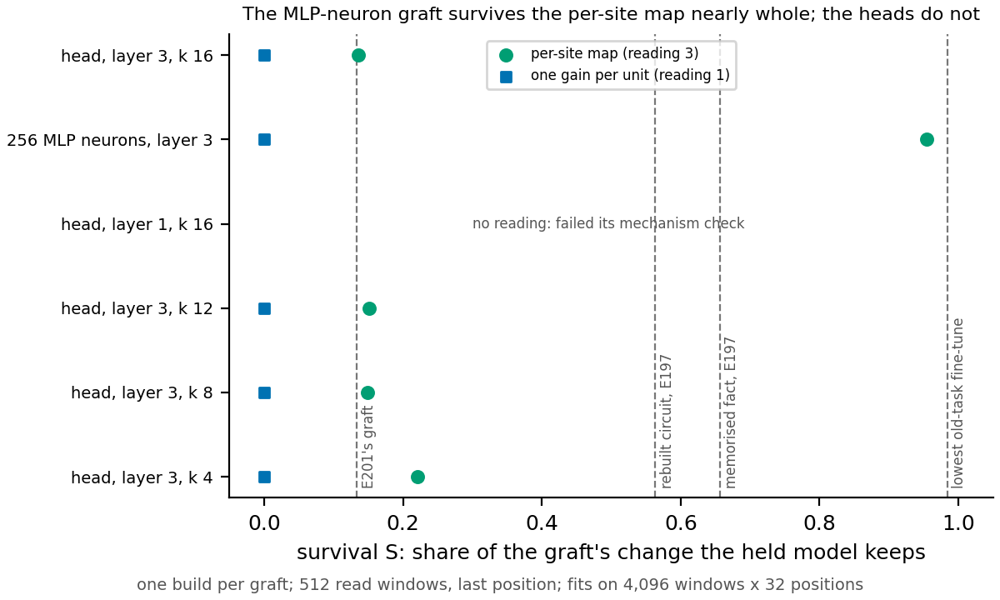
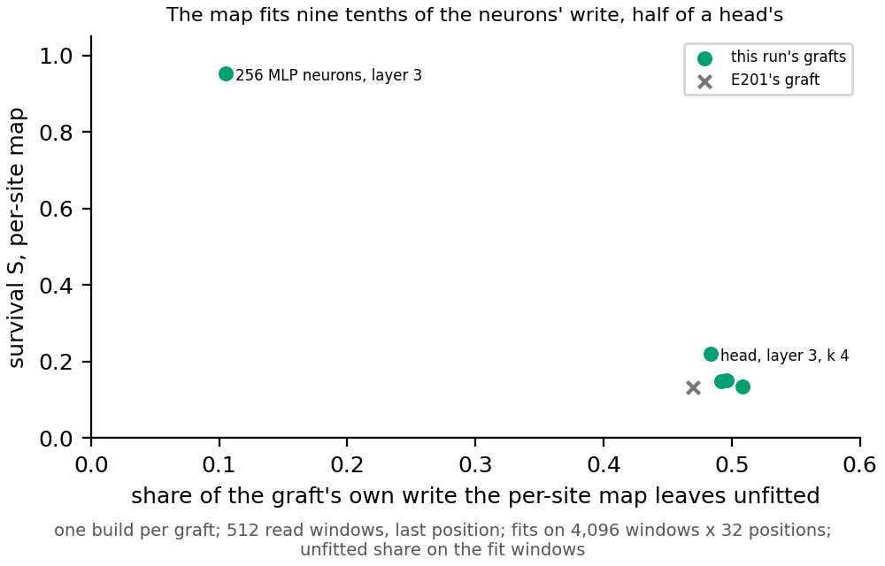
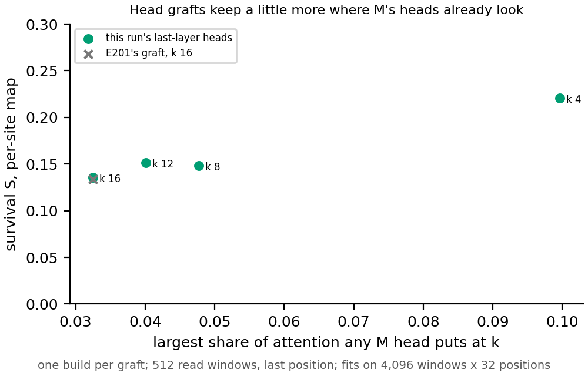

# Does new machinery grafted at other sites also read low under the held-model definition?

*2026-11-18, definition-lead. Cell P1.28, its one run, experiment E206 (`experiments/graft_sites/`). Read under the
working definition of reuse adopted on 2026-11-18 (`decisions.md`, "Working definition of reuse"), unchanged. No
cut-offs and no labels: no graft is called reuse or new on this page.*

We grafted new machinery onto the frozen 67M model at several sites, each piece trained alone on a task the model
cannot do. A held model built from the original model's own units kept little of what four new attention heads
changed, but nearly all of what 256 new MLP neurons doing a random token lookup changed. So the main reading of the
working definition in `GOALS.md` does not read new machinery low at every site: at the last MLP layer it keeps a
lookup that is new by construction nearly as well as an old skill.

## The answer

**256 new MLP neurons, trained to send each of 256 common tokens to a random other one, keep 0.95 of their change
under the main reading.** The model was frozen before the lookup was drawn, yet this is close to fine-tunes on old
tasks, which kept 0.98 or more. It is far above every head graft, a rebuilt circuit and a memorised fact. The four
last-layer head grafts keep 0.14 to 0.22, more where the model's own heads already look. One gain per unit keeps
nothing of any graft. A head grafted on layer 1 learned the task some other way and was not read.

## What we were testing

**The definition.** M is the original 67M model and F the model after a change. A *unit* is an MLP neuron, an
attention head or a whole MLP block. A unit's *rule* is what it writes into the residual stream as a function of its
layer's input, read on M's inputs. The *held model* H is M with each layer's output weights replaced by a fit to F's
own write at that site, made only from M's units. The main reading, the per-site map, is the least-squares linear map
from all of M's unit activations at a site, for example all 3,072 neurons of an MLP layer or all six heads of an
attention layer, to F's write there. The side reading, one gain per unit, pairs each of F's units with one of M's and
lets it only rescale that unit's write. A third reading, one gain per head and per whole MLP block, is reported in the
tables.

**Survival.** $S = 1 - \mathrm{KL}(F\|H)/\mathrm{KL}(F\|M)$, the next-token divergence at the last position of 512
read windows, never used in a fit. $S = 1$ when H reproduces F, and $S = 0$ when H is no closer to F than M is.

**The grafts.** Every weight of M stays frozen. Each graft is new weights added at one site and trained alone with the
67M's own pretraining recipe for 4,000 steps, one build each. Removing a graft gives back M exactly. So whatever F does
beyond M lives only in the graft, which is new by construction:

- **Four last-layer heads.** A seventh head on layer 3, the last, trained to output the token k positions back at the
  last position. The offsets are k = 16, 12, 8 and 4, picked by how much attention M's own most attentive head puts at
  that offset, from least to most. k = 16 repeats the first graft, read earlier at 0.134, with a new seed.
- **256 MLP neurons on layer 3.** At every position whose token is one of the 256 most frequent, they output a seeded
  random derangement of that token: each set token is sent to a different set token, drawn after M was trained.
- **A head on layer 1** with the k = 16 task, so its write passes through two frozen layers.

Each graft must pass three build checks before it is read: held-out accuracy at least 0.9, its own mechanism at least
0.8, and zeroing its output must give M's logits. The mechanism for a head is its attention at k from the last
position. For the neurons it is the share of set positions where their write alone, read through the unembedding,
ranks the right token first among the 256.

**The references** come from the earlier calibration page, `reports/analyses/2026-11-18_analysis_held-model-retention-run1.md`:
32 fine-tunes on tasks M already does, a circuit switched off and rebuilt by training later layers, and a fine-tune
that memorised a random fact.

## What we expected, and why

The rules compare survivals only, never against a cut-off between reuse and new. The first says each graft keeps
less than the lowest old-task fine-tune, 0.984. The second says the k = 4 head keeps more than the k = 16 head, since a
larger share of M's attention at that offset gives the map more to use. The third says the neurons keep more than the
k = 16 head.

Two pictures were filed. In one, no M unit at the graft's site computes what the graft computes, so every graft reads
far below the old-task fine-tunes. In the other, the map absorbs whatever M's units at the site already carry. M's
last-layer neurons see the current token, which is the neurons' whole input, so the neuron graft would read near the
old-task fine-tunes while the heads stay low. The first rule held for the neurons too, but only just: the second
picture's forecast is what came out.

## What we observed

### Do the controls and builds hold?

Yes, all of them. On the unchanged model and on grafts with zero output weights, all three readings reproduce F, and
the per-site map's divergence floor is 2.4e-15. M's attention shares repeat the first graft's run to within 1.6e-7.
M gets the neurons' derangement right 0.0037 of the time. Against 100 other random derangements of the same tokens, 93 get
a mean log-probability from M at least as high, so M does not lean towards this one. Five of the six grafts passed every build check:

| graft | accuracy with graft | M's accuracy | mechanism |
|---|---|---|---|
| head, layer 3, k 16 | 0.925 | 0.032 | 0.998 |
| head, layer 3, k 12 | 0.916 | 0.023 | 0.999 |
| head, layer 3, k 8 | 0.926 | 0.029 | 0.998 |
| head, layer 3, k 4 | 0.917 | 0.023 | 0.999 |
| 256 neurons, layer 3 | 0.998 | 0.0037 | 0.975 |
| head, layer 1, k 16 | 0.999 | 0.032 | 2.8e-5, missed |

Zeroing each graft's output gave M's logits with an error of exactly 0.

### How much of each graft's change survives?

**Reading it.** The MLP-neuron graft keeps nearly all of its change under the per-site map, and every head graft keeps
little. Each row is one graft, the green dot is the per-site map and the blue square one gain per unit. The neurons'
green dot sits at 0.954, just left of the lowest old-task fine-tune at 0.984. It is far right of the rebuilt circuit
at 0.56 and the memorised fact at 0.66. The four head dots sit between 0.136 and 0.221. The k = 16 rebuild reads
0.136 against the first build's 0.134, one build-to-build difference of 0.0023. Every blue square is exactly 0: one
gain per unit left each graft unpaired and kept every M unit at itself, so H is M. The graft moves M far: a divergence
of 10 to 11.7 for every graft. Under the map, H stays 7.8 to 8.8 away from F for the heads and only 0.54 for the
neurons.

### Why does the neuron graft survive?

**Reading it.** The per-site map rebuilds about nine tenths of what the new neurons write, and about half of what a new
head writes. The horizontal axis is the share of the graft's own write, in squared norm on the fit windows, that the
best linear mix of M's units at the same site leaves unfitted. The neurons leave 0.105 unfitted and the four heads
0.48 to 0.51, with the first graft at 0.47. At the whole MLP-3 site, the unfitted share falls from 0.73 under one gain
to 0.077 under the map. So the saved numbers say where the survival comes from: M's 3,072 last-layer neurons, mixed
linearly, already write most of what the lookup writes.

They do not say why M's neurons can do that. Our hypothesis is that M's last-layer neurons carry the identity of the
current token, and a lookup over 256 tokens is a function of that identity alone. A linear mix of many token-sensitive
neurons can then write any per-token table, random or not. No saved number measures how well M's neurons encode the
current token, so this stays a hypothesis. The heads differ in their input: a head needs the token k back, which M's
last-layer heads barely attend to, so their mix cannot rebuild it.

The map's fit does not translate one for one into survival. The neurons' map leaves a tenth of the write and keeps 0.95
of the change. The heads' maps leave half and keep only a seventh to a fifth.

### Does a head keep more where M's heads already look?

**Reading it.** A little, and mostly at the closest offset. The horizontal axis is the largest share of attention any
M head puts at the graft's offset. At the three farthest offsets that share runs from 0.033 to 0.048. Survival there
runs from 0.136 to 0.152, with k = 12 slightly above k = 8. At k = 4 the share is 0.100 and survival 0.221. One build per offset, and the
k = 12 and k = 8 difference of 0.003 is about the size of the build-to-build difference.

### What did the layer-1 head do instead?

It solved the task without the mechanism it was built for, so it was not read. With the graft, the model names the
token 16 back 0.999 of the time on held-out windows, better than any last-layer head. Yet from the last position the
graft puts only 2.8e-5 of its attention on that token. It also learned far faster: 0.95 accuracy after 500 steps,
where the last-layer heads were at 0.07 to 0.10. Its loss at the last training step was 0.014, against 0.30 to 0.51 for the
last-layer heads. The saved files hold no attention pattern beyond that one number, so how it did it is not shown. One
hypothesis: it attends at some other offset to a position whose residual already holds the target token, written there
by M's layer-0 heads, or it writes the token at an earlier position for M's later heads to carry.

## Full readings

All values from `experiments/graft_sites/results/summary.json` and `results/grafts/<role>_read.json`.

| graft | KL(F‖M) | S, per-site map | S, one gain per unit | S, one gain per block | graft's write left unfitted |
|---|---|---|---|---|---|
| head, layer 3, k 16 | 10.19 | 0.136 | 0 | 0 | 0.508 |
| head, layer 3, k 12 | 10.32 | 0.152 | 0 | 0 | 0.496 |
| head, layer 3, k 8 | 10.18 | 0.148 | 0 | 0 | 0.491 |
| head, layer 3, k 4 | 9.99 | 0.221 | 0 | 0 | 0.484 |
| 256 neurons, layer 3 | 11.66 | 0.954 | 0 | −0.0003 | 0.105 |
| head, layer 1, k 16 | not read | | | | |

Under one gain per block, the neurons and M's 3,072 neurons at layer 3 form one block with one gain, so the graft has
no unit of its own there. The fitted gains moved at most 0.205 from 1 and kept nothing. The graft's write is 0.73 of
F's MLP-3 write in squared norm, and a head's is 0.35 to 0.38 of F's layer-3 attention write.

## What we learned

The main reading, the per-site map, does not read new machinery low at every site. At the last MLP layer it keeps a
random lookup on the current token about as well as an old-task fine-tune, though the lookup was drawn after the model
was trained. The head grafts confirm the first graft's low reading at four offsets, with a mild rise where M's heads
already attend. One gain per unit reads every graft at exactly 0, as it read every fine-tune near 0. This page sets
out the observation; whether the map class should count a current-token lookup as kept is a question about the
definition for the user, not a patch.

## How compelling is the evidence

- One build per graft, no seeds. The only build-to-build number is the k = 16 rebuild, 0.0023 from the first build.
- The old-task reference spread is a seed deviation of 0.0025 on the calibration page's items. The neurons sit 0.030
  under the lowest old-task fine-tune, about twelve such spreads, but on one build.
- One MLP graft, one lookup task, at one layer. Whether a lookup at an earlier MLP layer, or an MLP task needing other
  positions, reads the same was not run.
- The unfitted share is a squared-norm share of the write on the fit windows, not a share of the behaviour.
- Survival reads the last position only, and the neurons act at every set position. The read windows' last position
  holds a set token in some windows and not others; how many is not saved.

## Surprises

The MLP-neuron graft reading 0.954 is the surprise for the definition, though not for the filed rules: it kept its
change nearly whole under the main reading while being new by construction. The second filed picture forecast it.
The layer-1 head solving the task with almost no attention at its offset was not expected.

## What next

- A definition question for the user: under the per-site map, a random lookup on the current token reads like an old
  skill. Should the map class change, or is a current-token lookup counted as kept by M's neurons? An answer either
  way changes what the 67M comparisons can call a built-new reference.
- A cheap check of the hypothesis from saved weights: how well a linear read of M's layer-3 neuron activations names
  the current token among the 256. A near-perfect read would make the neuron result a property of any per-token table.
- The layer-1 head's attention pattern at every position, from its saved weights, to see what it learned instead.

## Scorecard

| rule | claim in words | rule as filed | read | verdict |
|---|---|---|---|---|
| R1, k 16 head | keeps less than the lowest old-task fine-tune | per-site map S below 0.9839 | 0.136 | holds |
| R1, neurons | the same | the same | 0.954 | holds |
| R1, layer-1 head | the same | the same | not read, failed mechanism | no reading |
| R1, k 12 head | the same | the same | 0.152 | holds |
| R1, k 8 head | the same | the same | 0.148 | holds |
| R1, k 4 head | the same | the same | 0.221 | holds |
| R2 | k 4 head keeps more than k 16 head | per-site map S, strict | 0.221 against 0.136 | holds |
| R3 | neurons keep more than k 16 head | per-site map S, strict | 0.954 against 0.136 | holds |

Rules filed in `experiments/graft_sites/results/predictions.json` before the run. Ties count as missed; the
do-nothing state has no survival and reads "no reading" under every rule.

## Departures from the plan

- Platform: the plan priced the job on the cluster's `debug` QoS on one L40; it ran on a RunPod H100 SXM instead,
  about $2.15. Nothing in the code or settings changed.
- The layer-1 head missed its mechanism check and, as filed, was reported and not read. The cell's one run is spent,
  so it has no rebuild.
- None in the readings or the rules.

## Departures from the literature

None on this page. The held model and survival are the project's own, as adopted on 2026-11-18. The grafts use the
67M's own init and pretraining optimiser recipe unchanged, except that the neurons train on every set position, filed
before the run with its reason.

## Not run

- More than one build per graft, so no seed spread for any graft.
- Offsets beyond 16; heads or neurons on layers 0 and 2; an MLP graft on layer 1.
- An MLP graft whose task needs tokens at other positions.
- A linear read of the current token from M's layer-3 neurons, which would test the hypothesis above.
- The layer-1 head's attention pattern at positions other than the last.
- The neuron graft read at every set position rather than the last position only.

## Provenance

Results: `experiments/graft_sites/results/{stage0.json, summary.json, run.log, grafts/}`; graft weights and reading
3's site maps in `experiments/graft_sites/results/large/`. Figures from `experiments/graft_sites/plot.py`. Plan
`reports/plans/2026-11-18_plan_graft-sites.md`, card `experiments/graft_sites/card.md`. RunPod H100 SXM, one job,
about $2.15; peak host memory 6.1 GB.
