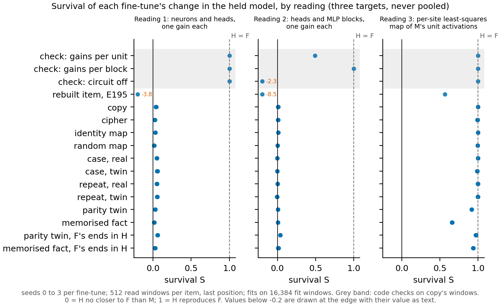
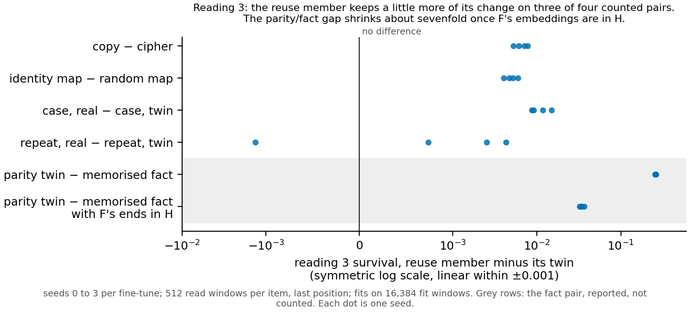

# Does a fine-tune's change survive when every unit is held to the original model's rule?

*2026-11-18, definition-lead. Cell P1.26, run 1 of 2, experiment E197. A test of the user's held-model wording of
causal-rule retention, not adopted. No fine-tune is called reuse or new on this page.*

For each fine-tune we built a held model from the original model's own units, held to their old rules, and asked how
much of the fine-tune's change in output survives in it, on code checks, a rebuilt circuit and five matched pairs at
four seeds. With one gain per unit almost none of any change survived, while a fitted linear map per layer kept nearly
all of it on old-task fine-tunes and favoured the reuse member of three counted pairs by small, steady margins. For
the working definition of `GOALS.md`, only that widest reading tells items apart, and this run calibrates it without a
verdict.

## The answer

Holding every neuron and head to the original model's rule at one gain keeps almost none of what any fine-tune
changed: survival reads 0.01 to 0.06. The widest reading, a fitted linear map at each layer, keeps 0.98 or more on
all eight old-task fine-tunes. On it the reuse member of three counted pairs keeps a little more than its twin, by
under two hundredths, and the fourth pair is a tie within its seeds. The memorised fact keeps less, mostly because
its embeddings changed, which the held model keeps at the original's.

## What we were testing

**The wording under test.** M is the original 67M model and F a fine-tune of it. A *unit* is an MLP neuron, an
attention head or a whole MLP block. A unit's *rule* is what it writes into the residual stream as a function of its
layer's input, read on M's own inputs. The user's wording: the change from M to F is reuse to the degree that it
survives in a *held model* H, where every unit of F is replaced by M's matching unit held to its rule.

**The held model.** H is M with only its output weights replaced, one layer's MLP output matrix and attention output
matrix at a time. Every input-side weight, the embeddings, the unembedding and the final norm are M's. Each
replacement is fitted by least squares to F's own write at that site, on M's inputs, over 16,384 fit windows. H then
runs end to end as an ordinary network. Three readings fit three different targets, never averaged:

- **Reading 1**: every neuron and every head of F is paired one to one with a unit of M in its layer and holds that
  unit's rule at one gain of any sign.
- **Reading 2**: the same with each MLP block as one unit, so one gain per block and per head.
- **Reading 3**: at each site, the least-squares linear map from M's unit activations to F's write. It can mix all
  3,072 neurons of a layer, or all six heads, and contains readings 1 and 2.

**Survival.** $S = 1 - \mathrm{KL}(F\|H)/\mathrm{KL}(F\|M)$, the next-token divergence at the last position of 512
read windows, which never meet the fit windows. $S = 1$ when H reproduces F, and $S = 0$ when H is no closer to F than
M is. $S$ goes below 0 when H is further from F than M is.

**The items.** First, four code checks built so that arithmetic fixes the answer. Then E195's rebuilt item: a circuit
of eight layer-one neurons switched off and two later MLP layers trained to rebuild its work, read here as an
unproven case. Then the five matched pairs of E196, now at seeds 0 to 3, forty fine-tunes. In each pair one member
was built to reuse a skill M has and its twin to need something new. The four counted pairs are copy against cipher,
an identity key table against a random one, real case labels against a case twin, and real repeats against a repeat
twin. The fifth, a parity task against a memorised random fact, is reported and not counted. The pair's gap is the
reuse member's $S$ minus its twin's, per seed; its spread is the sample deviation over the four seeds.

**The side number.** The parity twin and the memorised fact are full fine-tunes, so their embeddings, unembedding and
final norm moved too. H holds those at M's values, so such a change counts as not surviving. For these two items only,
$S$ is also read with F's values in those places. No gap or comparison on this page reads it except where it says so.

## What we expected

Nothing beyond the code checks was filed with a bar: the user set run 1 as a calibration that reports values, gaps
and their spread. The code checks have values fixed by arithmetic, set out in the scorecard. Readings 1 and 3 must
reproduce F wherever F only rescales, shuffles or switches off M's units. Reading 2 cannot express a gain on one
neuron or a switched-off part of a block, so on those two checks it is reported, not required.

Two pictures were in view before the run. In one, the reuse member keeps its units as gains of M's, while its twin
writes rules M's units lack. Some reading then separates each counted pair by more than its seed spread, with gaps
not ordered by update size. In the other, the reading tracks how far the weights moved, and reading 3's map absorbs
almost any change, so it reads near 1 on every item including the rebuilt one.

## What we observed

### Do the code checks come out as arithmetic says?

Yes, every one. On the do-nothing copy all three readings read "no change", and reading 3's own floor is a
divergence of 1.5e-13. Readings 1 and 3 reproduced F's logits within 2e-5 of their scale on every check, against a
tolerance of 1e-3. Reading 1 recovered the shuffled pairing exactly and every planted gain within 1e-4. Reading 2 missed where
arithmetic says it must: 0.49 on per-neuron gains and −2.3 on the switched-off circuit. The scorecard has each value.

### How much of each change survives under each reading?

**Reading it.** Almost none of any trained fine-tune's change survives under readings 1 and 2, and nearly all of it
survives under reading 3 except on the full fine-tunes and the rebuilt item. Each panel is one reading. The grey band
holds the code checks, which sit at 1 where arithmetic says they must. Under reading 1 every trained fine-tune reads
0.01 to 0.06, all four seeds of each item on top of each other. Under reading 2 they read between −0.005 and 0.011.
Under reading 3 the eight old-task fine-tunes read 0.98 to 0.999. The parity twin reads 0.91 and the memorised fact
0.65 to 0.66. The rebuilt item reads −3.8 under reading 1, −8.5 under reading 2 and 0.56 under reading 3.

**Why reading 1 is so low.** H takes every input weight from M. Each fine-tune moved the input weights of nearly
every neuron a little, so each of F's units responds to slightly different inputs than its M partner. A gain can
rescale what M's unit writes; it cannot change what the unit responds to. What a gain leaves over is small at every
site: under one percent of the site's write for the copy fine-tune, and under six percent on any trained fine-tune. The saved per-unit files show some error left
after the gain in nearly every neuron of copy's first two layers. But that remainder is the fine-tune's change.
The copy fine-tune moves M by a divergence of 3.5, and reading 1's H is still 3.4 away from it. In plain words, one
gain per unit holds the large unchanged part of each unit and drops the small change spread across all of them.

**The rebuilt item.** Readings 1 and 2 land further from F than M is. Reading 1 keeps the switched-off circuit off
but cannot express the two rebuilt layers, so H loses the circuit without its replacement. Reading 3 keeps 0.56: a
per-site map carries a little over half of a change built to need new machinery.

### Does the reuse member keep more of its change than its twin under reading 3?

**Reading it.** On three of four counted pairs the reuse member keeps a little more than its twin at every seed; on
the repeat pair the gap is a tie within its seeds. Each dot is one seed's gap, so the spread of the dots is the seed
spread. Copy against cipher reads 0.0066 on average, with a spread of 0.0011. The identity table against the random
one reads 0.0050, spread 0.0008. The case pair reads 0.0111, spread 0.0029. The repeat pair reads 0.0016 with a spread
of 0.0024, and one of its seeds is below zero. The parity twin against the fact reads 0.258, far apart from the rest,
which the next section explains.

These seed spreads are about six to twenty times the spread of 0.00014 that the card filed from E196, which was a
different reading of seeds 0 and 1. All three readings' gaps, with their spreads over the four seeds:

| pair | reading 1 gap | spread | reading 2 gap | spread | reading 3 gap | spread |
|---|---|---|---|---|---|---|
| copy − cipher | 0.0159 | 0.0015 | 0.0017 | 0.0010 | 0.0066 | 0.0011 |
| identity − random table | 0.0150 | 0.0013 | 0.0065 | 0.0011 | 0.0050 | 0.0008 |
| case, real − twin | −0.0068 | 0.0037 | 0.0022 | 0.0005 | 0.0111 | 0.0029 |
| repeat, real − twin | −0.0048 | 0.0012 | 0.0058 | 0.0011 | 0.0016 | 0.0024 |
| parity twin − fact, not counted | 0.0134 | 0.0017 | 0.0000 | 0.0010 | 0.258 | 0.0031 |

Readings 1 and 2 are reported, not compared at any bar. Their gaps are differences between two survivals that are
both near zero. Under reading 1 the case and repeat twins keep slightly more than their reuse members.

### How much of the memorised fact's low reading comes from its embeddings?

Most of it. We put F's embeddings, unembedding and final norm into H and read reading 3 again. The memorised fact
then moves from 0.65 to 0.93 or 0.94 at every seed. The parity twin moves less, from 0.91 to 0.97. The fact's fine-tune changed its embedding
weights, and H holds those at M's, so that change counts as lost. The pair's gap shrinks from 0.258 to 0.034, about a
seventh, with every seed between 0.032 and 0.037. The bottom row of the gap figure shows it. So the parity-fact gap
under reading 3 is mostly an embedding gap, not a difference in what the layers' units do.

### Do reading 3's gaps follow update size, as E196's did?

Not in order. E196 found its neuron-level gaps ranked the pairs exactly as the twins' larger MLP updates do. On seeds 0 and 1,
the case twin's MLP update is 2.59 times its reuse member's and the repeat twin's is 1.49 times. The random key table's
is 1.13 times the identity table's, and cipher's 1.07 times copy's. Reading 3's gaps rank the pairs case, copy, identity, repeat. The case pair has
both the largest ratio and the largest gap. The repeat pair has the second largest ratio and the smallest gap. The
fact pair's two sides moved their MLP weights equally, at a ratio of 0.99; its gap under reading 3 is mostly the
embedding change above. This is a report of the order, not a cause.

## What we learned

The held model reproduces F exactly where arithmetic says it must, so the apparatus is sound. One gain per neuron or
head cannot express even small changes of what each unit responds to, so readings 1 and 2 read near zero on every
trained fine-tune and cannot tell items apart. Reading 3 is the only reading that can: it reads near 1 on old-task
fine-tunes, lower on the parity twin and the memorised fact, and about half on the rebuilt circuit. Its gaps on the
counted pairs are small but steady over four seeds on three pairs, and they are not ordered by MLP update size.
Whether its gaps survive when update sizes are matched is not tested here.

## How compelling is the evidence

- Four seeds per fine-tune, five pairs, one rebuilt item, each read on 512 windows at the last position.
- Reading 3 is blind to any change that is linear in M's activations at a site. A change made by mixing M's units, or
  by moving their input weights so that the new response is a linear mix of the old ones, counts as surviving.
- Every reading holds the embeddings at M's values, so an embedding change counts as lost. Only the two full
  fine-tunes moved them; the side number shows how much that matters there.
- The rebuilt item is one build at one seed, and nothing independent says how much of it is new.
- The seed spread here is this reading's own, measured over four seeds. No noise floor separate from seeds was run.

## Surprises

- Reading 1 reads near zero on every trained fine-tune, though its local fits leave under six percent of any site's
  write. The plan filed no expectation for it on trained items. The reason is above: the change is the part a gain
  cannot fit.
- The memorised fact's low reading 3 comes mostly from its embeddings, not its layers.

## What next

- Run 2, the grafted head: a fresh head reading a position no head of M reads, with M frozen. If reading 3 keeps
  little of its change, the reading can see new machinery that sits outside M's span; if it keeps most, it cannot.
- A size-matched read of the pairs, such as E187's states, now moved to a later cell. If reading 3's gaps stay at
  matched size, it becomes a candidate for the user's gate; if they vanish, it reads update size too.

## Scorecard

Only the code checks were filed; each holds when H reproduces F within 1e-3 of F's logit scale where required, and
reading 1 recovers the planted pairing and gains within 1e-4.

| check | built as | reading 1 | reading 2 | reading 3 | verdict |
|---|---|---|---|---|---|
| do-nothing | F is M | no change | no change | no change | held |
| gains per unit | every neuron and head rescaled and shuffled | 1.000 | 0.49, reported | 1.000 | held |
| gains per block | one gain per MLP block and head | 1.000 | 1.000 | 1.000 | held |
| circuit off | E195's eight layer-one neurons zeroed | 1.000 | −2.3, reported | 1.000 | held |

## Departures from the literature

- The note under test reads retention as the mean rule similarity over each smallest sufficient set of F's units.
  The user's wording reads the survival of the change in a model with every unit held, with no sets searched. This
  page uses the user's wording, as the plan's Settled section records.
- Reading 3 resembles model stitching, Lenc and Vedaldi 2015 and Bansal et al. 2021, where a linear layer joins two
  networks and is trained on the task loss. Here the map is fitted by least squares to each site's write, one layer
  deep on M's inputs, and every site is replaced at once.
- The rule test follows the interchange of causal abstraction, Geiger et al., between two networks as Prakash et al.
  2024 patch between a model and its fine-tune. The rule is one layer deep, as in the neuron-level runs before this.
- The divergence is read at the last position of each window, where every task here is scored, as in E196.

## Not run

- The graft negative case, E201: run 2 of this cell, on its own page.
- E187's size-matched states, moved to a later cell.
- Gains with an offset or a threshold, pairing across layers, and residual-stream read-outs as units.
- Any bar, cut-off or label, by the user's instruction.
- A look at which units carry each reading's error; the per-unit files are saved, not analysed beyond the check above.

## Provenance

- Results: `experiments/held_model_retention/results/stage0.json`, `items/*.json` (41 items), `summary.json`; per-unit
  partners, gains and errors in `results/large/units/*.npz`; reading 3 maps for the checks and the rebuilt item in
  `results/large/maps/`. Filed checks in `results/predictions.json`, sha256 49995af0, unchanged since filing.
- Jobs: MATS cluster debug QoS, one L40 each, $0. Job 60914 ran stage 0 and the rebuilt item. Jobs 60919 to 60923 ran
  one pair each, about 31 s per item. Job 60912 stopped at argument parsing before any work. Logs
  `cluster/logs/commute-held_model_retention-609*.out`.
- Code: `src/commute/held_model.py`, `experiments/held_model_retention/run.py`; figures from
  `experiments/held_model_retention/plot.py`. Update sizes from E196's
  `experiments/rule_retention_pairs/results/update_size.json`.
