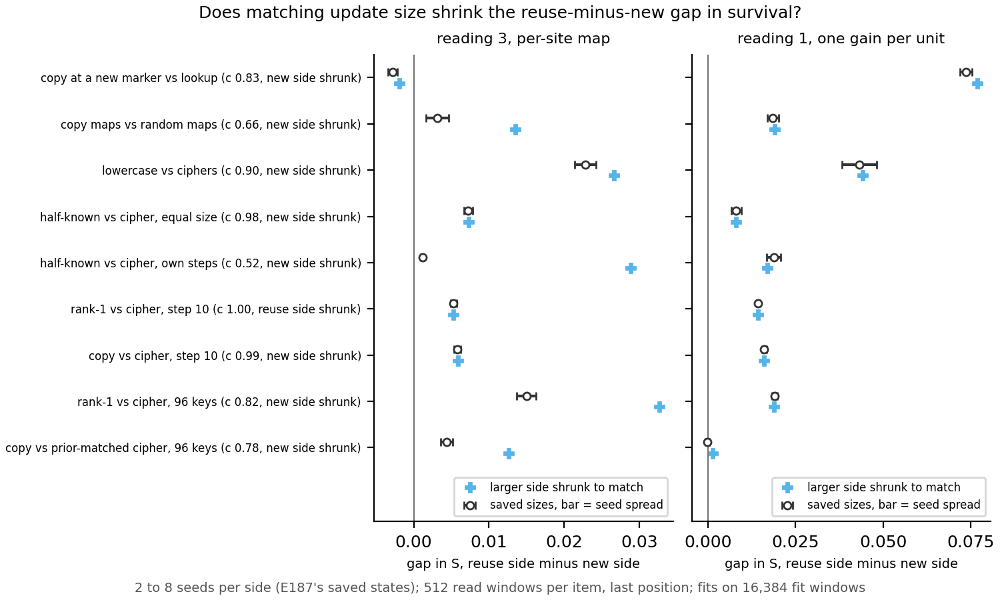
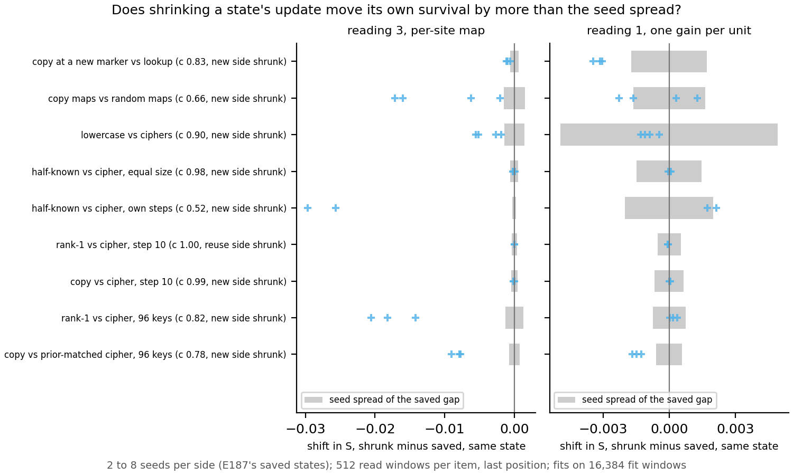

# Does the held-model reading's reuse-minus-new gap follow update size?

*2026-11-18, definition-lead. Cell P1.27, its one run, experiment E205. Plan
`reports/plans/2026-11-18_plan_held-model-size-matched.md`; every number from
`experiments/held_model_size_matched/results/`. No item or pair is called reuse or new on this page, and no cut-off is
applied.*

We shrank the larger weight change of each of nine fine-tune pairs to its partner's size and read again how much of
each change survives in the working definition's held model. Shrinking never closed a gap; it lowered the shrunk side's
own survival, by more than the seed spread whenever a pair was shrunk by a tenth or more. For `GOALS.md`, the main
reading's pair gaps are not the new side's larger update showing through, yet that reading does track update length.

## The answer

Matching update size did not close any gap under the main reading, the per-site linear map. All nine pairs kept the
sign of their gap, and on five the gap grew. The side that was shrunk, almost always the side built to need something
new, then kept less of its change. So a shorter update along the same direction reads lower survival, by up
to three hundredths. That is the opposite of the size story that would explain the gaps, and it was not expected. One
gain per unit barely moved.

## What we were testing

**The definition.** M is the original 67M model and F a fine-tune of it. The working definition, adopted by the user on
2026-11-18, builds a held model H from M in which every unit of F is replaced by M's matching unit held to M's rule.
Survival is $S = 1 - \mathrm{KL}(F\|H)/\mathrm{KL}(F\|M)$, the next-token divergence at the last position of 512 read
windows. $S = 1$ when H reproduces F, and $S = 0$ when H is no closer to F than M is. Two readings are reported, never
averaged. The main one, reading 3, fits at each layer's MLP and attention output the least-squares linear map from M's
unit activations to F's write. Reading 1, beside it, lets each neuron and head of F keep one M unit's rule at one gain.

**The pairs.** These are the nine built pairs of an earlier size-matching run, E187, at every saved seed: two to eight
fine-tunes per side. In each pair one side was built to reuse a skill M has, and the other built to need something new.
Those are construction labels, not readings of this page. The figures and tables name each pair by its two tasks,
reuse side first, such as copy at a new marker against a lookup.

**What was varied.** Update size is $\|\delta W\|/\|W_0\|$, the norm of the weight change over the norm of the original
weights, over the 24 decomposed matrices. In each pair the side with the larger mean update had every saved update
multiplied by one number $c$, so that $F_c = M + c\,\delta W$ and the two sides' mean sizes agree. The new side is the
larger in eight pairs; in the ninth the reuse side is, by a fraction of a percent. $c$ runs from 0.52 to 0.997. Every
state was read at its saved size, and every state of the larger side again at the matched size. H, the windows and the
fits are those of the run that first read this definition, unchanged.

**What is compared.** A pair's gap is the mean $S$ of the side built to reuse minus the mean $S$ of the side built to
need something new. Its seed spread is the standard error of that difference over seeds. A state's shift is its own $S$
at the matched size minus its $S$ at the saved size, so it is paired within one state.

**The premise caveat.** A scaled-down update is not a model that learned less. $F_c$ moves along the same direction as
$F$, only a shorter way. This run asks whether $S$ reads the length of an update along its own direction. It cannot say
whether $S$ would read a model that was trained to a smaller update.

## What we expected, and why

Two pictures were filed on the card. In the first, survival reads how far the weights moved. Then the larger, mostly
new, side keeps less because its update is longer, and shrinking it raises its survival by about the gap, so the gaps
move toward zero. In the second, survival reads only an update's direction. To first order in the update, both
divergences in $S$ scale as $c^2$, so their ratio does not change. Then every shift sits inside its pair's seed spread
and every gap keeps its value. The plan leaned to the second picture and checked its premise by reporting
$\mathrm{KL}(F_c\|M)$ over $c^2\,\mathrm{KL}(F\|M)$, expected near 1.

The rules filed before the run are comparisons only: whether the matched gap keeps the original's sign, the matched gap
as a fraction of the original, and whether the mean shift stays within the seed spread. None labels an item or a pair.

## What we observed

### Does the code check out?

Yes. With the update times zero, F is M exactly and every reading's H reproduces it, with a logit error of 1.3e-6
against a tolerance of 1e-3. One gain per block, scaled by a quarter, reads $S = 1$ in every reading to rounding. Four
unscaled states repeat the first run's $S$ within 2e-7, against a tolerance of 1e-4. Every state's size matched E187's
record.

### Does matching size shrink the gap?

**Reading it.** No: under the per-site map no gap moved toward zero in the way the size story predicts, and on five
pairs it moved away. Each row is a pair. The open circle is the gap at the saved sizes, its bar the seed spread either
side, and the cross is the gap once the larger side is shrunk. In the left panel every cross keeps its circle's sign.
On copy maps against random maps the gap went from 0.0031 to 0.0135. On the half-known pair at its own steps, shrunk
the most, it went from 0.0012 to 0.0288. Rank-1 against a cipher on 96 keys doubled, and copy against the prior-matched
cipher nearly tripled. The three pairs shrunk by under two percent stayed where they were, as they must. The one gap that
shrank, copy at a new marker against a lookup, was the one where the reuse side read lower to begin with. There the new
side was shrunk, its survival fell, and the gap went from -0.0028 to -0.0019, toward zero from below.

| pair | larger side | $c$ | gap, saved | seed spread | gap, matched | mean shift | matched over saved |
|---|---|---|---|---|---|---|---|
| copy at a new marker vs lookup | new | 0.834 | -0.0028 | 0.0006 | -0.0019 | -0.0009 | 0.68 |
| copy maps vs random maps | new | 0.659 | 0.0031 | 0.0015 | 0.0135 | -0.0103 | 4.29 |
| lowercase vs ciphers | new | 0.896 | 0.0228 | 0.0014 | 0.0266 | -0.0038 | 1.17 |
| half-known vs cipher, equal size | new | 0.981 | 0.0072 | 0.0006 | 0.0073 | -0.0001 | 1.01 |
| half-known vs cipher, own steps | new | 0.522 | 0.0012 | 0.0003 | 0.0288 | -0.0277 | 24.93 |
| rank-1 vs cipher, step 10 | reuse | 0.997 | 0.0053 | 0.0004 | 0.0053 | -1.7e-6 | 1.00 |
| copy vs cipher, step 10 | new | 0.990 | 0.0058 | 0.0004 | 0.0058 | -0.0001 | 1.01 |
| rank-1 vs cipher, 96 keys | new | 0.817 | 0.0150 | 0.0013 | 0.0326 | -0.0176 | 2.18 |
| copy vs prior-matched cipher, 96 keys | new | 0.780 | 0.0044 | 0.0008 | 0.0126 | -0.0082 | 2.88 |

*Per-site map, reading 3. Gap: mean S of the side built to reuse minus that of the side built to need something new.
Seed spread: the standard error of the saved gap over seeds. Mean shift: the shrunk side's S at matched minus saved
size, averaged over its states.*

### Does shrinking a state's update move its own survival?

**Reading it.** Yes, under the per-site map, and always downward. Each cross is one state of the shrunk side; the grey
bar is the pair's seed spread either side of zero. In the left panel all 19 states of the six pairs shrunk by a tenth
or more lost survival, by 0.0006 to 0.030. On each of those pairs the mean loss is larger than the seed spread. The
three pairs shrunk by two percent or less sit on zero. The loss does not follow $c$ alone. Copy at a new marker, shrunk
to 0.83, lost 0.0009 on average. Rank-1 on 96 keys, shrunk to 0.82, lost 0.018. Within copy maps against random
maps, the two states trained on the second random table lost 0.016 and 0.017, and the other two lost 0.006 or less.

**Why the leading-order argument failed.** It needed both divergences to shrink as $c^2$. The update's own divergence
from M came closer, at 0.91 to 1.47 times $c^2$ across the shrunk states. The divergence H leaves, $\mathrm{KL}(F\|H)$,
shrank far less on most pairs. On the half-known pair at its own steps it stayed at 7.0 to 9.5 times what $c^2$ predicts,
and on the second random table at 8.7 to 9.3 times. The part of each change that the map misses does not shrink in
proportion to the update. This is arithmetic on $S$'s definition, read from this run's numbers; which part of F it is,
this run does not say.

### Does one gain per unit read differently?

**Reading it.** Hardly at all. The right panels of both figures show it: under reading 1 the matched gap is 0.90 to 1.04
times the saved one on eight pairs, and every shift is under 0.0035. Two pairs moved by more than their seed spread,
copy at a new marker and copy against the prior-matched cipher. The one sign change is on the prior-matched cipher pair,
whose saved gap was -0.0001, smaller than its seed spread of 0.0006. The ratio of -12.87 is a small number over a
near-zero one; it does not say the pair reversed by a wide margin.

| pair | gap, saved | seed spread | gap, matched | mean shift | matched over saved |
|---|---|---|---|---|---|
| copy at a new marker vs lookup | 0.0736 | 0.0017 | 0.0768 | -0.0032 | 1.04 |
| copy maps vs random maps | 0.0185 | 0.0016 | 0.0191 | -0.0006 | 1.03 |
| lowercase vs ciphers | 0.0433 | 0.0049 | 0.0442 | -0.0009 | 1.02 |
| half-known vs cipher, equal size | 0.0081 | 0.0015 | 0.0081 | 3e-5 | 1.00 |
| half-known vs cipher, own steps | 0.0188 | 0.0020 | 0.0169 | 0.0019 | 0.90 |
| rank-1 vs cipher, step 10 | 0.0144 | 0.0005 | 0.0143 | -0.0001 | 1.00 |
| copy vs cipher, step 10 | 0.0161 | 0.0007 | 0.0161 | 2.8e-5 | 1.00 |
| rank-1 vs cipher, 96 keys | 0.0191 | 0.0007 | 0.0189 | 0.0002 | 0.99 |
| copy vs prior-matched cipher, 96 keys | -0.0001 | 0.0006 | 0.0014 | -0.0015 | -12.87 |

*One gain per unit, reading 1; columns as in the first table.*

## Update sizes

Sizes are $\|\delta W\|/\|W_0\|$ in thousandths, as means over each side's states, over all 24 matrices and over the 8
MLP matrices. After shrinking, the larger side's whole size equals its partner's by construction. Its MLP size does not
quite: whole-model matching leaves the shrunk side's MLP update 0.99 to 1.05 times its partner's.

| pair | seeds, reuse/new | whole, reuse | whole, new | MLP, reuse | MLP, new | MLP, shrunk side |
|---|---|---|---|---|---|---|
| copy at a new marker vs lookup | 3/3 | 7.12 | 8.54 | 7.52 | 9.14 | 7.63 |
| copy maps vs random maps | 4/4 | 4.93 | 7.48 | 5.34 | 8.29 | 5.46 |
| lowercase vs ciphers | 2/4 | 18.09 | 20.19 | 19.24 | 22.27 | 19.96 |
| half-known vs cipher, equal size | 5/5 | 4.98 | 5.08 | 5.45 | 5.60 | 5.50 |
| half-known vs cipher, own steps | 5/2 | 4.98 | 9.55 | 5.45 | 10.59 | 5.52 |
| rank-1 vs cipher, step 10 | 8/8 | 4.94 | 4.92 | 5.38 | 5.44 | 5.37 |
| copy vs cipher, step 10 | 8/8 | 4.87 | 4.92 | 5.28 | 5.44 | 5.39 |
| rank-1 vs cipher, 96 keys | 3/3 | 7.94 | 9.71 | 8.66 | 10.80 | 8.82 |
| copy vs prior-matched cipher, 96 keys | 3/3 | 7.30 | 9.36 | 7.68 | 10.36 | 8.08 |

*The last column is the larger side after shrinking: the new side, except on rank-1 against a cipher at step 10.*

## What we learned

The gaps the per-site map reads between built pairs are not the new side's larger update showing through. Shrinking
that update to its partner's size widened most gaps rather than closing them. But the main reading is not indifferent to
update length: the same fine-tune, shortened along its own direction, reads lower survival, by more than the seed spread
on every pair shrunk by a tenth or more. So pair gaps under this reading should be quoted with both sizes beside them,
since a size difference moves them by as much as the gaps themselves. One gain per unit is almost unaffected by size, and
still reads near zero survival on every fine-tune.

## How compelling is the evidence

- Nine pairs, two to eight seeds per side, 108 readings, each on 512 windows at the last position.
- Every shrunk state is a rescaled saved update, not a model trained to a smaller one. This page says nothing about
  survival of a fine-tune that learned less.
- Three pairs were shrunk by two percent or less, so they act as a near-null check rather than a test.
- The seed spread is this run's own over saved seeds. No separate noise floor of the reading itself was run; the first
  run's repeat of four states agreed within 2e-7.
- The lowercase-against-ciphers pair has two states on its reuse side, and the half-known pair at its own steps two on
  its new side, so their spreads rest on two values.

## Surprises

- **Something we did not predict happened.** The plan's leading-order argument said each shrunk state's survival would
  stay within its pair's seed spread. It moved by more on six of nine pairs, always downward, by up to 0.030. The
  divergence H leaves shrank up to about nine times more slowly than the square of the scale. Why, this run does not say.
- The size effect runs against the size story. A shorter update keeps less, yet the side with the longer update kept less to
  begin with, so size alone would have made the gaps run the other way.
- The update's own divergence from M did not scale as $c^2$ on four pairs: some states there read 1.13 to 1.47 times
  it, where the plan expected near 1.
- Saved survival under the per-site map read down to 0.958 on the lowercase and cipher fine-tunes, below the 0.98 the
  plan expected from the first run's tasks. One gain per unit read up to 0.104 on the copy at a new marker side.

## What next

- Fine-tunes trained to a smaller update, not rescaled: if their survival also falls, the main reading tracks how far a
  model moved, and pair gaps need a size-matched reference before any comparison.
- A look at which sites carry the divergence H leaves on the half-known pair at its own steps, whose survival moved most.
  If it sits at one site, the size effect is that site's, not the reading's.

## Scorecard

The filed rules, read as filed. Sign: whether the matched gap keeps the saved gap's sign. Kept: matched gap over saved
gap. Shift within spread: whether the absolute mean shift is at most the saved gap's seed spread.

| rule | claim in words | reading 3, per-site map | reading 1, one gain |
|---|---|---|---|
| R1 sign | the matched gap keeps the saved gap's sign | same on 9 of 9 | same on 8, flipped on copy vs prior-matched cipher |
| R2 kept | matched gap over saved gap | 0.68 to 24.93; 1.17 to 24.93 on five pairs | 0.90 to 1.04 on eight; -12.87 on copy vs prior-matched cipher |
| R3 shift within spread | expected true on every pair under reading 3 | true on 3, false on 6: every pair with $c$ of 0.896 or less | true on 7, false on copy at a new marker and copy vs prior-matched cipher |

| stage-0 code check | rule | read | verdict |
|---|---|---|---|
| do-nothing on the scaling path | KL(F‖M) at most 1e-6, logit error at most 1e-3 | 0 and 1.3e-6 | held |
| one gain per block, times 0.25 | logit error at most 1e-3 in every reading | 2e-5 at most | held |
| four unscaled states repeat the first run | S within 1e-4 | within 2e-7 | held |
| sizes match E187's record | within one part in a million | every state | held |

## Departures

**From the plan.**
- Platform: the run went to a RunPod H100 SXM pod, not the cluster's L40, because the cluster card was held by an outside
  process. It cost about 2.11 dollars, against 0 planned, and ran as two jobs on the pod rather than four on the cluster.
  Each reading took about 3 seconds rather than the planned 31, on a faster card and without a check the plan's
  figure included.
- None in the rules, windows, fits or states.

**From the literature.**
- Rescaling a saved fine-tune to stand for a smaller one follows E187; no source does it, and a rescaled update is not a
  trained one.
- The held model departs from the interchange of causal abstraction and from model stitching, as the first run's page
  sets out. Its per-site map is fitted by least squares to each site's write, one layer deep, and every site is
  replaced at once.

## Not run

- Fine-tunes trained to a smaller update, rather than rescaled.
- E187's Qwen half.
- Reading 2, one gain per block: its numbers are in the item files and no rule reads them.
- A look at which sites carry the remaining divergence; the per-unit files are saved in `results/large/units/`.
- Any bar, cut-off or label, by the user's instruction.

## Provenance

- Results: `experiments/held_model_size_matched/results/stage0.json`, `items/*.json` with 108 items, `summary.json`,
  `run.log`. Filed rules in `results/predictions.json`, unchanged since filing. Per-unit partners and gains in
  `results/large/units/`, about 10 MB.
- Pod: RunPod H100 SXM, two jobs, about 2.11 dollars as reported by the runner; peak host memory 6.1 GB.
- Code: `src/commute/held_model.py` through `experiments/held_model_retention/run.py`; this run's
  `experiments/held_model_size_matched/run.py`. Figures from `experiments/held_model_size_matched/plot.py`, redrawn for
  this page with each pair's seed spread on the same axes and the pairs named in words.
- E187's pairs, $c$ and sizes: `experiments/size_matched/results/m67.json`.
