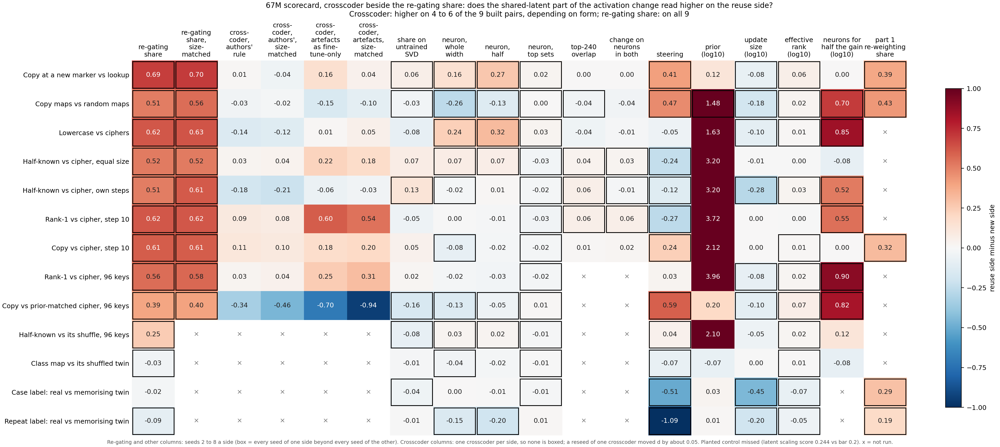

# Does a crosscoder see more of the change carried by shared latents on the reuse side than on the new side?

*2026-11-18, compare-lead. Cell P2.31, experiment E203, run 2 of the cell. Descriptive: sides are named as built, and no
side is called reused or new. Plan `reports/plans/2026-11-17_plan_p2-31-run2.md` with its amendment of 2026-11-18;
scope decision `reports/decisions/2026-11-18_decision_e203-crosscoder-scope.md`.*

We trained one crosscoder, by its authors' own code and recipe, between the original small model and each fine-tune of
the nine built pairs, and again for each pair's larger update scaled down to its partner's size. The crosscoder did not
order the pairs the way it was expected to: the side built to reuse read higher on only four to six of nine pairs, the
largest gaps pointed both ways, and the method's own check on a planted change missed its bar. As a model-diffing
baseline beside the re-gating share, which is higher on the side built to reuse on every pair, it adds no separation of
the built pairs.

## The answer

The crosscoder's reading is the part of the fine-tune's activation change that its shared latents carry, minus the part
carried by latents found only in the fine-tune. It was higher on the side built to reuse in five of nine pairs as built
and four of nine size-matched, by the authors' rule. Counting the latents latent scaling rejects as fine-tune-only too,
it was higher in six of nine both ways. Neither form reaches the filed seven of nine. Each side is one crosscoder, and
the planted-change control missed, so these are readings of a method whose sensitivity here is not shown.

## What we were trying to test

A crosscoder is one dictionary of sparse latents trained to rebuild two models' activations at once, here the original
67M model and one fine-tune of it, at block 2's input. Each latent has a decoder direction in each model. A latent whose
fine-tune direction is much longer than its original-model direction is a candidate for being fine-tune-only. Latent
scaling then asks whether the original model's activations could also be explained by that latent; if not, the latent
is called fine-tune-specific. We use the BatchTopK crosscoder with latent scaling of Minder et al. 2025, whose method
comes from Lindsey et al. 2024, trained by the authors' pinned trainer at their settings: 24,576 latents, 100 active per
token, two passes over 100M tokens.

For each side we split the activation change between the fine-tune and the original model into the parts each class of
latent carries. Shared latents have decoder directions of nearly equal length in both models. Fine-tune-specific latents
pass latent scaling. Fine-tune artefacts are top candidates that fail it. The reading has two forms:

- **the authors' rule**: shared part minus fine-tune-specific part, as the side files store it;
- **artefacts counted as fine-tune-only**: shared part minus the fine-tune-specific and artefact parts together, asked
  for by the user on 2026-11-18 after stage 1 showed no latent passing latent scaling on either side of the first pair.

A reading near 1 means the change lives in latents both models share; near 0 or below means it lives in latents only the
fine-tune has. The gap for a pair is the reuse side's reading minus the new side's, as for every scorecard column.
Size-matched means the larger side's weight change was multiplied by one number to match its partner's size, then a new
crosscoder was trained; the smaller side keeps its as-built reading.

Two controls ran first. With the original model against itself, no latent should look fine-tune-only. With one random
direction planted into the fine-tune's activations at the task's answer positions, the latent that carries it should
rank first and pass latent scaling. A random weight change of the reuse side's size was read beside the first pair.

## What we expected, and why

The user expected the reuse side to read higher: a fine-tune that builds on what the model already computes should move
activations mostly along directions the original model's dictionary also uses. That was filed as a gap above 0 on at
least seven of the nine pairs, as built and again size-matched. The filed alternative was that the gaps sit inside the
crosscoder's own noise.

## What we observed

### Does the crosscoder read higher on the side built to reuse?

**Reading it.** Not consistently. The four crosscoder columns, third to sixth in the figure, are pale or blue on four of
nine rows by the authors' rule, against a re-gating share column that is red and boxed on every built pair. The largest
crosscoder gaps are on the copy against prior-matched cipher pair, and they point the other way, at minus 0.34 as built.
Counting artefacts as fine-tune-only spreads the readings wider in both directions. It turns three cells from below 0 to
above it: lowercase against ciphers both ways, and copy against lookup size-matched. The planted-change control missed, and each cell is one
crosscoder a side, so no cell is boxed.

| Pair | Authors' rule, as built | Authors' rule, size-matched | Artefacts as fine-tune-only, as built | Artefacts, size-matched |
|---|---|---|---|---|
| Copy at a new marker vs lookup | 0.01 | -0.04 | 0.16 | 0.04 |
| Copy maps vs random maps | -0.03 | -0.02 | -0.15 | -0.10 |
| Lowercase vs ciphers | -0.14 | -0.12 | 0.01 | 0.05 |
| Half-known vs cipher, equal size | 0.03 | 0.04 | 0.22 | 0.18 |
| Half-known vs cipher, own steps | -0.18 | -0.21 | -0.06 | -0.03 |
| Rank-1 vs cipher, step 10 | 0.09 | 0.08 | 0.60 | 0.54 |
| Copy vs cipher, step 10 | 0.11 | 0.10 | 0.18 | 0.20 |
| Rank-1 vs cipher, 96 keys | 0.03 | 0.04 | 0.25 | 0.31 |
| Copy vs prior-matched cipher, 96 keys | -0.34 | -0.46 | -0.70 | -0.94 |
| **Gap above 0** | **5 of 9** | **4 of 9** | **6 of 9** | **6 of 9** |

Gap = reuse side minus new side, one crosscoder a side. Every side value is in
`experiments/crosscoder/results/run2/summary.json` and the side files `experiments/crosscoder/results/run2/sides/`.

### How big is the crosscoder's own noise?

With one crosscoder a side there is no seed range per pair. The only noise reading is stage 1's reseed: a second
crosscoder on the same fine-tune moved the authors' reading by 0.047, and the artefacts form by 0.054. A gap compares two
crosscoders, so its own noise is likely somewhat larger than one reseed's difference.

| Form | As built: beyond the reseed difference | of which above 0 | Size-matched: beyond | of which above 0 |
|---|---|---|---|---|
| Authors' rule, 0.047 | 5 of 9 | 2 | 5 of 9 | 2 |
| Artefacts as fine-tune-only, 0.054 | 8 of 9 | 5 | 6 of 9 | 4 |

So by the authors' rule, gaps beyond the reseed difference point the other way more often than the expected way. The
artefacts form has more large gaps above 0, but also its largest gap, near minus one, below 0.

Against the controls: the random weight change read 0.547 by both forms, higher than the reuse side of the first pair.
A change with no structure at all therefore reads as more shared than either built side of that pair, so a high reading
does not mark a change the original model already computes.

## Two checks on the runs before reading

**The copy side of the prior-matched cipher pair is the outlier.** It is the only side where latents seen only in the
fine-tune carry most of the change. Three latents pass latent scaling and carry 0.12 of the change, and ten artefact
latents carry 0.66, the largest artefact part of any side. Its shared part is 0.18, so its authors'-rule reading is
0.056 and its artefacts-form reading is far below 0. Shared latents carry 0.59 of the shared and fine-tune-specific
parts together. On every other side, latents that pass latent scaling carry at most 0.003 of the change, so the
authors' reading there is close to the shared part alone. The side file shows nothing about why this fine-tune differs.

**The six sides of the lowercase-against-ciphers and copy-against-lookup pairs trained on about half the tokens.** They
took about 25 minutes against about 49 for the other sides, at the same step time. Their task text cannot be generated
fresh, so it was drawn from a few hundred saved windows, at most 100 times a pass. Their training stream thus held
little more than its Pile half, and it ran out early. The last logged step is 52,000 on the lowercase and cipher sides
and 49,000 on the copy and lookup sides, of 97,656 planned. The side files' `tokens` and `step` fields record the plan,
not what trained, so they are wrong for these six.

Their lower fit, 0.927 to 0.928, against 0.932 for the base-against-itself control, is what the stage-1 crosscoders
read at 100M tokens, 0.925 to 0.926. It bears little on the reading. Both sides of each of these pairs were cut the same
way. Between 100M tokens and the end, the four stage-1 crosscoders' readings moved by at most 0.03, below the reseed
difference, and the lowercase-against-ciphers gap of minus 0.14 is well beyond that.

**Provenance.** The two copy-against-lookup sides as built were the first sides on pods the provider deleted before
their checksums were taken. Their side files reached the dev node, but their first-side logs are lost and the saved
decoders are unverified.

## The planted-change control missed

The planted direction was found: its latent ranked first by relative norm, its fine-tune decoder direction the longest
against the original model's. But latent scaling scored it 0.244 against the filed bar of 0.2, so the authors' rule called it an
artefact, and the fine-tune-specific part read 0 where at least 0.5 was required. The user approved stage 1 and stage 2
with this miss stated beside every reading. It means the authors' rule can call a change that is fine-tune-only by
construction an artefact on this model, which is why the artefacts form is read beside it.

The base-against-itself control passed: equal activations, every relative norm at one half, no fine-tune-only latent,
and a fit of 0.932.

## What we learned

The crosscoder, run as its authors run it, does not separate the nine built pairs on this model. Its reading is mostly
the shared part, because latent scaling almost never passes a latent here, and a random change reads more shared than
either side of the first pair. As a model-diffing baseline it therefore adds no evidence for or against the working
definition's question of whether the fine-tune's mechanism uses variables the original model already computes; the
re-gating share separates every built pair where this baseline separates none reliably.

## How compelling is the evidence

- One crosscoder a side; the only noise read is one reseed on one fine-tune.
- The planted-change control missed, so the method's power to find a fine-tune-only change on this model is not shown.
- One layer, block 2's input; the nine built pairs only, not the twins.
- Blind to: any change in how the model uses a direction it already represents, since a shared latent counts as shared
  whatever its activations do; and to changes outside block 2's input.
- Six sides trained on about half the planned tokens, both sides of their pairs alike.

## Surprises

- The random weight change reads the most shared of the first four crosscoders.
- No latent passed latent scaling on the first pair, and on 19 of 25 sides none did.
- The copy side of the prior-matched cipher pair alone carries most of its change in fine-tune-only latents.
- A runner-reported fact turned out to be a code issue: the six short sides' `tokens` and `step` fields state the plan,
  not what trained.

## What next

- A cell from the user for more seeds would give per-pair seed ranges; on these gaps the expected-sign count would have
  to rise to seven to change the reading.
- Fix the run script's stream for the saved-window tasks so it fills the planned tokens, and record the trained step,
  before any further use.

## Scorecard

| id | claim in words | rule | read, authors' rule | read, artefacts form | verdict |
|---|---|---|---|---|---|
| P1 | As built, reuse side higher on most pairs | gap > 0 on at least 7 of 9 | 5 of 9 | 6 of 9 | not met, both forms |
| P2 | Size-matched, reuse side higher on most pairs | gap > 0 on at least 7 of 9 | 4 of 9 | 6 of 9 | not met, both forms |
| apart | Sides apart per pair | every seed beyond every seed, 2 seeds a side | one value a side | one value a side | no call |
| planted | Planted direction found and fine-tune-specific | lead specific and part at least 0.5 | latent scaling 0.244 vs 0.2; part 0 | | missed |
| self | Original model against itself | no fine-tune-only latent, fit at least 0.8 | none; 0.932 | | met |

## Departures from the literature

From the plan, each against Minder et al. 2025 and their code (`diffing-toolkit@617d926`, `crosscoder_learning@d1fd6f3`):

1. The 67M model with width 768, so the dictionary is 24,576 latents at their 32 times expansion, not 73,728.
2. No chat model, so the paper's chat half of the tokens is the pair's own task text. Seven pairs get fresh windows from
   their own generator. The lowercase-against-ciphers and copy-against-lookup pairs reuse saved windows at most 100
   times a pass, a task share of 5.9 and 0.8 percent, and, unplanned, their training stream ran out at about half the
   planned tokens.
3. The top 1,667 latents by relative norm are latent-scaling candidates, the toolkit's 5,000 scaled by dictionary size;
   the toolkit's 5,000 is reported beside it and gives the same reading on every side.
4. The reading itself, its two forms and its controls are ours; the source reports no such quantity.
5. Latent scaling is ported line for line from the toolkit's closed form, not called, because that package cannot be
   installed here; it is checked against a direct least-squares fit.
6. The validation set is 4.2M Pile tokens against the toolkit's 5M.

## Not run

- More seeds per side, and the full set of the share's saved fine-tunes.
- The twin pairs, Qwen, and any layer but block 2's input.
- The diff-SAE, the Delta-Crosscoder and dedicated-feature crosscoders.
- A rerun of the six short sides at the full token budget.
- Any look inside the copy side's three fine-tune-specific latents.

## Provenance

Side files `experiments/crosscoder/results/run2/sides/*.json` (25), stage 0 `stage0a.json` and `stage0b.json`, stage 1
`stage1_summary.json` and `stage1_*.json`, logs `run_2_<shard>.log`, all under `experiments/crosscoder/results/run2/`.
Figure and table from `experiments/crosscoder/plot.py`, which writes `results/run2/summary.json` and
`figures/scorecard_crosscoder.png`. RunPod H100 pods, 13 for stage 2.
