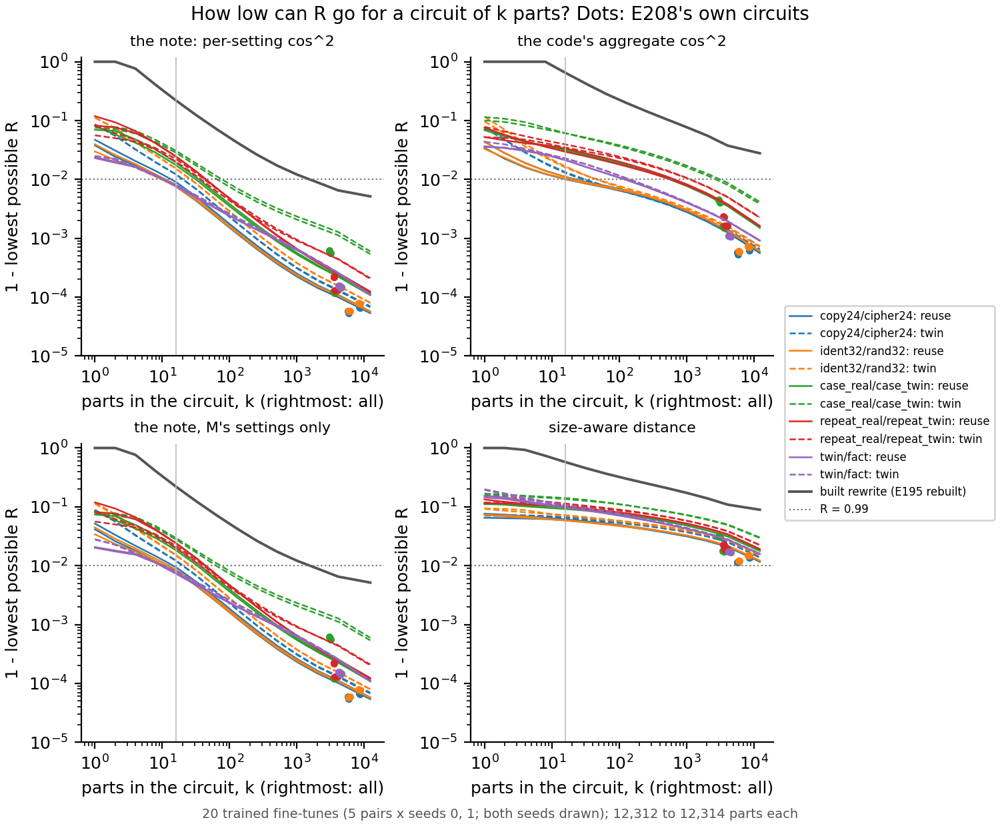

# How far can the reuse score move on the saved fine-tunes, whatever circuit is found?

*2026-11-18, definition-lead. Cell P1.34, experiment E213, test T1 of
`reports/analyses/2026-11-18_analysis_definition-vs-experiments.md`. A CPU read of saved scores: no GPU, no model, $0.
Nothing here is a verdict under the working definition, which stays under revision.*

We asked how low the definition's reuse score could go on twenty trained fine-tunes, for any circuit, under four
saved ways of comparing a part's mechanisms. With the note's squared cosine no circuit of 128 or more parts reads below
0.99, while a size-aware comparison keeps every circuit below 0.99 and splits one pair by a hundredth or more. For
`GOALS.md`, the near-1 scores at the neuron level come from the squared cosine, but the gaps that open still follow
how far each twin moved its weights.

## The answer

At the neuron-and-head level, how close the reuse score sits to 1 depends on the distance used to compare mechanisms.
With the note's squared cosine, any circuit of 128 or more parts reads above 0.99 on every trained fine-tune. With a
distance that also sees a change of size, every fine-tune reads 0.97 to 0.99 even over all its parts. The case pair's
reuse side then reads above its twin by more than a hundredth at every circuit size. That is the outcome filed for
the second explanation. The gaps it opens still rank the pairs by how far each twin's weights moved.

## What we were testing

**The score.** The working definition, in its 2026-11-18 form, finds the behaviour's smallest circuit $K^*$ under
mean ablation. It grades each part $u$ of that circuit by $s_u$, how close the fine-tune's mechanism for $u$ is to the
original model's, from 0 for unrelated to 1 for the same. The reuse score is the mean,
$R = \frac{1}{|K^*|}\sum_{u \in K^*} s_u$. Nobody has found $K^*$ on these items yet.

**Why the saved scores bound it.** E208 saved $s_u$ for every neuron and head of 20 trained fine-tunes. These are
five matched pairs at seeds 0 and 1: one side reuses machinery the original model has, its twin must learn something
new. Every part of a full fine-tune changed, so $R$ is a plain mean of saved scores over whichever parts $K^*$ holds.
So $R$ lies between the lowest and highest single score. A circuit of $k$ parts can read no lower than the mean of the
$k$ lowest scores, its **worst R at k**.

**The four distances.** Each turns two writes of a part into a score; E208 saved all four.
- *The note*: one minus the mean over input settings of $1 - \cos^2$ of the two writes, settings pooled from both
  models' runs.
- *The code's aggregate*: one $\cos^2$ of the part's whole write over every setting at once, on the original's
  settings.
- *The note on the original's settings only.*
- *Size-aware*: one minus the mean of $|f_F - f_M|^2 / (|f_F|^2 + |f_M|^2)$. Unlike the other three, it counts a
  change of size as a loss, so it reads a circuit turned up two-fold at 0.90 to 0.92 in E208.

**What was read.** Per fine-tune and distance: the lowest and highest score, the worst R at $k = 1, 2, 4, \dots, 4096$
and at every part, and $R$ on E208's five searched circuits. E208's circuits are the change's circuit, of 2,900 to
9,200 parts, not $K^*$. Then each pair's reuse side minus its twin at the same $k$ and seed. Four pairs are counted:
copy against cipher, an identity key table against a random one, real case labels against a case twin, and real
repeats against a repeat twin. A parity task against a memorised fact is reported only. E195's rebuilt circuit is the
built-rewrite reference: eight copy-circuit neurons zeroed and the later MLP layers retrained.

## What we expected

- **First explanation: saturation belongs to the neuron level.** Every part of a full fine-tune changes a little and
  none much, whatever the distance. It predicts the worst R at every $k \ge 16$ stays at or above 0.99 under every
  distance, on every fine-tune, and no pair gap reaches 0.01.
- **Second explanation: saturation belongs to the squared cosine.** The cosine is blind to a change of size. It
  predicts that the size-aware distance gives a pair gap of 0.01 or more at some $k \ge 16$ on a counted pair, at both
  seeds.

The spread between seeds was taken from E208's own all-part means: the largest seed-to-seed spread of a pair gap was
0.0006, so a gap of 0.01 sits far above it. Before filing, the lead had already seen each fine-tune's lowest and mean
score. E208's report had already given a size-aware gap of 0.013 to 0.014 on the case pair. So the second outcome was
likely before the run, and the predictions file says so.

## What we observed

### How low can the score go, and does any distance open gaps between the sides?

**Reading it.** The three squared-cosine panels saturate and the size-aware one does not. The y-axis is one minus the
lowest score a circuit of $k$ parts can have, so lower is closer to fully reused. Under the note, every fine-tune's
worst R reaches 0.99 by $k = 128$ and sits at 0.9987 or more by $k = 4096$. Its single worst part reads 0.88 to 0.98.
The code's aggregate needs $k = 4096$ to clear 0.99 on every fine-tune. Under the size-aware distance, no fine-tune
reaches 0.99 even over all its parts: they read 0.970 to 0.988. In every panel the case twin's dashed green lines sit
highest, and E208's own circuits, the dots, sit near each fine-tune's all-part value. The built rewrite, the dark line, reads
0.995 over all its parts under the note and 0.91 under the size-aware distance: below every trained fine-tune in
both, but only the size-aware distance puts it far below.

### Where do the pair gaps reach 0.01?

| pair, distance | $k = 16$, seeds 0 and 1 | $k = 256$ | $k = 4096$ | every part | E208's circuits |
|---|---|---|---|---|---|
| case, the note | 0.013, 0.009 | 0.003, 0.002 | 0.0011, 0.0009 | 0.0005, 0.0004 | 0.0005, 0.0004 |
| case, aggregate | 0.031, 0.029 | 0.015, 0.013 | 0.005, 0.005 | 0.003, 0.002 | 0.003, 0.003 |
| case, size-aware | 0.043, 0.043 | 0.030, 0.029 | 0.019, 0.018 | 0.012, 0.012 | 0.014, 0.013 |
| identity/random map, size-aware | 0.014, 0.012 | 0.010, 0.007 | 0.005, 0.005 | 0.003, 0.003 | 0.003, 0.003 |
| repeat, size-aware | 0.015, 0.005 | 0.009, 0.007 | 0.004, 0.005 | 0.003, 0.003 | 0.004, 0.004 |
| copy/cipher, size-aware | 0.008, 0.003 | 0.007, 0.005 | 0.004, 0.004 | 0.002, 0.002 | 0.002, 0.002 |

Each cell is the reuse side's score minus its twin's, seed 0 then seed 1. Every row not shown stays under 0.01 at
$k \ge 16$, except the case pair under the note on the original's settings, 0.011 at $k = 16$, seed 0 only. Under the
note, the largest gap at $k \ge 16$ is the case pair's 0.013 at $k = 16$, seed 0 only. Under the size-aware distance the reuse side reads higher on all four counted pairs at every
$k \ge 128$, at both seeds. The case gap stays above 0.01 at every size, including all parts and E208's circuits. The
identity/random-map gap passes 0.01 at both seeds at $k = 16$ only. The parity/fact pair stays under 0.01 everywhere.

**Reading it.** The size-aware distance opens gaps of a hundredth, the second explanation's outcome, but mostly on
one pair. The case twin moved its MLP weights about two and a half times as far as its reuse side, by E208's count.
At every part the size-aware gaps rank case, repeat, identity/random map, copy/cipher. Their twins moved about 2.6,
1.5, 1.13 and 1.07 times as far. That is the update-size order E208 found under the note. The distance makes the
gaps about ten times larger, but does not change their order.

## What we learned

The neuron level's near-1 scores are a property of the squared cosine. Swap in a distance that sees size, and every
trained fine-tune reads 0.97 to 0.99 whatever circuit is found, and pair gaps reach a hundredth. That answers the
question this test was for: coarser levels are not the only way off the ceiling. But the gaps that open still follow
update size, and the size-aware distance calls a pure change of gain a loss. So a size-aware distance at neurons
moves the score without yet showing that it reads reuse rather than how far the weights moved. Pairs matched in update
size would settle that.

## How compelling is the evidence

- **Seeds and pairs.** Two seeds, four counted pairs. The case gap under the size-aware distance agrees across seeds
  within 0.0014 at every $k$; the identity/random-map gap at $k = 16$ differs by 0.002 between seeds.
- **Code check.** For every fine-tune and distance, the all-part mean and $R$ on each of E208's five circuits match
  E208's own summaries within 1e-9.
- **Blind to.** $K^*$ itself: these are bounds, and the true score sits between the worst-R curve and 1. The weight
  of a part, since a head counts as one neuron. Any distance E208 did not save. Update size, which no pair here holds
  equal.
- **Not blind.** The filed outcome was foreseeable from E208's report, as stated before filing.

## Surprises

- The built rewrite reads 0.995 over all its parts under the note. A trained fine-tune's worst circuit of 256 parts
  reads about the same, 0.9954 at its lowest. So under the note a circuit rebuilt by retraining sits within a
  hundredth of 1, as close as a small worst-case circuit of an ordinary fine-tune.
- The code's aggregate needs a circuit of 4,096 parts before every fine-tune clears 0.99, against 128 for the note.

## What next

- **The same bounds on E187's size-matched pairs.** If the size-aware gaps vanish when update size is equal, the
  distance reads size, not reuse; a cell from the user is needed.
- **Coarser levels, T2 and T3.** If blocks or layers open gaps under the squared cosine, the level matters as well
  as the distance.
- **The distance question to the user.** E208 already raised it; this adds that only the size-aware distance moves
  the score off the ceiling at plausible circuit sizes.

## Scorecard

| id | claim in words | rule | read | verdict |
|---|---|---|---|---|
| R0 | the saved scores reproduce E208's summaries | all-part mean and five circuits within 1e-9 | all 20 fine-tunes, four distances | held |
| A | saturation belongs to the level | worst R at $k \ge 16$ at least 0.99 on all, every distance; every counted gap under 0.01 | 320 misses of the 0.99 bar, 200 of them size-aware; 26 gap misses | not held |
| B | saturation belongs to the squared cosine | a size-aware counted gap of 0.01 or more at the same $k \ge 16$ at both seeds | case pair at every $k$ from 16 to all; identity/random map at $k = 16$ | held |
| reported | parity/fact pair, built items | read only | parity/fact gaps under 0.01; appended grafts 0, slotted 0.002, rebuilt 0.995 | reported |

## Departures from the literature

- **The circuit is bounded, not found.** Geiger et al.'s sub-circuit analysis searches for the circuit; this reads
  the extremes over every circuit of a given size, from saved scores.
- **The size-aware distance** is this project's, from E208, not taken from a source.

## Not run

- A search for $K^*$ under mean ablation: T2 and T3.
- Any distance E208 did not save, and any weighting of parts.
- E187's size-matched pairs: no saved per-part scores.
- E208's activation-patching circuits, which E208 saved but this cell did not ask for.

## Provenance

Code `experiments/r_bounds_e208/run.py` and `plot.py`; filed rules `results/predictions.json`, committed before the
run; results `results/summary.json`; figure `figures/worst_r.png`, with its numbers in `worst_r.csv`. Inputs
`experiments/rho_saved_items/results/large/parts/*.npz` and `results/items/*.json` (E208). Run on the dev node's CPU
worker through `cpu-run`, seconds, $0.
