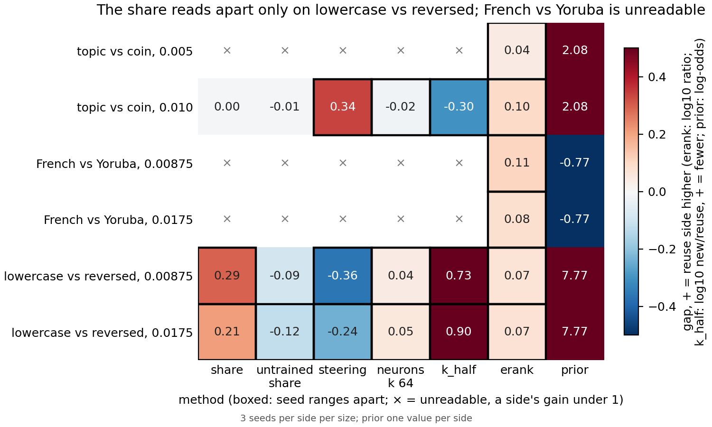

# Realistic tasks on the 67M, run 2: does each method separate the real-text pairs at matched size?

We fine-tuned both sides of three real-text pairs to two matched update sizes and read every scorecard method on each
update. The share separated only lowercase against reversed word order, as on the built pairs; it saw no difference on
the label pair and could not read French against Yoruba, where French gained too little. For `GOALS.md`, the share's
clean result on the built pairs does not carry to these real-text pairs as a whole, and no cheaper reading does better.

## The answer

The card reads its second rival: at the larger matched size two of the three pairs give the share no reading in the
expected direction. That reading comes from one "no call" and one pair the share cannot score, not from the share
pointing the other way anywhere. Where the share could read both sides, it was higher on the side built as reuse once
and level once. The cheaper readings did no better: steering split two pairs, but in opposite directions, and
erank put the side built as reuse higher on all three, against its filed direction on the label pair.

## What ran

Cell P2.38 run 2 of 3, experiment E211. Seven cluster jobs on L40 cards in the `debug` queue, $0, about 32 minutes of
wall time: the control job 61444 first and alone, then the six task jobs 61445 to 61450. Plan
`reports/plans/2026-11-18_plan_p2-38-run2.md`, card `reports/plans/2026-11-18_plan_p2-38-run2-card.md`, filed rules
`experiments/realistic_tasks/results/predictions_run2.json`, results `experiments/realistic_tasks/results/run2_*.json`,
scoring `run2_score.json` from `score2.py`, figure script `experiments/realistic_tasks/plot2.py`.

**The pairs, each named side first as built to need what the original model holds.** Topic label against a seeded coin
label on the same 512 news texts. French Wikipedia against Yoruba Wikipedia. Pile text in lowercase against the same kind
of text with each sentence's words reversed. Run 1 checked that the original model holds the first side of each pair
and lacks the second; see `reports/analyses/2026-11-18_analysis_realistic-tasks-run1.md`.

**The update size.** Size is the norm of the change over the norm of the original weights, across the 24 decomposed
matrices. Each fine-tune was saved at the first step it reached each of two sizes: 0.005 and 0.010 for the label pair,
0.00875 and 0.0175 for the two text pairs. Sizes are matched within each pair, not across pairs.

**What was read.** The gain is how much the fine-tune raised the log-odds of the right token on fixed rows: the label
pair on the difference between the two label words, the text pairs on the hardest word starts of held-out rows. The
share is the fraction of that gain still present when the change is passed through the released decomposition's
subcomponents in the do-nothing form; 0 means none of it, 1 all of it. The untrained share is the same on the original
weights' singular vectors. Steering is the best single added vector's share of the gain. The neuron reading is the share
recovered by the top 64 neurons; k_half is how many neurons carry half the gain. The prior is the original model's
log-odds on the same rows, erank the update's effective rank, size its size. Every share-like reading is left blank
when a side's gain is under 1 log-odds, the floor below which the ratio is noise.

**The call.** A cell reads "apart" when the three seeds of one side all sit above or all below the other side's three,
else "no call". With no true difference that happens by chance about one time in ten.

## What we expected, and why

The share separated all nine built pairs, so we expected it higher on the side built as reuse for both text pairs, with
a gap of about a quarter to a half on lowercase against reversed order. On the label pair we expected no difference,
because a share in the label-word difference had not told a real label fine-tune from a shuffled one before. Steering
and the untrained share were expected to read no difference anywhere. The neuron readings, k_half and erank were
expected to follow the share on the text pairs. The prior was expected higher on the reuse side of every pair.

## Controls

**The apparatus reproduces its earlier readings.** The control job re-read two saved fine-tunes from an earlier
experiment, one in lowercase and one in a cipher. The share read 0.7538 against a saved 0.7519, and 0.1249 against
0.1243, inside the filed tolerance of 0.01. Every other reading, the gain, the untrained share, the neurons, steering,
erank and k_half, matched its saved value to at least four decimals.

**A zero update reads exactly zero.** In all seven jobs every gain and every numerator read exactly 0 on the zero update.

**A random update of the same size gains nothing.** Three Gaussian updates per task and size, each with seed 0's
per-matrix norms, moved the gain by at most 0.075 log-odds either way, far under the floor of 1. Every share
on them read blank, as filed. Their erank was 690 to 704, above every trained update's, whose largest was 600.

## What we observed

### Which methods separate the pairs?

**Reading it.** The share separates only lowercase against reversed order, higher on lowercase at both sizes. The
figure gives each method's gap, the mean of the side built as reuse minus the mean of the other side; a box marks
seed ranges that do not overlap, and a cross marks a pair a method cannot read. The share's gap on that pair is 0.29 at
the smaller size and 0.21 at the larger. At the larger size lowercase reads 0.76 to 0.79 against reversed order's
0.566 to 0.569. On topic against coin the share is level at the larger size, with a gap of 0.00. The share's gap on
lowercase sits under the filed range at the larger size, because reversed order reads higher than expected.

### Why is French against Yoruba blank?

**Reading it.** French never gains a full log-odds at the hardest word starts, so no share-like method can read the
pair. At the larger size French gains 0.81 to 0.89, against Yoruba's 1.52 to 2.08. At the smaller size French gains
0.42 to 0.65, and one Yoruba seed is also under the floor. This was anticipated in the plan: run 1 had read a
French gain of 0.30. Only the prior, erank and size read this pair. The prior pointed the wrong way: French's hardest
word starts sit lower in the original model than Yoruba's, -13.16 against -12.39 log-odds.

The label pair is blank at its smaller size for a similar reason. The coin task reaches size 0.005 in 16 steps, before it has
learnt the coin, with a label-word gain of 0.14 to 0.21. The topic task reaches it in 17 or 18 steps with a gain of about 6.

### What do the other methods say?

**Reading it.** No other method follows the share across pairs. Steering separates two pairs in opposite directions.
On topic against coin it recovers 0.34 to 0.37 of the topic gain and almost none of the coin's. On lowercase against
reversed order it recovers more on the reversed side, 0.98 to 1.27 against 0.75 to 0.92. Steering above 1
means the best vector raises the right token by more than the fine-tune did. k_half follows the share on lowercase,
16 neurons against 64 to 128, but on the label pair the topic side needs more neurons, 256 against 128. Erank is higher
on the side built as reuse on every pair at every size, so it reads the label pair against its filed direction.

## What we learned

The share's separation of the built pairs carried to one of the three real-text pairs and did not show on the other two.
On the label pair, where both sides learn a large amount, it read no difference, as filed. On the language pair the scored
rows did not give French enough gain to read anything, so this run says nothing about the share on French against Yoruba.
No cheaper reading ordered the three pairs consistently: each one that separated a pair did so in a direction that
changed from pair to pair or disagreed with the share.

## How compelling is the evidence

- Three seeds a side, one decomposition, one model, three pairs. A chance "apart" has odds of one in ten per cell.
  Of the 33 scored cells with seeds on both sides, 23 read apart, where noise alone would give about three.
- The share reads where the gain passes through the decomposition's subcomponents. It does not say whether the original
  model's mechanism is the one the fine-tune uses.
- The hardest-position rule for the text pairs picks rows where the original model is worst. The prior is then a
  bottom tail on both sides, and every gain carries some regression toward the mean.
- Sizes match within each pair by construction; size reads nothing. On lowercase against reversed order the size
  cell reads "apart" at the larger size because the seeds are tightly clustered, but the gap is 0.0004 in log10,
  well inside the filed 0.005.

## Surprises

- **Erank reversed its filed direction on the label pair.** We expected the coin task, which memorises 512 independent
  labels, to spread its update over more directions. Instead the topic task's update has the higher effective rank at
  both sizes, 525 to 539 against 415 to 433 at the larger size.
- **The neuron reading with matched k reversed on lowercase against reversed order at the larger size.** Filed higher on
  lowercase, it read higher on reversed order, though both sides sit within 0.032 of zero.
- **The prior reversed on French against Yoruba**, a filed medium-confidence direction, as described above.
- **Steering split lowercase against reversed order, reversed side higher**, where no difference was filed.

## What next

- Run 3, the crosscoder on the same saved updates, experiment E212, is being prepared. If it orders the pairs as the
  share does on lowercase and the label pair, the share's single real-text separation has company.
- French against Yoruba needs rows where French has room to gain, or a larger size, before any share can be read. A
  different row rule would be a new run of this cell or a new cell.

## Scorecard

Filed direction: + means the side built as reuse higher, or fewer neurons for k_half; "none" means no difference.
Calls from `run2_score.json`, in the scored unit. Hit means the call agrees with the filed direction; a filed "none"
counts as a hit only on no call.

| pair | method | filed | smaller size: call, gap | larger size: call, gap | verdict |
|---|---|---|---|---|---|
| topic vs coin | share | none | unreadable | no call, 0.00 | hit at larger |
| topic vs coin | untrained share | none | unreadable | no call, -0.01 | hit at larger |
| topic vs coin | untrained, rotated | none | unreadable | no call, -0.03 | hit at larger |
| topic vs coin | steering | none | unreadable | apart, +0.34 | miss |
| topic vs coin | neurons k 64 | none | unreadable | apart, -0.018 | miss; both under 0.05 as filed |
| topic vs coin | neurons k matched | none | unreadable | apart, -0.007 | miss |
| topic vs coin | k_half | none | unreadable | apart, -0.30 | miss |
| topic vs coin | prior | + | +2.08 | +2.08 | hit |
| topic vs coin | erank | - | apart, +0.04 | apart, +0.10 | **reversed** |
| topic vs coin | size | none | no call | no call | hit |
| French vs Yoruba | share and every share-like reading | + or none | unreadable | unreadable | unreadable |
| French vs Yoruba | prior | + | -0.77 | -0.77 | **reversed** |
| French vs Yoruba | erank | + | apart, +0.11 | apart, +0.08 | hit |
| French vs Yoruba | size | none | no call | no call | hit |
| lowercase vs reversed | share | + | apart, +0.29 | apart, +0.21 | hit; larger gap under the filed 0.25 |
| lowercase vs reversed | untrained share | none | no call, -0.09 | apart, -0.12 | miss at larger |
| lowercase vs reversed | untrained, rotated | none | apart, +0.19 | apart, +0.41 | miss |
| lowercase vs reversed | steering | none | apart, -0.36 | apart, -0.24 | miss |
| lowercase vs reversed | neurons k 64 | + | apart, +0.040 | apart, +0.051 | hit |
| lowercase vs reversed | neurons k matched | + | no call, -0.005 | apart, -0.029 | **reversed** at larger |
| lowercase vs reversed | k_half | + | apart, +0.73 | apart, +0.90 | hit |
| lowercase vs reversed | prior | + | +7.77 | +7.77 | hit |
| lowercase vs reversed | erank | + | apart, +0.07 | apart, +0.07 | hit |
| lowercase vs reversed | size | none | no call | apart, -0.0004 | miss by the call rule; within the filed 0.005 |
| card | rival b at both sizes | | | | |

Over the 60 scored cells `score2.py` counts 23 hits, 15 misses, 1 no call against a filed direction and 21 unreadable.

Expected values beside the calls:

| quantity | filed | read |
|---|---|---|
| share, lowercase, larger size | 0.72 to 0.78 | 0.764 to 0.790 |
| share, reversed order, larger size | 0.3 to 0.5 | 0.566 to 0.569 |
| gain, lowercase, larger size | 1.65 within 0.05 | 1.605 to 1.647 |
| held-out gain in the label-word difference, coin | within 0.3 of 0 | -0.275 to 0.086 |
| held-out gain in the label-word difference, topic | over 1 | 5.38 to 10.47 |
| steps to the larger size | topic ~280, coin ~80, lowercase 285-300, French ~200, Yoruba and reversed 120-150 | topic 233-288, coin 77-78, lowercase 274-283, French 187-196, Yoruba 119-130, reversed 127-131 |

## Departures from the literature

None beyond the plan's: the share, steering and neuron readings are the scorecard's own, unchanged.

## Not run

- The crosscoder on these updates: run 3, E212, being prepared; the bf16 updates are saved under
  `experiments/realistic_tasks/results/large/run2/` for it.
- French against Yoruba with rows or sizes where French gains over 1 log-odds.
- Sizes equal across pairs: each pair is matched only within itself.
- FLORES+ parallel sentences: the dataset requires access approval; the languages are compared on different Wikipedia articles.
- The sentiment label task, dropped in run 1.
- Qwen3-1.7B.
- Any reused or new verdict: this run is descriptive under the sides as built.
