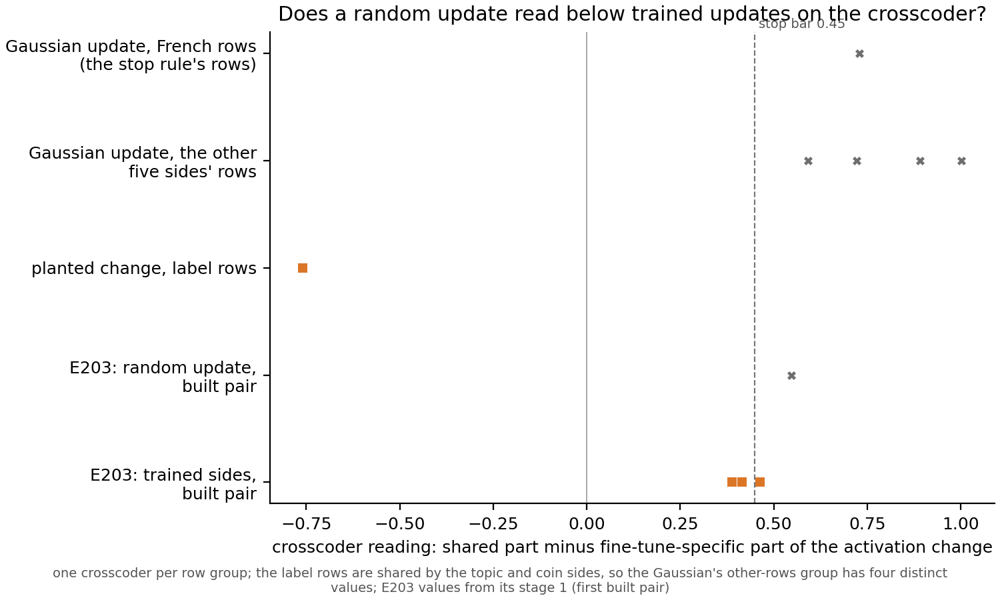

# Realistic tasks on the 67M, run 3: can a crosscoder tell a random update from a trained one?

*2026-11-18, compare-lead. Cell P2.38 run 3 of 3, experiment E212. Descriptive: sides are named as built, and no side
is called reused or new. Plan `reports/plans/2026-11-18_plan_p2-38-run3.md`, card
`reports/plans/2026-11-18_plan_p2-38-run3-card.md`, filed rules `experiments/realistic_tasks/results/predictions_run3.json`.*

Before reading any real fine-tune, we trained the crosscoder of Minder et al. on two controls: a random weight change,
and a direction planted into the updated model. The random change read as more shared than any trained update had, past
the filed stop bar, so the six real-text fine-tunes were not run. For `GOALS.md`, the crosscoder cannot serve as a
scorecard baseline at this model size, because it does not separate a structureless change from a learnt one.

## The answer

The run stopped where its card said it would. A random weight change the size of the French fine-tune read 0.730 on the
French rows, over the stop bar of 0.45. On the other sides' rows it read between 0.59 and 1.00. On the built pairs the
trained sides had read only 0.39 to 0.46. The planted direction was found and called fine-tune-only, so the method can
see a change it is built to see. It does not see which latents carry a fine-tune here. Its scorecard column reads
"failed its do-nothing control".

## What ran

Two RunPod H100 pods at once, one crosscoder each, about 50 minutes of training and reading per pod, $8.03 in all. A
cluster `prep` job built the text once, and the rehearsal ran every job at small size on the cluster for $0. Code
`experiments/realistic_tasks/run3.py`, reading in `src/commute/crosscoder.py`, results
`experiments/realistic_tasks/results/run3_gauss.json` and `run3_planted.json` with their logs, rehearsal outputs in
`results/run3_rehearsal/`, figure script `experiments/realistic_tasks/plot3.py`.

**The crosscoder.** A crosscoder is one dictionary of sparse latents that rebuilds two models' activations at once. Here
the two are the original model and an updated one, at the input of block 2. Each latent has a decoder direction in each
model. Its relative norm compares the two directions' lengths: one half means equal, one means the latent exists only in
the updated model. We use the BatchTopK crosscoder with latent scaling of Minder et al. 2025. It is trained by the
authors' pinned trainer at their settings, exactly as in the earlier run on the built pairs. A replication of their
released Gemma crosscoder had already shown that our code reproduces their numbers.

**The reading.** The update moves block 2's input on each row. We split that activation change into the parts carried
by each class of latent. Shared latents have relative norm strictly between 0.4 and 0.6. Fine-tune-specific latents are
top candidates by relative norm that also pass latent scaling, the authors' test that the original model's activations
cannot explain the latent. Fine-tune artefacts are top candidates that fail it. The filed reading is the authors' form:
the shared part minus the fine-tune-specific part. Near 1 means the change lives in latents both models share; near 0 or
below means it lives in latents only the update has. The second form, read beside, also subtracts the artefact part.

**The stream.** Every job trained on one fixed stream of about 200M token presentations. Half was Pile text and half
the six fine-tunes' own training texts, so jobs differed only in the update.

**The controls, run first and alone.**

- *The random update.* A Gaussian weight change with the same per-matrix norms as the French fine-tune, at relative
  size 0.0175. It has no structure, so a reading that tracks learnt structure should place it below every trained side.
  The filed stop: a reading at or over 0.45 on the French rows ends the run before any trained side is read.
- *The planted change.* Both sides keep the original weights, and one fixed direction is added to the updated side's
  activations at regular positions of the task text. That change exists only in the updated side by construction. Its
  latent should rank first and pass latent scaling, with a fine-tune-specific part of at least 0.5.

**The six sides that would have followed.** Topic label against a seeded coin label, French against Yoruba Wikipedia,
lowercase against reversed word order. One crosscoder per side, seed 0, at each pair's larger matched size from run 2.

## What we expected, and why

The card filed two rivals. In the first, the built tasks failed only because their small updates barely moved block 2.
Real-text fine-tunes move it more, so the random update would read near 0.2 or lower, below every trained side. In the
second, the reading follows how much the activations change, not which latents carry the change. Then the random update
would read 0.4 or above again. The lean was toward the second. On the built pairs a random update had read 0.547, above
the trained sides, with an activation change about a hundred times smaller.

## What we observed

### Does the random update read below the trained ones?

**Reading it.** No. The grey crosses are the random update; all five sit right of the dashed stop bar. On the French
rows it read 0.730, and on the other sides' rows from 0.59 to 1.00. The orange squares at the bottom are the trained
sides of the first built pair, at 0.39 to 0.46. So the random change reads more shared than any trained update the
crosscoder has read, and the stop rule ended the run.

Almost every latent of this crosscoder sits in the shared band: all but two, on the planted crosscoder too. With an
update this small, no decoder direction lengthens much in the updated model. The reading then measures how much of the
change the shared dictionary rebuilds. For the random update that is 0.78 of the change on the French rows. One artefact
latent carries a negative part there, -0.12, so the second form reads higher than the first, at 0.848. On the label rows
the same negative part raises the reading to 1.00.

| Read rows | Authors' form | Artefacts subtracted too | Activation change per token |
|---|---|---|---|
| French, the stop rule's rows | 0.730 | 0.848 | 0.33 |
| Yoruba | 0.72 | 0.744 | 0.28 |
| Lowercase | 0.89 | 1.076 | 0.32 |
| Reversed order | 0.59 | 0.596 | 0.24 |
| Topic and coin labels, one row set | 1.00 | 1.259 | 0.40 |

The activation change is the mean squared change of block 2's input per token. It does not depend on the crosscoder.

**Was the random change too small to be seen?** Less so than on the built pairs. The rehearsal measured the trained
French fine-tune's activation change on the same rows at 11.9, about 36 times the random update's. On the built pairs
the ratio was about 114, 1.96 against 0.017. So the random change is relatively three times larger here, and it reads
higher, not lower. Nothing in this run says a larger activation change would make the reading fall.

### Can the crosscoder see a change built to be fine-tune-only?

**Reading it.** Yes, this time. On the label rows the planted direction's latent ranked first by relative norm. It
passed latent scaling, with a ratio of 0.021 against the bar of 0.2. It carries 0.766 of the change, over the bar of 0.5.
Its decoder difference points along the planted direction to a cosine of 1.000. The reading on the planted change is
-0.76, far left in the figure, where a fine-tune-only change belongs. On the built pairs this control had missed: latent
scaling gave 0.244, the latent was called an artefact, and the fine-tune-specific part read 0.

So the method works as its authors describe on a change made to be fine-tune-only. The planted change also moved the
label rows more than the random update did, 1.16 per token against 0.40. The failure is in the other direction: a
change with no structure is not placed apart from learnt ones.

### Is the crosscoder trained well enough to read?

**Reading it.** Yes, by every filed early check. Both crosscoders rebuilt 0.93 of the variance in each model's
activations at the end, against a bar of 0.8, with no dead latents. Both were projected at 52 minutes, under the bar of
150. A zero update reproduced the original model's activations exactly. The random update matched its source's size
to within one part in ten billion.

## What we learned

The crosscoder, as its authors run it, does not read which latents carry a fine-tune on this 67M model, on built or
real-text tasks. At these update sizes nearly every latent stays shared, and the reading becomes how well the shared dictionary
rebuilds the activation change. A random change is rebuilt at least as well as a learnt one, so it reads at least as
shared. Its column on the part 2 scorecard is drawn as "failed its do-nothing control", and the card proposes no
further crosscoder run.

## How compelling is the evidence

- One crosscoder for the random update, one draw of it. Two crosscoders on one built fine-tune differed by 0.047; the
  random update sits 0.28 over the bar, about six of these.
- The reading moved during training. On the French rows it read 0.57 after an eighth of training and 0.447 after a
  quarter. It read 0.75 at half and 0.730 at the end. That one snapshot under the bar shows the trajectory is wider than
  the reseed difference; the filed reading is the end of training.
- The trained sides were not run, so the comparison to trained updates uses the built pairs' values of 0.39 to 0.46.
  The filed expectation for real-text sides was 0.35 to 0.50. A real-text side reading over 0.730 on the French
  rows would have been a new range.
- The reading sees only block 2's input. It is blind to how the model uses a direction it already represents, since a
  shared latent counts as shared whatever its activations do.

## Surprises

- **The random update read higher than on the built pairs**, 0.730 against 0.547, with a relatively larger activation
  change. Rival b's filed reasoning, that a tiny change is read as shared, does not account for this by size alone.
- **The planted control passed here after missing on the built pairs.** The direction and seed were the same. What
  differed was the stream, with half real task text, and the positions the direction was added at.
- **In the rehearsal the random update read under the bar.** A dictionary of 1,536 latents trained on about 4M tokens
  read 0.37 on the French rows. The rehearsal's bars were set not to stop it, and its numbers decide nothing.

## What next

- None for the crosscoder: the card's stop line holds and the cell's three runs are spent.
- The saved fine-tunes of run 2 remain available for any other baseline the user adds a cell for.

## Scorecard

| id | claim in words | rule | read | verdict |
|---|---|---|---|---|
| stop | Random update reads below 0.45 on the French rows | at or over 0.45 stops the run | 0.730 | stopped |
| P1 | Random below every trained side; reuse side 0.15 above on two of three pairs | floor and gaps | random not below the bar; sides not run | not met |
| P2 | Random at or above a trained side, or no gap reaches 0.15 | floor fails | stop rule taken as the floor failing | met, as the card's stop line |
| planted | Planted latent ranks first, is fine-tune-specific, carries at least 0.5 | lead specific, part at least 0.5 | ratio 0.021, part 0.766 | met |
| early checks | Fit, dead share, projected time, zero update, sizes | as filed | every one within its bar | met |

## Departures from the literature

Against Minder et al. 2025 and their code, `diffing-toolkit@617d926` and `crosscoder_learning@d1fd6f3`, as in the plan:

1. The 67M model with width 768, so the dictionary has 24,576 latents at their 32 times expansion.
2. Half the stream is the six fine-tunes' own training texts in place of their chat data. One stream serves every job,
   so each crosscoder sees all six tasks' text, not only its own update's.
3. The label texts are drawn at most 100 times a pass and are also the label sides' read rows. The built-pair run kept
   read rows out of the stream.
4. The top 1,667 latents by relative norm are latent-scaling candidates, their 5,000 scaled by dictionary size; their
   5,000 gives the same reading here.
5. The reading, its two forms and both controls are ours. The source reports no such quantity and has no random-update
   control.
6. The validation mix is Pile rows plus every task's read rows, the same for every job.

## Not run

- The six real-text sides and their three pair gaps: stopped by the filed rule.
- A second draw of the random update, or a second crosscoder seed on it.
- Seeds 1 and 2 of the fine-tunes and the smaller matched size.
- Per-side streams, each crosscoder on its own task's text only.
- Layers other than block 2's input; Qwen3-1.7B.
- Any reused or new verdict: this run is descriptive under the sides as built.
