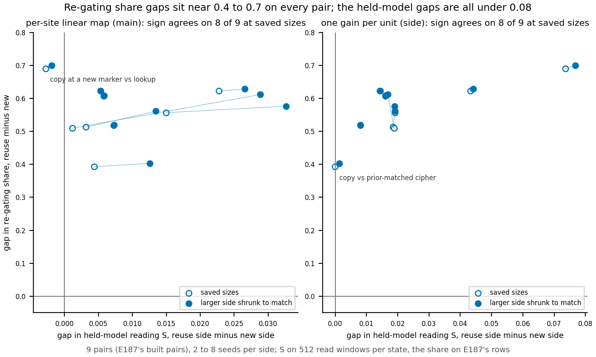

# Does the re-gating share order the built pairs as the held-model reading does?

*2026-11-18, definition-lead. Cell P2.35, zero-run: no new run, no experiment number. Inputs: E205's
`experiments/held_model_size_matched/results/summary.json` in this repository and E187's
`experiments/size_matched/results/summary.json` in compare-lead's clone. Figure and per-pair numbers from
`experiments/held_model_size_matched/plot_regating.py`, which writes `results/regating_vs_S.json`. No pair or side is
called reuse or new on this page, and no cut-off is applied.*

We set the re-gating share beside the held-model reading on nine built pairs of fine-tunes, before and after matching
each pair's update sizes. Both put the side built to reuse higher on eight pairs, but the share's gaps are large and
alike while the held-model gaps are tiny, and the two order the pairs differently. For `GOALS.md`, the share and this
cheap reading of the working definition agree on direction and on little else.

## The answer, for the paper

On E187's nine built pairs, the re-gating share is higher on the side built to reuse on every pair, by 0.39 to 0.70.
Matching update size leaves that range almost unchanged. The
held-model reading under the per-site linear map agrees in sign on eight of the nine pairs, both at the saved sizes and
after matching. The exception is copy at a new marker against a lookup. There the held-model gap is -0.0028 against a
seed spread of 0.0006, while the share's gap is the largest of all, 0.69. The held-model gaps are small beside the
share's. They reach at most 0.023 at the saved sizes and 0.033 after matching. On the three pairs already within two
percent of each other in size they are 0.0053 to 0.0072. The two do not order the pairs alike. Their rank correlation
is 0.13 at the saved sizes and -0.27 after matching. With nine pairs, chance alone reaches a rank correlation of about
0.7, either way, one time in twenty. The side reading, one gain per unit, agrees in sign on eight pairs saved and nine
matched. Its rank correlation with the share is 0.52 saved and 0.68 matched.

## What was compared

**The pairs.** Nine pairs of fine-tunes of the 67M model, built for E187, with two to eight seeds per side. In each pair
one side was trained on a task built to reuse a skill the original model has, the other on a task built to need
something new. These are construction labels. A pair's gap, for either measure, is the mean over the first side's
seeds minus the mean over the second side's.

**The re-gating share.** For one fine-tuned state, the share of the gain in the trained answer's log-odds that appears
when the original subcomponents are kept and only the frozen Γ switches them on differently on the fine-tuned
activations. It is 0 when Γ's changed pattern carries none of the gain and 1 when it carries all of it. Values above 1
occur. Compare-lead read it in E187.

**The held-model reading.** The working definition, revised by the user on 2026-11-18, is the mean retention of the
parts the fine-tune needs: how far those parts still compute what the original's parts compute on the same inputs. The
held-model survival is one cheap reading of it, not the definition. It builds a held model in which every part of the
fine-tune follows the original model's matching part, and reads $S = 1 - \mathrm{KL}(F\|H)/\mathrm{KL}(F\|M)$ on 512
windows, with F the fine-tune, H the held model and M the original. $S = 1$ when the held model reproduces the
fine-tune, and $S = 0$ when it is no closer to it than the original is. The main version fits a linear map at each
layer's MLP and attention output; the side version lets each neuron and head keep one original unit's rule at one gain.
Definition-lead read both in E205.

**The two sizes.** At the saved sizes every state is as trained. After matching, the side with the larger mean update
had every update multiplied by one number $c$ so that the two sides' mean update sizes agree. Both measures read the
same shrunk states, so a pair's matched gaps are comparable. The pair names in the two result files map one to one.

## How far do the two measures agree?

**Reading it.** They agree on direction for eight pairs and not on ordering. Each point is a pair: its horizontal place
is the held-model gap, its vertical place the share gap, open at the saved sizes and filled after matching, with a thin
line joining the two. All points sit high above the horizontal zero line, since every share gap is between 0.39 and
0.70. In the left panel, the per-site map, all but one pair sit right of the vertical zero line, and the points form no
rising band: the pair with the largest share gap sits furthest left. Matching size mostly slides points to the right,
because shrinking lowered the shrunk side's held-model reading, while their heights barely move. The right panel's
held-model gaps run wider, to about 0.08, and rise loosely with the share's. Its one pair on the zero line, copy against
the prior-matched cipher, sits within its own seed spread.

Because every share gap is positive, counting sign agreement only counts how many held-model gaps are positive. The
count says the two measures put the sides the same way round. It does not say they read the same amount.

| pair | $c$ | share, saved | share, matched | per-site map, saved | per-site map, matched | one gain, saved | one gain, matched |
|---|---|---|---|---|---|---|---|
| copy at a new marker vs lookup | 0.834 | 0.691 | 0.700 | -0.0028 | -0.0019 | 0.0736 | 0.0768 |
| copy maps vs random maps | 0.659 | 0.513 | 0.561 | 0.0031 | 0.0135 | 0.0185 | 0.0191 |
| lowercase vs ciphers | 0.896 | 0.622 | 0.629 | 0.0228 | 0.0266 | 0.0433 | 0.0442 |
| half-known vs cipher, equal size | 0.981 | 0.518 | 0.519 | 0.0072 | 0.0073 | 0.0081 | 0.0081 |
| half-known vs cipher, own steps | 0.522 | 0.510 | 0.611 | 0.0012 | 0.0288 | 0.0188 | 0.0169 |
| rank-1 vs cipher, step 10 | 0.997 | 0.622 | 0.623 | 0.0053 | 0.0053 | 0.0144 | 0.0143 |
| copy vs cipher, step 10 | 0.990 | 0.607 | 0.608 | 0.0058 | 0.0058 | 0.0161 | 0.0161 |
| rank-1 vs cipher, 96 keys | 0.817 | 0.557 | 0.576 | 0.0150 | 0.0326 | 0.0191 | 0.0189 |
| copy vs prior-matched cipher, 96 keys | 0.780 | 0.393 | 0.403 | 0.0044 | 0.0126 | -0.0001 | 0.0014 |

*Every column is a gap: mean over the side built to reuse minus mean over the side built to need something new. $c$
is the factor applied to the larger side, which is the new side except on rank-1 against a cipher at step 10. The
held-model gaps' seed spreads are in the E205 report.*

| held-model version, size | pairs with the same sign as the share | rank correlation with the share |
|---|---|---|
| per-site map, saved | 8 of 9 | 0.13 |
| per-site map, matched | 8 of 9 | -0.27 |
| one gain per unit, saved | 8 of 9 | 0.52 |
| one gain per unit, matched | 9 of 9 | 0.68 |

*Rank correlation is Spearman's, over the nine pairs, with no ties.*

## How compelling is the evidence

- Nine pairs. A rank correlation over nine points moves a long way when two pairs swap, so the rank results say only
  that no strong common ordering shows under the per-site map.
- The share's gaps sit in a narrow band far from zero, so the share gives little ordering to agree with: every pair reads
  between 0.39 and 0.70.
- Shrinking is a rescaled update, not a model trained to a smaller one; both measures share that limit.
- The held-model reading is one cheap reading of the definition. The definition itself, the mean retention of the parts
  a fine-tune needs, has not been read on these pairs, so nothing here says how the share agrees with it.

## Departures from the literature

None beyond those of the two source runs: rescaling a saved update to stand for a smaller one follows E187 and has no
source.

## Not run

- The working definition itself on these pairs: its search for the parts each fine-tune needs.
- The Qwen half of E187.
- The held model's one gain per block, read in E205 and not compared here.
- The share's own seed spread drawn on the figure.
- Any label, cut-off or verdict, by the user's instruction.
