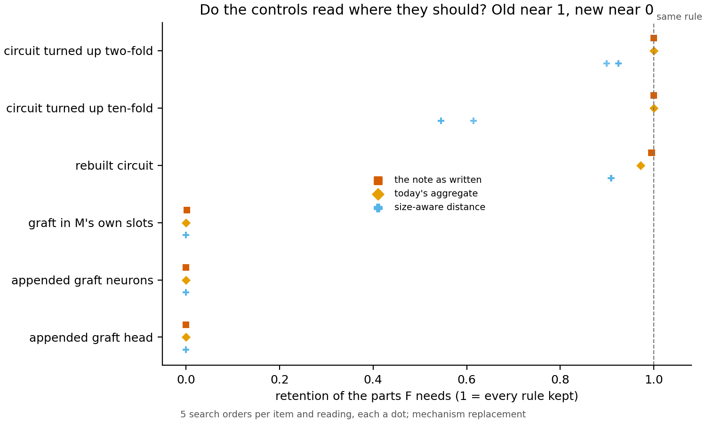
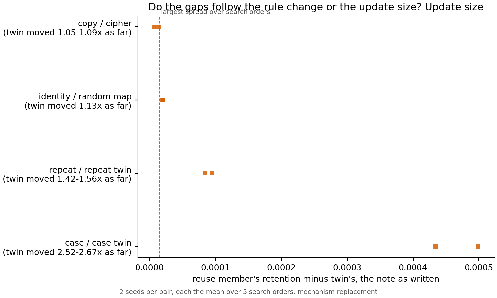
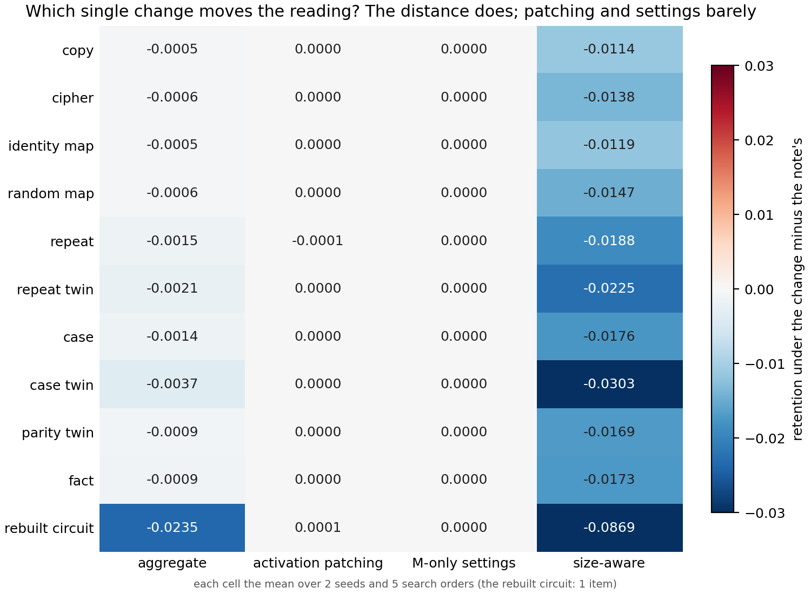

# Does the working definition, read as the theory note writes it, tell reuse from new on saved fine-tunes?

*2026-11-18, definition-lead. Cell P1.30, experiment E208, run 2 of 2. A test of the working definition's measurement
as written, not a verdict: no fine-tune is called reuse or new on this page, and the definition stays "tested, not
adopted".*

We read the working definition as the theory note writes it, on saved fine-tunes: five pairs where one side reuses
old machinery and its twin must learn something new, plus a rebuilt circuit and grafted units. The controls landed
where the rule says, but every trained fine-tune read almost fully retained, and each pair's gap grew with how far the
twin moved its weights. For `GOALS.md`, the definition as written does not separate reuse from new on these pairs,
and it raises three definition questions for the user.

## The answer

Read as written, the definition says all twenty trained fine-tunes kept almost every rule. Each read 0.999 or more,
where 1 means every rule kept. The reuse member read above its twin in every pair. But the margins rank exactly as the
twins' extra weight movement does, at both seeds. The pair built to test new rules in
attention ranked below a pair that differs mostly in size. The controls behaved: new units read near 0, a turned-up
circuit reads 1. Today's code and a size-aware distance give the same ranking.

## What we were testing

**The definition, in plain words.** The working definition says a fine-tune F reuses the original model M, for a
behaviour, to the extent that the parts F needs for that behaviour keep M's rules. The theory note,
`theory/2026-11-18_definition_causal_abstraction.md`, writes each step as an intervention. Its starred choices fix
what this run reads:

- **Parts.** Every MLP neuron, every attention head, the token embedding and the unembedding, each the same unit in M
  and F. Every variable on a path from input to output is a part, so F with every part given M's weights is M itself.
- **The swap.** F with the parts outside a set $K$ given M's weights, written $F_K$. Each such part runs M's
  mechanism on whatever input it receives in the hybrid.
- **The parts F needs.** A smallest set $K$ of changed parts for which $F_K$ still carries 0.9 of the behaviour, measured
  as next-token divergence from M. The search drops parts in a random order, five orders per item, so $K$ is an upper
  bound on the smallest set.
- **Keeping a rule.** A part's rule score is $r_u = 1 - \mathrm{mean}_v\, d(f_u^F(v), f_u^M(v))$, where $f_u^N(v)$ is
  what part $u$ writes in network $N$ when its input is the setting $v$, and $d = 1 - \cos^2$ of the two writes. The
  settings are the inputs the part sees in M's run and in F's run, pooled. Two zero writes count as the same value. A
  part M lacks scores 0. So $r_u = 1$ means the same output direction at every setting, $r_u = 0$ means unrelated.
- **Retention.** $\rho$, the plain mean of $r_u$ over $K$, read in each of the five orders and averaged.

**Beside it, one change at a time.** Each alternative changes one choice and keeps the rest. *Today's aggregate* is
the score E195 and E196 used: one squared cosine of the part's whole write over every setting at once, on M's
settings, read on the same $K$. *Activation patching*, after Prakash et al. 2024, builds $F_K$ by setting each
changed part outside $K$ to the value it took in M's own run, and searches $K$ again. *M-only settings* reads $r_u$
on M's settings alone. *The size-aware distance* replaces $d$ by $|f_F - f_M|^2 / (|f_F|^2 + |f_M|^2)$, which also
counts a change of size. On the rebuilt circuit only, *zeroed parts restored* lets the eight neurons F had zeroed
come back outside $K$.

**The items.** The five matched pairs read in E184 and E196, each trained at seeds 0 and 1. Four pairs are counted:
copy against cipher, an identity key table against a random one, real case labels against a case twin, and real
repeats against a repeat twin. The fifth, a parity task against a memorised fact, is reported only. Each is read on
512 held-out windows at the last position. E195's rebuilt circuit, with the eight neurons of a known copy circuit
zeroed and the later MLP layers retrained, is read as E195 read it.

**The controls, run first and alone.** A do-nothing copy of M must read "no change". The copy circuit's eight output
columns turned up two-fold and ten-fold must read 1, since a change of gain is the same rule. E206 trained 256 lookup neurons. Written without training into
M's quietest layer-3 slots, they are new by construction in slots M already has, and should read near 0. E206's
grafts as built add neurons and a head that M lacks. The rule says a part M lacks keeps nothing, so they read 0: a
check of the code, not a test.

## What we expected

One rule was filed, which separates two readings by the four counted pairs' gaps, each the reuse member's $\rho$
minus its twin's. The twins of the two key-table pairs moved their MLP weights about as far as their reuse members.
The repeat twins moved about one and a half times as far, and the case twins two and a half times.

- **Rival A, the rules.** The new key table lives in what the attention heads compute, which this level now reads
  per setting. Then the identity/random-map gap should exceed the repeat gap at both seeds. E196's heads-and-blocks
  reading already showed this order.
- **Rival B, update size.** At a neuron the per-setting cosine sees only the direction of its output column, so
  $\rho$ follows how far weights moved. Then the gaps rank case above repeat above both key-table pairs at both seeds.

The algebra also fixed a neuron's score before the run. Write $z_u$ for the share of settings where it is silent in
both networks, $a_u$ for the share where it is active in both, and $c_u$ for the squared cosine of its two output
columns. Then $r_u = z_u + a_u c_u$. So M-only settings should leave $\rho$ almost unchanged on neurons.

## What we observed

### Do the controls read where the rule says they should?

**Reading it.** Yes. The do-nothing copy read "no change" on every pod. The turned-up circuit read 1 under the note
and under today's aggregate, in every order. The size-aware distance read it lower, as it must, since it counts a change
of size as a loss: 0.90 to 0.92 at two-fold, 0.55 to 0.61 at ten-fold. The graft written into M's own slots read
0.002 under the note and 0.0001 under today's aggregate. The size-aware distance read it about 0.
The appended graft read 0 under every reading, as the rule fixes. The rebuilt circuit read 0.995 under the note,
against 0.97 under today's aggregate, which matches E195's own reading of 0.97. With nothing kept, its hybrid sat at
-1.11 of the behaviour, as E195 found, because the zeroed neurons stay absent.

The first run stopped at this stage. The filed value for the turned-up circuit under the size-aware distance assumed
every write was non-zero. But the 67M's activation function returns exact zeros, and the code counts two zero writes
as agreement, as the note says. Amendment 1 made each part's expected value exact: one minus the gain's distance
times the share of settings where the part writes. The tolerance stayed as filed. The amendment also turned the
slotted graft's bound from a stop into a reported number. The second run passed on all eleven pods.

| control | the note | today's aggregate | size-aware | expected |
|---|---|---|---|---|
| do-nothing | no change | no change | no change | no change |
| circuit two-fold | 1 | 1 | 0.90 to 0.92 | 1, 1, exact per active share |
| circuit ten-fold | 1 | 1 | 0.55 to 0.61 | 1, 1, exact per active share |
| graft in M's own slots | 0.002 | 0.0001 | about 0 | filed near 0; reported since amendment 1 |
| appended neurons, appended head | 0 | 0 | 0 | 0 by the rule |
| rebuilt circuit | 0.995 | 0.97 | 0.91 | at or above E195's 0.97 |

Ranges are over the five search orders. Zeroed parts restored moved the rebuilt circuit to 0.994, and activation
patching to 0.995, both within a thousandth of the note's reading.

### Does retention separate each reuse member from its twin by more than update size does?

**Reading it.** No. The gaps follow update size at both seeds, the outcome filed as rival B. The case pair, whose
twin moved its MLP weights about two and a half times as far, has the largest gap. The repeat pair comes next, and
the two key-table pairs sit near the spread between search orders. The identity/random-map gap, which rival A needed
above the repeat gap, sat below it by 6.5e-5 at seed 0 and 7.4e-5 at seed 1. The largest spread of one item over its
orders was 1.3e-5 and 1.5e-5, so both calls are clear of it. Every gap is five to eight times smaller than E196's at the same
pair and seed. That fits a neuron being read by its output column and its silent settings alone.

| pair, seed | gap, the note | gap, E196 | twin's MLP update over reuse member's |
|---|---|---|---|
| copy / cipher, 0 | 1.4e-5 | 1.0e-4 | 1.09 |
| copy / cipher, 1 | 7.1e-6 | 4.3e-5 | 1.05 |
| identity / random map, 0 | 1.9e-5 | 1.1e-4 | 1.13 |
| identity / random map, 1 | 2.1e-5 | 1.2e-4 | 1.13 |
| repeat, 0 | 8.5e-5 | 6.7e-4 | 1.42 |
| repeat, 1 | 9.5e-5 | 7.6e-4 | 1.56 |
| case, 0 | 5.0e-4 | 2.8e-3 | 2.67 |
| case, 1 | 4.3e-4 | 2.4e-3 | 2.52 |

Every fine-tune's $\rho$ under the note is the mean over five orders. The lowest was the case twin at seed 0, 0.9994.
The parity twin and the fact, not counted, differ by under 1e-5 at both seeds.

### Which single change to the reading moves it?

**Reading it.** Only the distance moves it, and none of the changes reverses the ranking. M-only settings changed
$\rho$ by under 3e-6 on every item, as the algebra said it would for neurons. Activation patching shrank $K$ by 10 to
49 percent on the pair fine-tunes but moved $\rho$ by under 0.0001. Today's aggregate read 0.0005 to 0.0039 lower on
the pairs, and the size-aware distance 0.011 to 0.031 lower. Under all four readings, at both seeds, the case gap is
largest, the repeat gap next, and the two key-table gaps smallest.

| pair, seed | today's aggregate | activation patching | size-aware |
|---|---|---|---|
| identity / random map, 0 | 1.1e-4 | 7.1e-6 | 2.8e-3 |
| identity / random map, 1 | 1.3e-4 | 5.8e-6 | 2.8e-3 |
| repeat, 0 | 6.6e-4 | 6.5e-5 | 3.6e-3 |
| repeat, 1 | 7.4e-4 | 7.1e-5 | 3.9e-3 |
| case, 0 | 2.9e-3 | 5.1e-4 | 1.4e-2 |
| case, 1 | 2.5e-3 | 4.2e-4 | 1.3e-2 |

Each cell is the reuse member's retention minus its twin's under that one change.

## What we learned

Unlike E196's neuron-only level, F with every part swapped is now M, so the definition as written gives a reading on
every item. But on these pairs it does not tell reuse from new: the controls sit at the two ends, and every
trained fine-tune sits at the top with gaps set by update size. The reason is in the definition's per-setting
distance at a neuron, which reads the output column's direction and almost nothing else. The heads, where rival A
placed the new tables, do show its order when read alone, but each counts as one part among thousands. The working
definition's status does not change: tested, not adopted.

## Definition questions for the user

These are questions about wording, raised by the data. The page proposes no wording, cut-off or verdict.

1. **What should "the same value" mean at a neuron?** As written, a neuron writes its activation times a fixed output
   column. So the squared cosine of two writes is the squared cosine of the two columns. A neuron then
   reads only its output direction and when it is silent, never how strongly it fires. Today's aggregate pools every
   setting first, so it sees the firing pattern and reads 0.0005 to 0.0039 lower on the pairs. A size-aware distance
   also counts a change of size, reads 0.011 to 0.031 lower, and calls a pure change of gain a loss. None of the three
   separated the pairs beyond update size here. Which did you mean: the note as written, today's aggregate, or one
   that sees size?
2. **Do two units that are both silent on an input follow the same rule there?** The note says yes. That
   did not raise the slotted graft's reading here: no slot neuron was ever exactly silent at the same setting as the M
   neuron it replaced. The 67M's activation function returns exact zeros only far below zero. On the pair fine-tunes,
   a neuron was silent in both networks on about one setting in a thousand. It matters elsewhere. The eight circuit neurons of
   the turned-up control were silent in both on about half their settings. In a network whose activation is zero for
   every negative input, shared silence could make two unrelated units read as the same rule.
3. **Should a head weigh the same as one neuron?** Heads made up under one percent of every $K$. Read alone, the
   heads in $K$ scored 0.976 to 0.995 and the neurons 0.9994 or more. At the heads alone, the identity/random-map gap
   was 0.0036 and 0.0039 at the two seeds, above the repeat gap of 0.0007 and -0.0024: the order rival A predicted,
   as E196's heads-and-blocks reading also saw. The plain mean over $K$ drowns it. Is a plain mean what you intended?

## How compelling is the evidence

- **Seeds and pairs.** Two seeds, four counted pairs, the same call at both seeds. The calls sit four to five times
  the largest spread between search orders.
- **Blind to.** Pairs matched in update size, which would separate the rivals directly, are not in this set. At a
  neuron the main reading is blind to how strongly an active neuron fires. $\rho$ is blind to how much each part
  matters.
- **Code checks.** On every item, F with no part swapped gave F's own output, and F with every changed part swapped
  gave M's within the filed tolerance. Each neuron's $r_u$ matched the silent-and-active formula to rounding. Each
  fine-tune's divergence from M matched E184's.

## Surprises

- The first run stopped at its controls on an expectation, not a code error: exact zeros in the activation function.
  Amendment 1 fixed the expectation, not a tolerance.
- The graft in M's own slots read 0.002 even after the amendment allowed it to read high, because exact shared
  silence never happened there.

## What next

- **Pairs matched in update size**, E187's, would read whether any gap survives once size is equal. A gap there would
  reopen rival A. It needs a cell from the user.
- **The user's answers to the three questions.** A distance that sees firing strength, or a weighting of parts,
  changes what $\rho$ reads. The saved sets and per-part scores let most of these be re-read at no cost.

## Scorecard

| id | claim in words | rule | read | verdict |
|---|---|---|---|---|
| R0, stage 0 | do-nothing "no change"; two-fold and ten-fold read 1, size-aware exact per active share | stop on a miss | held on all eleven pods in run 2; run 1 stopped on the filed size-aware value | held, amendment 1 |
| R0, slotted | new parts in M's slots read near 0 | reported since amendment 1 | 0.002 | reported |
| R0, appended | a part M lacks keeps nothing | 0 exactly | 0 | held |
| R0, code checks | no-swap gives F, full swap gives M, neuron formula, E184's divergence | within tolerance | every item | held |
| R1 | identity/random-map gap above repeat gap, rival A; or gaps ranked case, repeat, key tables, rival B | strict, both seeds | B at seed 0 and seed 1 | B |
| R2 | appended neurons beside E206's held-model reading | reported | 0 against 0.954 | reported |
| R3 | M-only settings equal the note on neurons; aggregate at or below it | reported | under 3e-6; 0.0005 to 0.0039 lower | as expected |

## Departures from the literature

- **The swap's mechanism comes from the other model.** Geiger et al. 2025 intervene within one model. The note's
  swap gives F's part M's mechanism and reads one alignment on two networks; the note states both as its own steps.
- **Activation patching applied to changed parts only.** Prakash et al. 2024 patch activations across models. Here
  only changed parts outside $K$ take M's values; unchanged parts run on the hybrid's input, so that they do not all
  enter $K$.
- **Two zero writes count as agreement.** The note's "the same value"; no source fixes the cosine of two zero
  vectors.
- **$K$ is searched, not found.** Chunked backward elimination gives an upper bound on the smallest set, as in E195
  and E196.

## Not run

- E187's size-matched pairs: no cell.
- E201's graft, which is of the same kind as E206's appended head.
- A fitted alignment and distributed variables, choices the note says no reading uses.
- The fit of the alignment on F, which is 0 by construction at the identity alignment.
- Any weighting of parts in $\rho$, or any distance other than the three read: those are definition questions.

## Provenance

Results: `experiments/rho_saved_items/results/items/*.json`, `stage0_*.json`, `summary.json`, `parts_summary.json`
(per-part split of the note's reading, written by `plot.py` from `results/large/parts/*.npz`), logs `run_*.log`.
Figures: `experiments/rho_saved_items/figures/{controls,gaps,one_change}.png`. Code: `src/commute/rho.py`,
`experiments/rho_saved_items/run.py`, `plot.py`. Filed rules and amendment 1: `results/predictions.json`. Eleven
H100 SXM pods on RunPod, 19 to 33 minutes per pair item. Run 1's stop: commit a98fa582.
