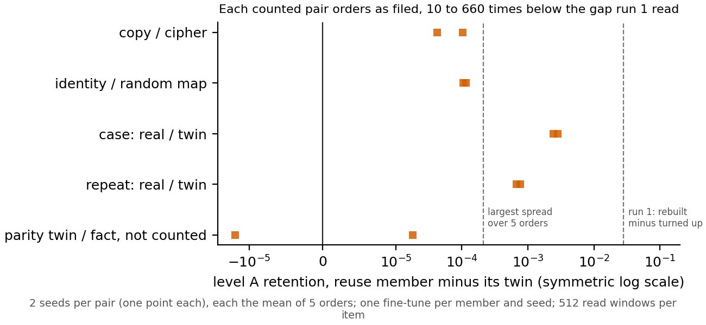
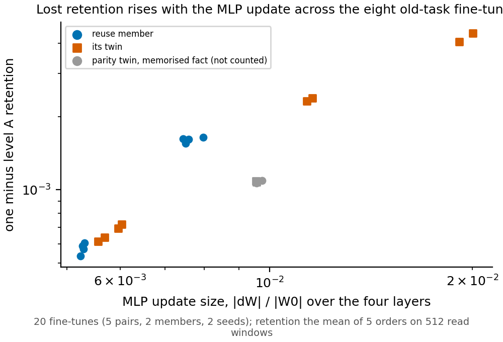

# Does the reuse member of each trained pair keep more of its neurons' rules than its twin?

*2026-11-18, definition-lead. Cell P1.25, run 2 of 2, experiment E196. A test of a candidate definition of "reused
against new", not adopted. No fine-tune is called reuse or new on this page.*

We read a candidate definition, causal-rule retention at the level of single MLP neurons, on the five pairs of
fine-tunes the project built so that one member reuses old machinery and its twin must learn something new. In all
four counted pairs and both seeds the reuse member read higher than its twin, as filed. But every fine-tune read
almost fully retained, and each gap was far smaller than the gap a rebuilt circuit read in run 1. For `GOALS.md`, the
neuron-level reading points the right way on every pair, yet its gaps grow with how far each fine-tune moved its MLP
weights, so this run cannot tell retained rules from a smaller update.

## The answer

The filed rule holds in all eight counted comparisons: the reuse member keeps more of its neurons' rules than its twin.
The margins are tiny. Every fine-tune reads 0.996 or more on a scale where 1 means every rule kept. The largest gap,
in the case pair, is about a tenth of run 1's gap between a rebuilt circuit and a turned-up one. The gaps rank the
pairs exactly as the size of the twins' larger MLP updates does. The memorised-fact pair, whose two sides moved their
MLP weights equally, reads a tie.

## What we were testing

**The definition, in plain words.** The draft under test says a fine-tune F *retains* a mechanism of the original
model M to the degree that the matching unit in F follows the same rule. Two units follow the same rule when they give
the same values once their inputs are set the same in both networks. For this test the user fixed every choice.
A unit is one MLP neuron. Its rule is what it writes into the residual stream as a function of its layer's input,
read on M's own inputs to that layer. The *rule similarity* $r$ of a neuron of F and a neuron of M is the squared
cosine between their two outputs over those inputs: $r = 1$ means the same rule up to a change of size, $r = 0$ means
unrelated outputs. Neurons are re-paired one to one within a layer to give the greatest total $r$. A change of size
costs nothing. The reading is comparative only, with no bar.

**Retention for the change.** The change is $\mathrm{KL}(F \| M)$, the next-token divergence of F from M, read at the
last position of each window, where every task here is scored. A smallest set of F's changed neurons is searched for
that, kept as in F while every other changed neuron is put back to its M rule, still recovers 0.9 of that divergence.
The *retention* is the mean $r$ over that set. The search drops neurons in a random order, so it runs in 5 seeded
orders; the item's reading is the mean of the five. The same reading one level up, with attention heads and whole MLP
blocks as units, is reported with no expectation. We call the neuron level *level A* and the heads-and-blocks level
*level B*.

**The items.** The five matched pairs read in E184, each trained on seeds 0 and 1, twenty fine-tunes in all. In each
pair one side was built to reuse a skill the original model has, and its twin was built to need something new. The
four counted pairs are copy against cipher, an identity key table against a random one, real case labels against a
case twin, and real repeats against a repeat twin. The fifth pair, a parity task built to read a variable the model
already has against a memorised random fact, is reported and not counted. The draft itself says a memorised fact
controls for new information, not for new machinery. Each item is read on 512 windows of its own held-out
read set.

**The control.** Run first and alone on every pod: a do-nothing copy of M must read "no change", and run 1's circuit
turned up two-fold must read 1 in every order. Both held on all five pods. Each fine-tune's gap from M also matched
E184's to the sixth decimal, so these are the same fine-tunes E184 read.

## What we expected

The user filed one rule, descriptive with no bar: in each counted pair and seed, the reuse member's mean retention at
level A is strictly above its twin's. Two readings were in view before the run. If the reuse member keeps its
neurons' rules and the twin changes what its neurons respond to, the order holds with gaps that do not follow the size
of the weight update. If the reading mostly tracks how far each fine-tune moved its weights, the order holds too,
since every twin moved its MLP weights further. The gaps then follow the update-size ratio: largest in the case pair,
smallest in the two key-table pairs. The filed rule cannot tell these apart; the gap sizes can.

## What we observed

### Does the reuse member read higher in every counted pair?

**Reading it.** Yes, in all eight counted comparisons, and in each one the five orders of the two members do not
overlap. The figure plots, on a symmetric log scale, the reuse member's mean retention minus its twin's. Every counted
point sits right of zero. The right dashed line is run 1's gap between a turned-up circuit and a rebuilt one, 0.03.
The case pair comes closest at 0.0028 and 0.0024, about a tenth of it. The two key-table pairs sit near 0.0001, more
than two hundred times below it. The left dashed line is the largest spread over the five search orders of any item
here, 0.0002. The two key-table pairs sit left of it, so their margins are smaller than the search noise on the
noisiest item, though within each of those pairs the orders did not overlap.

The search order is not the only noise. The same fine-tune trained on a second seed moves the reading too: by up to
0.00004 for the key-table members, and by 0.00033 for the case twin. Against that, the copy and cipher gap at seed 1
is 0.00004, the size of the seed-to-seed change. The case and repeat gaps are several times their seed-to-seed
change.

| pair, seed | reuse member | twin | reuse minus twin | largest order spread of the two | twin's MLP update over reuse member's |
|---|---|---|---|---|---|
| copy / cipher, 0 | 0.99947 | 0.99936 | 0.00010 | 0.00004 | 1.09 |
| copy / cipher, 1 | 0.99943 | 0.99939 | 0.00004 | 0.00002 | 1.05 |
| identity / random map, 0 | 0.99941 | 0.99931 | 0.00011 | 0.00004 | 1.13 |
| identity / random map, 1 | 0.99939 | 0.99928 | 0.00012 | 0.00002 | 1.13 |
| case, 0 | 0.99845 | 0.99561 | 0.00284 | 0.00011 | 2.67 |
| case, 1 | 0.99839 | 0.99594 | 0.00245 | 0.00018 | 2.52 |
| repeat, 0 | 0.99836 | 0.99768 | 0.00067 | 0.00017 | 1.42 |
| repeat, 1 | 0.99838 | 0.99762 | 0.00076 | 0.00021 | 1.56 |
| parity twin / fact, 0, not counted | 0.99893 | 0.99892 | 0.00002 | 0.00005 | 1.00 |
| parity twin / fact, 1, not counted | 0.99891 | 0.99892 | -0.00002 | 0.00004 | 0.98 |

Retention is the mean over 5 orders at level A. The update ratio is the relative size of the whole MLP change,
$\lVert \Delta W \rVert / \lVert W_0 \rVert$ over the four layers' MLP matrices, twin over reuse member.

### Could "holds" be tracking the size of the update?

**Reading it.** It could: nothing in this run separates retained rules from a smaller update. The figure plots each
fine-tune's lost retention, one minus its reading, against how far it moved its MLP weights. Across the
sixteen old-task fine-tunes, eight per seed, the loss rises with the update almost in step. The copy member at seed 0 moved its MLP by 0.005
and lost 0.0005. The case twin at seed 0 moved it by 0.020 and lost 0.0044. At seed 1 two items swap rank, with
losses that nearly tie. Read per pair, the table's last two columns rank the four counted pairs in the same order:
case first, repeat second, the two key-table pairs last. That is the order the update-size reading predicted, and the
one the reading of retained rules said the gaps would not follow.

Per layer, the twins' MLP updates are 2.04 to 3.12 times the reuse members' in the case pair, 1.22 to 1.77 times in
the repeat pair, and 1.02 to 1.18 times in the key-table pairs. In the not-counted pair the two sides moved their MLP
weights by the same amount, 0.98 to 1.00 times, and the reading is a tie, with one seed each way. That fits the size
reading as well. The parity twin and the fact sit off the old tasks' line: both moved their MLP by about 0.0096 and
lost only about 0.0011. They were trained by a different recipe, so one line through all twenty items is not expected.

This is a correlation over ten pair-seeds, not a cause. A fine-tune that learns something new may need a larger
update, so update size and a change of rules can travel together in these pairs. Telling them apart needs the same
reading on pairs matched in update size, which was not run.

### What does level A not see?

**Reading it.** A large share of each change, and more of it for the reuse members. At level A only MLP neurons are
units; attention weights, embeddings and norms enter only as the fixed surroundings in which neurons are put back.
Putting every changed neuron back to its M rule still leaves a model that recovers part of the change, by the same
divergence measure the set search uses. That part lives outside the neurons, and level A never reads it.

- *Copy and cipher.* With every neuron put back, the copy member still recovers 0.64 and 0.68 of its change, the
  cipher 0.38 and 0.39. Each moved its attention weights by about 0.8 times its MLP weights. The copy member's change
  sits more in attention, which level A cannot score.
- *Identity and random map.* The same pattern: 0.63 and 0.64 for the identity table, 0.37 for the random one.
- *Case.* 0.51 and 0.55 for real labels, 0.33 and 0.35 for the twin. The case twin moved its attention by as much as
  its MLP, 1.03 to 1.05 times, so its larger change is in attention as well as neurons.
- *Repeat.* 0.46 and 0.56 for real repeats, 0.43 and 0.45 for the twin.
- *Parity twin and fact.* 0.40 against 0.38. Both are full fine-tunes that also moved embeddings and norms, by 0.012
  of their size, which no level reads. The old tasks' updates touched only the attention and MLP matrices.

So level A scores only the part of each change carried by neurons. In the key-table and case pairs that part is
clearly a smaller share of the reuse member's change than of its twin's; in the repeat pair the two are close. What attention did is read only at level B, where heads are
units.

**Level B, reported.** At heads and whole MLP blocks the reuse member also reads higher in all eight counted
comparisons, by 0.001 to 0.011. There the five orders of the two members overlap in six of the eight, all but the
case pair.

## What we learned

The neuron-level reading orders every counted pair as filed, so it does not contradict the labels the pairs were built
with. But it cannot carry those labels. Every fine-tune reads near 1, the gaps rank with the twins' larger MLP updates,
and the one pair with equal updates reads a tie. This is the draft's own stated limit, that a neuron reading sits
close to a weight comparison, now measured on trained pairs. Run 1 found a rebuilt circuit only 0.03 below a turned-up
one, and here the largest trained-pair gap is a tenth of that. Level A also leaves out the attention part of every
change, which is the larger part for several reuse members.

## How compelling is the evidence

- Two seeds per pair. The direction holds in all eight. The key-table gaps are one to six times the seed-to-seed
  change of a single member; the case and repeat gaps are seven times it or more.
- One subset of 512 read windows per item, the same seed for all. Another subset was not read.
- The search orders agree closely: within each counted pair the members' orders never overlap. The smallest set holds
  between 1,703 and 7,226 of the 12,288 neurons, so the reading is a mean over thousands of slightly changed neurons,
  as in run 1. The plain mean $r$ over every neuron orders all eight comparisons the same way, with nearly the same
  gaps.
- The update-size check is on the weights alone, ten pair-seeds, and shows a shared ranking, not a cause.
- No bar was filed, by the user's instruction, so "higher" is read as a direction only. This page sets no bar.

## Surprises

None against the filed rule. Not anticipated: in three of the four counted pairs the reuse members carry more of their
change outside the neurons than their twins, so level A reads a smaller part of exactly the fine-tunes it is meant to credit.

## What next

- The same reading on E187's size-matched pairs, where the side with the larger update was shrunk until both sides
  matched. If the gaps vanish there, level A is reading update size; if they stay, it is reading something the size
  does not explain. This needs a new cell from the user.
- Whether attention changes should count, by reading heads or read-outs of the residual stream, is a definition
  question for the user, not a measurement choice.

## Scorecard

| id | claim in words | rule | read | verdict |
|---|---|---|---|---|
| stage 0 | do-nothing reads "no change"; the two-fold circuit reads 1 | stop on any miss | held on all five pods | held |
| gap check | each fine-tune is E184's | within 1e-4 of E184's gap | equal to the sixth decimal, all 20 | held |
| filed | reuse member above its twin, level A, each counted pair and seed | strict, mean of 5 orders, no bar | 8 of 8 | holds |
| side | parity twin above the fact | reported | one seed each way, gaps 0.00002 | tie |
| side | level B, same comparison | reported | 8 of 8, orders overlap in 6 | reported |

## Departures from the literature

- The same-rule test is the interchange intervention of causal abstraction, Geiger et al. There it compares a network
  with a written algorithm; here it compares two networks, as Prakash et al. 2024 patch between a model and its
  fine-tune. The parents of a neuron are its layer's own input, so a rule is one layer deep, and the distance ignores a
  change of size. Both are the draft's fixed choices, as in run 1.
- *From run 1.* The divergence is read at the last position of each window, where every task here is scored; run 1
  averaged over every position.

## Not run

- The reading on pairs matched in update size, such as E187's shrunk states.
- A third seed, another subset of read windows, or the whole held-out read set.
- Any unit outside the MLP neurons at level A: attention, embeddings, residual-stream read-outs.
- Bars of any kind, by the user's instruction.
- A per-neuron look at which neurons make up each set; the sets are saved as masks but not analysed here.

## Provenance

- Results: `experiments/rule_retention_pairs/results/summary.json`, `items/*.json`, `stage0*.json`,
  `run_pair*.log`; per-neuron profiles and set masks in `results/large/units/*.npz`. Filed rule in
  `results/predictions.json`, sha256 f557cc53, unchanged since filing.
- Update sizes: `experiments/rule_retention_pairs/update_size.py` on the saved states, CPU only, written to
  `results/update_size.json`.
- Figures: `experiments/rule_retention_pairs/plot.py`, which also draws `figures/retention.png`, every order per item
  at both levels.
- Run 1, for the reference gap: `experiments/rule_retention_fixed/results/stage2.json`; page
  `reports/analyses/2026-11-17_analysis_rule-retention-fixed-run1.md`.
- Definition draft: `~/commute-data/scratch/definition-session/2026-11-17_causal-rule-retention.md`, "Choices fixed
  for the test" and "Stated limits". Plan: `reports/plans/2026-11-17_plan_rule-retention-fixed-choices.md`, "Run 2".
- Five GPU pods in parallel, one per pair, 2026-11-17; each fine-tune took 4 to 11 minutes.
