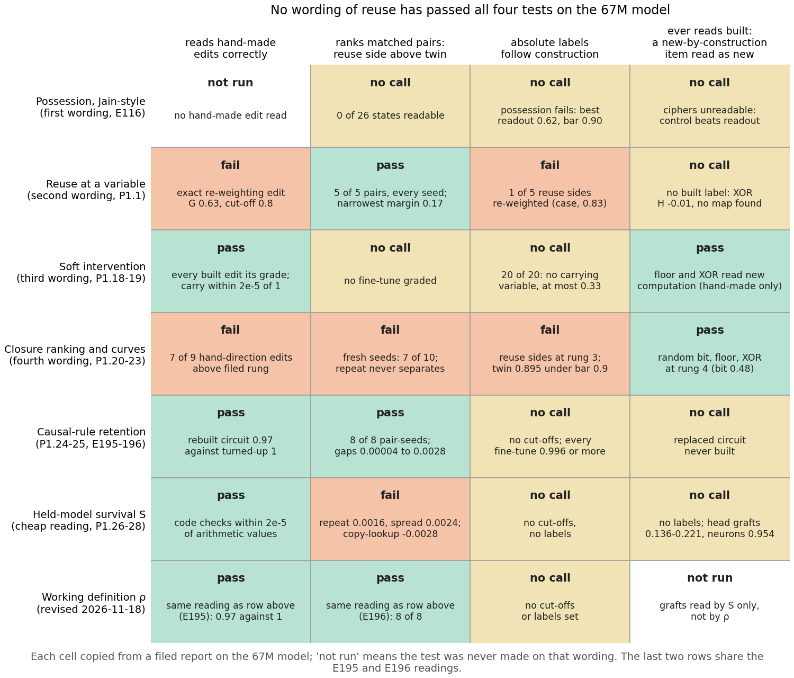

# How did each wording of reuse fare on the tests a definition must pass?

*2026-11-18, definition-lead. Cell P1.29, section 4 material for the paper. Reading and writing only: nothing was run,
and every number below is copied from a filed report. Figure `experiments/held_model_retention/figures/wordings_matrix.png`
from `experiments/held_model_retention/plot_wordings.py`. The working definition quoted here is the research log's box
"The working definition · revised 2026-11-18" (`docs/research_log/parts/sections/overview.html`, id `existing-new`),
which the user named as the wording to adopt. No cut-off, label or rule is set on this page.*

We set the seven wordings of reuse the project has tried side by side, each against the same four tests, using only
results already on file. No wording passed all four: the early ones failed on hand-made edits or gave no reading on
real fine-tunes, and the later ones mostly order matched pairs the right way but set no labels and have not read new
machinery as new. For the goal of a working definition of reused against new, the current definition is the
best-founded so far, but its own reading has been made once, and never on the grafted heads and neurons that are new
by construction.

## The answer

No wording of reuse has passed all four tests. The first wording gave no verdict on any fine-tune, and the third read
hand-made edits correctly but graded no fine-tune. The fourth read new items as new, but also graded copying fine-tunes
as needing a new direction. Rule
retention, on which the working definition rests, ranks every counted pair the right way and reads hand-made edits
correctly, but by tiny margins that follow update size. Its cheap reading puts four grafted heads far below old-task
fine-tunes, and a grafted neuron lookup close to them. The definition itself has never read a graft.

## The four tests

Each column of the figure is one question a definition of reuse must answer correctly before its labels can be
trusted. The tests are applied as follows, to numbers already filed; where a report filed its own rule, its verdict is
given beside the cell in the table below.

- **Reads hand-made edits correctly.** Edits written into the 67M by hand, whose answer is known by construction, read
  that answer. Pass means every hand-made item that the wording's report scored read as built.
- **Ranks matched pairs.** In each matched pair of fine-tunes, one side was built to reuse a skill the original model
  has and its twin to need something new, on the same inputs. Pass means the reuse side reads more reused than its twin
  on every counted pair and seed, with no tie.
- **Absolute labels follow construction.** The wording's labels, at the cut-offs the user set, give each fine-tune
  the label it was built with. Where no cut-offs exist, the cell is no call.
- **Ever reads built.** At least one item new by construction is read as new by the wording. With no labels, the cell
  is no call, and the number says where the new items sit.

A cell reads **no call** when the wording was applied and gave no reading, and **not run** when the test was never
made on that wording.

## Figure 2: the wordings against the tests

**Reading it.** No row is green across. The first wording gave no reading on any of its saved fine-tunes. The second
ordered every matched pair but failed an exact hand-made edit and labelled four of five reuse sides as rewired. The
third read every hand-made edit, but no named variable carried any fine-tune's change. The fourth read new items as new,
but also graded copy and identity, built to reuse, as needing a new direction. Rule retention and the held-model survival both read the hand-made edits; retention ranks
every pair, by margins far smaller than the gap a rebuilt circuit opens. The working definition's row shares rule
retention's two readings, and its graft cell is empty because only the cheap reading was ever made there.

## The matrix in full

Each cell gives the reading, the number it rests on, and the source. "Filed" quotes the source report's own rule and
verdict where it had one.

| Wording | Reads hand-made edits | Ranks matched pairs | Absolute labels follow construction | Ever reads built |
|---|---|---|---|---|
| Possession, Jain-style | not run: E116 read only saved fine-tunes | no call: 0 of 26 states readable, 3 "does not apply" (E116) | no call: possession fails on every task; best non-key readout 0.62 against a bar of 0.90 | no call: the text ciphers read unreadable, their control readout beats the readout |
| Second wording, reuse at a variable | fail: the planted odd edit, an exact re-weighting, reads $G$ 0.63 under the cut-off 0.8; the hand-made changes set the cut-offs, so they agree by design (P1.1 update 2026-11-12) | pass: every reuse seed above every twin seed in all five pairs, narrowest margin 0.17 | fail: only the real case label, $G$ 0.83, reads re-weighted; the other four reuse sides of the matched pairs read rewired | no call: the measured rule has no built label; XOR's $H$ -0.01 reads "no map found", and the positive control for a built test read $H$ 0.466, so no built arm ran |
| Third wording, soft intervention | pass: every built edit in the stop rule read its grade at bars 0.8, 0.9 and 0.95; carry and reversion within 2e-5 of 1 (P1.19) | no call: no fine-tune graded; as description only, the reuse side's named trigger explains more of its change on every pair | no call: all 20 fine-tunes read "no carrying variable", the smaller of carry and reversion at most 0.33 | pass, on hand-made items only: the floor and XOR read "new computation" at every bar, the floor's fit shares 0.004 and 0.18 |
| Fourth wording, closure ranking and curves | fail: four list-built controls read as built, but 7 of 9 hand-direction items read above their filed rung; 16 names closed at most 0.72 of the planted constant push | fail. Filed ranking rule: holds on 7 of 8 pair-seeds, case seed 0 reversed (P1.20). Filed curve rule on fresh seeds: 7 of 10 full, 8 of 10 answer tokens; repeat never separates (P1.23) | fail: copy and identity, built to reuse, read rung 3, a new direction; the parity twin read rung 3, one free direction closing 0.895 under the bar 0.9 | pass: random bit, floor and XOR read rung 4, the random bit's best closure 0.48; cipher, random map and fact also read rung 4 |
| Causal-rule retention | pass: do-nothing reads 1 on every unit, the doubled circuit 0.80 by the formula (P1.24); under the fixed choices the rebuilt circuit reads 0.97 against 1 for the turned-up one, filed "lower" holds (E195) | pass: filed rule holds on 8 of 8 counted pair-seeds, but gaps run 0.00004 to 0.0028 against the rebuilt-circuit gap of 0.03 and follow MLP update size (E196) | no call: no cut-offs; every fine-tune reads 0.996 or more | no call: the replaced circuit, the new-by-construction item, was never built in two runs; the copies correlated 0.999 with circuit neurons |
| Held-model survival $S$, the cheap reading | pass: code checks reproduce arithmetic values within 2e-5 against a tolerance of 1e-3, under one gain and the per-site map (P1.26) | fail, per-site map: three of four counted pairs ahead at every seed, repeat 0.0016 with seed spread 0.0024; on nine size-matched pairs eight ahead, copy against lookup -0.0028 (P1.27) | no call: no cut-offs, no labels | no call: no labels; four last-layer head grafts keep 0.136 to 0.221 and a 256-neuron graft 0.954, against 0.984 for the lowest old-task fine-tune; one gain keeps 0 of every graft (P1.26, P1.28) |
| Working definition $\rho$ | pass: shares rule retention's E195 reading, 0.97 against 1 | pass: shares rule retention's E196 reading, 8 of 8 | no call: the definition sets no cut-offs or labels | not run: the grafts were read by $S$ only |

**Why the last two rows share cells.** The working definition is causal-rule retention at a declared level, and its
one reading is E195 and E196. That reading took single MLP neurons as parts, inputs one layer deep taken from M's runs
only, and $d$ as one minus a squared cosine. The definition asks for inputs from both networks' runs, so the shared
cells are its reading under that narrower choice.

**Cells I could not source as a test.** The first wording was never run on a hand-made edit, so that cell is not run.
No wording's "ever reads built" cell was tested on a trained fine-tune whose machinery is known to be new, other than
the grafts, which only $S$ read.

## Appendix: definition wordings in full

**Possession, Jain-style, the first wording.** A model possesses a capability when a linear readout trained on
ordinary text recovers it at some layer; a fine-tune reuses it when its answer is a small function of that readout,
carries to held-out values, and breaks when the readout's direction is removed. The possession test is accuracy at
least 0.90 and selectivity over a Hewitt-Liang control at least 0.3: $\mathrm{acc}(C) \ge 0.9$ and
$\mathrm{acc}(C) - \mathrm{acc}(\text{control}) \ge 0.3$. Carrying, the small function and removal each had bars of
0.9, 0.9 and one half, copied from E112. The search is one ridge readout per value at each block. On the 67M's 26
saved states it read every task unreadable: key tables had selectivity zero, copying and guesses stayed under the
accuracy bar, and on ciphers the control beat the readout.

**Reuse at a variable, the second wording.** A fine-tune reuses the original when a few directions at one layer
split the change and the fine-tune sets them by a fixed affine map of their own value; if the map needs everything
earlier, it is rewired; if neither, built. Measured as shares of the gap closed: the re-weighting share $G$ maps a
four-direction variable from its own value, the rewiring share $H$ from all earlier activations. Re-weighted needs $G
\ge 0.8$ and $H \ge 0.5$; rewired needs $H \ge 0.5$ with $G$ below; $H$ under 0.5 reads "no map found". The user
rounded these from filed midpoints 0.794 and 0.476 on 2026-11-10. The search fits variables and maps greedily at one
site. It ordered all five matched pairs and labelled nearly every ordinary fine-tune rewired; built was never read.

**Soft intervention, the third wording.** A fine-tune reuses a variable of the original when it is the original with
only that variable's rule changed, checked by interchange through an alignment fixed on the original. Carry is
$c = 1 - \overline{TV}(M[V \leftarrow V_F], F)/\text{gap}$ and reversion the same the other way; both must clear the
bar before the variable's change is graded as re-setting, new trigger or new computation. Bars 0.8, 0.9 and 0.95 were
read side by side for the user to choose between; none was adopted. The variables were named by hand per task. It read
every built edit as built and found no carrying variable in any of 20 fine-tunes. A zero-run page before it, P1.18,
read the same wording by argument and listed where it gives no reading.

**Closure ranking and curves, the fourth wording.** A fine-tune reuses the original to the extent that it is the
original under a simple intervention on the original's own variables. Closure is $1 - \mathrm{KL}(F\|M_I)/\mathrm{KL}
(F\|M)$, ranked into five rungs from "already matches" to "from scratch", at bars 0.8, 0.9 and 0.95, with up to 16
names on rungs 1 and 2. The search is greedy over M's neurons, principal directions, tokens and logits. Ranked, it read
the list-built controls but put hand-direction edits a rung or two high; as curves on fresh seeds, three of five pairs
separated and repeat never did.

**Causal-rule retention, P1.24 and P1.25.** A unit is retained to the degree that its rule, what it writes given its
inputs, is unchanged; the reading is the mean over a smallest set of units that carries the change. P1.24 used
$r(u) = 1 - \min(1, \lVert f_F - f_M\rVert^2/(\lVert f_F\rVert^2 + \lVert f_M\rVert^2))$ with bars 0.7 and 0.3 for
high and low; P1.25 used the user's fixed choices, a squared cosine with gain reported and no bars. The set is found
by dropping units in five random orders until 0.9 of the divergence is kept. It read code checks exactly, the rebuilt
circuit slightly lower, and every pair the right way by margins that follow update size.

**Held-model survival $S$, P1.26 to P1.28.** Build a held model H from M's own units at their old rules, fitted to
F's write at each site, and ask how much of F's change survives: $S = 1 - \mathrm{KL}(F\|H)/\mathrm{KL}(F\|M)$. The fit
class is declared: one gain per unit at the strict end, a per-site linear map as the main reading. No cut-offs and no
labels. The search is a least-squares fit per site. It kept almost nothing under one gain, 0.98 or more of every
old-task fine-tune under the map, and between those for the rebuilt circuit, the memorised fact and the grafts.

**The working definition, revised 2026-11-18.** Quoted from the log: "the *reuse* of M by F, for that behaviour at
that level, is the mean retention of the parts F needs: $\rho = (1/|K|)\sum_{u \in K} r_u$." Retention is
$r_u = 1 - \text{mean}_v\, d(f_u^F(v), f_u^M(v))$, with $v$ ranging over the values u's inputs take when M and when F
run on the behaviour's inputs. F needs K when K is a smallest set with $\mathrm{KL}(F\|F^K) \le (1-\tau)\,
\mathrm{KL}(F\|M)$. Declared with every reading: the level, the behaviour's inputs, the tolerance and the distance. No
cut-offs and no labels are set. Its search is any search for K, which gives only an upper bound on its size. It has
been read once, as E195 and E196.

## The working definition and the grafts

The working definition, in the log's one line: "A fine-tune reuses the original model to the extent that the parts it
needs for a behaviour still compute what the original's parts compute when given the same inputs." Reuse is
$\rho$, the mean retention of the parts K that F needs for a behaviour, at a declared level. The held-model survival
$S$ is one cheap reading of it: it gives every part M's rule at once, up to a fitted gain or linear map, and asks how
much of the change survives. $S$ is not the definition.

**The grafts are its built cases.** A graft adds new weights to a frozen 67M and trains only those, so whatever F does
beyond M lives in the graft, and removing it gives back M exactly. Five grafts were read. One last-layer head trained
to copy the token 16 back, in P1.26. Four more last-layer heads at offsets 16, 12, 8 and 4, and 256 last-layer MLP
neurons sending each of 256 common tokens to a random other one, in P1.28. All five passed their build checks.

**What the cheap reading said.** Under the per-site map, the four head grafts in P1.28 kept 0.136 to 0.221 of their
change, and the first build in P1.26 kept 0.134. The 256-neuron graft kept 0.954. Old-task fine-tunes kept 0.98 or
more, the lowest 0.984. Under one gain per unit every graft kept exactly 0, because no unit of M was paired with the
graft and H was M itself. So the heads read far below old-task fine-tunes, while the neuron lookup, new by
construction, read close to them. The map rebuilt about nine tenths of the neurons' write, a sign that M's last-layer
neurons, mixed linearly, already write most of a per-token table.

**What the definition itself would say was not read.** These are readings of $S$, the cheap reading, and $\rho$ was
not read on any graft. By the definition, a part of F with no counterpart in M has retention 0. If the graft is a part
with no counterpart and it lies in K, it pulls $\rho$ down whatever the per-site map can absorb. Whether it lies in K,
and how the level pairs a graft, are declared choices of a reading that has not been made.

**Known limits, as the log box states them.** $\rho$ is read on parts whose rules changed, so after a small update it
sits near 1: in E196 every fine-tune read 0.996 or more, and the gaps between pair members followed the size of the
MLP update. With inputs one layer deep a neuron's rule is fixed by its weights, so the reading is close to a weight
comparison; how far upstream a part's inputs sit is an open choice. Different levels can give different answers, so
methods are compared at one level. No cut-offs and no labels are set.

## Departures from the literature

- The first wording departs from Jain et al. 2024 by requiring held-out carrying, a row-87 departure the user filed.
- The second and fourth wordings search any affine map or any variable on a list, where Jain et al. 2024 probe one
  named function and Prakash et al. 2024 patch named heads.
- The working definition is an interchange intervention between two networks, after Geiger et al. 2025 and Prakash
  et al. 2024, who intervene within one network; the held-model's map fit is a stitching step, not an interchange.

## Not run

- The working definition $\rho$ on any graft, at any level.
- $\rho$ with inputs taken from F's runs as well as M's, as the definition asks.
- Any wording on a trained fine-tune whose machinery is known to be new, other than the grafts.
- The first wording on hand-made edits.
- Any cut-off or label under the last three wordings; those are the user's.
- An independent check of any cell.

Provenance: `reports/analyses/2026-11-06_analysis_e116-definition-table.md`,
`2026-11-10_analysis_gate-page-working-definition.md`, `2026-11-12_analysis_third-wording-no-reading.md`,
`2026-11-13_analysis_third-wording-measured.md`, `2026-11-16_analysis_e184-simplest-intervention.md`,
`2026-11-16_analysis_e184-curves.md`, `2026-11-17_analysis_e192-curve-test.md`,
`2026-11-17_analysis_p1-24-rule-retention.md`, `2026-11-17_analysis_rule-retention-fixed-run1.md`,
`2026-11-18_analysis_rule-retention-pairs-run2.md`, `2026-11-18_analysis_held-model-retention-run1.md`,
`2026-11-18_analysis_held-model-size-matched.md`, `2026-11-18_analysis_graft-sites.md`; the ledger beside this page
traces every decimal to its results file.
