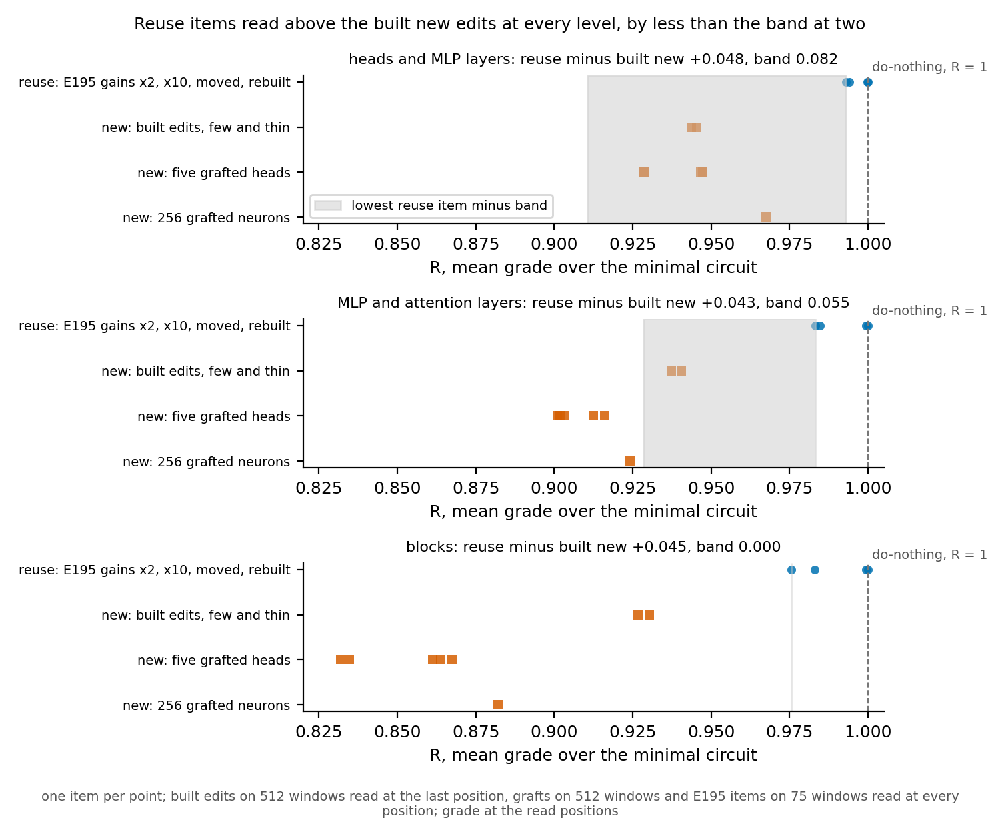

# Does the reuse score put built reuse above built new at some level? (E214, cell P1.35)

*Definition-lead, written the same day as the run. Experiment `experiments/kstar_levels`. Plan
`reports/plans/2026-11-18_plan_p1-35-t2.md`, whose amendments close its section "Order, route, cost", and its appendix.
Filed rules: `experiments/kstar_levels/results/predictions.json`. The main grade uses the read positions, by the user's
choice.*

We read the decided reuse score on items built to be reuse or new, with heads, layers or blocks as the variables.
The two hand-built reuse edits could not be built, so no filed rule could be read, and the user chose four older reuse
items as a stand-in. The lowest of those scores above the built new edits when only the read positions are graded and
below them when every position is, so this run does not settle whether the score tells reuse from new.

## The answer

The two edits meant to show reuse re-aim the model's own copy circuit at a new cue. They never copied well enough to
pass their build check, so the filed pass rule and every filed prediction are not read. As a description only, with
four earlier reuse items standing in, every reuse item scores above both built new edits at every level we read. The margin beats the new edits' own spread only at the block level. Graded at every position instead of the read
positions, the new edits score above the lowest reuse item at all three levels.

## What we were trying to test

The working definition says a fine-tune F reuses the base model M for a behaviour to the extent that the variables F
needs still have M's mechanisms. We take M's featurized model at three levels. Each level also has the embedding and
the unembedding as variables:

- **heads and MLP layers**: each attention head and each whole MLP layer, 30 variables;
- **MLP and attention layers**: each whole attention layer and each whole MLP layer, 10 variables;
- **blocks**: each transformer block, 6 variables.

An item is one pair of F and M with its windows D. For each item the run finds the minimal circuit K\*: the smallest
set of variables that, with every other variable mean-ablated, keeps F's next-token distribution at the read positions
nine tenths of the way back from "all ablated" to F. Each variable u in K\* gets a grade $s_u$. It is one minus the mean
over input settings of $1 - \cos^2$ between F's and M's write of u on the same input. A grade of 1 means the same
mechanism up to a gain, and 0 means a write at right angles, or a variable M lacks. The score is $R = \frac{1}{|K^*|}\sum_{u \in K^*} s_u$: 1 when
every variable F needs keeps M's mechanism.

The **main grade** averages over the read positions only; the **side grade** averages over every position of D. On
the built edits the read position is the last token of each window. On the earlier reuse items and the grafts it is
every position.

The items, by what they were built to be:

- **Reuse, hand-built and not built.** Two edits meant to send a new cue through M's existing copy circuit. A layer-0
  shift makes the new cue token look like the old one. The larger edit also turns up one head until its weight change
  matches the larger new edit's.
- **Reuse, from an earlier experiment.** E195's four items on M's copy behaviour. Its eight copy neurons' outputs are
  doubled, or multiplied by ten, or moved onto eight appended copies. In the fourth, those neurons are zeroed and layers
  2 and 3's MLPs retrained to rebuild the behaviour.
- **New, hand-built.** A lookup written into eight quiet layer-0 neurons, called "new few". The same lookup spread as a
  least-norm change across all of layer 0's neurons is "new thin".
- **New, grafts.** Five grafted attention heads and one graft of 256 neurons, from E201 and E206. A grafted variable is
  one M lacks, so it grades 0 where it is its own variable.
- **Controls and reported items.** Do-nothing, with F equal to M. E137's four one-line pieces written at block 2's
  input, which count as the rest-of-network remainder variable and grade 0 when needed.

Only the four hand-built edits enter the filed pass rule. The rest are controls or reported.

## What we expected, and why

The filed pass rule says a level recovers the labels when the lower reuse edit beats the higher new edit by more than
that level's band. The band is three times the largest spread of R over the four edits. Three spreads count: across
five search orders, between two halves of D, and across tied minimal circuits.

By hand the plan expected a pass only at the heads-and-MLP level. There the size-matched head gain is its own variable
and reads as kept. The new edits' circuits are small, so their one changed variable weighs more in R. At the coarser
levels the same gain changes a whole layer's write, so the plan expected the size-matched reuse edit to fall below a
new edit. It also expected the ten-fold gain to score below the two-fold one wherever the gain sits inside a merged
variable. The moved copy should score exactly 1 at every coarse level.

## What we observed

### The reuse edits could not be built

**Reading it.** No build of the reuse edits re-triggered M's copy circuit well enough. The bar is 0.8 of M's own copy
rate on windows where the old cue really occurs. M copies at 0.258 there, so the bar is 0.206. Four builds were tried.
The last left the small reuse edit at a copy rate of 0 and the size-matched one at 0.012. Both new edits passed their
lookup bar at 0.90.

A diagnostic found no bug: the ceiling is in the construction. Writing the exact mean shift between
the two cue tokens straight into the residual reaches a copy rate of 0.137. Scaling the edit's own write peaks at
0.125 and falls off at larger scales. Putting each window's own residual from the true-cue run in place reaches 0.258,
M's full rate. So M's copy circuit responds to the whole context of the old cue, and one shared shift of the token
cannot stand in for it. The user chose to report these two edits as not built, with no call on their filed rows. The
pass formula is read instead with E195's four reuse items in their place.

### The substitute reading: reuse items above the built new edits, by more than the spread only at blocks

**Reading it.** This is a description, not the filed rule. Under the main grade the lowest reuse item scores above both
built new edits at every level. The margin is 0.0475 at the heads-and-MLP level, 0.0426 at the layer level and 0.0452
at blocks. Only the new edits' part of the filed band can be measured. It is wider than the margin at the two finer
levels, at 0.0824 and 0.0548. At blocks it is 0, because the minimal circuit there is all six variables on both halves
of D. The grafts sit lower still at the two coarser levels. At the heads-and-MLP level the 256-neuron graft reads
0.9675, inside the band below the lowest reuse item.

Two caveats limit how far this reaches. First, the two sides were not read on the same windows. The reuse items were
graded at every position of 75 windows, the new edits at the last token of 512. Under the side grade, which uses
every position for both, the order reverses at every level. The gap there falls to -0.0218 at blocks.

Second, with one changed variable R is close to $1 - (1 - s)/|K^*|$. The new edits' circuits are smaller, 12 to 14
variables at the finest level against 23 or 24 for the reuse items. That pulls their R down through circuit size as
much as through the grade.

The filed band cannot be computed: it is defined over the four hand-built edits and two of them do not exist. The table
gives the raw difference and, beside it, three times the new edits' largest spread.

| grade | level | lowest reuse item | highest built new edit | difference | band, new edits only | highest graft | difference, grafts |
|---|---|---|---|---|---|---|---|
| main, read positions | heads and MLP layers | 0.9930 | 0.9454 | 0.0475 | 0.0824 | 0.9675 | 0.0255 |
| main, read positions | MLP and attention layers | 0.9831 | 0.9405 | 0.0426 | 0.0548 | 0.9241 | 0.0590 |
| main, read positions | blocks | 0.9755 | 0.9303 | 0.0452 | 0 | 0.8820 | 0.0934 |
| side, every position | heads and MLP layers | 0.9930 | 0.9979 | -0.0050 | 0.0206 | 0.9675 | 0.0255 |
| side, every position | MLP and attention layers | 0.9831 | 0.9977 | -0.0146 | 0.0020 | 0.9241 | 0.0590 |
| side, every position | blocks | 0.9755 | 0.9973 | -0.0218 | 0 | 0.8820 | 0.0934 |

Every reuse item has at least one changed variable in its minimal circuit at every level, so the filed rule's second
condition holds for the substitute side. The lowest reuse item is the ten-fold gain at every level. The rule was
applied at the filed setting, keeping nine tenths of the behaviour, on all of D, with the filed band factor of 3.

All items, R under both grades and the number of changed variables in K\* out of |K\*|. R is the mean over search
orders: five at the finest level for the built edits and E201's head, one otherwise.

| item | built as | heads and MLP layers: R main, R side, changed in K\* of \|K\*\| | MLP and attention layers: R main, R side, changed in K\* of \|K\*\| | blocks: R main, R side, changed in K\* of \|K\*\| |
|---|---|---|---|---|
| do_nothing | control | 1, 1, 0 of 22 | 1, 1, 0 of 10 | 1, 1, 0 of 6 |
| x2 | reuse | 0.9998, 0.9998, 1 of 23 | 0.9994, 0.9994, 1 of 9 | 0.9993, 0.9993, 1 of 6 |
| x10 | reuse | 0.9930, 0.9930, 1 of 24 | 0.9831, 0.9831, 1 of 10 | 0.9755, 0.9755, 1 of 6 |
| moved | reuse | 1, 1, 1 of 23 | 1, 1, 1 of 9 | 1, 1, 1 of 6 |
| rebuilt | reuse | 0.9940, 0.9940, 3 of 23 | 0.9848, 0.9848, 3 of 9 | 0.9831, 0.9831, 3 of 6 |
| new_few | new | 0.9437, 0.9979, 1 of 14 | 0.9374, 0.9977, 1 of 7 | 0.9267, 0.9973, 1 of 6 |
| new_thin | new | 0.9454, 0.9864, 1 of 12 | 0.9405, 0.9852, 1 of 7 | 0.9303, 0.9827, 1 of 6 |
| e201 | new, graft | 0.9467, 0.9467, 1 of 21 | 0.9124, 0.9124, 1 of 9 | 0.8612, 0.8612, 1 of 6 |
| last_lowest | new, graft | 0.9474, 0.9474, 1 of 19 | 0.9161, 0.9161, 1 of 9 | 0.8674, 0.8674, 1 of 6 |
| last_rank5 | new, graft | 0.9474, 0.9474, 1 of 19 | 0.9032, 0.9032, 1 of 8 | 0.8639, 0.8639, 1 of 6 |
| last_rank9 | new, graft | 0.9286, 0.9286, 1 of 14 | 0.9010, 0.9010, 1 of 8 | 0.8319, 0.8319, 1 of 5 |
| last_rank13 | new, graft | 0.9286, 0.9286, 1 of 14 | 0.9019, 0.9019, 1 of 8 | 0.8347, 0.8347, 1 of 5 |
| neurons | new, graft | 0.9675, 0.9675, 1 of 21 | 0.9241, 0.9241, 1 of 9 | 0.8820, 0.8820, 1 of 6 |
| always_on | E137 piece | 1, 1, 0 of 22 | 1, 1, 0 of 9 | 1, 1, 0 of 6 |
| cue | E137 piece | 1, 1, 0 of 22 | 1, 1, 0 of 9 | 1, 1, 0 of 6 |
| xor | E137 piece | 1, 1, 0 of 22 | 1, 1, 0 of 9 | 1, 1, 0 of 6 |
| table | E137 piece | 0.9474, 0.9474, 1 of 19 | 0.9000, 0.9000, 1 of 10 | 0.8571, 0.8571, 1 of 7 |

A "1" is 1 within 1e-6. The moved copy reads 1 to twelve decimal places. The changed counts are from the first search order.

### Circuit recovery: every known part is in K\*, and the grade reads what was built

**Reading it.** At every level, every part each item was built to change is in its minimal circuit, except three
of E137's four pieces. The grade then reads each part as built. The moved copy's layer keeps M's mechanism exactly.
The gains read just under 1, the ten-fold one lower. The grafted heads read 0 where they are their own variable, and the
new lookups read near one half at their read position.

"Known parts" are the variables each item changes by construction, named at the level that holds them. E195's eight
copy neurons sit in layer 1's MLP, the built edits' slots in layer 0's MLP, and the grafts in layer 3. The grade is the
main one. "Kept" means a grade within 1e-6 of 1. "Changed" means some weight differs from M's, or the variable is a
graft or piece. This table reads the first search order, not the mean over orders.

| item | known parts | heads and MLP layers | MLP and attention layers | blocks |
|---|---|---|---|---|
| x2 | layer 1's eight copy neurons, doubled | L1.mlp in K\*, s 0.995, changed | L1.mlp in K\*, s 0.995, changed | L1.block in K\*, s 0.996, changed |
| x10 | the same, times ten | L1.mlp in K\*, s 0.831, changed | L1.mlp in K\*, s 0.831, changed | L1.block in K\*, s 0.853, changed |
| moved | the same, moved onto eight appended neurons | L1.mlp in K\*, s 1, kept, changed | L1.mlp in K\*, s 1, kept, changed | L1.block in K\*, s 1, kept, changed |
| rebuilt | copy neurons zeroed, layers 2 and 3 retrained | L1.mlp, L2.mlp, L3.mlp all in K\*, s 0.993, 0.887, 0.983, all changed | the same three, s 0.993, 0.887, 0.983 | L1, L2, L3 blocks in K\*, s 0.995, 0.925, 0.979 |
| new_few | eight layer-0 slot neurons | L0.mlp in K\*, s 0.562, changed | L0.mlp in K\*, s 0.562, changed | L0.block in K\*, s 0.560, changed |
| new_thin | all of layer 0's MLP | L0.mlp in K\*, s 0.583, changed | L0.mlp in K\*, s 0.583, changed | L0.block in K\*, s 0.582, changed |
| e201 | grafted head 6 in layer 3 | L3.h6 in K\*, s 0, graft | L3.attn in K\*, s 0.212, changed | L3.block in K\*, s 0.167, changed |
| last_lowest | the same site | L3.h6 in K\*, s 0 | L3.attn in K\*, s 0.245 | L3.block in K\*, s 0.204 |
| last_rank5 | the same site | L3.h6 in K\*, s 0 | L3.attn in K\*, s 0.226 | L3.block in K\*, s 0.183 |
| last_rank9 | the same site | L3.h6 in K\*, s 0 | L3.attn in K\*, s 0.208 | L3.block in K\*, s 0.160 |
| last_rank13 | the same site | L3.h6 in K\*, s 0 | L3.attn in K\*, s 0.215 | L3.block in K\*, s 0.174 |
| neurons | 256 grafted neurons in layer 3's MLP | L3.mlp in K\*, s 0.317, changed | L3.mlp in K\*, s 0.317, changed | L3.block in K\*, s 0.292, changed |
| always_on | the piece, a constant write | piece not in K\* | piece not in K\* | piece not in K\* |
| cue | the piece | piece not in K\* | piece not in K\* | piece not in K\* |
| xor | the piece | piece not in K\* | piece not in K\* | piece not in K\* |
| table | the piece | piece in K\*, s 0 | piece in K\*, s 0 | piece in K\*, s 0 |

Three things in this table bear on how R is read. First, at the block level all six of M's variables are in the
minimal circuit for 15 of the 17 items. There K\* selects almost nothing, and R is the mean grade of every block.
Second, the new lookups grade about one half at the read position but much closer to 1 over every position. That is
why the two grades order the sides differently. Third, the Cue and XOR pieces leave K\*, so they score 1. The plan
allowed this, but a one-line write M lacks then counts for nothing at a bar of nine tenths. At every level the
remainder variable's share of the circuit is one over |K\*| for the Table piece and 0 for every other item.

### The controls held

Stage 0 passed every check. Do-nothing read R = 1 with every grade exactly 1 at all three coarse levels. M's
induction top-1 read 0.8247, on the filed base of 0.8247. The ten-fold gain's eight neurons graded 1 to fifteen decimal
places as single variables. E201's graft at the heads-and-MLP level was in K\* with a grade of 0. Each of E137's four pieces
matched E137's own edit exactly. Every item's full-circuit check matched F's own logits within the filed tolerance.

## What we learned

The reuse items we had score above the built new edits under the main grade at every level read. But the comparison
crosses windows, behaviours and grading positions, and its order flips when the grade uses every position. So this run
does not show whether R as decided tells built reuse from built new. The test that would, with both sides on the same
windows and behaviour, could not be built. It does show three properties any later reading must handle. R falls as the
minimal circuit shrinks, the block level's minimal circuit is nearly everything, and a gain inside a merged variable
lowers the grade. No verdict on the definition is given here.

## How compelling is the evidence

- The substitute comparison is one item per arm per level, with no seeds. Its only spread is across search orders and
  halves of D. The halves differ only through K\*, because the grades are taken on all of D. So the band does not see
  sampling noise in the grade itself.
- At the heads-and-MLP level the search is greedy plus a polish, and the polish hit its cap of 2,000 evaluations on
  most items. Those circuits are not proved minimal. The two coarser levels are exhaustive.
- The neuron-and-head level was dropped by the user, so nothing here reads single neurons.

## Surprises

- Something unexpected happened that changes what this run can say: the reuse edits, the core of the filed test,
  could not be built. No shift of a single token re-triggered M's copy circuit beyond about half of M's own copy rate.
- The grade's positions decide the sign of the substitute comparison. It is positive at all three levels under the
  read positions and negative at all three under every position.
- Two of E137's pieces that M lacks are not in the minimal circuit at any level.
- `score.py` first printed the size-matched prediction as False. It was not read: its first condition looked up a
  reading that was "not read" and compared the text, so it fell through to False. Reordering the condition so the
  missing item is looked up first fixed it, and it now prints "not read".

## What next

- If the paper needs a reuse-against-new check on the same windows, the reuse side needs another construction. A
  token shift cannot carry the copy context. One option is a reuse edit that writes each window's own true-cue residual
  through a learned map, if the user opens a cell for it.
- Before trained pairs are read, which positions a mechanism is graded on matters more than the level. On these items
  it flips the order.

## Departures from the plan

The filed detector direction reached the ten-fold firing ratio for none of the eight cues, because layer 0's MLP has
no bias. Its limits ran from 2.81 to 6.33. Every cue uses the ridge-whitened direction instead. Cue 5's new-cue token
reached only 8.57 at every ridge. It and its first replacement were swapped for tokens from the answer pool, and the
second replacement passed. Removing them redraws every window's answer token, so the edits are read on windows that
differ from stage 0's do-nothing windows. The shift for the reuse edits was
retaken at the last position of matched windows, and the scale loop was capped at 8 as filed. Neither change brought
the reuse edits to their bar. The user then dropped the neuron level, made the read positions the main grade, and chose
the substitute reading reported above. Thresholds and predictions are unchanged.

**Departures from the literature.** None beyond the decided definition's own. The minimal circuit by mean ablation and
the squared-cosine grade are the definition's choices, recorded in `decisions.md` on 2026-11-18. This run adds none.

## Scorecard

| id | claim in words | rule | what was read | verdict |
|---|---|---|---|---|
| R1 | a level separates the reuse edits from the new edits by more than its band | min reuse − max new > band(L), f > 0 for both reuse edits | the reuse edits were not built; the band needs them | not read at the three coarse levels; finest level dropped by the user |
| R2 | the cell passes at some level | R1 recovers at one or more levels | R1 not read | not read |
| P1 | the neuron level misses the thin new edit | at the finest level | level dropped | not read: stage dropped by the user |
| P2 | the heads-and-MLP level recovers the labels | R1 at that level | R1 not read | not read |
| P3 | the layer and block levels do not, through the size-matched gain | R1 "does not" and the size-matched reuse edit at or below a new edit | that edit was not built | not read |
| P4 | gains read 1 as single neurons and lower inside a merged variable | finest level plus R(two-fold) − R(ten-fold) > band at three levels | finest level dropped; band not computable | not read: stage dropped by the user. Described: the ten-fold gain reads below the two-fold at all three coarse levels |
| P5 | grafts read new | in K\* with ρ′ = 0 at the two finest levels, below reuse small | finest level dropped; reuse small not built | not read: stage dropped by the user. Described: all five grafted heads in K\* with grade 0 at the heads-and-MLP level |
| P6 | the moved copy is new at neurons, kept at layers | below 1 at the finest level, 1 within 1e-6 at three levels | finest level dropped | not read: stage dropped by the user. Described: 1 within 1e-6 at all three coarse levels |
| P7 | the passing level's sign survives other settings | sign at α 0.8, 0.95, restricted D | no level recovers | not read |
| substitute | user's choice, a description | R1's formula with E195's four reuse items | table above | main grade: positive at three levels, above the new edits' spread at blocks only; side grade: negative at three levels |

Both grades give the same filed scores. `results/summary.json` holds them.

## Not run

- The two hand-built reuse edits: not built after four attempts, so not read at any level.
- The neuron-and-head level, all items: dropped by the user on 2026-11-19.
- The filed band at any level, which needs the four hand-built edits.
- The α and restricted-D variants for the substitute reading: the variants were searched only for the built edits and
  E201's head.
- Split halves for E195's items and the grafts at the heads-and-MLP level, where each had one search.
- Any reading on trained pairs.

## Provenance

- Item readings: `experiments/kstar_levels/results/items/*.json`, 17 items at three levels.
- Filed scores: `results/summary.json` from `score.py`. Substitute reading: `results/substitute.json` from
  `substitute.py`. Circuit recovery: `results/recovery.json` from `recovery.py`. Figure from `plot.py`.
- Build record `results/edits.json`, stage 0 `results/stage0.json`, the reuse diagnostic `results/diag_reuse.log`
  from cluster job 61863, and the stage logs `results/run_s01.log` and `results/run_s2a.log` to `run_s2d.log`.
- Stage 0 on the MATS cluster; stage 2 on H100 pods, one per item group, per plan amendment 1.
