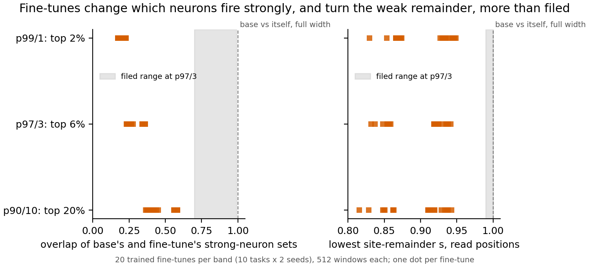

# Does the definition still saturate when only strongly firing neurons are features?

We read the working definition on the 20 trained fine-tunes of the small model at a new featurized model: each MLP
neuron counts as a feature on a token only when it fires strongly by the base model's own yardstick, and all weaker
firing at a layer is pooled into one remainder. Reuse fell below the near-perfect values it reads when every neuron is
a feature, on every fine-tune, because fine-tunes change which neurons fire strongly far more than we expected, and
the pooled weak firing also turned more than we expected. So the strongest-firing featurized model is the first one
below the full width that does not saturate, which gives the paper's section on neuron featurizations a reading,
descriptive only and with no verdict on what was reused or new.

## The answer

Reading only strongly firing neurons as features lowers the share of the circuit that keeps the base model's
mechanisms from about 0.9999 at full width to between 0.9598 and 0.9896 at Goodfire's main threshold. Two filed leans
were reversed. The base model's and each fine-tune's sets of strongly firing neurons share only about a quarter to a
third of their members, where we filed most. The pooled weak firing at each layer turns noticeably, where we filed
that it would barely move.

## What we were trying to test

The working definition reads a fine-tune against its base model through a featurized model: a fixed set of variables
shared by both networks, each with a mechanism in each. Reuse is
$R = \frac{1}{|K^*|}\sum_{u \in K^*} s_u$, where $K^*$ is the smallest set of variables that keeps the fine-tune's
behaviour when every other variable is held at its mean, and $s_u$ is the squared cosine between the fine-tune's and
the base model's write of variable $u$. $R = 1$ means every variable the behaviour runs through still writes in the
base model's direction; 0 means none does.

With every MLP neuron as a variable, the full width, $R$ saturates: it read at least 0.99 on every fine-tune in an
earlier run, so it cannot tell fine-tunes apart. The user asked for the featurized model Goodfire uses for neurons
instead. At each of the four MLP layers, a neuron is a feature on a token only when its activation lies above that
neuron's 97th percentile or below its 3rd, percentiles taken once from the base model on 204,800 Pile tokens. All
weaker activations at that layer are summed into one remainder variable, so the featurized model is exact: nothing is
dropped and the network is recovered without error. The same thresholds, fixed from the base, read the fine-tune.

We read 20 trained fine-tunes: ten tasks, two seeds each. Eight tasks form four built pairs, a fine-tune designed to
use a skill the base already has beside a twin designed to need something new; one more pair is not counted. Each
item is read on 512 short windows at the last position. Beside $R$ we report two descriptive quantities. The overlap
is the share of strong neurons that base and fine-tune have in common at the read position. It is a Jaccard index
over all four layers: 1 means the same neurons fire strongly in both, 0 that none are shared. The remainder's $s$ is the same squared cosine for a
layer's pooled weak write: 1 means the weak firing writes in the base's direction. Two other thresholds sit beside
the main one as a sensitivity check: the top and bottom 1%, and the top and bottom 10%.

Two controls ran first. Reading the base against itself must show no change: every $s$ equal to 1 and overlap 1 at
every threshold. At full width, every activation is a feature, the remainders write nothing, and $R$ must reproduce
the earlier full-width run item by item within a floor measured in the same job.

## What we expected, and why

We expected full-width $R$ to stay at or above 0.99, reproducing the earlier saturation. At the main threshold we
expected $R$ between 0.95 and 0.999 and below full width, because a neuron crossing the threshold between the two
runs scores as disagreement. We expected every circuit to contain all four remainders, making their share of the
circuit under 0.01. We expected the remainders to barely turn, $s$ at least 0.99, since a summed weak write should
average out small changes. We expected the strong sets to overlap between 0.7 and 0.99, a fine-tune moving only a few
activations across a threshold. We expected almost every variable in the circuit to be changed by the fine-tune.

## What we observed

### How much of each fine-tune's strong firing and weak firing stays the base model's?

**Reading it.** Far less than filed, on every fine-tune. The left panel shows each fine-tune's overlap of
strong-neuron sets at the three thresholds. The dashed line is the base read against itself and the full width,
both exactly 1. At the main threshold the overlap is 0.231 to 0.361, far left of the filed band from 0.7. A stricter
threshold makes it smaller still, 0.172 to 0.229, and a looser one larger, 0.364 to 0.585. The right panel shows each
fine-tune's lowest layer remainder $s$. At the main threshold it reads 0.832 to 0.942, every point left of the filed
band from 0.99. The fine-tunes split into two clusters there: the case and repeat tasks read 0.832 to 0.859, and the
other six tasks 0.919 to 0.942. The second MLP layer has the lowest remainder on 19 of 20 fine-tunes.

### How far does reuse fall?

At full width $R$ reads 0.9991 to 0.9999 on all 20 fine-tunes, reproducing the saturation. At the main threshold it
reads 0.9598 to 0.9896, below its own full-width value on every fine-tune. Every circuit holds all four remainders,
which are 0.0006 to 0.0014 of the circuit, and almost every variable in it is changed: 0.9993 to 1. So the fall in
$R$ comes from the neuron features, not the remainders, which are a handful of variables among thousands.

The lowest values are again the case and repeat tasks. The stricter threshold gives $R$ from 0.9790 to 0.9918 and
the looser one 0.9354 to 0.9873, so the more activations count as features, the further $R$ falls.

The card set 0.01 as the smallest gap worth reading between a built pair's two sides. At full width every built
pair's gap stays under 0.001. At the main threshold the case pair opens a gap of 0.0112 and 0.0108 on the two seeds,
which differ by 0.0004; the other three pairs read 0.0016 to 0.0045. At the looser threshold the case pair reads
0.0229 and 0.0213. These are reported as read; no verdict on reuse or new is given.

| threshold | $R$ at read positions | overlap | lowest remainder $s$ | remainders' share of circuit |
|---|---|---|---|---|
| full width | 0.9991-0.9999 | 1 | 1 | 0 |
| top and bottom 1% | 0.9790-0.9918 | 0.172-0.229 | 0.830-0.949 | 0.0011-0.0110 |
| top and bottom 3% | 0.9598-0.9896 | 0.231-0.361 | 0.832-0.942 | 0.0006-0.0014 |
| top and bottom 10% | 0.9354-0.9873 | 0.364-0.585 | 0.816-0.943 | 0.00048-0.00076 |

Ranges over the 20 trained fine-tunes; every item is in `experiments/topk_neurons/results/summary.json` → `table`.

## What we learned

The strongest-firing featurized model does not saturate: $R$ falls below 0.99 on all 20 fine-tunes and below its own
full-width value on each. That meets the card's condition for giving the paper's neuron-featurization section a
reading, rather than closing neuron-level featurized models. The reason it moves is not small threshold crossings.
Most of the strong set changes, and the pooled weak firing turns too, so a fine-tune redistributes which neurons
carry its activity. Since the featurized model is relative to the base's thresholds, this says the base's yardstick
for "strong" is not stable under fine-tuning on these tasks.

## How compelling is the evidence

All 80 items ran: 20 fine-tunes at four thresholds, 512 windows each, two seeds per task. The two seeds agree
closely: at the main threshold the counted gaps differ between seeds by at most 0.0015. The base read against itself
showed no change at every threshold. Its largest exactness error was 2.8e-6 against a bar of 0.001, and every one of the
80 fine-tune items passed the same bar. The full-width control matched the earlier run on all 20 items to 7.9e-8. Its
bar came from a floor of 9.0e-9 measured in the same job. The strong share on Pile text was 0.0599 against a target
of 0.06, so the thresholds were set correctly.

What the readings are blind to: the overlap counts a neuron that moves from just above to just below its threshold as
lost. So part of the low overlap may be activations near the edge; this run did not measure how far they moved. The
remainder's $s$ grades the direction of a summed write and cannot tell many small turns from one large one. $K^*$
came from one greedy search order, so a different order could change its size. Only the small model and these ten
tasks were read.

## Surprises

Something unexpected happened that I cannot explain. We filed that base and fine-tune would share most of their
strongly firing neurons, an overlap of 0.7 to 0.99. Every fine-tune read 0.231 to 0.361 instead. We filed that the
pooled weak firing would barely turn, $s$ at least 0.99, and every fine-tune read 0.832 to 0.942. Both are reversals
of filed leans, not narrow misses. The pruned weak remainder carries more of the fine-tune's change than filed. And
fine-tunes change which neurons are strong much more than filed.

Smaller: at the strictest threshold the copy and identity tasks' circuits hold only 363 to 611 variables. There the
four remainders make up 0.0065 to 0.0110 of the circuit, around the filed 0.01.

## What next

1. Measure how far the lost strong neurons moved: if most sit just below their threshold in the fine-tune, the low
   overlap is an edge effect and a margin around the threshold should raise it; if they fell far, it is real
   redistribution.
2. Read the case pair's gap with a second search order: if it stays above 0.01, it is the first counted gap the
   definition opens below full width on the small model.

## Scorecard

| id | claim in words | rule | read | verdict |
|---|---|---|---|---|
| P1 | full width saturates | $R$ in [0.99, 1] on all 20 | 0.9991-0.9999 | hit |
| P2 | main threshold lowers $R$ a little | $R$ in [0.95, 0.999] on all 20, below full width | 0.9598-0.9896; below on all 20 | hit |
| P3 | all four remainders in every circuit | share in [0, 0.01] | 0.0006-0.0014; four in every circuit | hit |
| P4 | pooled weak write barely turns | lowest remainder $s$ in [0.99, 1] | 0.832-0.942 | MISS, reversal |
| P5 | strong sets mostly shared | overlap in [0.7, 0.99] | 0.231-0.361 | MISS, reversal |
| P6 | almost all of the circuit changed | changed share in [0.99, 1] | 0.9993-1 | hit |
| P7 | built-pair gaps | reported, no lean | case pair 0.0112 and 0.0108; others 0.0016-0.0045 | reported |

## Departures from the literature

The threshold rule is Goodfire's, "Neurons as an interpretable basis": "p97/3 refers to both positive and negative
extremes", with "mean ablation to everything between the positive and negative extremes".

1. Goodfire ablates the weak activations to their mean; here they are kept exactly, summed into one remainder per
   layer, so the featurized model is exact. This is the user's design.
2. Goodfire's models use SwiGLU, whose activations have two signed tails. This model's GELU has a short negative tail,
   so the bottom 3% here are small negative values. The rule is applied as written.
3. Goodfire fixes percentiles on about 10 billion tokens; here on 204,800 Pile tokens, about 6,000 above the 97th
   percentile per neuron.
4. The paper's draft text describes top-k by magnitude; this run uses the user's percentile rule.
5. Goodfire measures the thresholds' effect on one model; here the base model's thresholds read a second network,
   the fine-tune, which is our use. On the 8-token read windows the strong share was 0.0577, against 0.0599 on Pile
   text.

## Not run

- How far lost strong neurons moved across their threshold, and a margin around the threshold.
- More than one greedy search order for $K^*$.
- Mean-ablating the weak activations as Goodfire does, instead of keeping them as a remainder.
- Thresholds fixed from the fine-tune, or from both networks.
- Any model other than the small 67M one; any verdict on reuse or new.

## Provenance

Plan `reports/plans/2026-11-19_plan_topk-neurons.md`; card `experiments/topk_neurons/card.md`; predictions
`experiments/topk_neurons/results/predictions.json`; control `experiments/topk_neurons/results/stage0.json`; scores
`experiments/topk_neurons/results/summary.json` and per item `experiments/topk_neurons/results/items/`; per-variable
$s$ and circuits in `experiments/topk_neurons/results/large/items/`; figure from `experiments/topk_neurons/plot.py`.
Stage 0 then eight stage-1 tasks, one per threshold and seed, on GPU pods; percentiles sha256 `e70d0a45`.
