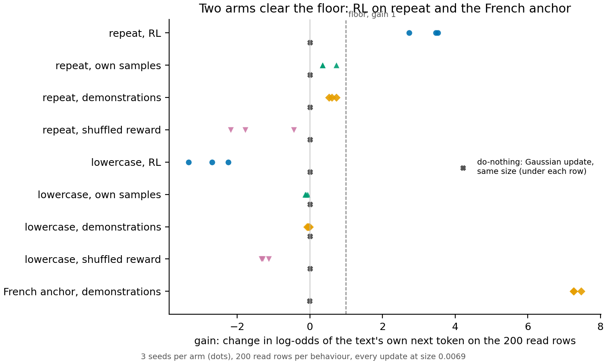
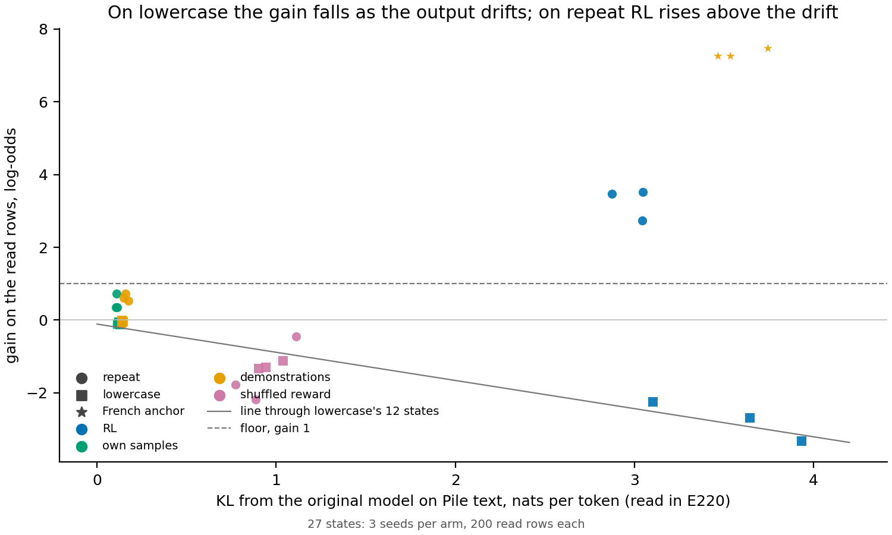

# Can the re-gating share tell RL updates on the 67M from other routes to the same behaviour? (E222)

*2026-11-19, compare-lead. Cell P2.41, stage 3, the cell's fourth and last run. Descriptive: no verdict on reused
against new is given here.*

We read the re-gating share and the scorecard baselines on 27 small saved updates of the 67M model: two behaviours,
each reached by reinforcement learning, by training on the model's own rewarded samples, by training on outside
demonstrations and by a shuffled reward, plus a taught French anchor. Only reinforcement learning on repeated text
and the French anchor moved the scored token past the one log-odds floor, so the filed call is "no call", and
reinforcement learning toward lowercase text pushed the scored token down because the read rows score one exact word
while the reward accepts any lowercase word. For `GOALS.md` the run says nothing yet about whether the route to a
behaviour changes how the featurized model carries it, and it shows the reading must score the contrast the reward
sets.

## The answer

Two of nine arms could be read. Reinforcement learning on repeated text puts about seven tenths of its gain through
changed causal importances, and the taught French anchor about half. Every other arm sat under the floor, so the
filed rule makes no call on either behaviour, as filed at probability 0.7. One reading looked wrong and is explained:
reinforcement learning made samples lowercase almost every time, yet lowered the log-odds of the text's own next
word. The read rows score that exact word, and the update moved the model's predictions on ordinary text away from it.

## What we were trying to test

E220 trained the 24 decomposed matrices of the 67M model toward two behaviours the original model already shows
sometimes. *Repeat* rewards copying the tokens that followed an earlier occurrence of the prompt's last two tokens.
*Lowercase* rewards a 16-token continuation with at least eight letters and no capital. Each behaviour was reached
four ways, three seeds each:

- **RL**: plain policy-gradient training on the programmed reward.
- **Own samples**: supervised training on the original model's own samples that earned the reward.
- **Demonstrations**: supervised training on the corpus's own continuations that earn the reward.
- **Shuffled reward**: RL with the rewards shuffled across samples, to check that a reading follows the reward and
  not just the drift of any RL update.

A fifth arm, the anchor, taught French after English text from demonstrations: a behaviour the original model almost
never shows. Every update was stopped at the same size, its norm over the original weights' norm at 0.0069.

On each saved update E222 read the measurements of E211's scorecard on 200 held-out rows per behaviour. A read row
is a 64-token prompt whose own text continuation earns the reward; the scored token is that continuation's first
token. The **gain** is the mean change in that token's log-odds over the whole vocabulary, the updated model minus
the original. The **re-gating share** is the part of the gain that the released decomposition, with W0's components
held fixed, carries through changed causal importances, divided by the gain: 0 means none of it, 1 means all. A share
is read only when the gain is at least 1 log-odds. The do-nothing reference is a Gaussian update of the same size.

## What we expected, and why

The card's two readings: if RL only re-weights what the model already samples, RL, own samples and demonstrations
read alike, above the anchor and the shuffled arm; if the route matters, demonstrations read apart from RL. Both need
RL and demonstrations over the floor. The writer expected them not to be. In E220 own samples and demonstrations moved
the 16-token held-out reward rate only a little, at a KL from the original model of 0.10 to 0.17 nats per token,
against about 3 for RL. So the filed prediction was "no call", at probability 0.7. RL on lowercase was expected at
-1 to +2: the reward raises lowercase in general, not the text's own word.

## What we observed

### Which updates move the scored token past the floor?

**Reading it.** Only RL on repeat and the French anchor clear the floor. RL on repeat gained 2.73 to 3.53 log-odds
over three seeds, and the anchor 7.26 to 7.47. Own samples and demonstrations on repeat gained 0.35 to 0.73, the
right direction but under the floor. On lowercase they read near zero, -0.13 to 0. The shuffled arm lost 0.44 to 2.18
on repeat and 1.13 to 1.34 on lowercase. RL on lowercase lost 2.25 to 3.33, under the filed range. The Gaussian
update of the same size read within 0.01 of zero on all three behaviours. So the measurement sees these updates; the
floor, not noise, is what leaves seven arms unread.

### The filed call

On both behaviours the filed rule reads "no call: fewer than two arms, RL or demonstrations under the floor"
(`results/stage3_score.json`, `.share.card` = "no call"). On repeat only RL is readable; on lowercase no arm is.
The shuffled arm reads like RL on neither behaviour, so the third outcome, a reading that follows drift and not the
reward, is not seen. The baselines run through the same rule also give no call, being unreadable on the same arms.

### What the two readable arms read

On the readable states, all descriptive, nothing filed against them:

| state | gain | re-gating share | steering share | neuron share, k 64 | untrained SVD share |
|---|---|---|---|---|---|
| repeat, RL, seed 0 | 3.53 | 0.676 | 0.222 | 0.028 | 0.144 |
| repeat, RL, seed 1 | 3.47 | 0.715 | 0.246 | 0.019 | 0.014 |
| repeat, RL, seed 2 | 2.73 | 0.786 | 0.382 | 0.019 | 0.316 |
| French anchor, seed 0 | 7.27 | 0.533 | 1.050 | 0.044 | 0.128 |
| French anchor, seed 1 | 7.47 | 0.555 | 1.033 | 0.039 | 0.108 |
| French anchor, seed 2 | 7.26 | 0.528 | 1.062 | 0.042 | 0.121 |

RL on repeat reads 0.68 to 0.79 on the re-gating share and the anchor 0.53 to 0.56. Those ranges do not overlap and
their means differ by more than 0.1. They are two different behaviours, so this is not a route comparison, and the
filed rule does not read it.

## The anomaly: RL on lowercase lowers the scored token

### What the gain compares, from the code

- **The rows.** `experiments/rl_67m/run_stage3.py` `read_rows` keeps the prompts whose own text continuation earns
  the reward, `keep = r.rewards(conts.long(), extra, 1)`. It then appends that continuation's first token,
  `windows(prompts[keep], conts[keep])`, and makes it the target, `RR.Read(name, toks, toks[:, -1], toks.shape[1] - 2, ...)`.
  On lowercase the rows are Pile prompts cut before a word, `rl_tasks.eligible` cut `"word"`. The target is the first
  word of a Pile continuation that stays lowercase for 16 tokens.
- **The unit.** `Read.fns` in `src/commute/realistic_reads.py` gives `{"lo": ST.logodds_at}` when the task has no
  label pair, as here. `steering.logodds_at` is the log-probability of the target minus that of everything else, over
  the whole vocabulary. The gain is the mean of the updated minus the original value, `realistic_reads.py` line 187.
- **The reward.** `rl_tasks.reward` for lowercase asks only that the 16 sampled tokens hold at least eight letters
  and no capital. Any lowercase continuation earns it.

So on lowercase the gain asks whether the text's own next word became more likely, against every other token. The
reward asks whether whatever is written is lowercase. An update can satisfy the reward completely while making the
text's own word less likely, by moving probability onto other lowercase tokens.

### What RL did instead

E220 saved three samples per state at the stop. RL's lowercase samples are lowercase word salad, for example ", and
control and or or cal over more than, or two or more or" (`results/stage2b_2_rl_s2.json`, seed 2). They earn the
reward and no longer continue the text. The same seed's samples before training, saved in the same file, were ordinary
text with capitals and numbers.

### A check on the saved numbers

If the lowercase gain comes from the update moving the model's predictions on ordinary text, it should track how far
each state moved them. E220 read that for every state as the KL from the original model's next-token distribution,
averaged over every position of Pile validation text. Across lowercase's twelve states the gain falls in a straight
line with that KL: a least-squares slope of -0.77 log-odds per nat and a correlation of -0.97
(`results/stage3_gain_vs_kl.json`, written by `plot_stage3.py`; no model run).

**Reading it.** On lowercase every arm sits on one line: the further an update moved the model's predictions on
ordinary text, the less likely the text's own next word became. RL's three seeds fall in the order of their KL. RL on
repeat sits far above that line, because its reward demands exactly the scored token. Repeat's shuffled arm sits near
or below the line, as an update with no reward for the scored token should.

### How firm this is

What the gain compares is read from the code and is firm. That drift accounts for RL's negative lowercase gain rests
on the twelve-state line, a correlation over four arms. It is a strong pattern but not a measurement of where the
probability went. One part is not measured: how much RL moved from capitalised forms to lowercase forms of the same
word at the scored position. That shift would raise the gain a little and is hidden under the drift. A read that
scores the lowercase form against the capitalised form of the same word would show it directly, as E53 scored
lowercase. It was not run.

### Why own samples and demonstrations read under the floor

At the same update size they moved the output twenty to thirty times less than RL: KL 0.10 to 0.17 nats per token
against 2.88 to 3.93 for RL, from E220. Their held-out reward rate rose only a little. On repeat it went from about 0.16 to
between 0.17 and 0.20, against 0.68 to 0.72 for RL. Their supervised loss also spreads the change across all 16 tokens of each
continuation, while the gain reads one. On repeat their gain has the right sign, 0.35 to 0.73, but stays under 1. On
lowercase it is near zero, where the drift line puts a state at their KL. Matching the arms on update size did not
match them on how much they changed the model's behaviour.

## What we learned

The cell closes with one readable route on one behaviour, so it cannot say whether the route to a behaviour changes
how the featurized model carries it. RL on repeat puts most of its gain through changed causal importances, as E53's
lowercase update did. The run also shows a flaw in the read rows for a reward that accepts many forms. Scoring the
text's own next token measures how well the model still predicts the text, not whether it does what the reward asks.
A read that scores the contrast the reward draws would follow the reward.

## How compelling is the evidence

- The control passed: E53's lowercase and cipher states re-read to their saved values, and a zero update read every
  numerator exactly zero on all three behaviours' rows (`results/stage3_ctl.json`).
- The Gaussian update read within 0.01 of zero, so the floor is far above the noise.
- Three seeds per arm and 200 rows per behaviour. Two behaviours and one anchor; the readable shares come from one
  behaviour and one anchor.
- The gain is blind to a shift between the forms the reward separates when the update also moves the text's own
  word, which is the lowercase case.

## Surprises

- **RL on lowercase read -2.25 to -3.33, below the filed -1 to +2.** Explained above from the code and the saved KL.
- The original model's log-odds of the scored token on repeat was 3.62, above the filed -2 to +3. On the anchor it was
  -15.55, below the filed -14 to -8.
- Steering on the anchor read 1.03 to 1.06, above the filed 0.3 to 0.8. On repeat RL it read 0.22 to 0.38, partly
  under that range.
- The rotated untrained share on repeat RL was negative, -0.06 to -0.32, against the filed 0.15 to 0.35.
- The count of neurons carrying half the neuron reading on repeat RL was 128, 128 and 1,024, against the filed 5 to
  60; the anchor read 64.

## What next

- **One more read of the same 27 saved states, scored as a contrast.** For lowercase, the lowercase form against the
  capitalised form of the same word at the same position. For repeat, the repeated token against the token the text
  actually has. If RL reads over the floor on both and own samples or demonstrations read too, the card's two
  readings can be scored. The cell's runs are spent, so this needs the user: decision card
  `reports/decisions/2026-11-19_decision_p2-41-read-unit.md`.
- If the contrast still leaves own samples and demonstrations under the floor, the route question needs longer
  supervised training, matched on behaviour rather than update size.

## Scorecard

| item | claim | rule | read | verdict |
|---|---|---|---|---|
| card call | no call, probability 0.7 | per behaviour, RL and demonstrations both readable on the share | repeat: RL only; lowercase: none | no call, as filed |
| third outcome | shuffled reads like RL | shuffled readable and alike RL | shuffled unreadable on both | not seen |
| Gaussian | gain within 0.05 of 0 | gain under 1 or the job stops | 0.002, 0.008, -0.009 | as expected |
| control | E53 re-reads, zero update exactly 0 | E211's tolerances | all within | passed |

## Departures from the literature

- RL is on-policy policy gradient with each prompt's group mean as baseline. That is GRPO's baseline without its
  standard-deviation division or clipping, as Dr. GRPO does. No KL penalty to the original model is added, unlike
  most RL fine-tuning; the size stop bounds the update instead. Source: `src/commute/rl_arms.py` docstring.
- Every arm stops at a fixed update size, not at a step count or reward level as RL papers do. This matches the
  arms on the quantity the share depends on, and leaves them unmatched on behaviour.
- RL papers judge an update by its reward. The read rows instead score the next token of the text that earns the
  reward. That is the departure the anomaly turns on.
- The steering, neuron and untrained baselines follow E143, E136 and E211 unchanged.

## Not run

- The contrast read above, on either behaviour.
- Where RL's lowercase probability went at the scored position: capitalised to lowercase forms, or away from the
  text's word to others.
- Any read beyond the first continuation token.
- The loophole stage of the plan: a reward the policy can satisfy without the behaviour.
- A second decomposition seed.

Provenance: cluster L40 on the `debug` queue, $0; per-state read about 18 s. Results
`experiments/rl_67m/results/stage3_{ctl,1,2,anchor}.json`, `stage3/*.json`, `stage3_score.json`,
`stage3_gain_vs_kl.json`; E220's states and KL in `results/stage2b_*.json`. Code `run_stage3.py`, `score_stage3.py`,
`plot_stage3.py`. Plan `reports/plans/2026-11-19_plan_rl-67m.md`, section "Stage 3"; card
`reports/plans/2026-11-19_plan_rl-67m-stage3-card.md`.
