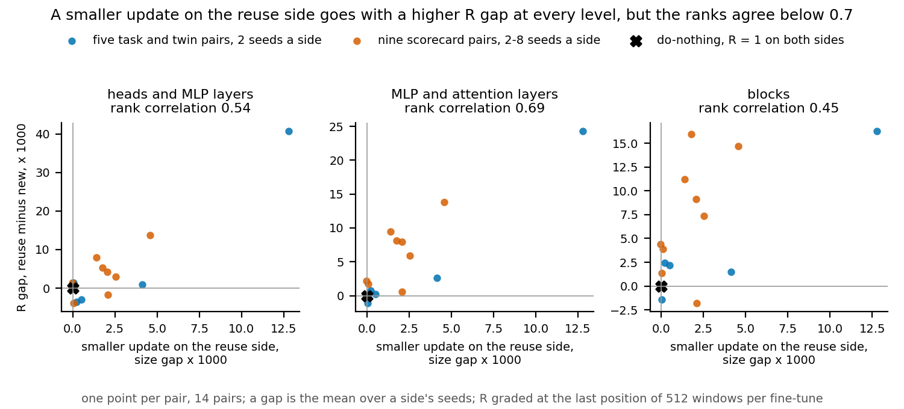

# Does the reuse score on trained pairs follow update size, or any earlier reading? (E221)

*Definition-lead, 2026-11-20. Cell P1.36, tests T3 and T4 of `reports/analyses/2026-11-18_analysis_definition-vs-experiments.md`.
Experiment `experiments/kstar_pairs` (`run.py`, `score.py`, `plot.py`). Plan `reports/plans/2026-11-19_plan_p1-36-pairs.md`
and its appendix. Filed rules: `experiments/kstar_pairs/results/predictions.json`. A description: no verdict on the
definition is given.*

We read the reuse score on all 80 saved fine-tunes of fourteen matched pairs, at three coarse levels of the model, and
compared each pair's reuse-minus-new difference with its difference in update size and with every earlier reading of
the same pairs. The difference ranks with update size more than with anything else, but below the filed bar at every
level, and no earlier reading, the held-model reading included, agrees with it on every pair. For `GOALS.md` this gives
the paper a label column under the working definition, but it does not show that the column reads reuse rather than
how far and where each fine-tune moved the model.

## The answer

On trained pairs, the reuse score is a little higher on the side built to reuse in most pairs, by a few thousandths.
The pairs where it is higher are mostly those where that side also moved the weights less. That ordering by update
size is real but loose: it never reaches the strength we filed in advance. No earlier reading of the same pairs orders
them the way the score does. The one that comes closest does so on only five pairs, and only because it too follows
update size.

## What we were trying to test

The working definition, as the user adopted it on 2026-11-18, says a fine-tune F reuses the base model M for a
behaviour to the extent that the parts F needs still compute what M's parts compute on the same inputs. This run reads
it as E214 did, with nothing added:

- **Level.** The parts are the variables of one of three featurized models of the 67M model: each attention head and
  each whole MLP layer, 30 variables; each whole attention layer and MLP layer, 10 variables; each transformer block, 6
  variables. Every level also has the embedding and the unembedding as variables.
- **Minimal circuit.** $K^*$ is the smallest set of variables that, with every other variable mean-ablated over the
  windows D, keeps F's next-token distribution at the read position nine tenths of the way back from "all ablated" to
  F. It is searched exhaustively at the two coarser levels and greedily, with a polish and three search orders, at the
  finest.
- **Grade.** $s_u = 1 - \text{mean}(1 - \cos^2)$ between F's and M's write of variable u on the same input. A grade of
  1 means M's mechanism up to a gain, 0 a write at right angles.
- **Score.** $R = \frac{1}{|K^*|}\sum_{u \in K^*} s_u$, 1 when every needed variable keeps M's mechanism.
- **Changed share.** $f$ is the share of $K^*$ whose weights the fine-tune changed. The remainder share, the share of
  $K^*$ that is a "rest of the network" variable, is 0 here because unit levels need none.

The main grade takes $s_u$ at the read position, the last token of each window, by the user's choice of 2026-11-19.
The side grade takes it at every position.

**The items.** Each fine-tune is read once on 512 windows of 8 tokens from its own task's read half, with E196's seed.
The fourteen pairs each set a fine-tune labelled reuse against one labelled new, by construction:

- E196's five pairs at seeds 0 and 1: a copy task against a cipher, identity against a random map, a case rule and a
  repeat rule each against a twin task the base model cannot already do, and a parity twin against a memorised fact.
- E187's nine scorecard pairs, with every saved seed, 2 to 8 a side.

These are 80 distinct fine-tunes. Four E196 members are the same files as E187 states and are read once. The pairs are
fewer than fourteen independent units: two of E196's pairs are seeds 0 and 1 of two E187 pairs, the cipher states sit
in three pairs, and the elicited states in two.

**The comparison.** A pair's R gap is the mean R over its reuse side minus the mean over its new side. Each earlier
reading's gap is oriented so that positive means the reuse side reads more like reuse by that reading's own report.
The update-size gap enters as its negative, the **smaller-update gap**, so positive means the reuse side moved the
weights less. Size is $\lVert\delta W\rVert / \lVert W_0\rVert$ over the 24 matrices.

**What each reference reads.** Do-nothing, F equal to M, reads R = 1 and a gap of 0 at zero size. E195's ten-fold gain
on M's copy neurons is the positive control; it must repeat E214's minimal circuit and score.

## What we expected, and why

- **R would be a size reading.** Earlier readings at the neuron level, E196 and E208, and the case pairs once
  saturation was removed, all ordered pairs by update size. So we filed that R's gap would rank with the smaller-update
  gap at a rank correlation of 0.7 or more at all three levels. If it did, R at a coarse level would mostly measure how
  much each side moved.
- **R would not follow the held-model reading.** The held-model survival keeps its sign under size matching on all nine
  scorecard pairs, so it is not a size reading. If R were one, the two should disagree: we filed a rank correlation
  under 0.7 at all three levels.
- **The rule for "tracks".** An earlier reading tracks R when the two gaps have the same sign on every pair and their
  rank correlation is 0.7 or more. With five pairs, a rank correlation of 0.9 or more comes by chance one time in 24.
- **Expected values.** $f = 1 - 2/|K^*|$, because a fine-tune of the 24 matrices changes every head and MLP layer and
  neither end. R between 0.99 and 1 and gaps under a hundredth, from E208's neuron-level readings above 0.999.

## What we observed

### Does R's gap rank with the update-size gap?

**Reading it.** Partly, and not to the filed strength. The rank correlation between the R gap and the smaller-update
gap is 0.54 at heads and MLP layers, 0.69 at MLP and attention layers and 0.45 at blocks. All three are under the 0.7
bar, so the filed prediction that R is a size reading does not hold. In every panel the pair whose reuse side moved
least relative to its new side, the case rule against its twin, also has the largest R gap. Near zero size difference
the R gaps still spread from about minus four to plus four thousandths. At the two coarser levels most orange
scorecard pairs sit above the blue pairs of similar size gap. The do-nothing cross at the origin is where a pair with
no difference would sit.

The signs agree with the smaller-update gap on 9, 11 and 11 of the 14 pairs. Against the update size of the 8 MLP
matrices alone the signs agree on 13 of 14 at the two coarser levels, and the rank correlation is a little lower, 0.67
and 0.42. Seed noise is small beside most gaps: the gap is more than twice its seed standard error on 10, 9 and 13
pairs at the three levels.

Per pair, main grade. "Reuse side R" and "new side R" are means over each side's seeds; the gap is their difference.

**Heads and MLP layers**

| pair | reuse side R | new side R | R gap | seed standard error | R gap, every position |
|---|---|---|---|---|---|
| copy24 | 0.9876 | 0.9911 | -3.52e-3 | 9.2e-4 | -1.72e-3 |
| ident32 | 0.9864 | 0.9893 | -2.91e-3 | 9.5e-4 | 7.60e-5 |
| case_real | 0.9709 | 0.9302 | 4.07e-2 | 7.2e-3 | 1.19e-2 |
| repeat_real | 0.9549 | 0.9539 | 9.99e-4 | 3.9e-3 | -1.25e-3 |
| twin | 0.9915 | 0.9902 | 1.33e-3 | 4.7e-4 | 4.78e-4 |
| e62_copy_lookup | 0.9802 | 0.9723 | 7.97e-3 | 1.2e-3 | 2.21e-3 |
| e46_copy_random | 0.9859 | 0.9829 | 3.01e-3 | 3.9e-3 | 2.18e-3 |
| e53_lowercase_cipher | 0.9884 | 0.9901 | -1.73e-3 | 1.4e-3 | -1.06e-3 |
| e54_matched | 0.9912 | 0.9906 | 5.82e-4 | 3.2e-4 | 8.89e-4 |
| e54_own | 0.9912 | 0.9775 | 1.37e-2 | 8.1e-4 | 6.62e-3 |
| open_pair_c3 | 0.9927 | 0.9913 | 1.34e-3 | 2.7e-4 | 1.47e-3 |
| open_pair_c3_copy | 0.9874 | 0.9913 | -3.92e-3 | 3.1e-4 | -1.74e-3 |
| e58_rank1_96 | 0.9836 | 0.9783 | 5.32e-3 | 8.6e-4 | 5.55e-3 |
| e58_copy_prior_cipher | 0.9831 | 0.9788 | 4.25e-3 | 4.5e-4 | 3.12e-3 |

**MLP and attention layers**

| pair | reuse side R | new side R | R gap | seed standard error | R gap, every position |
|---|---|---|---|---|---|
| copy24 | 0.9908 | 0.9900 | 7.71e-4 | 4.5e-4 | 1.70e-3 |
| ident32 | 0.9899 | 0.9897 | 2.26e-4 | 2.1e-4 | 1.52e-3 |
| case_real | 0.9661 | 0.9418 | 2.43e-2 | 5.5e-3 | 5.56e-3 |
| repeat_real | 0.9591 | 0.9565 | 2.58e-3 | 5.6e-4 | -1.08e-3 |
| twin | 0.9888 | 0.9899 | -1.12e-3 | 8.9e-5 | -1.46e-4 |
| e62_copy_lookup | 0.9776 | 0.9681 | 9.45e-3 | 7.2e-4 | 2.94e-3 |
| e46_copy_random | 0.9898 | 0.9839 | 5.94e-3 | 3.4e-3 | 4.39e-3 |
| e53_lowercase_cipher | 0.9896 | 0.9890 | 6.21e-4 | 1.6e-3 | 6.66e-4 |
| e54_matched | 0.9919 | 0.9901 | 1.76e-3 | 2.2e-4 | 2.08e-3 |
| e54_own | 0.9919 | 0.9780 | 1.38e-2 | 5.6e-4 | 8.55e-3 |
| open_pair_c3 | 0.9929 | 0.9907 | 2.18e-3 | 1.9e-4 | 2.26e-3 |
| open_pair_c3_copy | 0.9907 | 0.9907 | -5.92e-5 | 1.9e-4 | 1.14e-3 |
| e58_rank1_96 | 0.9874 | 0.9793 | 8.12e-3 | 7.9e-4 | 5.83e-3 |
| e58_copy_prior_cipher | 0.9890 | 0.9811 | 7.98e-3 | 4.3e-4 | 3.93e-3 |

**Blocks**

| pair | reuse side R | new side R | R gap | seed standard error | R gap, every position |
|---|---|---|---|---|---|
| copy24 | 0.9847 | 0.9823 | 2.41e-3 | 8.2e-4 | 3.35e-3 |
| ident32 | 0.9827 | 0.9805 | 2.19e-3 | 3.0e-4 | 4.00e-3 |
| case_real | 0.9452 | 0.9290 | 1.63e-2 | 4.5e-3 | 3.65e-3 |
| repeat_real | 0.9396 | 0.9381 | 1.48e-3 | 5.0e-4 | -1.79e-3 |
| twin | 0.9815 | 0.9829 | -1.41e-3 | 2.0e-4 | -9.01e-5 |
| e62_copy_lookup | 0.9624 | 0.9512 | 1.12e-2 | 1.0e-3 | 2.71e-3 |
| e46_copy_random | 0.9825 | 0.9751 | 7.36e-3 | 3.1e-3 | 4.56e-3 |
| e53_lowercase_cipher | 0.9841 | 0.9859 | -1.81e-3 | 2.6e-3 | -1.66e-3 |
| e54_matched | 0.9855 | 0.9816 | 3.89e-3 | 5.0e-4 | 3.87e-3 |
| e54_own | 0.9855 | 0.9708 | 1.47e-2 | 7.0e-4 | 6.51e-3 |
| open_pair_c3 | 0.9876 | 0.9831 | 4.42e-3 | 3.0e-4 | 4.05e-3 |
| open_pair_c3_copy | 0.9845 | 0.9831 | 1.34e-3 | 2.7e-4 | 2.94e-3 |
| e58_rank1_96 | 0.9821 | 0.9661 | 1.60e-2 | 6.8e-4 | 1.01e-2 |
| e58_copy_prior_cipher | 0.9809 | 0.9717 | 9.16e-3 | 7.3e-4 | 4.68e-3 |

### Does any earlier reading track R?

**Reading it.** No. Under the filed rule, no earlier reading tracks R at any level, under either grade. The held-model
survival orders the pairs against R: its rank correlation is -0.28, -0.45 and -0.32 at the three levels, so the
second filed prediction holds. The re-gating share and the crosscoder also rank against R at every level. The two
readings that come closest are rule retention at neurons and rule retention A, at 0.90 at MLP and attention layers.
They exist only on E196's five pairs.

Both are still called "does not track" there, because of the every-pair sign rule. On the parity twin against the
memorised fact, R's gap is negative at MLP and attention layers and at blocks: the twin scores below the fact by about
one thousandth. Both retention readings put the twin above the fact, by under a ten-thousandth. That one pair breaks
the rule; the other four agree in sign. At heads and MLP layers the copy and identity pairs also disagree, and the
rank correlation falls to 0.40.

The 0.90 says less than it seems. On these five pairs both retention readings order the pairs exactly as the smaller
update does, and R's own rank correlation with the smaller update on the same five pairs is also 0.90. So the near
agreement is two size orderings agreeing.

"Signs agree" counts the pairs where both gaps have the same non-zero sign. The rank correlation is Spearman's, with
ties at their average rank. The last two readings are ranks or labels and are read by sign only.

| reading | pairs | heads and MLP layers: signs agree, rank correlation | MLP and attention layers | blocks | call at every level |
|---|---|---|---|---|---|
| smaller update, all 24 matrices | 14 | 9, 0.54 | 11, 0.69 | 11, 0.45 | does not track; does not track; does not track |
| smaller update, 8 MLP matrices | 14 | 9, 0.51 | 13, 0.67 | 13, 0.42 | does not track; does not track; does not track |
| minimal circuit size | 14 | 6, 0.54 | 2, 0.42 | 0, - | does not track; does not track; not read |
| rule retention at neurons, E208 | 5 | 3, 0.40 | 4, 0.90 | 4, 0.60 | does not track; does not track; does not track |
| rule retention A, E196 | 5 | 3, 0.40 | 4, 0.90 | 4, 0.60 | does not track; does not track; does not track |
| held-model survival, reading 3 | 14 | 9, -0.28 | 11, -0.45 | 11, -0.32 | does not track; does not track; does not track |
| held-model survival, reading 1 | 14 | 7, 0.02 | 9, 0.02 | 9, 0.02 | does not track; does not track; does not track |
| re-gating share | 13 | 7, -0.29 | 10, -0.32 | 10, -0.21 | does not track; does not track; does not track |
| steering share | 9 | 5, 0.18 | 4, 0.18 | 6, 0.22 | does not track; does not track; does not track |
| top-neuron share | 9 | 4, 0.02 | 5, 0.02 | 3, -0.15 | does not track; does not track; does not track |
| neurons for half the gain | 9 | 5, 0.13 | 6, 0.13 | 5, 0.23 | does not track; does not track; does not track |
| crosscoder, E203 | 9 | 5, -0.45 | 4, -0.45 | 6, -0.23 | does not track; does not track; does not track |
| simplest-intervention rung, E184 | 5 | 2, - | 3, - | 3, - | sign only: 2 of 5; sign only: 3 of 5; sign only: 3 of 5 |
| old-task label G, E142 | 4 | 2, - | 4, - | 4, - | sign only: 2 of 4; sign only: 4 of 4; sign only: 4 of 4 |

Every pair's gaps, main grade. Each earlier reading's gap is taken from its own saved results as `score.py`
`old_readings` names them, oriented so positive is reuse-like.

| pair | R gap, heads and MLP layers | R gap, MLP and attention layers | R gap, blocks | smaller update | rule retention at neurons | retention, rule A | held-model survival, reading 3 | held-model survival, reading 1 | re-gating share | steering | top neurons | half-effect count | crosscoder |
|---|---|---|---|---|---|---|---|---|---|---|---|---|---|
| copy24 | -3.52e-3 | 7.71e-4 | 2.41e-3 | 2.26e-4 | 1.04e-5 | 7.26e-5 | 6.50e-3 | 1.48e-2 | 6.07e-1 | - | - | - | - |
| ident32 | -2.91e-3 | 2.26e-4 | 2.19e-3 | 5.15e-4 | 2.00e-5 | 1.10e-4 | 5.60e-3 | 1.54e-2 | 5.12e-1 | - | - | - | - |
| case_real | 4.07e-2 | 2.43e-2 | 1.63e-2 | 1.28e-2 | 4.66e-4 | 2.64e-3 | 1.05e-2 | -4.48e-3 | -1.20e-2 | - | - | - | - |
| repeat_real | 9.99e-4 | 2.58e-3 | 1.48e-3 | 4.13e-3 | 8.97e-5 | 7.17e-4 | 1.64e-3 | -4.12e-3 | -1.46e-2 | - | - | - | - |
| twin | 1.33e-3 | -1.12e-3 | -1.41e-3 | 4.03e-5 | 7.41e-6 | 8.11e-7 | 2.60e-1 | 1.25e-2 | - | - | - | - | - |
| e62_copy_lookup | 7.97e-3 | 9.45e-3 | 1.12e-2 | 1.41e-3 | - | - | -2.80e-3 | 7.36e-2 | 6.91e-1 | 4.12e-1 | 2.40e-2 | 0 | 1.32e-2 |
| e46_copy_random | 3.01e-3 | 5.94e-3 | 7.36e-3 | 2.55e-3 | - | - | 3.14e-3 | 1.85e-2 | 5.13e-1 | 4.70e-1 | 4.97e-3 | 6.99e-1 | -3.33e-2 |
| e53_lowercase_cipher | -1.73e-3 | 6.21e-4 | -1.81e-3 | 2.10e-3 | - | - | 2.28e-2 | 4.33e-2 | 6.22e-1 | -5.30e-2 | 2.97e-2 | 8.45e-1 | -1.41e-1 |
| e54_matched | 5.82e-4 | 1.76e-3 | 3.89e-3 | 9.48e-5 | - | - | 7.23e-3 | 8.11e-3 | 5.18e-1 | -2.37e-1 | -3.00e-2 | -7.92e-2 | 2.76e-2 |
| e54_own | 1.37e-2 | 1.38e-2 | 1.47e-2 | 4.57e-3 | - | - | 1.16e-3 | 1.88e-2 | 5.10e-1 | -1.20e-1 | -1.93e-2 | 5.23e-1 | -1.82e-1 |
| open_pair_c3 | 1.34e-3 | 2.18e-3 | 4.42e-3 | -1.26e-5 | - | - | 5.29e-3 | 1.44e-2 | 6.22e-1 | -2.65e-1 | -3.36e-2 | 5.51e-1 | 9.38e-2 |
| open_pair_c3_copy | -3.92e-3 | -5.92e-5 | 1.34e-3 | 4.88e-5 | - | - | 5.79e-3 | 1.61e-2 | 6.07e-1 | 2.38e-1 | -1.58e-2 | 0 | 1.12e-1 |
| e58_rank1_96 | 5.32e-3 | 8.12e-3 | 1.60e-2 | 1.77e-3 | - | - | 1.50e-2 | 1.91e-2 | 5.57e-1 | 2.84e-2 | -1.98e-2 | 9.03e-1 | 2.78e-2 |
| e58_copy_prior_cipher | 4.25e-3 | 7.98e-3 | 9.16e-3 | 2.06e-3 | - | - | 4.37e-3 | -1.06e-4 | 3.93e-1 | 5.94e-1 | 1.43e-2 | 8.24e-1 | -3.35e-1 |

### What do the minimal circuits hold?

**Reading it.** At the two coarser levels the minimal circuit is nearly every variable, so R there is close to the mean
grade of the whole model. At blocks $K^*$ is all six variables for every one of the 80 fine-tunes, as E214 found on
most built items. At MLP and attention layers it is 9 of 10 variables for 71 fine-tunes. The one left out is the
attention layer of layer 2 or of layer 3, and the parity twin and the memorised fact keep all ten. At heads and MLP
layers the circuit holds 14 to 25 of 30 variables. The polish hit its cap of 2,000 evaluations in 193 of the 240
searches there, so those circuits are not proved minimal. The embedding and unembedding are in $K^*$ on every item at
every level.

The changed share follows from the circuit size. It equals $1 - 2/|K^*|$ on 76 fine-tunes, as expected, because the
two ends are unchanged and every other variable is changed. The parity twin and the memorised fact also changed their
embedding and unembedding, so their changed share is 1 at every level. The changed-share gap is therefore 0 on every
pair at blocks, and at the finer levels it moves only through $|K^*|$. The remainder share is 0 on every item, as no
remainder variable exists at these levels. Minimal-circuit size, run through the same rule, does not track R.

R itself sits lower than we expected. Under the main grade, 48, 45 and 78 of the 80 fine-tunes score under 0.99 at the
three levels. The lowest, the case twin at seed 0, scores 0.9232 at heads and MLP layers and 0.9247 at blocks.

Per fine-tune. Update size is $\lVert\delta W\rVert / \lVert W_0\rVert$ over the 24 matrices. $|K^*|$ at heads and MLP
layers is the mean over three search orders. "Left out" names the variables of the 10 that are not in the first
order's $K^*$ at MLP and attention layers. R is the main grade, the mean over search orders.

| item | update size | heads and MLP layers: \|K*\|, R | MLP and attention layers: \|K*\|, left out, R | blocks: R |
|---|---|---|---|---|
| c3/copy_s0 | 4.85e-3 | 18.0, 0.9884 | 9, L3.attn, 0.9913 | 0.9855 |
| c3/copy_s1 | 4.89e-3 | 16.7, 0.9867 | 9, L3.attn, 0.9904 | 0.9840 |
| c3/cipher_s0 | 5.15e-3 | 21.0, 0.9908 | 9, L2.attn, 0.9900 | 0.9820 |
| c3/cipher_s1 | 5.04e-3 | 21.7, 0.9914 | 9, L3.attn, 0.9900 | 0.9826 |
| e46/ident32_s0 | 4.89e-3 | 18.3, 0.9861 | 9, L3.attn, 0.9897 | 0.9825 |
| e46/ident32_s1 | 4.92e-3 | 17.3, 0.9866 | 9, L3.attn, 0.9901 | 0.9828 |
| e46/rand32_s0 | 5.38e-3 | 21.0, 0.9902 | 9, L2.attn, 0.9898 | 0.9807 |
| e46/rand32_s1 | 5.46e-3 | 21.3, 0.9884 | 9, L2.attn, 0.9896 | 0.9802 |
| case_real_s0 | 7.10e-3 | 19.0, 0.9725 | 9, L2.attn, 0.9672 | 0.9465 |
| case_real_s1 | 7.21e-3 | 19.0, 0.9693 | 9, L2.attn, 0.9649 | 0.9440 |
| case_twin_s0 | 2.05e-2 | 20.0, 0.9232 | 9, L3.attn, 0.9364 | 0.9247 |
| case_twin_s1 | 1.94e-2 | 20.3, 0.9372 | 9, L2.attn, 0.9471 | 0.9333 |
| repeat_real_s0 | 7.58e-3 | 20.3, 0.9524 | 9, L3.attn, 0.9588 | 0.9401 |
| repeat_real_s1 | 7.10e-3 | 20.3, 0.9574 | 9, L3.attn, 0.9595 | 0.9392 |
| repeat_twin_s0 | 1.14e-2 | 19.3, 0.9509 | 9, L2.attn, 0.9561 | 0.9384 |
| repeat_twin_s1 | 1.15e-2 | 20.0, 0.9569 | 9, L2.attn, 0.9570 | 0.9379 |
| twin_s0 | 9.03e-3 | 24.0, 0.9920 | 10, none, 0.9887 | 0.9813 |
| twin_s1 | 9.22e-3 | 24.0, 0.9911 | 10, none, 0.9889 | 0.9817 |
| fact_s0 | 9.15e-3 | 24.3, 0.9900 | 10, none, 0.9899 | 0.9830 |
| fact_s1 | 9.17e-3 | 24.3, 0.9904 | 10, none, 0.9899 | 0.9828 |
| e62/copy_s0 | 7.15e-3 | 19.7, 0.9798 | 9, L3.attn, 0.9770 | 0.9620 |
| e62/copy_s1 | 7.07e-3 | 20.7, 0.9812 | 9, L3.attn, 0.9786 | 0.9640 |
| e62/copy_s2 | 7.14e-3 | 20.3, 0.9797 | 9, L3.attn, 0.9771 | 0.9612 |
| e62/lookup_s0 | 8.48e-3 | 18.3, 0.9702 | 9, L2.attn, 0.9674 | 0.9501 |
| e62/lookup_s1 | 8.55e-3 | 19.7, 0.9731 | 9, L2.attn, 0.9678 | 0.9514 |
| e62/lookup_s2 | 8.57e-3 | 18.3, 0.9735 | 9, L2.attn, 0.9691 | 0.9521 |
| e46/ident32b_s0 | 4.95e-3 | 17.7, 0.9854 | 9, L3.attn, 0.9897 | 0.9822 |
| e46/ident32b_s1 | 4.97e-3 | 18.0, 0.9854 | 9, L3.attn, 0.9898 | 0.9825 |
| e46/rand32b_s0 | 9.45e-3 | 14.3, 0.9739 | 8, L2.attn, L3.attn, 0.9783 | 0.9713 |
| e46/rand32b_s1 | 9.64e-3 | 15.0, 0.9790 | 8, L2.attn, L3.attn, 0.9779 | 0.9684 |
| e53/lowercase_s0 | 1.79e-2 | 22.0, 0.9882 | 9, L3.attn, 0.9894 | 0.9840 |
| e53/lowercase_s1 | 1.82e-2 | 21.3, 0.9886 | 9, L3.attn, 0.9898 | 0.9841 |
| e53/cipher_s0 | 1.86e-2 | 21.0, 0.9924 | 9, L3.attn, 0.9918 | 0.9904 |
| e53/cipher_s1 | 1.86e-2 | 21.0, 0.9926 | 9, L3.attn, 0.9917 | 0.9905 |
| e53/broad_cipher_s0 | 2.17e-2 | 22.0, 0.9881 | 9, L3.attn, 0.9858 | 0.9812 |
| e53/broad_cipher_s1 | 2.18e-2 | 22.0, 0.9873 | 10, none, 0.9866 | 0.9814 |
| e54/elicit_s0 | 4.93e-3 | 16.0, 0.9916 | 9, L2.attn, 0.9922 | 0.9860 |
| e54/elicit_s1 | 4.98e-3 | 16.0, 0.9915 | 9, L2.attn, 0.9920 | 0.9856 |
| e54/elicit_s2 | 4.99e-3 | 16.0, 0.9909 | 9, L2.attn, 0.9918 | 0.9854 |
| e54/elicit_s3 | 5.03e-3 | 16.0, 0.9906 | 9, L2.attn, 0.9916 | 0.9849 |
| e54/elicit_s4 | 4.99e-3 | 16.0, 0.9914 | 9, L2.attn, 0.9918 | 0.9854 |
| e54/cipher_s0 | 5.03e-3 | 21.0, 0.9908 | 9, L2.attn, 0.9903 | 0.9823 |
| e54/cipher_s1 | 5.05e-3 | 21.0, 0.9907 | 9, L2.attn, 0.9903 | 0.9820 |
| e54/cipher_s2 | 5.07e-3 | 21.3, 0.9912 | 9, L2.attn, 0.9905 | 0.9826 |
| e54/cipher_s3 | 5.12e-3 | 21.0, 0.9896 | 9, L2.attn, 0.9894 | 0.9803 |
| e54/cipher_s4 | 5.12e-3 | 21.3, 0.9908 | 9, L2.attn, 0.9900 | 0.9807 |
| e54/cipher_own_s0 | 9.56e-3 | 15.0, 0.9783 | 8, L2.attn, L3.attn, 0.9775 | 0.9701 |
| e54/cipher_own_s1 | 9.54e-3 | 15.3, 0.9767 | 8, L2.attn, L3.attn, 0.9786 | 0.9714 |
| c3/rank1_s0 | 4.99e-3 | 17.3, 0.9928 | 9, L3.attn, 0.9927 | 0.9875 |
| c3/rank1_s1 | 4.86e-3 | 17.7, 0.9928 | 9, L2.attn, 0.9929 | 0.9873 |
| c3/rank1_s2 | 4.94e-3 | 17.7, 0.9923 | 9, L2.attn, 0.9927 | 0.9875 |
| c3/rank1_s3 | 4.95e-3 | 17.3, 0.9930 | 9, L2.attn, 0.9935 | 0.9887 |
| c3/rank1_s4 | 5.00e-3 | 18.0, 0.9926 | 9, L2.attn, 0.9925 | 0.9867 |
| c3/rank1_s5 | 4.90e-3 | 17.7, 0.9928 | 9, L2.attn, 0.9931 | 0.9880 |
| c3/rank1_s6 | 4.94e-3 | 17.7, 0.9932 | 9, L2.attn, 0.9931 | 0.9877 |
| c3/rank1_s7 | 4.91e-3 | 18.0, 0.9919 | 9, L2.attn, 0.9927 | 0.9871 |
| c3/cipher_s2 | 4.86e-3 | 22.0, 0.9918 | 9, L2.attn, 0.9910 | 0.9831 |
| c3/cipher_s3 | 4.80e-3 | 21.7, 0.9919 | 9, L2.attn, 0.9912 | 0.9838 |
| c3/cipher_s4 | 4.83e-3 | 22.0, 0.9917 | 9, L2.attn, 0.9910 | 0.9834 |
| c3/cipher_s5 | 5.07e-3 | 21.3, 0.9900 | 9, L2.attn, 0.9907 | 0.9837 |
| c3/cipher_s6 | 4.81e-3 | 21.0, 0.9912 | 9, L2.attn, 0.9909 | 0.9835 |
| c3/cipher_s7 | 4.82e-3 | 21.7, 0.9919 | 9, L2.attn, 0.9909 | 0.9830 |
| c3/copy_s2 | 4.93e-3 | 17.7, 0.9874 | 9, L3.attn, 0.9904 | 0.9841 |
| c3/copy_s3 | 4.87e-3 | 18.0, 0.9878 | 9, L3.attn, 0.9907 | 0.9843 |
| c3/copy_s4 | 4.83e-3 | 17.7, 0.9878 | 9, L3.attn, 0.9907 | 0.9846 |
| c3/copy_s5 | 4.85e-3 | 17.3, 0.9872 | 9, L3.attn, 0.9909 | 0.9848 |
| c3/copy_s6 | 4.87e-3 | 17.7, 0.9870 | 9, L3.attn, 0.9905 | 0.9843 |
| c3/copy_s7 | 4.89e-3 | 16.3, 0.9869 | 9, L3.attn, 0.9905 | 0.9843 |
| e58/rank1_s0 | 7.87e-3 | 18.0, 0.9846 | 9, L2.attn, 0.9885 | 0.9830 |
| e58/rank1_s1 | 7.96e-3 | 17.3, 0.9829 | 9, L3.attn, 0.9864 | 0.9811 |
| e58/rank1_s2 | 7.98e-3 | 17.7, 0.9833 | 9, L3.attn, 0.9872 | 0.9823 |
| e58/cipher_s0 | 9.72e-3 | 21.0, 0.9769 | 9, L2.attn, 0.9801 | 0.9669 |
| e58/cipher_s1 | 9.74e-3 | 20.0, 0.9792 | 9, L2.attn, 0.9793 | 0.9656 |
| e58/cipher_s2 | 9.67e-3 | 20.7, 0.9787 | 9, L3.attn, 0.9784 | 0.9659 |
| e58/copy_s0 | 7.25e-3 | 16.0, 0.9828 | 9, L3.attn, 0.9890 | 0.9810 |
| e58/copy_s1 | 7.31e-3 | 16.7, 0.9829 | 9, L3.attn, 0.9891 | 0.9804 |
| e58/copy_s2 | 7.35e-3 | 16.3, 0.9835 | 9, L3.attn, 0.9890 | 0.9813 |
| e58/prior_cipher_s0 | 9.38e-3 | 17.0, 0.9786 | 9, L2.attn, 0.9802 | 0.9706 |
| e58/prior_cipher_s1 | 9.34e-3 | 17.0, 0.9783 | 9, L2.attn, 0.9815 | 0.9730 |
| e58/prior_cipher_s2 | 9.38e-3 | 17.7, 0.9795 | 9, L2.attn, 0.9815 | 0.9715 |

### Does the grade's position or the search's settings change the ordering?

**Reading it.** Little. The read-position and every-position gaps agree in sign on 12, 12 and 13 of 14 pairs, with a
rank correlation of 0.95, 0.82 and 0.68. Under the every-position grade, R's gaps rank less with size, at 0.48, 0.42
and 0.12, and track no earlier reading. At the two exhaustive levels we also re-read the gap under other search settings. One
keeps eight tenths of the behaviour, one 0.95 of it; one uses only the half of D where F departs most from M; two use
either random half of D. Under every one the gap keeps the main reading's sign on at least 13 of 14 pairs. The rank
correlation with the smaller update stays under the bar: 0.55 to 0.69 at MLP and attention layers, 0.19 to 0.45 at
blocks.

## What R at coarse levels reads, against the filed predictions

This is what was read, not a verdict on the definition. The filed size prediction does not hold: R's gaps rank with
the smaller-update gaps, but at 0.45 to 0.69, never at 0.7. The filed held-model prediction does hold: R ranks against
that reading at every level. So R at these levels is neither a clean size reading nor a copy of any earlier reading.
What else orders it is not identified. Candidates the run did not separate include the task's windows, which differ
between the two sides of every pair, and where in the model each fine-tune's change sits.

### The premise doubt carried from the previous cell

The previous cell's premise check, `~/commute-data/premise/P1.35.md`, judged its premise doubtful. The premise was that
a gap in R between reuse and new reflects reuse against building, not how the items were made or measured. Its reasons:
the hand-built reuse edits could not be built, so no level passed the known-answer test, and every gap seen could be
explained by update size, window count, circuit size and grade.

This run reads every coarse level, as the cell's "done when" says to when no level passed. It removes one of those
causes: both sides of every pair are read on 512 windows at the last position. It measures two more: update size
orders R loosely, under the bar, and circuit size does not track R. It reports both grades. It does not answer the
doubt itself. With no level having passed a known-answer test, nothing here shows that R at any coarse level reads
reuse, and the gaps above cannot be read as reuse labels of known accuracy.

## What we learned

R at coarse levels gives every trained pair a label, and the reuse side scores higher on 10 to 12 of the 14 pairs,
depending on the level. The label is partly an update-size reading, less than we filed, and it disagrees with the
held-model reading and with the re-gating share. At blocks and at MLP and attention layers the minimal circuit is
almost the whole model, so R there is close to the mean grade over every variable. Whether R reads reuse at all stays
open until some level passes a known-answer test.

## How compelling is the evidence

- Fourteen pairs, fewer independent units because pairs share fine-tunes. Each correlation is over at most 14 points,
  and the earlier readings with five or nine pairs have little power: with five, a 0.9 comes by chance one time in 24.
- The rank rule reads ranks only. It is blind to the size of a gap and to whether a gap clears its seed noise.
- Seeds: 2 to 8 a side. The seed standard error is beside each gap.
- The finest level's circuits are not proved minimal: the polish hit its cap in most searches.
- Every pair's two sides are different tasks on different windows, so the R gap compares behaviours as well as
  constructions.

## Surprises

- Something unexpected happened that I cannot explain: we filed that R's gap would rank with update size at 0.7 or
  more at all three levels, and it ranks at 0.54, 0.69 and 0.45. At MLP and attention layers the miss is narrow; at
  the other two it is not. Nothing here identifies what else orders the gaps.
- R is lower than expected. We expected 0.99 to 1; most fine-tunes read under 0.99, down to 0.9232, and the R gaps
  reach four hundredths, beyond the expected hundredth.
- The parity twin and the memorised fact changed their embedding and unembedding, so their changed share is 1, not
  $1 - 2/|K^*|$ as the plan expected.

## What next

- A known-answer test at a coarse level, with reuse and new built on the same windows. If one passes, these labels can
  be read; if none can be built, the paper's label column stays a description.
- A partial rank correlation of R and each earlier reading with update size held fixed, from the files on disk at no
  cost. If R then tracks some reading, the two share something beyond size.
- R on E187's size-matched states, which this run did not read. If the scorecard pairs' R gaps keep their sign at
  matched size, the gap is not a size reading on those pairs.

## Scorecard

| id | claim in words | rule | what was read | verdict |
|---|---|---|---|---|
| R0 | the apparatus reads a known change and no change correctly | do-nothing R = 1, f = 0, every grade 1 within 1e-6 at three levels; E195's ten-fold gain repeats E214 within 1e-5; each item's saved divergence and size repeat | do-nothing exact at three levels on all eight pods; ten-fold gain 0.9755 at blocks and 0.9831 at MLP and attention layers, equal to E214's | holds |
| score control | the rank code reproduces a known ordering | this run's size gaps against E187's saved sizes, nine pairs: all signs agree and Spearman 0.999 or more | 9 of 9 signs, Spearman 1 | holds |
| T4 | an earlier reading tracks R | same sign on every pair and Spearman 0.7 or more, per reading, level and grade | no reading tracks at any level or grade | no reading tracks |
| P1 | R's gap ranks with the smaller-update gap | Spearman 0.7 or more at all three levels, main grade | 0.54, 0.69, 0.45 | does not hold |
| P2 | R's gap does not rank with the held-model reading | Spearman under 0.7 at all three levels, main grade | -0.28, -0.45, -0.32 | holds |

## Not run

- E187's size-matched, scaled states.
- The neuron level, closed by the user on 2026-11-19.
- Overlap between $K^*$ and E208's change set K.
- E192's seeds 2 and 3.
- R at the VPD featurization, test T5.
- A partial correlation with update size held fixed.
- Any reuse-against-new pair on shared windows.
- An independent check: the cell is descriptive and not a headline claim.

## Departures from the literature

None beyond the decided definition's own. The minimal circuit by mean ablation, after Geiger et al.'s sub-circuit
analysis, and the squared-cosine grade are the definition's choices, recorded in `decisions.md` on 2026-11-18. The rank
correlation is Spearman's with average ranks for ties. This run adds no departure.

## Related

Compare-lead's E217, `reports/analyses/2026-11-19_analysis_e217-topk-neurons.md`, read R at a pruned-neuron
featurization at 0.9598 to 0.9896: the first featurization below full width that does not saturate. It is a different
featurization and is not compared here.

## Provenance

- Item readings: `experiments/kstar_pairs/results/items/*.json`, 80 fine-tunes at three levels.
- Filed calls: `experiments/kstar_pairs/results/summary.json` from `score.py`. Per-pair and per-item tables and the
  setting variants: `experiments/kstar_pairs/results/pairs.json` from `plot.py`. Figure
  `experiments/kstar_pairs/figures/r_gap_vs_size.png`, its numbers in the `.csv` beside it.
- Stage 0 per pod: `results/stage0_pod0.json` to `stage0_pod7.json`; logs `results/run_pod0.log` to `run_pod7.log`.
  The rehearsal on the MATS cluster: `results/stage0_rehearse.json`, `results/rehearse/`, `results/run_rehearse.log`.
- Eight H100 pods, one per shard of ten fine-tunes.
