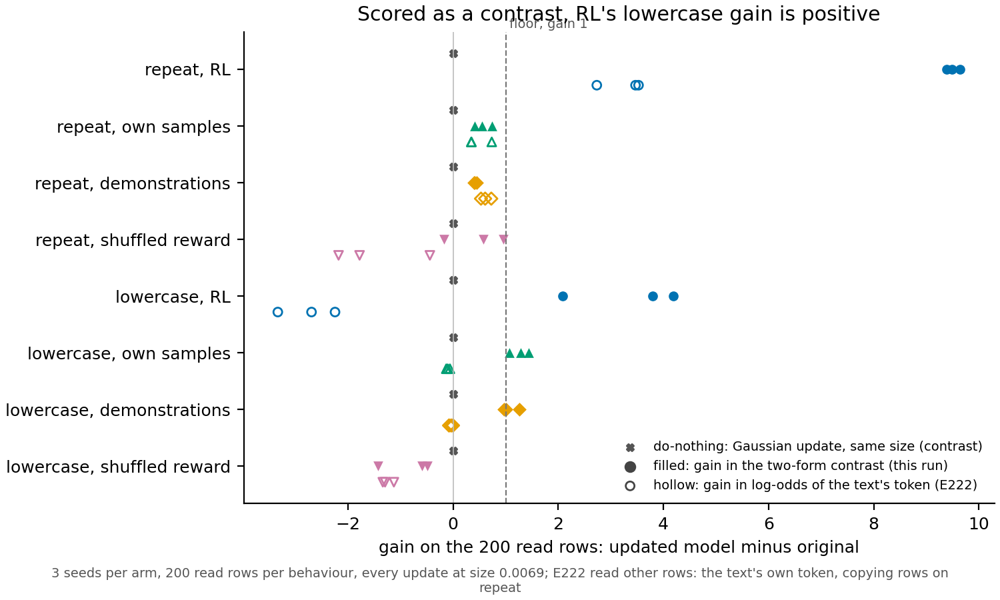
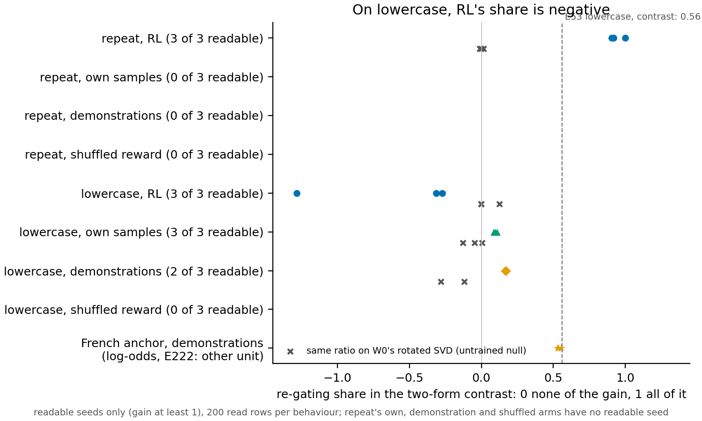
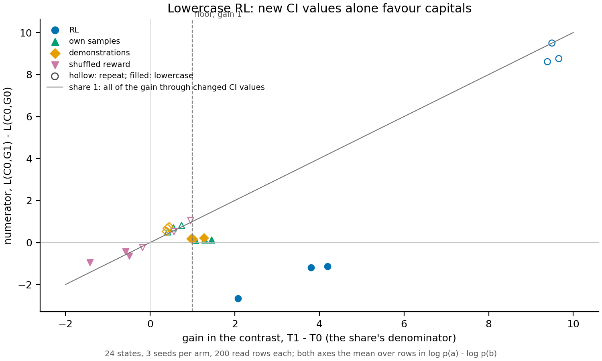

# Does scoring the RL updates as a two-form contrast let the 67M routes be compared? (E223)

*2026-11-20, compare-lead. Cell P2.41, run 5, the cell's last. Descriptive: no verdict on reused against new is given
here, since the working definition is under revision.*

We re-read the saved updates of the 67M model toward two behaviours, scoring each row as the gap between the form the
reward prefers and the form it does not. Rescored this way, reinforcement learning toward lowercase text now raises
its score, and the filed rule calls "neither" on lowercase and makes no call on repeat. For `GOALS.md` the cell still
cannot say whether the route to a behaviour changes how the featurized model carries it, since its one readable
comparison rests on a negative share.

## The answer

Scored as a contrast, the comparison can be read on lowercase only, and it does not come out either way the card set
up. Reinforcement learning now moves the model toward lowercase, which supports the earlier reading that its old
negative score was drift. Yet the part of that move carried by changed causal importances points the other way, so
its share is negative. Training on the model's own samples and on demonstrations each carry about a tenth to a fifth.
On repeat only reinforcement learning clears the floor.

## What we were trying to test

E220 trained the 24 decomposed matrices of the 67M model toward two behaviours the original model already shows
sometimes. *Repeat* rewards copying the tokens that followed an earlier occurrence of the prompt's last two tokens.
*Lowercase* rewards a 16-token continuation with no capital. Each behaviour was reached four ways, three seeds each:

- **RL**: policy-gradient training on the programmed reward.
- **Own samples**: supervised training on the original model's own rewarded samples.
- **Demonstrations**: supervised training on corpus text that earns the reward.
- **Shuffled reward**: RL with the rewards shuffled across samples. It rules out a reading that follows any RL
  update's drift rather than the reward.

Every update stopped at the same size, its norm over the original weights' norm at 0.0069.

E222 read these updates on the log-odds of the text's own next token. On lowercase that score fell under RL, because
the reward accepts any lowercase word while the row scores one exact word. This run reads the same saved updates on a
**two-form contrast**: the log-probability of form a minus that of form b at the read position, $\log p(a) - \log
p(b)$. A shift that lowers both forms alike cancels.

- **Lowercase**: a is the text's next word, a lowercase word starting with a space; b is the same word capitalised,
  kept when the vocabulary holds it as one token.
- **Repeat**: on prompts whose text does not copy, a is the token a copy would write at the first place copy and text
  part, and b is the text's token there.

Each behaviour has 200 read rows. The **gain** $T_1 - T_0$ is the mean contrast of the updated model minus the
original. The **re-gating share** is the ratio $[L(C_0,G_1) - L(C_0,G_0)] / [T_1 - T_0]$. Here $L(C_0, G)$ is the contrast of the
released decomposition with W0's subcomponents, each masked by the causal importances Γ assigns. $G_0$ is Γ read on
the original model's activations and $G_1$ on the updated model's. So the share is the part of the gain that appears
when the subcomponents are kept and only Γ switches different ones on: 0 means none, 1 means all. A share is read
only when the gain is at least 1, the floor; an arm is readable when two of its three seeds are.

Beside the share, the scorecard's baselines were read the same way. The **untrained** baselines take the same ratio
on a decomposition of W0 by its SVD, and on a rotation of it, neither trained. The **neuron** version keeps each
block's top neurons in place of subcomponents. **Steering** adds one vector fitted on training windows.

The French anchor, a behaviour taught from demonstrations, was not re-read: no two-form pair is natural for French
after English. Its E222 share is in log-odds of the French target token, a different unit from every contrast share
here.

The controls ran first and alone. One re-read E211's label state through the new per-row pair code and matched its
saved readings. A zero update read every numerator exactly 0. A Gaussian update of the same size, the do-nothing
reference, read a gain within 0.01 of 0 on both behaviours.

## What we expected, and why

The contrast cancels a shift that moves both forms together, so RL's drift should drop out. The writer expected RL to
gain 1 to 5 on both behaviours and to read a share between 0.1 and 0.8. The supervised arms had moved the 16-token
reward rate only a little in E220, so they were expected to gain 0.2 to 1.2 and mostly stay under the floor. The
filed call was therefore "no call", at probability 0.55. Given a call, the card's first reading was favoured: RL, own
samples and demonstrations alike, at 0.5 against 0.3 for demonstrations reading apart.

## What we observed

### Does the contrast remove the drift that sank RL on lowercase?

**Reading it.** Yes. Filled points are this run's gains in the contrast, hollow points E222's gains in log-odds, and
the grey crosses the do-nothing Gaussian update. RL on lowercase now gains 2.1 to 4.2 in the contrast. In log-odds it
had read -2.25 to -3.33. The shuffled reward still falls, at -0.5 to -1.4, so the contrast does not hand every RL update a
positive score. Own samples and demonstrations on lowercase rise from about 0 to just over the floor, 1.0 to 1.4. On
repeat, RL's gain grows to about 9.5, from about 3.5; the rows differ, since E222 scored rows whose text copies. The
other repeat arms stay under the floor.

This supports E222's reading that RL's lowercase drop was drift away from the text's exact word. It does not show
what the drift is.

| gain in the contrast | seed 0 | seed 1 | seed 2 | E222 log-odds gain, seeds 0-2 |
|---|---|---|---|---|
| repeat RL | 9.49 | 9.38 | 9.65 | 3.53, 3.47, 2.73 |
| repeat own samples | 0.74 | 0.41 | 0.54 | |
| repeat demonstrations | 0.45 | 0.41 | 0.39 | |
| repeat shuffled | 0.96 | 0.57 | -0.17 | |
| lowercase RL | 2.08 | 3.80 | 4.19 | -3.33, -2.69, -2.25 |
| lowercase own samples | 1.44 | 1.28 | 1.07 | |
| lowercase demonstrations | 1.26 | 0.97 | 1.00 | |
| lowercase shuffled | -0.49 | -0.59 | -1.43 | -1.13, -1.29, -1.34 |
| Gaussian, do-nothing | repeat 0.009 | lowercase -0.003 | | |

The original model's mean contrast on the read rows is 8.04 on lowercase and 0.63 on repeat: it already strongly
prefers the lowercase form of a mid-sentence word.

### Do the routes read alike on the share?

**Reading it.** No call on repeat, and "neither" on lowercase. On repeat only RL is readable, at 0.91 to 1.00: nearly
all of its gain appears when Γ alone is updated. On lowercase three arms are readable, and they do not agree. RL
reads -1.28, -0.31 and -0.27. Own samples read 0.09 to 0.11 and demonstrations 0.17 on both readable seeds. The
demonstrations sit 0.79 above RL with no overlap, which is the card's second reading's first half; but own samples do
not read like RL, which that reading also needs. So the filed rule calls neither.

Two references sit beside. E53's lowercase update, re-read on its own case-pair contrast, reads 0.56. The French
anchor reads 0.53 to 0.56, but in log-odds, not the contrast: the rule's "above the anchor" clause compares numbers in
two units. No lowercase arm is above it, and repeat RL is.

The grey crosses are the untrained rotated decomposition's share for the same states, a null that no training put
structure into. It too gives a call: own samples near RL and demonstrations 0.24 apart, the card's second reading. A
gap of 0.1 between arms is therefore within reach of a decomposition that knows nothing about the model, on these
small gains.

| re-gating share, contrast | seed 0 | seed 1 | seed 2 | rule |
|---|---|---|---|---|
| repeat RL | 1.00 | 0.92 | 0.91 | only arm readable: no call |
| lowercase RL | -1.28 | -0.31 | -0.27 | |
| lowercase own samples | 0.09 | 0.10 | 0.11 | not alike RL |
| lowercase demonstrations | 0.17 | under floor | 0.17 | apart from RL by 0.79 |
| French anchor, log-odds, E222 | 0.53 | 0.56 | 0.53 | other unit |
| E53 lowercase, contrast | 0.56 | | | beside |

The other three repeat arms and the lowercase shuffled arm have no seed over the floor, so they have no share.

### Why is RL's share negative on lowercase?

**Reading it.** The share is negative because its numerator is negative while its gain is positive. The figure plots
each state's numerator, $L(C_0,G_1) - L(C_0,G_0)$, against its gain, both in the contrast. On the diagonal, every bit
of the gain would appear through Γ's changed causal importances. The three lowercase RL states sit far below zero: Γ's
new causal importances alone move the decomposition's contrast toward the capitalised form, by 1.1 to 2.7. Over the
same rows the full updated model moves toward the lowercase form, by 2.1 to 4.2.

So the negative term is the numerator, not the gain. Both are means over the same 200 rows, read in the same job, and
the share's own gain matches the fp32 gain to within 0.01 on every lowercase RL seed.

| lowercase state | gain $T_1 - T_0$ | numerator | share | KL from W0, E220 |
|---|---|---|---|---|
| RL seed 0 | 2.08 | -2.67 | -1.28 | 3.93 |
| RL seed 1 | 3.80 | -1.20 | -0.31 | 3.64 |
| RL seed 2 | 4.19 | -1.14 | -0.27 | 3.10 |
| shuffled seed 0 | -0.49 | -0.64 | under floor | 1.04 |
| shuffled seed 1 | -0.59 | -0.42 | under floor | 0.94 |
| shuffled seed 2 | -1.43 | -0.95 | under floor | 0.90 |
| own samples, seeds 0-2 | 1.44, 1.28, 1.07 | 0.13, 0.12, 0.11 | 0.09-0.11 | 0.12-0.13 |
| demonstrations, seeds 0-2 | 1.26, 0.97, 1.00 | 0.21, 0.18, 0.17 | 0.17, under, 0.17 | 0.14 |

What else the saved files show, without naming a cause:

- The shuffled reward, which carries no information about case, also has a negative numerator on every seed, and its
  points lie near the diagonal: there Γ's change carries most of a gain that is itself negative.
- Across lowercase's twelve states the numerator falls as E220's KL from the original model rises, with a correlation
  of -0.91. The RL seed with the largest KL has the most negative numerator.
- In E222's log-odds, lowercase RL's numerators were -3.33, -2.59 and -2.15, nearly equal to its gains. There, Γ's
  change carried the drift almost whole.
- The untrained SVD decomposition's numerator for the same three RL states is positive, 0.71 to 2.47, so the sign is
  not forced by the ratio's arithmetic; it belongs to the released decomposition's Γ.

What the saved files cannot say. The reader computes the four quantities $T_0$, $T_1$, $L(C_0,G_0)$ and
$L(C_0,G_1)$ per row, then keeps only the mean of each difference (`src/commute/realistic_reads.py` line 159,
`Reader.share`). So the per-state files hold:

- no per-row values, so whether a few rows or all of them carry the negative numerator is unknown;
- no $L(C_0,G_0)$ or $L(C_0,G_1)$ on their own, so how faithful the decomposition is to the original model on these
  rows is unknown;
- no per-subcomponent or per-layer split, which the share never computes, so which subcomponents Γ switches on or
  off to favour the capitalised form is unknown.

Telling apart "Γ's change reproduces the drift unevenly across the two forms" from other causes needs those per-row
cells and a per-layer split of the CI change. Neither was saved, so no cause is named here.

### The baselines, beside and not filed

| lowercase, readable seeds | untrained SVD | untrained rotated | neuron, k 64 | steering | steering, random vectors |
|---|---|---|---|---|---|
| RL | 0.34, 0.65, 0.50 | 0.12, 0.00, 0.00 | -0.06, 0.03, -0.02 | 1.27, 0.92, 1.02 | -0.50, -0.22, -0.26 |
| own samples | 0.20, 0.08, 0.17 | -0.05, -0.13, 0.00 | -0.05, -0.05, -0.02 | 3.11, 2.95, 2.51 | -0.74, -0.66, -0.63 |
| demonstrations | 0.23, 0.31 | -0.12, -0.28 | 0.00, -0.04 | 2.77, 2.51 | -0.93, -0.96 |

The filed rule run on each baseline gives "neither" for the untrained SVD, the neurons at k 64 and at matched k, and
steering; it gives the card's second reading for the rotated null. On lowercase, random steering vectors move the
contrast down by a quarter to almost the whole gain. So steering's share there sits on a noise floor of that size and
is not a reading of the update. On repeat the RL steering share is 0.19 to 0.23, with random draws near 0.06.

## What we learned

Scoring the reward's two forms removes the drift that made E222's lowercase reading meaningless, and with it the
supervised arms on lowercase reach the floor. The comparison the cell was built for can now be scored on one behaviour,
and the answer is that the routes read apart, but not in the pattern either reading predicted. RL's gain on lowercase
comes with Γ switching subcomponents in a way that, alone, favours capitals; the supervised arms' Γ change carries a
small positive part. Whether that sign is a property of RL or of drift of RL's size cannot be told from these files.
For `GOALS.md` this is a measurement result about the share on drifting updates, not evidence on reused against new.

## How compelling is the evidence

- Three seeds per arm, one decomposition, one model, two behaviours, 200 read rows each.
- Repeat has one readable arm, so it bears on nothing comparative.
- On lowercase the supervised arms sit just over the floor, 1.0 to 1.4; one demonstration seed is under it at 0.97.
  Shares over gains this small are fragile.
- The untrained rotated null crosses the rule's 0.1 bar, so a 0.1 gap is not a safe separation at these gains. The
  card's seed spread came from E211's label tasks, at 0.017, not from these arms.
- The share is blind to anything beyond the pair at the read position: which lowercase word is chosen, case
  elsewhere, and the copy past its first parting token.
- The anchor comparison mixes a contrast share with a log-odds share.

## Surprises

Something unexpected happened that I cannot explain. RL on lowercase reads a negative share, -1.28 to -0.27. A share
of 0.1 to 0.8 was predicted. Γ's changed causal importances alone favour the capitalised form, while the full
update favours lowercase. The files show it is the numerator and that it tracks drift across the lowercase states;
they cannot show which rows or subcomponents carry it.

Smaller ones. RL on repeat gains about 9.5, well above the predicted 1 to 4. Its share reaches 0.91 to 1.00, over
the predicted top of 0.8. The untrained rotated null gives a call. Random steering vectors on lowercase read about as
large as the steering vector itself.

## What next

1. A $0 re-read of the three lowercase RL states and the three shuffled ones that saves the per-row cells and a
   per-layer split of Γ's change. If the negative numerator sits in the same layers for shuffled and RL, the sign is
   drift; if not, it is the reward. This needs a new run, and the cell's runs are spent: it needs the user.
2. A Gaussian or shuffled update matched to RL's KL rather than its size, to separate drift from reward on the share.
3. Close the cell as it stands: "neither" on lowercase, no call on repeat, with the negative share recorded.

## Scorecard

| id | claim in words | rule | read | verdict |
|---|---|---|---|---|
| card | no call, probability 0.55 | E222's pick_call and card_call on the contrast share | repeat no call; lowercase neither; card neither | miss |
| RL | readable on both picks, share 0.1 to 0.8, probability 0.7 | gain at least 1 on 2 of 3 seeds | readable on both; shares 0.91 to 1.00 and -1.28 to -0.27 | readable yes; share range missed on both |
| third outcome | shuffled not read, probability 0.85 | shuffled under the floor | under the floor on both picks | as expected |
| ctl reproduce | E211's L1 state through the pair code | relative bar 1e-3, Amendment 1 | every reading within the bar; share off by 3.7e-5 | pass |
| ctl zero | every numerator exactly 0 at a zero update | exact | 0 on L1, repeat and lowercase rows | pass |
| do-nothing | Gaussian gain within 0.1 of 0 | absolute | 0.009 and -0.003 | pass |
| E53 beside | share 0.5 to 1.0, prior about 1 | recorded, not checked | share 0.56, prior 0.31 | share as expected; prior lower |
| prior | lowercase 2 to 7; repeat -3 to 1 | expected value | 8.04; 0.63 | lowercase over; repeat as expected |
| gains | RL repeat 1 to 4, lowercase 1 to 5; own and demo 0.2 to 1.2; shuffled -1 to 0.5 | expected value | RL 9.4 to 9.6 and 2.1 to 4.2; own and demo 0.39 to 1.44; shuffled -1.43 to 0.96 | RL repeat over; three supervised seeds and three shuffled seeds outside |
| baselines | SVD under the share; rotated 0 to 0.35; neuron under 0.05; steering 0.2 to 0.8 | expected value | SVD above RL's lowercase share; rotated down to -0.28; neuron all under 0.05; steering up to 3.1 on lowercase | partly missed |
| time | at most 18 s per state | measured | 14.1 to 15.2 s | as expected |

## Not run

- Per-row cells and a per-layer or per-subcomponent split of Γ's change: the evidence a cause of the negative share
  would need.
- The French anchor in any contrast; no natural pair exists for it.
- The k_half reading: it scores one target per row and is undefined for a pair.
- Any read beyond the first parting token, or of which lowercase word the model chose.
- A drift-matched null: an update matched to RL's KL rather than its size.
- A second decomposition seed, and the loophole stage of the plan.

## Departures from the literature

- The two-form contrast follows E140 and E211's label contrast, a logit difference between two tokens, as in logit
  difference readings of indirect-object identification by Wang et al. 2022. Here the pair changes from row to row
  instead of being one fixed pair per task, so that it follows the reward.
- The re-gating share is the project's own ratio; its terms are VPD's subcomponents and causal importances, read with
  the released decomposition unchanged.
- RL is policy gradient with a group-mean baseline and no KL penalty, stopped at a fixed update size, as in E222.
- The steering, neuron and untrained baselines follow E143, E136 and E211 unchanged, scored in the contrast.

Provenance: cluster L40 on the `debug` queue, $0; jobs 62152 (control), 62153 (repeat) and 62154 (lowercase); 14 to
15 s per state. An earlier control job, 62141, stopped on an absolute agreement bar and led to Amendment 1
(`results/predictions_E223_amend1.json`), which replaced that bar with a relative one. Results
`experiments/rl_67m/results/contrast_{ctl,1,2}.json`, `contrast/*.json`, `contrast_score.json`,
`contrast_numerator_vs_kl.json`; E222's `stage3/*.json` for the anchor and the log-odds gains. Code
`experiments/rl_67m/run_contrast.py`, `score_contrast.py`, `plot_contrast.py`. Predictions
`results/predictions_E223.json`; card `reports/plans/2026-11-20_plan_rl-67m-contrast-card.md`; decision
`reports/decisions/2026-11-19_decision_p2-41-read-unit.md`.
