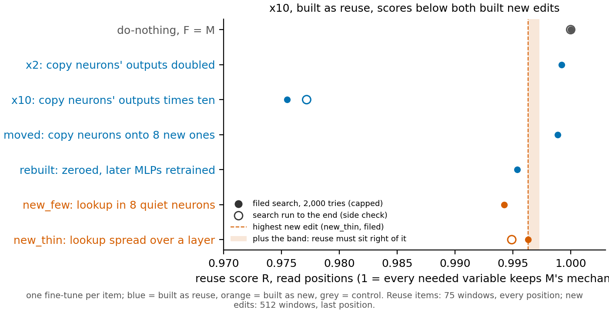
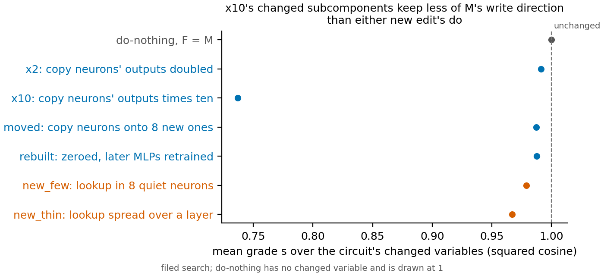
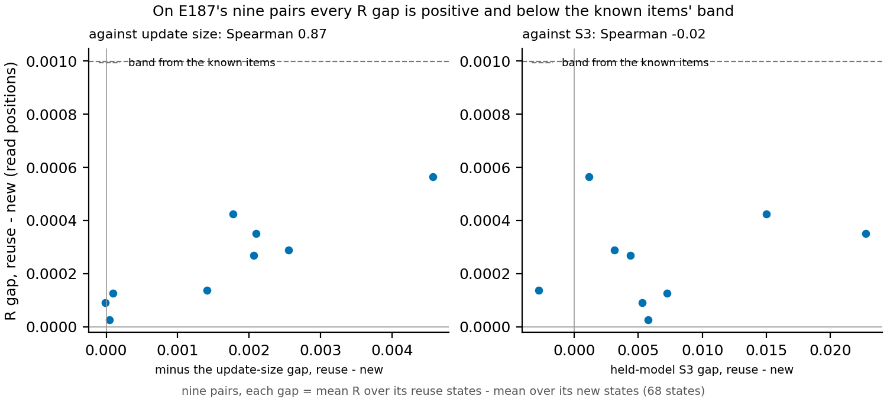

# Does the reuse score separate built reuse from built new with VPD subcomponents as the variables? (E226)

*2026-11-20, definition-lead (writer agent). Cell P1.37, experiment `experiments/kstar_vpd`. Plan
`reports/plans/2026-11-20_plan_p1-37-vpd.md`, its appendix and card `reports/plans/2026-11-20_plan_p1-37-card.md`.
Filed rules `experiments/kstar_vpd/results/predictions.json`; scored readings `results/summary.json`. Nothing here is
a verdict under the working definition.*

We read the reuse score with VPD subcomponents as the variables, on six edits built to be reuse or new and on nine
trained pairs. A reuse edit that multiplies eight copy neurons' outputs by ten scored below both new edits, so the
filed rule failed, and the trained pairs' small gaps followed update size. For `GOALS.md`, this level does not read the
built labels either, because of how the score grades a changed mechanism, not because of the circuit search.

## The answer

**The filed prediction reversed.** We predicted that every edit built as reuse would score above both edits built as
new. Instead the reuse edit that multiplies the copy neurons' outputs by ten scored 0.9755, below the new edit spread
thinly over a layer at 0.9963. A search run to the end, rather than capped, moves each score by under 0.002 and keeps
the order. The gap comes from the grade: the ten-fold edit turns its subcomponents' write directions further from the
original's than the new edits do. On trained pairs the score sits near 1 and its gaps follow update size.

## What we were trying to test

**The score.** The working definition says a fine-tune F reuses the original model M for a behaviour to the extent
that the parts F needs still compute what M's parts compute. We read it as follows.

- **Variables.** The embedding, each of the 38,912 VPD subcomponents of the 24 decomposed matrices, one remainder per
  matrix that holds what the subcomponents do not, one variable per neuron F has and M lacks, and the unembedding.
- **The split.** A fine-tune's weight change $\delta W$ at each matrix is split over the subcomponents by the
  least-squares split, the least-norm $(dU, dV)$ with $dU V^\top + U dV^\top \approx \delta W$. What the split
  leaves goes into that matrix's remainder, so the split is exact.
- **The circuit.** $K^*$ is a smallest set of variables that, with every other variable mean-ablated over the windows
  D, keeps F's next-token distribution nine tenths of the way back from "everything ablated" to F.
- **The grade.** Each variable $u$ gets $s_u$: one minus the mean over inputs, in F's run and in M's, of
  $1 - \cos^2$ between F's and M's write of $u$. It is 1 when the write keeps its direction and 0 for a write at right
  angles or a variable M lacks.
- **The reuse score.** $R = \frac{1}{|K^*|}\sum_{u \in K^*} s_u$, from 0 to 1, where 1 means every variable F needs
  keeps M's mechanism. With $f$ the share of $K^*$ that the fine-tune changed and $\rho'$ the mean grade over those
  changed members, $R = 1 - f(1 - \rho')$ exactly.

**The known-answer items.** Six edits of M whose label is known by how they were built:

- **Built as reuse**, from E195, on M's copy behaviour, which runs through eight copy neurons in layer 1's MLP. Their
  outputs are doubled, or multiplied by ten, or moved onto eight appended neurons. In the fourth, rebuilt, they are
  zeroed and layers 2 and 3's MLPs are retrained to restore copying.
- **Built as new**, from E214: a lookup written into eight quiet layer-0 neurons, new_few, and the same lookup spread
  as a least-norm change across all of layer 0's neurons, new_thin.

The do-nothing control, F equal to M, runs first on every pod and must read $R = 1$ with nothing changed. Each item is
searched three times: on all of D, then on each half of D. The largest gap between the halves over the six items is
the band, the run's own noise floor.

**The trained pairs.** E187's nine pairs, each a fine-tune labelled reuse against one labelled new on the same task, 68
saved states in all. Here no label is known by construction, so the reading is descriptive.

**The alternative each piece rules out.** Moved, with its eight appended neurons scoring 0, checks that a variable M
lacks pulls R down. The two halves of D check that a gap is not window noise. The uncapped side check rules out that
the 2,000-try search cap made the circuits, and so R, wrong.

## What we expected, and why

The card named two rivals.

- **Rival a.** A new edit moves the subcomponents its circuit needs away from M's mechanisms, while a reuse edit keeps
  their writes on M's directions. Then both new edits score below every reuse item except moved, by more than the band.
- **Rival b.** As at the neuron level, a thin change spread over many subcomponents keeps each one near M's mechanism,
  so new_thin scores at or above the reuse items.

The filed rule asked for the lowest reuse item to beat the highest new edit by more than the band. A second rule
leaves moved out, because its appended neurons score 0 by declaration and were expected to drag it low. A drafted rule
expected moved itself to sit below the other three reuse items.

## What we observed

### Do the reuse items score above the new edits?

**Reading it.** No, the filed rule failed. The reuse edit with the copy outputs multiplied by ten scored 0.9755, and
the thinly spread new edit 0.9963. So the lowest reuse item sits 0.021 below the highest new one. The band
the rule needed to clear is 0.0010, set by new_thin's two halves of D. The other three reuse items do score above both
new edits, but by less than a hundredth. Leaving moved out changes nothing, because x10 is the lowest item either way,
and the second rule reads as rival b. Moved scored 0.9989, near the top rather than below the others, so the drafted
rule for moved failed too. Graded at every position instead of the read positions, the two new edits score 0.9966 and
0.9967, still above x10.

The do-nothing control read exactly 1 on every pod, with no variable changed and every grade equal to 1 up to rounding.

One caveat: the two sides were not read on the same windows. The reuse items use every position of 75 copy windows,
and the new edits the last position of 512 lookup windows, as in E214.

| item | built as | R | R, every position | $f$ | $\rho'$ | $\lvert K^*\rvert$ | half 1 | half 2 |
|---|---|---|---|---|---|---|---|---|
| do-nothing | control | 1 | 1 | 0 | none | 33,177 | | |
| x2 | reuse | 0.9992 | 0.9992 | 0.0886 | 0.9911 | 31,767 | 0.9993 | 0.9992 |
| x10 | reuse | 0.9755 | 0.9755 | 0.0931 | 0.7368 | 34,839 | 0.9752 | 0.9751 |
| moved | reuse | 0.9989 | 0.9989 | 0.0878 | 0.9874 | 31,888 | 0.9989 | 0.9989 |
| rebuilt | reuse | 0.9954 | 0.9954 | 0.3742 | 0.9876 | 31,299 | 0.9953 | 0.9952 |
| new_few | new | 0.9942 | 0.9966 | 0.2717 | 0.9788 | 12,983 | 0.9940 | 0.9936 |
| new_thin | new | 0.9963 | 0.9967 | 0.1112 | 0.9668 | 9,601 | 0.9965 | 0.9955 |

R, $f$ and $\rho'$ are at the polished circuit of the search on all of D. Every search hit its cap of 2,000 tries.

### Does the capped search explain it?

The same figure's hollow circles answer this. **Reading it.** No: running the search to the end moves R by under
0.002 and keeps the order. With no cap, new_thin scores 0.9949 and x10 scores 0.9772. The gap between them is still
-0.0177, and do-nothing stays at exactly 1. What does change is the circuit's size: new_thin's shrinks from 9,601 to
2,113 variables, and the other two lose about a tenth to a fifth. So the capped circuits overcount, but R barely
depends on which circuit is found.

| item | R capped | R uncapped | $\lvert K^*\rvert$ capped | $\lvert K^*\rvert$ uncapped | tries used, uncapped |
|---|---|---|---|---|---|
| do-nothing | 1 | 1 | 33,177 | 26,180 | 38,957 |
| x10 | 0.9755 | 0.9772 | 34,839 | 31,943 | 37,730 |
| new_thin | 0.9963 | 0.9949 | 9,601 | 2,113 | 8,828 |

Even the uncapped do-nothing circuit holds about two thirds of the 38,938 variables. The diagnosis report
`reports/analyses/2026-11-20_analysis_e226-search-cap.md` traces this to VPD's inactive subcomponents, which matter
jointly: mean-ablating all of them at once already costs more than the circuit's allowance.

### Where does the reversal come from?

**Reading it.** It comes from the grade, not from which variables are in the circuit. Since $R = 1 - f(1 - \rho')$,
R falls only through the share of the circuit the edit changed and how far those changed members moved. The shares
are similar: 0.0931 of x10's circuit is changed against 0.1112 of new_thin's. The grades are not. X10's changed
members average 0.7368, while new_thin's average 0.9668 and new_few's 0.9788. Multiplying eight output columns by ten
turns each touched subcomponent's write toward those eight directions, which the squared cosine reads as a different
mechanism. The new edits change behaviour far more but spread a small change over many subcomponents, so each one
keeps nearly its old direction. Their KL from M is about 10 nats against x10's 0.7138. This is the card's rival b.

### Do the trained pairs' gaps follow anything?

**Reading it.** The gaps are tiny and follow update size. On the 68 saved states R lies between 0.9970 and 0.9997.
Nearly the whole circuit is changed on every state, because every matrix changes. Each pair's gap, reuse side minus new side, is
positive but at most 0.00056, under the known items' band of 0.0010 on all nine pairs. The filed rule calls both
comparisons "does not track", since it needs the sign to agree on every pair. Against minus the update-size gap the
sign agrees on eight of nine and the rank correlation is 0.87. The one miss is a pair whose size gap is near zero.
Against the held-model S3 gap the rank correlation is -0.02. So on trained pairs R ranks the pairs by which side moved
its weights less, as at coarser levels in E221.

## What we learned

The VPD featurization joins the coarse levels and neurons: the reuse score does not put the built reuse items above the
built new edits. The cause is the grade, the squared cosine between F's and M's writes, which reads a large gain on
a few output directions as a change of mechanism and a small change spread widely as kept. The circuit search is not
the cause: its cap overcounts the circuit but barely moves R. On trained pairs R sits near 1 and its small gaps follow
update size. The grade is part of the adopted definition, so what to do with it is the user's question.

## How compelling is the evidence

- **Items.** One fine-tune per known item, six items, read once each. The band, 0.0010, is a split-half band from one
  search order; the order spread was not read here. The reversal, 0.021, is twenty times the band.
- **Search.** Every filed search hit its cap, so each circuit is an upper bound. The uncapped side check on three
  items moved R by under 0.002 and kept the order.
- **Windows.** The reuse and new items use different windows and read positions, inherited from E214. Graded at every
  position the order is the same.
- **Blind to.** R cannot see a change of a write's size, only of its direction. It cannot see a new circuit built
  from M's existing subcomponents.
- **Pairs.** Nine pairs, two of which share a fine-tune. The gaps sit under the known items' band.

## Surprises

**Something unexpected happened that I cannot fully explain.** The filed prediction was that every reuse item scores
above both new edits. Instead x10, built as reuse, scores 0.021 below new_thin, built as new. The grades show where it
sits; whether the squared cosine is the right way to compare a scaled mechanism is a definition question.

Moved scored 0.9989 rather than low: its appended neurons barely enter its circuit, at a graft share of 0.00025, and
moved computes the same function as M.

## What next

- **For the user: R saturates near 1 here, as it did at neurons.** Every reuse item but x10 and every trained state
  read above 0.995. Whether that saturation, and the grade's reading of a ten-fold gain as a change of mechanism, are
  acceptable in the definition is the user's call; no wording is proposed here.
- **If the user keeps the grade:** the VPD featurization is reported as a level that does not read the built labels,
  and the pairs stage as a description only, as the card's stop rule says.

## Scorecard

| id | claim in words | rule | read | verdict |
|---|---|---|---|---|
| R0 | do-nothing and every code check pass | stops on a miss | do-nothing R 1, every check passed | pass |
| band | split-half noise floor | largest half gap over six items | 0.0010, new_thin | set |
| R1 | lowest reuse above highest new | min reuse - max new > band | -0.021 against 0.0010 | fail |
| R1b | same without moved | as R1 | -0.021 | fail; rival b |
| P-moved | moved within its graft bound | code check | holds | pass |
| P-moved2 | moved below the other reuse items | moved < min of x2, x10, rebuilt - band | 0.9989 against 0.9755 | fail |
| T4 size | pair gaps track minus size gap | sign on every pair and Spearman ≥ 0.7 | 8 of 9 signs, 0.87 | does not track |
| T4 S3 | pair gaps track S3 gap | as above | 8 of 9 signs, -0.02 | does not track |

## Departures from the literature

- **Ablation.** VPD trains and reads subcomponents under causal-importance masks that scale a subcomponent toward
  zero. Here a subcomponent is mean-ablated over D, as in circuit-discovery work, because the definition's circuit is
  defined under mean ablation.
- **Remainder as a variable.** VPD treats the decomposition's residual Δ as a fixed term. Here each matrix's Δ, plus
  what the split leaves of the fine-tune's change, is one variable that can be ablated and graded, so the
  featurization is exact.
- **The circuit search** is our own: attribution order, bisection, re-ranking and a polish, capped at 2,000 tries. It
  is not ACDC or VPD's causal-importance selection.

## Not run

- The signed-order search, which ranks by the attribution's sign as well as its size.
- An uncapped search on the other three known items and on the trained states.
- Any other split of the fine-tune's change, such as the adjoint or rescaling split.
- Any other grade, such as one that sees a change of size: the grade is part of the definition.
- More than one search order per item, so the order spread is not in the band.
- Grouping inactive subcomponents into one variable.
- E187's scaled states and E196's pairs.

## Provenance

- Results: `experiments/kstar_vpd/results/summary.json` from `score.py`; `results/items/<item>.json` per item;
  `results/stage0_pod0` to `stage0_pod3` for do-nothing; `results/converge/` for the uncapped side check
  from `converge.py`; per-variable arrays in `results/large/`.
- Figures: `experiments/kstar_vpd/figures/r_known.png`, `rho_known.png`, `r_pairs.png` from `plot.py`.
- Code: `experiments/kstar_vpd/run.py`, `score.py`, `converge.py`, `src/commute/kstar_vpd.py`.
- Compute: four H100 pods for the scored run, each do-nothing projecting 0.25 s per try; the side check on separate
  H100 pods.
